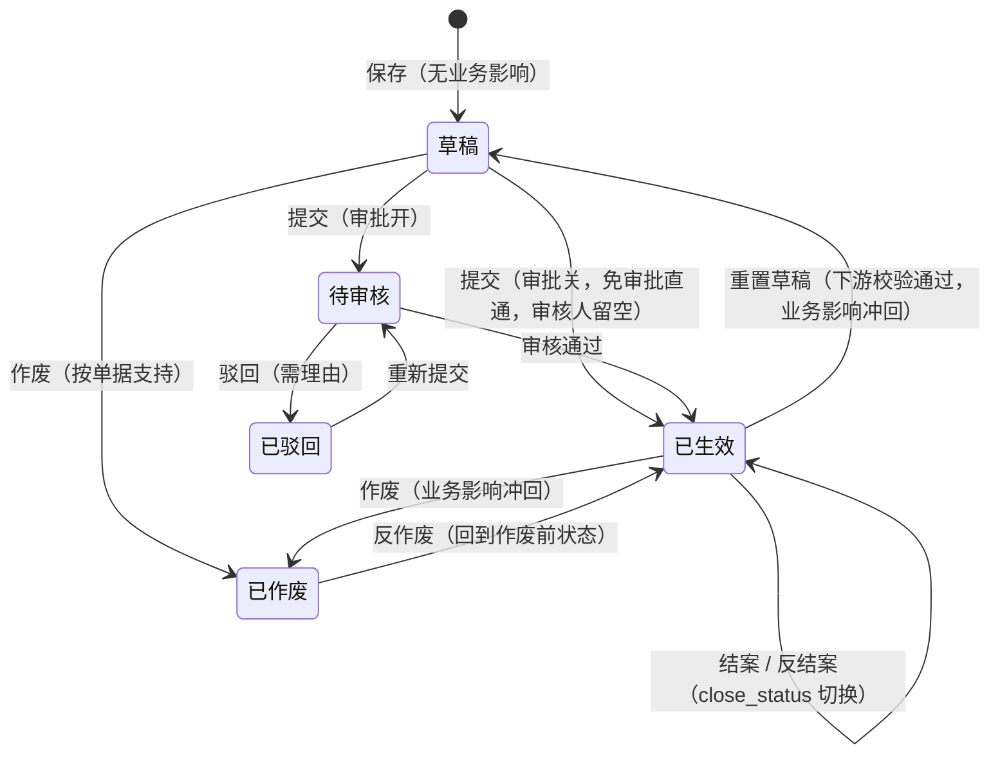

# 12 销售订单 测试设计（样板）

> 选它做样板的原因：它是全系统的源头单据——销售出库、发票、应收由它下推，生产工单、采购订单也从它发起。
>
> **口径来源**：`.trae/rules/11-单据状态机标准.md`（唯一事实来源）+ `10-防复发坑记录.md`（已知坑）。
> 与标准不一致的代码实现，一律记为**缺陷**，不写成"待确认的产品问题"。

本文件按四种测试设计方法产出：**状态迁移测试、边界值分析、开关组合（成对覆盖）、场景法**。

---

## 一、状态迁移（依据「11-单据状态机标准」，不是依据代码现状）

### 1.1 铁律与状态

- **保存 = 草稿**，保存不产生任何业务影响。
- **业务影响只在"生效"那一刻释放**；重置草稿/作废时才冲回。
- 主状态：`草稿`、`已驳回`、`待审核`、`已生效`、`已作废`、（已关闭/已取消，按单据支持）。
- `close_status` 是独立维度：**"已生效 + 已结案"是合法组合**，结案不改主状态。
- `approval_status` 与主状态同源同步。

### 1.2 状态 × 动作矩阵（按标准第七节"按钮与可见性"）

图例：✔ 允许且按钮可见　✘ 不允许（按钮**隐藏**，不是置灰）

| 状态 | 保存 | 提交 | 审核 | 驳回 | 重置草稿 | 结案 | 反结案 | 作废 | 反作废 | 删除 | 下推 | 打印 |
|---|---|---|---|---|---|---|---|---|---|---|---|---|
| 草稿 | ✔ | ✔ | △ | ✘ | ✘ | ✘ | ✘ | ✔※ | ✘ | ✔ | ✘ | ✔ |
| 已驳回 | ✔ | ✔ | ✘ | ✘ | ✘ | ✘ | ✘ | ✔※ | ✘ | ✔ | ✘ | ✔ |
| 待审核 | ✘ | ✘ | ✔ | ✔ | ✘ | ✘ | ✘ | ✘ | ✘ | ✘ | ✘ | ✔ |
| 已生效（未结案） | ✘ | ✘ | ✘ | ✘ | ✔ | ✔ | ✘ | ✔ | ✘ | ✘ | ✔ | ✔ |
| 已生效（已结案） | ✘ | ✘ | ✘ | ✘ | ✘ | ✘ | ✔ | ✔ | ✘ | ✘ | ✘ | ✔ |
| 已作废 | ✘ | ✘ | ✘ | ✘ | ✘ | ✘ | ✘ | ✘ | ✔ | ✘ | ✘ | ✔ |
| 已取消 | ✘ | ✘ | ✘ | ✘ | ✘ | ✘ | ✘ | ✘ | ✘ | ✘ | ✘ | ✔ |

- △：标准第四节点注明"审核：允许源状态 待审核 / 草稿（免审批单的兼容口径）"；**按钮清单（第七节）里草稿只列保存/提交/删除/打印**，两处有张力，以单据类型是否免审批为准，需在单据级确认后固定。
- ※：作废的允许源状态，标准写"已生效 / 草稿（按单据）"，销售订单是否支持草稿作废需按单据声明；不支持则应隐藏。

---

## 二、金额与数量边界（等价类 + 边界值）

| 字段 | 等价类 | 边界值（必测） | 预期 |
|---|---|---|---|
| 数量 | 正数 / 0 / 负数 | `0`、`0.0001`、`999999.9999` | 0 与负数提交被拦；4 位小数可存 |
| 单价 | 正数 / 0 / 负数 | `0`、`0.0001`、`1.005` | 0 是否允许取决于"允许单价为 0"参数；1.005 按设置中心「单价小数位数」精度处理（坑 9.2） |
| 折扣率 | 0–100 | `0`、`0.01`、`99.99`、`100`、`100.01`、`-1` | 超 100 或负数被拦 |
| 税率 | 0–100 | `0`、`13`、`100` | 超范围被拦 |
| 金额（行） | — | 两行各 `0.005`、`1.005` | 行合计 = 各行之和，误差 ≤0.01；含税价不得"各算各的再相加"（坑 9.3） |
| 汇率 | 正数 | `0`、`0.000001`、`99999` | 0 被拦；6 位小数可存 |
| 交货日期 | 过去 / 今天 / 未来 | 昨天、今天、一年后 | 口径统一（详情/列表/打印一致） |
| 信用额度 | 未超 / 恰好 / 超出 | 9800 / 10000 / 10000.01 | 开关开启时超限被拦；恰好等于允许 |
| 明细行数 | 0 / 1 / 多 | 0 行、1 行、100 行 | 0 行提交被拦；100 行不卡死 |

固定断言：**行金额之和 = 表头折前金额；折前 − 折扣 + 税额 = 价税合计**，三种计税方式各验一次；打开已保存单据时金额**不得自动变化**（坑 9.1）。

---

## 三、开关组合（成对覆盖）

因子：审批（A）、含税（T）、外币（C）、信用控制（R）、价格策略（P）。

| # | 审批 | 含税 | 外币 | 信用 | 策略 | 要验的点 |
|---|---|---|---|---|---|---|
| C1 | 关 | 开 | 关 | 关 | 无 | 提交即生效；**审核人留空**（标准第五节）；税额正确 |
| C2 | 开 | 关 | 开 | 开 | 有 | 提交入待审核并生成待办；无税率列；币种/汇率可选；超额被拦；低于策略价被拦 |
| C3 | 关 | 关 | 关 | 开 | 有 | 税额恒 0；策略价校验仍生效 |
| C4 | 开 | 开 | 关 | 关 | 无 | 审批+含税+本位币；审核后生效，金额不变 |
| C5 | 关 | 开 | 开 | 开 | 无 | 外币+信用；本位币金额=原币×汇率 |
| C6 | 开 | 开 | 开 | 关 | 有 | 全开场景一次通过 |
| C7 | 关 | 关 | 开 | 关 | 无 | 外币+不计税：合计=数量×单价×汇率 |
| C8 | 开 | 关 | 关 | 关 | 无 | 审批+不计税：提交后数值不变 |

---

## 四、场景（主流程 / 备选流 / 异常流）

| 场景 | 类型 | 路径 |
|---|---|---|
| S1 报价→订单→出库→发票→收款 | 主流程 | 数量金额逐单传递，应收最终归零 |
| S2 订单→生产工单 | 主流程（下推） | 带出产品与数量，来源单号正确 |
| S3 订单→采购订单 | 备选流 | **前端未登记该下推**，应无入口；出现入口即缺陷 |
| S4 部分出库 + 退货 | 备选流 | 出 4 退 2；退货按处理方式：回库加库存、不回库只回写数量并生成红票 |
| S5 反审链路 | 异常流 | 出库未反审时订单反审被拦；出库反审后订单可反审，业务影响逐层冲回 |
| S6 信用超额 | 异常流 | 被拦并提示额度与占用 |
| S7 低于价格策略价 | 异常流 | 提交被拦，提示行号、单价、策略价 |
| S8 自动下推合同 | 备选流 | 设置开启→订单生效自动生成**已生效**合同（标准第十一节例外登记）；关闭→不生成 |
| S9 审批开启但无可用流程 | 异常流 | 提交**报错并留在草稿**，不得出现"待审核却没有待办"（标准第五节） |

---

## 五、用例表

### 5.1 状态机（XS-S）

| 编号 | 优先级 | 前置 | 步骤 | 预期 |
|---|---|---|---|---|
| XS-S01 | P0 | 无 | 新建订单保存 | 「草稿」；按钮＝保存/提交/删除/打印；**库存、应收均无变化** |
| XS-S02 | P0 | 审批关 | 草稿提交 | 「已生效」；`approved_by` 为空、`approved_at` 有值（标准第八节） |
| XS-S03 | P0 | 审批开且有流程 | 草稿提交 | 「待审核」；审批人生成待办；库存/应收无变化 |
| XS-S04 | P0 | 审批开但无可用流程 | 草稿提交 | **报错并留在草稿**，不产生待审核卡死单 |
| XS-S05 | P0 | 待审核 | 审核 | 「已生效」；审核人/时间落库；业务影响此刻才释放 |
| XS-S06 | P0 | 待审核 | 驳回并填原因 | 「已驳回」；原因可见；可再次提交 |
| XS-S07 | P0 | 已生效未结案 | 重置草稿 | 回「草稿」；库存/应收/信用**严格镜像冲回** |
| XS-S08 | P0 | 已生效且已被出库引用 | 重置草稿 | 被拦，提示下游单号 |
| XS-S09 | P0 | 已生效未结案 | 结案 | close_status=1，主状态仍「已生效」；下推按钮消失 |
| XS-S10 | P0 | 已结案 | 反结案 | close_status=0；下推恢复 |
| XS-S11 | P1 | 已生效 | 作废（填理由） | 「已作废」；业务影响冲回；记录 bill_before_status |
| XS-S12 | P1 | 已作废 | 反作废 | 回到作废前状态；业务影响重新释放 |
| XS-S13 | P1 | 待审核 | 查找作废按钮 | **不出现**（标准第七节：待审核只有审核/驳回/打印） |
| XS-S14 | P1 | 已取消 | 查找提交按钮 | **不出现**（标准第四节：提交仅允许草稿/已驳回） |
| XS-S15 | P1 | 任意态 | 对照 1.2 矩阵逐格点一次 | 按钮显隐与矩阵完全一致；无能力的按钮隐藏而非置灰 |

### 5.2 金额与边界（XS-M）

| 编号 | 优先级 | 前置 | 步骤 | 预期 |
|---|---|---|---|---|
| XS-M01 | P0 | 不计税 | 2 行：2×50、3×30 | 合计 190；税额 0 |
| XS-M02 | P0 | 不含税 13% | 2×50、税率 13 | 金额 100、税额 13、价税合计 113 |
| XS-M03 | P0 | 含税 13% | 单价 113、税率 13 | 不含税 100.00、税额 13.00（倒算误差≤0.01） |
| XS-M04 | P0 | 折扣率 10% | 2×50 折 10% | 折扣额 10、金额 90；税额按折后算 |
| XS-M05 | P1 | 折扣率 100.01 | 保存 | 被拦（上限 100） |
| XS-M06 | P1 | 单价 1.005 | 保存 | 按设置中心「单价小数位数」处理，不得静默舍入后金额对不上（坑 9.2） |
| XS-M07 | P1 | 两行各 0.005 | 保存 | 合计 0.01，不丢分 |
| XS-M08 | P1 | 数量 0 | 提交 | 被拦 |
| XS-M09 | P1 | 已保存单据重新打开 | 不做任何修改 | 金额**不变**（坑 9.1：打开即重算导致金额漂移） |
| XS-M10 | P2 | 交货日期填昨天 | 保存 | 详情/列表/打印三处口径一致 |

### 5.3 开关组合（XS-C）

| 编号 | 优先级 | 组合 | 预期 |
|---|---|---|---|
| XS-C01 | P0 | C1 | 提交即生效；审核人为空；税额=金额×13% |
| XS-C02 | P0 | C2 | 入待审核+待办；无税率列；可选外币；超额与低于策略价均被拦 |
| XS-C03 | P0 | C3 | 税额恒 0；策略价校验仍生效 |
| XS-C04 | P1 | C4 | 审核后生效，金额前后一致 |
| XS-C05 | P1 | C5 | 本位币金额=原币×汇率 |
| XS-C06 | P1 | C6 | 全开场景一次通过 |
| XS-C07 | P1 | C7 | 合计=数量×单价×汇率 |
| XS-C08 | P1 | C8 | 提交后数值不变 |

### 5.4 链路（XS-F）

| 编号 | 优先级 | 场景 | 预期 |
|---|---|---|---|
| XS-F01 | P0 | S1 全链路 | 订单 10 件 → 出库 → 发票 → 收款：数量金额逐单一致，应收归零 |
| XS-F02 | P0 | S2 下推生产工单 | 工单带出成品与数量，来源单号=订单号 |
| XS-F03 | P1 | S3 下推采购订单 | 前端无入口；出现即缺陷 |
| XS-F04 | P0 | S4 部分出库+退货 | 已出库 4、已退货 2；回库时库存 +2、不回库时库存不变；红票金额为负 |
| XS-F05 | P0 | S5 反审链路 | 出库未反审时订单反审被拦；出库反审后订单可反审 |
| XS-F06 | P0 | S6 信用超额 | 被拦，提示额度与占用 |
| XS-F07 | P0 | S7 低于策略价 | 被拦，提示行号/单价/策略价 |
| XS-F08 | P1 | S8 自动下推合同 | 开：生成已生效合同并可追溯来源；关：不生成 |
| XS-F09 | P1 | S9 结案后 | 不能下推、不能重置草稿 |

---

## 六、代码与标准的偏差（按标准判定为缺陷，不是产品待确认项）

| 编号 | 偏差 | 证据 | 标准条款 | 影响 |
|---|---|---|---|---|
| DEF-01 | **「已取消」仍可提交**：提交只校验状态编号为 0（草稿族），而已取消被并入草稿族 | `AbstractBillService.submitForApproval` 仅判 `statusNum == DRAFT.code`；`bill-status.js` 的 `DRAFT_CLASS_SET` 含「已取消」 | 标准第四节：提交仅允许 草稿 / 已驳回 | 取消的单据能被"复活"，下游取数口径混乱 |
| DEF-02 | **「待审核」可作废** | `bill-status.js` `canVoid` 含 `isPending` | 标准第七节：待审核仅 审核/驳回/打印；第四节作废仅 已生效/草稿 | 审批中的单据可被绕过审批直接作废 |
| DEF-03 | **免审批单据写入占位审核人** | `OperationExpenseServiceImpl.approve` 传 `"系统(自动通过)"` | 标准第五节/第八节：免审批 `approved_by` 留空 | 审核人一栏出现虚假人员，审计失真 |
| DEF-04 | 「已取消」可删除 | `bill-status.js` `canDelete` 用 DRAFT_CLASS_SET | 标准第七节：删除仅列在草稿 | 与 DEF-01 同源，一并收口 |

> 以上四条在写用例时按**标准**写预期（见 XS-S13/S14），执行时若与预期不符即提缺陷，并关联本表编号。

## 七、自动化归属（复用现有工具，不另造）

| 用例 | 工具 |
|---|---|
| XS-S01~S15 状态矩阵 | `deploy/local-run/verify-all-bill-state-machine.cjs`（接口级生命周期）+ `verify-bill-state-machine-adoption.cjs`（逐单静态核查） |
| 状态机违规扫描（保存即生效、自写状态赋值） | `deploy/gates/gate4-status-machine-scan.mjs`（发布闸门） |
| XS-M01~M10 金额边界 | Vitest 单元测试（金额函数独立可测） |
| XS-C01~C08 开关组合 | 接口脚本（切开关 + 建单行单） |
| XS-F01/F04/F05 | Playwright E2E（`03-e2e-loop` 扩销售订单链路） |
| XS-F03 未登记下推 | `npm run check:relations`（已存在） |

## 八、样板推广规则（其余模块照此）

1. **先读 `11-单据状态机标准.md`**，状态与动作以它为准；代码不一致 = 缺陷，不是"待确认"。
2. 再读 `10-防复发坑记录.md` 中与该模块相关的坑，把坑写进用例的预期里。
3. 画状态迁移图与「状态×动作」矩阵（按钮显隐按标准第七节）。
4. 列金额/数量边界清单 → 开关两两组合 → 主/备/异常场景。
5. 最后写用例并标注方法归属与自动化工具；发现代码偏差单列一张"偏差表"。
