# 基础资料模块操作手册

> 适用版本：智能ERP系统
> 文档说明：本手册详细介绍基础资料模块下各子模块的功能、界面、操作步骤与注意事项，帮助用户快速掌握系统基础档案的维护方法。

---

## 目录

1. [模块概述](#1-模块概述)
2. [通用操作说明](#2-通用操作说明)
3. [客户管理](#3-客户管理)
4. [供应商管理](#4-供应商管理)
5. [物料管理](#5-物料管理)
6. [物料分类](#6-物料分类)
7. [BOM管理](#7-bom管理)
8. [仓库管理](#8-仓库管理)
9. [库位管理](#9-库位管理)
10. [部门管理](#10-部门管理)
11. [员工管理](#11-员工管理)
12. [单位管理](#12-单位管理)
13. [结算方式](#13-结算方式)
14. [付款条件](#14-付款条件)
15. [币种管理](#15-币种管理)
16. [账户管理（会计科目）](#16-账户管理会计科目)
17. [价格等级](#17-价格等级)
18. [物料编码规则](#18-物料编码规则)

---

## 1. 模块概述

基础资料模块是整个ERP系统运行的基石，用于维护企业运营所需的各类主数据（Master Data）。基础资料的完整性和准确性直接影响采购、销售、库存、生产、财务等业务模块的正常运转。

本模块包含以下子模块：

| 分类 | 子模块 | 主要用途 |
|------|--------|----------|
| 往来单位 | 客户管理、供应商管理 | 维护销售/采购往来的客商档案 |
| 物料主数据 | 物料管理、物料分类、BOM管理 | 维护物料档案、分类与物料清单 |
| 仓储档案 | 仓库管理、库位管理 | 维护仓库与货位信息 |
| 组织架构 | 部门管理、员工管理 | 维护企业组织与人员信息 |
| 财务基础 | 单位管理、结算方式、付款条件、币种管理、账户管理 | 维护计量、结算与财务基础数据 |
| 价格与编码 | 价格等级、物料编码规则 | 维护价格体系与编码自动生成规则 |

**进入方式**：登录系统后，在左侧导航菜单中点击「基础资料」展开各子模块菜单，点击对应菜单项即可进入。

---

## 2. 通用操作说明

基础资料各子模块的列表页与编辑页采用统一的组件框架，操作方式基本一致，以下为通用操作说明，后续各章节不再重复赘述。

### 2.1 列表页通用功能

- **搜索栏**：列表上方提供关键字搜索框，输入编码/名称等关键字后点击「搜索」按钮即可筛选数据，点击「重置」清空搜索条件。
- **操作按钮**：列表右上角提供「新增」「导入」「导出」等按钮（根据用户权限显示）。
- **数据表格**：以表格形式展示数据，支持列宽拖拽调整、列排序。
- **行操作**：每行数据末尾提供「编辑」「删除」等操作链接。
- **分页**：表格底部提供分页控件，可切换每页显示条数和跳转页码。
- **状态标签**：状态列以彩色标签显示（绿色表示正常/启用，灰色表示停用/离职）。

### 2.2 编辑页通用功能

- **分区表单**：编辑页按业务逻辑分为多个区域（如基本信息、联系方式、财务信息等），每个区域有独立标题。
- **必填项**：带红色「*」标记的字段为必填项，保存前必须填写。
- **保存与返回**：填写完成后点击「保存」按钮保存数据，点击「取消」或「返回列表」放弃编辑返回列表。
- **操作日志**：部分档案编辑页提供「操作日志」按钮，可查看该档案的历史变更记录。
- **自动编码**：部分档案编码支持按编码规则自动生成（详见[物料编码规则](#18-物料编码规则)章节）。

### 2.3 权限说明

各子模块的操作受权限控制，常见权限包括：
- **新增权限**（如 `basedata:customer:add`）：控制是否显示「新增」按钮。
- **编辑权限**（如 `basedata:customer:edit`）：控制是否显示「编辑」按钮。
- **删除权限**（如 `basedata:customer:delete`）：控制是否显示「删除」按钮。

若无相应操作权限，请联系系统管理员授权。

---

## 3. 客户管理

### 3.1 功能说明

客户管理用于维护企业的客户档案信息，包括客户基本信息、联系方式、财务资料及关联档案等。客户档案是销售订单、发货单、销售发票等销售业务单据的必填基础数据。

### 3.2 界面描述

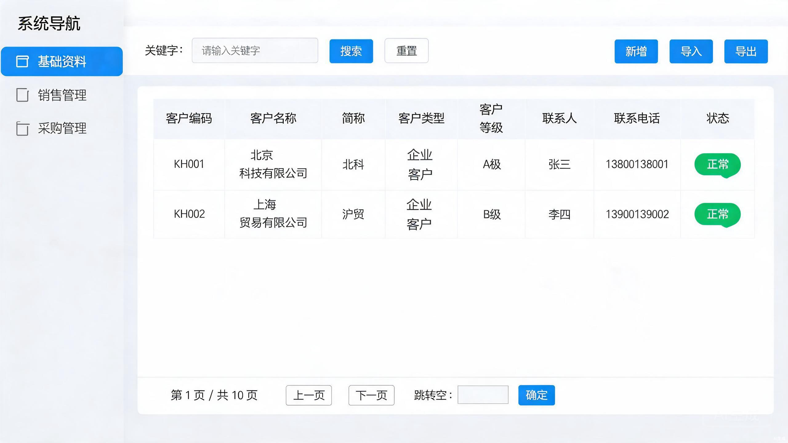

客户管理列表页主要包含以下区域：
- **搜索栏**：提供「关键字」搜索框，可按客户编码、客户名称、简称进行模糊搜索。
- **操作按钮区**：提供新增、导入、导出等按钮。
- **数据表格**：展示客户编码、客户名称、简称、客户类型、客户等级、联系人、联系电话、状态等列。
- **状态列**：以绿色标签显示「正常」，灰色标签显示「停用」。

### 3.3 操作步骤

#### 新增客户
1. 在客户列表页点击右上角「新增」按钮，进入客户档案新增页面。
2. **基本信息**区域：填写客户编码（如 C001）、客户名称（必填，如 XX科技有限公司）、简称；选择客户类型（企业客户/个人客户）和客户等级（普通客户/VIP客户/战略客户）。
3. **联系方式**区域：填写联系人、联系电话、邮箱、地址（地址为多行文本框）。
4. **财务信息**区域：填写税号、开户行、银行账号、信用额度。
5. **关联与状态**区域：选择付款条件、币种、默认业务员、默认发货仓（均为可搜索下拉框）；选择状态（正常/停用，必填，默认正常）。
6. 确认信息无误后点击「保存」按钮，系统保存数据并返回列表页。

#### 编辑客户
1. 在客户列表页找到目标客户，点击该行「编辑」链接，进入编辑页面。
2. 修改需要变更的字段。
3. 点击「保存」按钮保存修改，或点击「取消」放弃修改。

#### 删除客户
1. 在客户列表页找到目标客户，点击该行「删除」链接。
2. 系统弹出确认提示，点击「确定」完成删除。
3. **注意**：已被业务单据引用的客户可能无法删除，建议改为「停用」状态。

#### 搜索客户
1. 在搜索栏「关键字」输入框中输入客户编码、名称或简称的关键字。
2. 点击「搜索」按钮，表格将显示匹配的客户记录。
3. 点击「重置」按钮清空搜索条件，显示全部客户。

### 3.4 注意事项

- 客户名称为必填项，编码建议按企业编码规范填写（如 C001、C002）。
- 付款条件、币种、默认业务员、默认发货仓等关联档案需先在对应模块中维护后才能选择。
- 客户编码若启用了自动编码规则（MD_CUSTOMER），则新增时编码可能由系统自动生成，无需手动输入。
- 建议对长期不合作的客户设置为「停用」状态，而非直接删除，以保留历史业务数据。

---

## 4. 供应商管理

### 4.1 功能说明

供应商管理用于维护企业的供应商档案信息，包括供应商基本信息、联系方式、财务资料及关联档案等。供应商档案是采购订单、采购入库、采购发票等采购业务单据的必填基础数据。

### 4.2 界面描述

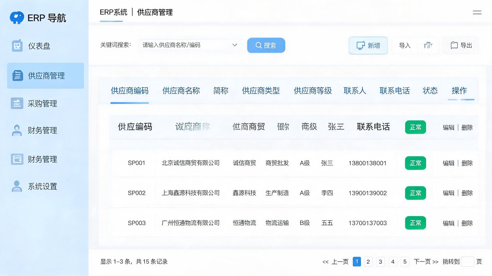

供应商管理列表页主要包含以下区域：
- **搜索栏**：提供「关键字」搜索框，可按供应商编码、供应商名称、简称进行模糊搜索。
- **操作按钮区**：提供新增、导入、导出等按钮。
- **数据表格**：展示供应商编码、供应商名称、简称、供应商类型、供应商等级、联系人、联系电话、状态等列。
- **状态列**：以绿色标签显示「正常」，灰色标签显示「停用」。

### 4.3 操作步骤

#### 新增供应商
1. 在供应商列表页点击右上角「新增」按钮，进入供应商档案新增页面。
2. **基本信息**区域：填写供应商编码（如 S001）、供应商名称（必填，如 XX材料有限公司）、简称；选择供应商类型（一般供应商/战略供应商）和供应商等级（A级/B级/C级）。
3. **联系方式**区域：填写联系人、联系电话、邮箱、地址。
4. **财务信息**区域：填写税号、开户行、银行账号。
5. **关联与状态**区域：选择付款条件、币种、默认采购员（均可搜索下拉框）；填写交货天数（默认0）；选择状态（正常/停用，必填，默认正常）。
6. 点击「保存」按钮保存数据并返回列表页。

#### 编辑供应商
1. 在供应商列表页点击目标供应商行的「编辑」链接，进入编辑页面。
2. 修改相关字段后点击「保存」按钮。

#### 删除供应商
1. 点击目标供应商行的「删除」链接，在确认提示中点击「确定」。

#### 搜索供应商
1. 在搜索栏输入供应商编码、名称或简称关键字，点击「搜索」按钮筛选。

### 4.4 注意事项

- 供应商名称为必填项。
- 供应商等级（A/B/C级）可用于供应商评估和筛选，建议按供应商综合实力评定。
- 交货天数用于采购计划计算，请据实填写。
- 已被采购业务引用的供应商建议停用而非删除。

---

## 5. 物料管理

### 5.1 功能说明

物料管理是ERP系统的核心主数据之一，用于维护企业所有物料（原材料、半成品、成品、包材等）的档案信息，包括基本信息、价格库存、控制选项、产品图片等。物料档案贯穿采购、销售、库存、生产全流程。

### 5.2 界面描述

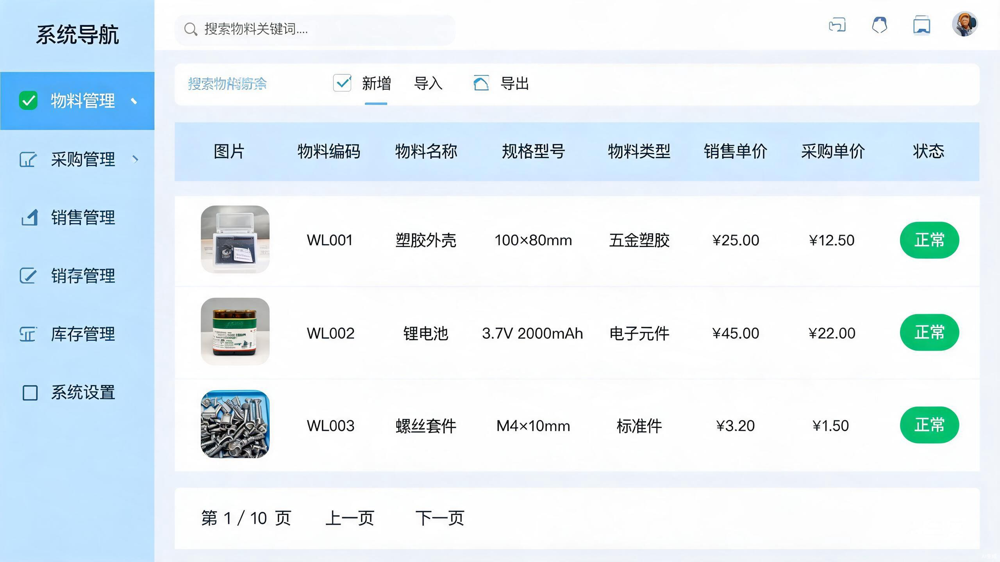

物料管理列表页主要包含以下区域：
- **搜索栏**：提供「关键字」搜索框，可按物料编码、物料名称、全称进行模糊搜索。
- **操作按钮区**：提供新增、导入、导出等按钮。
- **数据表格**：首列为「图片」列（显示物料主图缩略图，无图显示占位图标），后续依次为物料编码、物料名称、规格型号、物料类型、销售单价、采购单价、状态。
- **图片预览**：点击列表中的物料图片可放大预览，支持多图翻页浏览。

### 5.3 操作步骤

#### 新增物料
1. 在物料列表页点击右上角「新增」按钮，进入物料档案新增页面。
2. **基本信息**区域：
   - 物料编码：若启用了编码规则（MD_MATERIAL），保存时由系统自动生成，无需手动输入；否则手动填写（如 M001）。
   - 物料名称（必填）：如「精密轴承」。
   - 全称、规格型号：如「M8*20」。
   - 物料类型（必填）：选择原材料/半成品/成品/包材/辅助材料/自制件。
   - 基本单位（必填）：选择计量单位（可搜索）。
   - 采购单位、销售单位：可选项，可搜索选择。
   - 物料分类：通过级联选择器选择物料分类（支持多级分类）。
3. **价格与库存**区域：
   - 销售单价、采购单价：精确到4位小数。
   - 税率：默认13。
   - 最低库存、最高库存：用于库存预警。
   - 默认仓库：选择该物料的默认存放仓库。
4. **控制选项**区域：
   - 批次管理：开启后该物料按批次管理。
   - 序列号管理：开启后该物料按序列号管理。
   - 货位管理：开启后该物料启用货位管理。
   - 质检要求：开启后该物料入库需质检。
   - 保质期管理：开启后显示「有效期天数」字段，需填写。
   - 保密物料：开启后AI小助手将无法读取该物料信息。
   - 状态（必填）：正常/停用，默认正常。
5. **产品图片**区域：通过图片上传组件上传物料图片，可设置主图。
6. **信息确认**区域：页面底部展示已填写的关键信息汇总，供核对。
7. 点击「保存并返回」按钮保存并返回列表，或点击「保存为草稿」（将状态设为停用）保存草稿。

#### 编辑物料
1. 在物料列表页点击目标物料行的「编辑」链接，或在列表中点击物料编码链接，进入编辑页面。
2. 修改相关字段后点击「保存并返回」按钮。

#### 删除物料
1. 点击目标物料行的「删除」链接，在确认提示中点击「确定」。

#### 搜索物料
1. 在搜索栏输入物料编码、名称或全称关键字，点击「搜索」按钮筛选。

#### 查看物料图片
1. 在列表中点击物料图片缩略图，系统弹出图片预览窗口。
2. 若该物料有多张图片，可在预览窗口中翻页浏览。

### 5.4 注意事项

- 物料名称、物料类型、基本单位、状态为必填项。
- 物料编码若由系统自动生成，编码输入框将显示为禁用状态并提示「编码由系统按编码规则自动生成」。
- 保密物料开启后，AI小助手无法读取该物料信息，请根据企业保密要求谨慎设置。
- 开启保质期管理后，务必填写有效期天数，否则可能影响批次保质期管理。
- 物料分类的选择会影响编码规则的匹配（支持多级分类编码拼接），请正确选择分类。
- 已被业务单据引用的物料建议停用而非删除。

---

## 6. 物料分类

### 6.1 功能说明

物料分类用于对物料进行分层级分类管理，支持多级分类树结构。物料分类不仅便于物料的归类查询和统计，还参与物料编码规则的自动编码匹配（支持多级分类编码拼接）。

### 6.2 界面描述

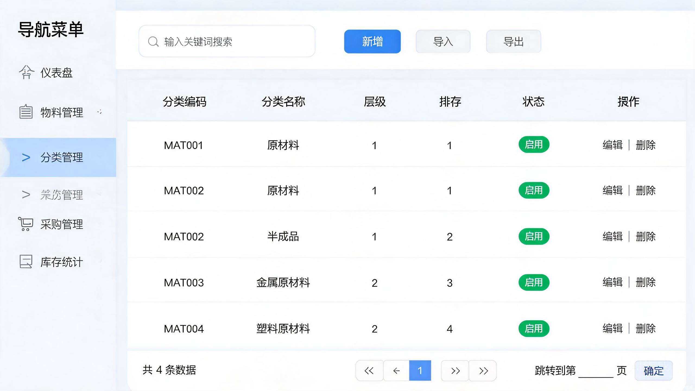

物料分类列表页主要包含以下区域：
- **搜索栏**：提供「关键字」搜索框，可按分类编码、分类名称搜索。
- **操作按钮区**：提供新增、导入、导出等按钮。
- **数据表格**：展示分类编码、分类名称、层级、排序、状态等列。

### 6.3 操作步骤

#### 新增物料分类
1. 在物料分类列表页点击「新增」按钮，进入新增页面。
2. **基本信息**区域：
   - 分类编码：如「1001」（若启用编码规则 BD_MATERIAL_CATEGORY，可能自动生成）。
   - 分类名称（必填）：如「原材料」。
   - 上级分类：通过级联选择器选择上级分类，留空表示顶级分类。
3. **层级与排序**区域：
   - 分类层级：数字，默认1（选择上级分类后系统会自动计算层级）。
   - 排序：数字，默认0，用于同级分类的显示排序。
4. **状态**区域：选择启用/停用（必填，默认启用）。
5. 点击「保存」按钮保存。

#### 编辑物料分类
1. 点击目标分类行的「编辑」链接，修改字段后保存。
2. **注意**：编辑时上级分类选择器会排除自身，避免循环引用。

#### 删除物料分类
1. 点击目标分类行的「删除」链接，确认后删除。

#### 搜索物料分类
1. 在搜索栏输入分类编码或名称关键字，点击「搜索」筛选。

### 6.4 注意事项

- 分类名称为必填项。
- 选择上级分类后，系统会自动计算当前分类的层级（上级层级+1）。
- 编辑分类时，不能将自身设为上级分类，系统已自动排除。
- 删除分类前，请确保该分类下无子分类且无物料引用，否则可能删除失败。
- 物料分类的编码会参与物料编码规则中的「拼接分类编码」功能，请规范编码。

---

## 7. BOM管理

### 7.1 功能说明

BOM（Bill of Materials，物料清单）管理用于维护产品的物料构成清单，定义母件（成品/半成品）与子件（原材料/半成品/包材）之间的组成关系及用量。BOM是生产计划、成本核算、物料需求计划（MRP）的核心依据。

BOM是系统内带审批流程的单据，支持草稿、待审批、已生效、已停用等状态流转。

### 7.2 界面描述

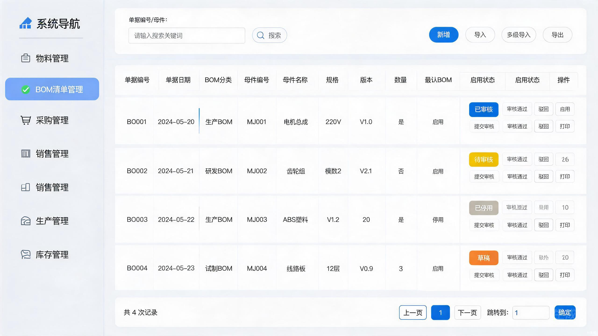

BOM管理列表页主要包含以下区域：
- **搜索栏**：提供「关键字」搜索框，可按单据编号、母件编号、母件名称搜索。
- **操作按钮区**：提供新增、导入、多级导入、导出等按钮。
- **数据表格**：展示单据编号、单据日期、BOM分类、母件编号、母件名称、规格、版本、数量、默认BOM、启用状态、单据状态等列。
- **状态列**：以彩色标签显示单据状态（灰色-草稿、橙色-待审批、绿色-已生效、红色-已停用）。
- **行操作按钮**：根据单据状态动态显示，如「提交审核」「审核通过」「驳回」「重置草稿」「停用」「启用」「打印」等。

### 7.3 操作步骤

#### 新增BOM
1. 在BOM列表页点击「新增」按钮，进入BOM新增页面。
2. **基本信息**区域：
   - 单据编号：保存后由系统自动生成（编码规则 MD_BOM）。
   - 单据日期（必填）：默认当天日期。
   - BOM分类：选择标准BOM/工程BOM/生产BOM/成本BOM/委外BOM。
   - BOM版本：如「V1.0」。
   - BOM类型：选择标准BOM/工程BOM/生产BOM/成本BOM。
   - 默认BOM：开关，开启后该BOM为母件的默认BOM。
3. **母件信息**区域：
   - 母件物料（必填）：选择母件物料（仅显示成品/半成品类型的物料），选择后自动带出母件编号、名称、规格、基本单位。
   - 规格属性、色号、产地、材质：按需填写。
   - 基本单位（必填）：选择后自动带出，可修改。
   - 数量（必填）：母件的数量，默认1。
   - 损耗率(%)：母件生产损耗率。
4. **其他信息**区域：
   - 负责人：选择负责人（员工）。
   - 默认仓库：选择默认仓库。
   - 生效日期、失效日期：设置BOM的有效期间。
   - 备注：多行文本。
5. **BOM明细（子件）**区域：
   - 点击「从物料库选择」按钮，在弹窗中搜索并勾选子件物料（支持多选），点击「确定添加」批量添加子件。
   - 或点击「添加子件」按钮手动添加一行空明细。
   - 在明细表格中填写每个子件的：用量、用量类型（变动/固定）、损耗率(%)、供应类型（领料/倒冲/虚拟件/委外）、工序号、关键件、位号、生效/失效日期等。
   - 点击行末「删除」可删除该子件。
   - 若子件物料有下级BOM，可点击行首展开箭头查看下级BOM明细。
6. 确认信息无误后：
   - 点击「保存草稿」：保存为草稿状态，可继续编辑。
   - 点击「保存并提交」：保存并提交审核，进入待审批状态。

#### 提交审核
1. 在BOM列表页，状态为「草稿」的BOM行点击「提交审核」按钮。
2. 系统弹出确认提示，点击「确定」，BOM进入「待审批」状态。

#### 审核通过
1. 在BOM列表页，状态为「待审批」的BOM行点击「审核通过」按钮。
2. 系统弹出确认提示，点击「确定」，BOM进入「已生效」状态，此后不可再修改。

#### 驳回/重置草稿
1. 状态为「待审批」的BOM：点击「驳回」按钮，可填写驳回原因，BOM回到草稿状态。
2. 状态为「已生效」的BOM：点击「重置草稿」按钮，BOM回到草稿状态，可重新编辑。

#### 停用/启用
1. 状态为「已生效」的BOM：点击「停用」按钮，BOM进入「已停用」状态。
2. 状态为「已停用」的BOM：点击「启用」按钮，BOM恢复为「已生效」状态。

#### 删除BOM
1. 仅草稿状态的BOM可删除。在编辑页面点击「删除」按钮，确认后删除。
2. 列表页也可通过行操作删除草稿状态的BOM。

#### 多级BOM展开
1. 在BOM编辑页面（编辑模式），底部「多级BOM展开」区域：
   - 点击「展开多级BOM」按钮：以树形结构递归展示所有层级的子件构成，显示各级层级标签（L0、L1、L2...）和用量。
   - 点击「扁平化视图」按钮：以表格形式展示所有层级子件的汇总数量、采购单价、销售单价。

#### 多级导入
1. 在BOM列表页点击「多级导入」按钮，弹出BOM多级导入弹窗。
2. 按模板填写多级BOM数据后上传导入。

#### 打印BOM
1. 在BOM列表页点击行操作的「打印」按钮，弹出打印预览窗口，可预览并打印BOM单据。

### 7.4 注意事项

- BOM是带审批流程的单据，必须经过「提交审核→审核通过」才能在生产业务中使用。
- 草稿状态的BOM可编辑，已生效状态的BOM不可直接编辑，需先重置草稿。
- 母件物料只能选择成品或半成品类型；子件物料可选择原材料、半成品、包材类型。
- 每个子件的物料、用量为必填项，且至少添加一条BOM明细才能保存。
- 默认BOM：同一母件可设置一个默认BOM，便于生产业务自动引用。
- 多级BOM展开功能仅在编辑模式下可用，需先保存BOM后才能展开。
- 已生效的BOM如需修改，请先「重置草稿」回到草稿状态。

---

## 8. 仓库管理

### 8.1 功能说明

仓库管理用于维护企业的仓库档案信息，包括仓库编码、名称、类型、地址、管理员及管理控制选项等。仓库档案是所有出入库业务单据的必填基础数据。

### 8.2 界面描述

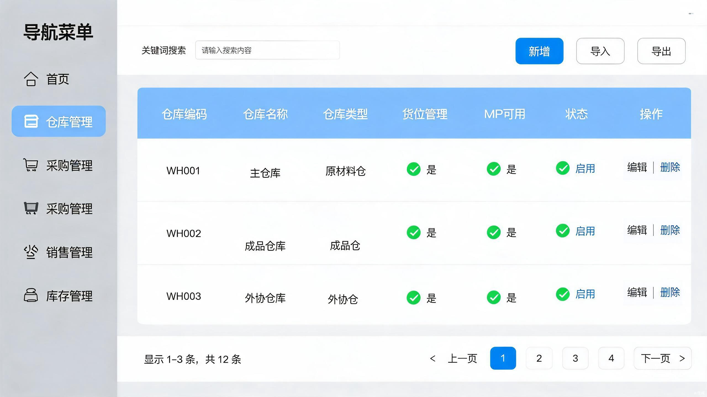

仓库管理列表页主要包含以下区域：
- **搜索栏**：提供「关键字」搜索框，可按仓库编码、仓库名称搜索。
- **操作按钮区**：提供新增、导入、导出等按钮。
- **数据表格**：展示仓库编码、仓库名称、仓库类型、货位管理、MRP可用、状态等列。
- **货位管理/MRP可用列**：以蓝色标签显示「是」，未开启显示「-」。

### 8.3 操作步骤

#### 新增仓库
1. 在仓库列表页点击「新增」按钮，进入仓库档案新增页面。
2. **基本信息**区域：
   - 仓库编码：如「WH01」（若启用编码规则 BD_WAREHOUSE，可能自动生成）。
   - 仓库名称（必填）：如「原材料仓」。
   - 仓库类型（必填）：选择原材料仓/成品仓/半成品仓/普通仓库/废品仓/辅助材料仓。
3. **地址与管理**区域：
   - 仓库地址：多行文本。
   - 管理员：选择仓库管理员（可搜索员工列表）。
4. **控制选项**区域：
   - 货位管理：开关，开启后该仓库启用货位（库位）管理。
   - 参与MRP：开关，开启后该仓库参与物料需求计划计算，默认开启。
   - 状态（必填）：启用/停用，默认启用。
5. 点击「保存」按钮保存。

#### 编辑/删除/搜索仓库
操作方式同通用操作，此处不再赘述。

### 8.4 注意事项

- 仓库名称、仓库类型、状态为必填项。
- 开启「货位管理」后，才可以在库位管理中为该仓库添加货位。
- 「参与MRP」控制该仓库的库存是否纳入MRP计算，原材料仓和成品仓建议开启。
- 已有库存或被业务单据引用的仓库不建议删除，建议改为停用。

---

## 9. 库位管理

### 9.1 功能说明

库位管理（货位管理）用于维护仓库内部的货位档案，实现物料存放位置的精细化管理。仅开启了「货位管理」的仓库才能添加货位。

### 9.2 界面描述

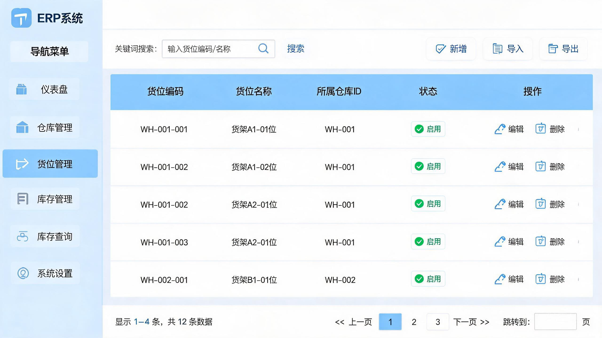

库位管理列表页主要包含以下区域：
- **搜索栏**：提供「关键字」搜索框，可按货位编码、货位名称搜索。
- **操作按钮区**：提供新增、导入、导出等按钮。
- **数据表格**：展示货位编码、货位名称、所属仓库ID、状态等列。

### 9.3 操作步骤

#### 新增库位
1. 在库位列表页点击「新增」按钮，进入货位档案新增页面。
2. **基本信息**区域：
   - 货位编码（必填）：如「A-01-01」。
   - 货位名称（必填）：如「A区1排1层」。
   - 所属仓库（必填）：选择所属仓库（可搜索，仅显示开启了货位管理的仓库）。
3. **状态**区域：选择启用/停用（必填，默认启用）。
4. 点击「保存」按钮保存。

#### 编辑/删除/搜索库位
操作方式同通用操作。

### 9.4 注意事项

- 货位编码和名称为必填项。
- 所属仓库下拉列表仅显示在仓库管理中开启了「货位管理」的仓库。若列表为空，系统会提示「没有开启仓位管理的仓库，请先到仓库档案中勾选仓位管理」。
- 货位编码建议按「区-排-层」的规则编码，便于仓库管理人员快速定位。
- 已被库存引用的货位不建议删除。

---

## 10. 部门管理

### 10.1 功能说明

部门管理用于维护企业的部门组织架构，支持多级部门树结构。部门档案是员工管理、业务单据（如请假、报销、业务归属）等的基础数据。

### 10.2 界面描述

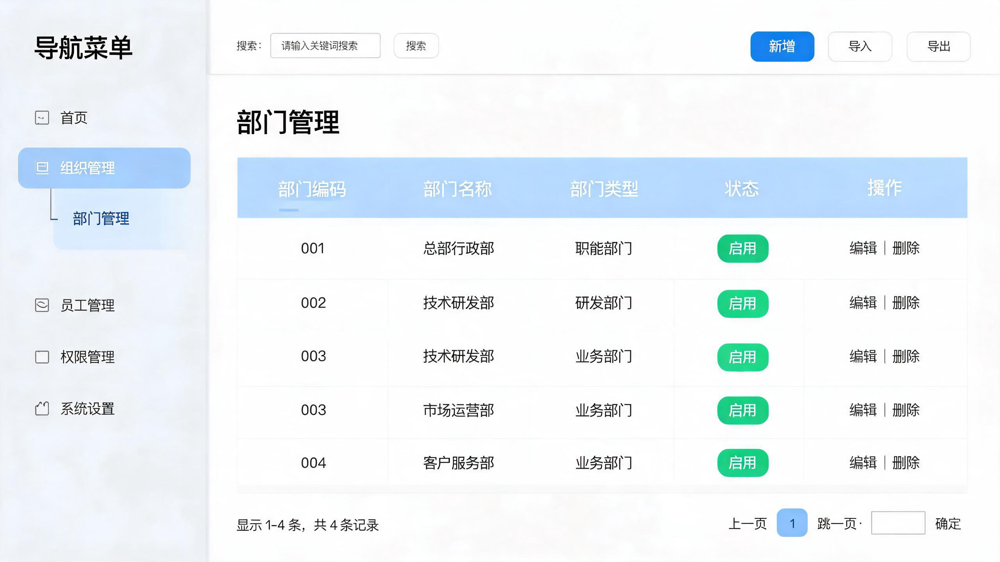

部门管理列表页主要包含以下区域：
- **搜索栏**：提供「关键字」搜索框，可按部门编码、部门名称搜索。
- **操作按钮区**：提供新增、导入、导出等按钮。
- **数据表格**：展示部门编码、部门名称、部门类型、状态等列。

### 10.3 操作步骤

#### 新增部门
1. 在部门列表页点击「新增」按钮，进入部门档案新增页面。
2. **基本信息**区域：
   - 部门编码：如「D001」（若启用编码规则 BD_DEPARTMENT，可能自动生成）。
   - 部门名称（必填）：如「财务部」。
   - 上级部门：选择上级部门（可搜索），留空表示顶级部门。
   - 部门类型（必填）：选择职能部门/业务部门/决策部门。
3. **状态**区域：选择启用/停用（必填，默认启用）。
4. 点击「保存」按钮保存。

#### 编辑/删除/搜索部门
操作方式同通用操作。

### 10.4 注意事项

- 部门名称、部门类型、状态为必填项。
- 通过设置上级部门可构建多级部门组织架构。
- 编辑部门时，上级部门不能选择自身，避免循环引用。
- 删除部门前，请确保该部门下无子部门且无员工归属，否则可能删除失败。
- 建议按企业实际组织架构建立部门层级关系。

---

## 11. 员工管理

### 11.1 功能说明

员工管理用于维护企业员工档案信息，包括基本信息、联系方式、系统账号及在职状态等。员工档案与系统登录账号关联，填写用户名后可自动创建系统登录账号。

### 11.2 界面描述

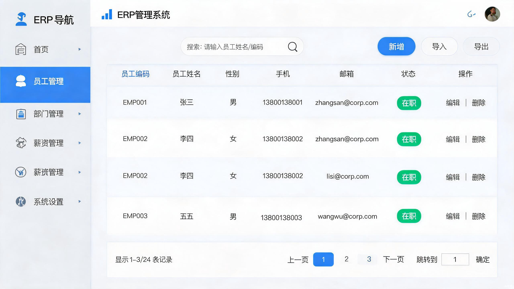

员工管理列表页主要包含以下区域：
- **搜索栏**：提供「关键字」搜索框，可按员工编码、员工姓名搜索。
- **操作按钮区**：提供新增、导入、导出等按钮。
- **数据表格**：展示员工编码、员工姓名、性别、手机、邮箱、状态等列。
- **状态列**：以绿色标签显示「在职」，灰色标签显示「离职」。

### 11.3 操作步骤

#### 新增员工
1. 在员工列表页点击「新增」按钮，进入员工档案新增页面。
2. **基本信息**区域：
   - 员工编码：如「E001」（若启用编码规则 BD_EMPLOYEE，可能自动生成）。
   - 员工姓名（必填）：如「张三」。
   - 部门（必填）：选择所属部门（可搜索）。
   - 职位：如「经理」。
3. **联系方式**区域：
   - 性别：选择男/女/未知，默认男。
   - 手机号码、邮箱：按实际填写。
   - 入职日期：选择日期。
4. **系统账号**区域：
   - 用户名：填写后保存时将自动创建/更新对应的系统登录账号（sys_user），不填则不创建账号。
   - 密码：留空则默认密码为123456。
   - 角色：选择系统角色（可搜索）。
5. **状态**区域：选择在职/离职（必填，默认在职）。
6. 点击「保存」按钮保存。

#### 编辑/删除/搜索员工
操作方式同通用操作。

### 11.4 注意事项

- 员工姓名、部门、状态为必填项。
- 填写用户名后，系统会自动创建对应的登录账号，初始密码默认为123456，建议首次登录后修改密码。
- 离职员工建议设置为「离职」状态而非删除，以保留历史业务记录。
- 角色需先在系统管理的角色管理中维护后才能选择。

---

## 12. 单位管理

### 12.1 功能说明

单位管理（计量单位管理）用于维护物料的计量单位档案，支持单位分组和换算率设置。计量单位是物料档案、采购、销售、库存等业务的基础数据。

### 12.2 界面描述

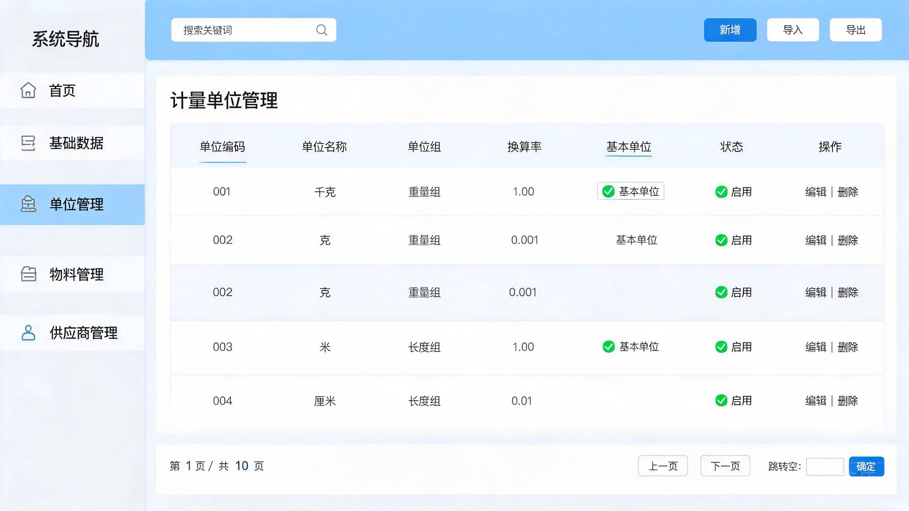

单位管理列表页主要包含以下区域：
- **搜索栏**：提供「关键字」搜索框，可按单位编码、单位名称搜索。
- **操作按钮区**：提供新增、导入、导出等按钮。
- **数据表格**：展示单位编码、单位名称、单位组、换算率、基本单位、状态等列。
- **基本单位列**：以蓝色标签显示「基本单位」，否则显示「-」。

### 12.3 操作步骤

#### 新增单位
1. 在单位列表页点击「新增」按钮，进入计量单位新增页面。
2. **基本信息**区域：
   - 单位编码：如「PCS」（若启用编码规则 BD_UNIT，可能自动生成）。
   - 单位名称（必填）：如「件」。
   - 单位组：如「个数」「重量」「长度」等，用于单位分组管理。
3. **换算与状态**区域：
   - 换算率：数字，精确到6位小数，默认1。
   - 是否基本单位：开关，开启后该单位为所在单位组的基本单位，默认开启。
   - 状态（必填）：启用/停用，默认启用。
4. 点击「保存」按钮保存。

#### 编辑/删除/搜索单位
操作方式同通用操作。

### 12.4 注意事项

- 单位名称为必填项。
- 同一单位组内应设置一个基本单位，其他单位的换算率以基本单位为基准。
- 计量单位被物料档案引用后不建议删除，建议改为停用。
- 常见单位组：个数（个/件/只/台）、重量（kg/g/吨）、长度（m/cm/mm）、体积（L/mL/m³）等。

---

## 13. 结算方式

### 13.1 功能说明

结算方式用于维护企业的收付款结算方式档案，如现金、转账、支票、电汇等。结算方式在收付款单据、销售/采购发票等财务单据中使用。

### 13.2 界面描述

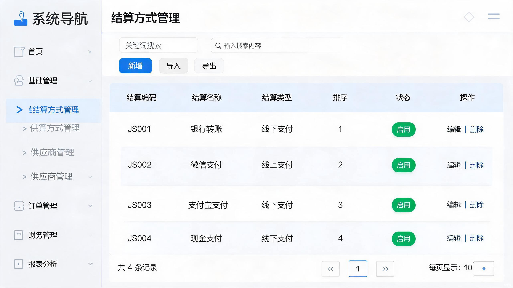

结算方式列表页主要包含以下区域：
- **搜索栏**：提供「关键字」搜索框，可按结算编码、结算名称搜索。
- **操作按钮区**：提供新增、导入、导出等按钮。
- **数据表格**：展示结算编码、结算名称、结算类型、排序、状态等列。

### 13.3 操作步骤

#### 新增结算方式
1. 在结算方式列表页点击「新增」按钮，进入新增页面。
2. **基本信息**区域：
   - 结算编码（必填）：如「CASH」。
   - 结算名称（必填）：如「现金」。
   - 结算类型（必填）：选择通用/收款/付款。
3. **排序与状态**区域：
   - 排序：数字，默认0，用于显示排序。
   - 状态（必填）：启用/停用，默认启用。
4. 点击「保存」按钮保存。

#### 编辑/删除/搜索
操作方式同通用操作。

### 13.4 注意事项

- 结算编码和名称为必填项。
- 结算类型分为通用、收款、付款，用于区分该结算方式适用的业务场景。
- 常见结算方式：现金、银行转账、支票、电汇、承兑汇票、微信支付、支付宝等。
- 被财务单据引用的结算方式不建议删除。

---

## 14. 付款条件

### 14.1 功能说明

付款条件用于维护企业的收付款账期条件档案，定义账期天数、折扣天数、折扣率、预付比例等。付款条件在客户档案、供应商档案及采购/销售业务单据中使用，用于计算应收应付到期日。

### 14.2 界面描述

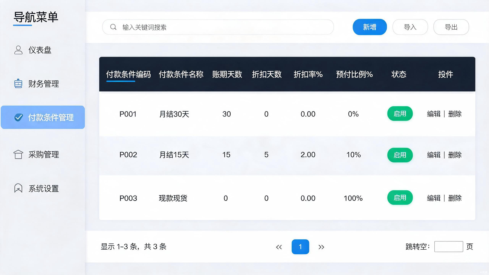

付款条件列表页主要包含以下区域：
- **搜索栏**：提供「关键字」搜索框，可按付款条件编码、名称搜索。
- **操作按钮区**：提供新增、导入、导出等按钮。
- **数据表格**：展示付款条件编码、付款条件名称、账期天数、折扣天数、折扣率%、预付比例%、状态等列。

### 14.3 操作步骤

#### 新增付款条件
1. 在付款条件列表页点击「新增」按钮，进入新增页面。
2. **基本信息**区域：
   - 付款条件编码（必填）：如「NET30」。
   - 付款条件名称（必填）：如「30天净额」。
   - 付款天数（必填）：数字，默认0，表示账期天数。
3. **折扣与预付**区域：
   - 折扣天数：数字，默认0，表示享受折扣的最后期限天数。
   - 折扣率：数字，精确到4位小数，默认0。
   - 预付比例：数字，精确到4位小数，默认0。
4. **状态**区域：选择启用/停用（必填，默认启用）。
5. 点击「保存」按钮保存。

#### 编辑/删除/搜索
操作方式同通用操作。

### 14.4 注意事项

- 付款条件编码、名称、付款天数为必填项。
- 常见付款条件示例：
  - 「NET30」-30天净额：付款天数30，无折扣。
  - 「2/10 NET30」-10天内付款享受2%折扣，否则30天付全款：付款天数30，折扣天数10，折扣率2。
  - 「预付30%」-预付比例30，余款货到付款。
- 付款条件被客户/供应商引用后不建议删除。
- 付款天数用于系统自动计算应收/应付到期日，请确保填写正确。

---

## 15. 币种管理

### 15.1 功能说明

币种管理用于维护企业业务中使用的货币档案，包括币种编码、名称、符号、汇率及本位币设置。币种在客户档案、供应商档案及外币业务单据中使用。

### 15.2 界面描述

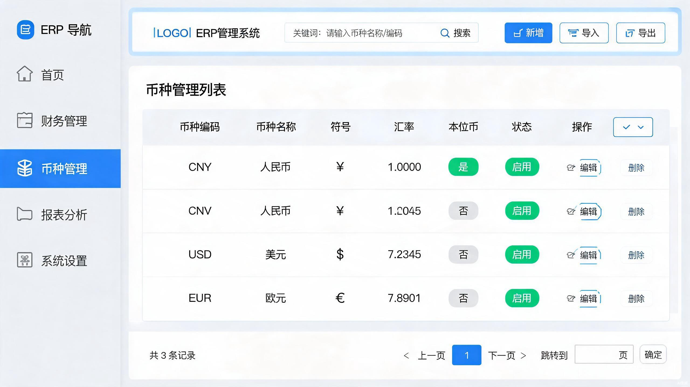

币种管理列表页主要包含以下区域：
- **搜索栏**：提供「关键字」搜索框，可按币种编码、币种名称搜索。
- **操作按钮区**：提供新增、导入、导出等按钮。
- **数据表格**：展示币种编码、币种名称、符号、汇率、本位币、状态等列。
- **本位币列**：以蓝色标签显示「是」，否则显示「-」。

### 15.3 操作步骤

#### 新增币种
1. 在币种列表页点击「新增」按钮，进入新增页面。
2. **基本信息**区域：
   - 币种编码：如「CNY」（若启用编码规则 BD_CURRENCY，可能自动生成）。
   - 币种名称（必填）：如「人民币」。
   - 币种符号：如「¥」。
3. **汇率与状态**区域：
   - 汇率：数字，精确到8位小数，默认1。
   - 是否基本币种：开关，开启后该币种为本位币（记账本位币），默认关闭。
   - 状态（必填）：启用/停用，默认启用。
4. 点击「保存」按钮保存。

#### 编辑/删除/搜索
操作方式同通用操作。

### 15.4 注意事项

- 币种名称为必填项。
- 本位币（基本币种）是企业记账的基础货币，通常只有一个。设置本位币后，外币业务将按汇率折算为本位币记账。
- 汇率请根据实际汇率定期更新，确保外币业务金额计算准确。
- 常见币种：CNY（人民币）、USD（美元）、EUR（欧元）、HKD（港币）、JPY（日元）等。
- 被客户/供应商引用的币种不建议删除。

---

## 16. 账户管理（会计科目）

### 16.1 功能说明

账户管理（会计科目管理）用于维护企业的会计科目体系，支持多级科目树结构。会计科目是财务凭证、账簿、报表等财务管理的基础数据。

### 16.2 界面描述

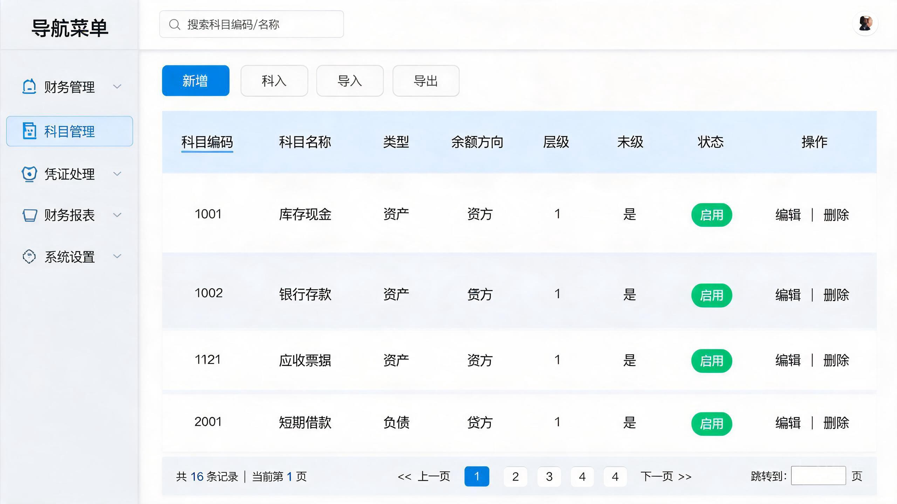

账户管理列表页主要包含以下区域：
- **搜索栏**：提供「关键字」搜索框，可按科目编码、科目名称搜索。
- **操作按钮区**：提供新增、导入、导出等按钮。
- **数据表格**：展示科目编码、科目名称、类型、余额方向、层级、末级、状态等列。
- **末级列**：以蓝色标签显示「是」，否则显示「-」。

### 16.3 操作步骤

#### 新增会计科目
1. 在账户列表页点击「新增」按钮，进入会计科目新增页面。
2. **基本信息**区域：
   - 科目编码（必填）：如「1001」。
   - 科目名称（必填）：如「库存现金」。
   - 科目全称：科目完整名称。
   - 上级科目：选择上级科目（可搜索），留空表示顶级科目。
3. **类型与方向**区域：
   - 科目类型（必填）：选择资产/负债/权益/成本/损益。
   - 余额方向（必填）：选择借/贷，默认借。
   - 科目层级：数字，默认1。
4. **控制选项**区域：
   - 是否末级科目：开关，开启后该科目为末级科目（可录入凭证），默认开启。
   - 是否现金科目：开关，开启后该科目标记为现金科目，默认关闭。
   - 状态（必填）：启用/停用，默认启用。
5. 点击「保存」按钮保存。

#### 编辑/删除/搜索
操作方式同通用操作。

### 16.4 注意事项

- 科目编码和名称为必填项。
- 会计科目编码建议遵循国家统一会计准则编码规范（如1001库存现金、1002银行存款、1122应收账款、2202应付账款等）。
- 只有末级科目才能在凭证中录入金额，非末级科目为汇总科目。
- 通过设置上级科目可构建多级科目体系（如：1001资产→1001.01流动资产→1001.01.01库存现金）。
- 已被凭证引用的科目不可删除，建议改为停用。
- 现金科目标记用于现金流量表的编制。

---

## 17. 价格等级

### 17.1 功能说明

价格等级用于维护企业的价格体系档案，定义不同等级的价格调整率。价格等级可应用于销售业务，实现不同客户等级对应不同价格水平的灵活定价。

### 17.2 界面描述

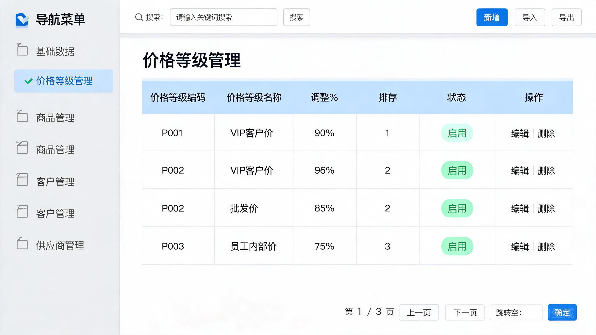

价格等级列表页主要包含以下区域：
- **搜索栏**：提供「关键字」搜索框，可按价格等级编码、名称搜索。
- **操作按钮区**：提供新增、导入、导出等按钮。
- **数据表格**：展示价格等级编码、价格等级名称、调整率%、排序、状态等列。

### 17.3 操作步骤

#### 新增价格等级
1. 在价格等级列表页点击「新增」按钮，进入新增页面。
2. **基本信息**区域：
   - 等级编码（必填）：如「LV01」。
   - 等级名称（必填）：如「批发价」。
3. **调整与状态**区域：
   - 价格调整率：数字，精确到4位小数，默认0。正值表示加价，负值表示降价。
   - 排序：数字，默认0，用于显示排序。
   - 状态（必填）：启用/停用，默认启用。
4. 点击「保存」按钮保存。

#### 编辑/删除/搜索
操作方式同通用操作。

### 17.4 注意事项

- 等级编码和名称为必填项。
- 价格调整率以百分比表示，如「10」表示在基准价上加价10%，「-5」表示降价5%。
- 常见价格等级示例：零售价（调整率0）、批发价（调整率-10）、VIP价（调整率-15）、战略客户价（调整率-20）。
- 排序值越小显示越靠前，建议按价格优惠程度从低到高排序。

---

## 18. 物料编码规则

### 18.1 功能说明

物料编码规则用于配置物料编码的自动生成规则，支持按物料分类设置不同的编码规则。通过前缀、分类编码拼接、日期、流水号等元素的灵活组合，实现物料编码的规范化自动生成。

物料编码规则是物料管理、客户、供应商、币种、单位、BOM等档案自动编码的配置中心。本节以物料编码规则为例说明。

### 18.2 界面描述

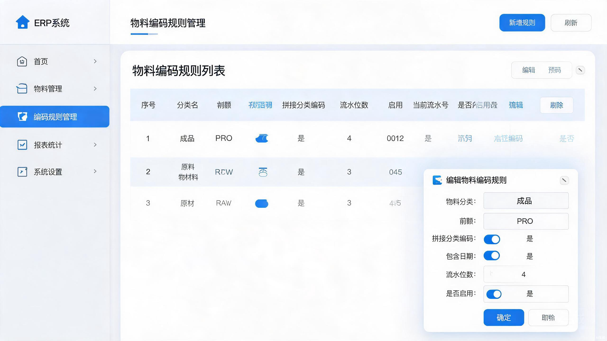

物料编码规则页面主要包含以下区域：
- **操作按钮区**：提供「新增规则」「刷新」按钮。
- **数据表格**：展示序号、分类名、前缀、拼接分类编码（是/否）、包含日期（是/否）、流水位数、当前流水号、是否启用等列。
- **行操作**：每行提供「编辑」「预览编码」「删除」按钮。

### 18.3 操作步骤

#### 新增编码规则
1. 在物料编码规则列表页点击「新增规则」按钮，弹出新增弹窗。
2. 填写规则信息：
   - 物料分类：选择该规则适用的物料分类，留空表示通用规则（所有分类兜底使用）。
   - 前缀：编码开头部分，如「RM」（开启拼接分类编码时可留空）。
   - 拼接分类编码：开关，开启后编码 = 前缀 + 各级分类编码依次拼接 + [日期] + 流水号。
   - 包含日期：开关，开启后编码中插入 yyyyMMdd 日期段。
   - 流水位数：数字（1-10），默认4，表示流水号的位数。
   - 是否启用：开关，默认启用。
3. 点击「保存」按钮保存规则。

#### 编辑编码规则
1. 在列表中找到目标规则，点击「编辑」按钮，弹出编辑弹窗。
2. 修改规则参数后点击「保存」。

#### 预览编码
1. 在列表中点击目标规则的「预览编码」按钮，弹出编码预览弹窗。
2. 弹窗中展示分类、前缀、拼接分类编码、包含日期及下一编码预览值。
3. 点击「关闭」关闭预览。

#### 删除编码规则
1. 在列表中点击目标规则的「删除」按钮。
2. 系统弹出确认提示，点击「确定」完成删除。

### 18.4 注意事项

- 不选分类则创建通用规则，所有未匹配到专属规则的分类将兜底使用通用规则。
- 编码生成逻辑：
  - 拼接分类编码关闭时：编码 = 前缀 + [日期] + 流水号。
  - 拼接分类编码开启时：编码 = 前缀 + 各级分类编码依次拼接 + [日期] + 流水号。
  - 例：分类 A(成品) › BCD(螺丝类) › EFG(颜色)，开启拼接后编码为 ABCDEFG001。
- 流水位数决定流水号的位数，如4位则流水号从0001开始。
- 当前流水号显示该规则已生成多少个编码，可用于了解编码使用情况。
- 建议为不同物料分类设置不同的编码规则，便于物料编码的识别和管理。
- 规则启用后才能生效，停用的规则不会参与编码生成。
- 除物料编码规则外，系统还支持客户（MD_CUSTOMER）、供应商（MD_SUPPLIER）、币种（BD_CURRENCY）、单位（BD_UNIT）、部门（BD_DEPARTMENT）、员工（BD_EMPLOYEE）、仓库（BD_WAREHOUSE）、物料分类（BD_MATERIAL_CATEGORY）、BOM（MD_BOM）等档案的自动编码，配置方式类似。

---

## 附录：常见问题

### Q1：新增档案时编码字段为灰色不可编辑？
**A**：该档案启用了自动编码规则，编码由系统按规则自动生成，无需手动输入。如需手动编码，请在编码规则中关闭对应档案的自动编码。

### Q2：删除档案时提示删除失败？
**A**：该档案可能已被业务单据引用，无法直接删除。建议将档案状态改为「停用」，以保留历史数据。

### Q3：下拉选项为空无法选择？
**A**：关联档案尚未维护。例如客户档案中的「付款条件」下拉为空，需先在「付款条件」模块中新增付款条件后才能选择。

### Q4：库位管理中所属仓库下拉为空？
**A**：所属仓库仅显示开启了「货位管理」的仓库。请先到仓库管理中编辑仓库，开启「货位管理」开关。

### Q5：BOM已生效后发现填写错误怎么办？
**A**：已生效的BOM不可直接编辑。需在BOM列表页点击「重置草稿」按钮将BOM回到草稿状态，修改后重新提交审核。

### Q6：员工档案填写用户名后有什么作用？
**A**：填写用户名后保存，系统会自动创建对应的系统登录账号（初始密码123456），该员工即可使用用户名和密码登录系统。

### Q7：如何查看档案的修改历史？
**A**：在档案编辑页面点击「操作日志」按钮，可查看该档案的历史变更记录（创建人、创建时间、修改人、修改时间、修改字段等）。

---

*本手册版本：V1.0*
*最后更新：2026年8月*
