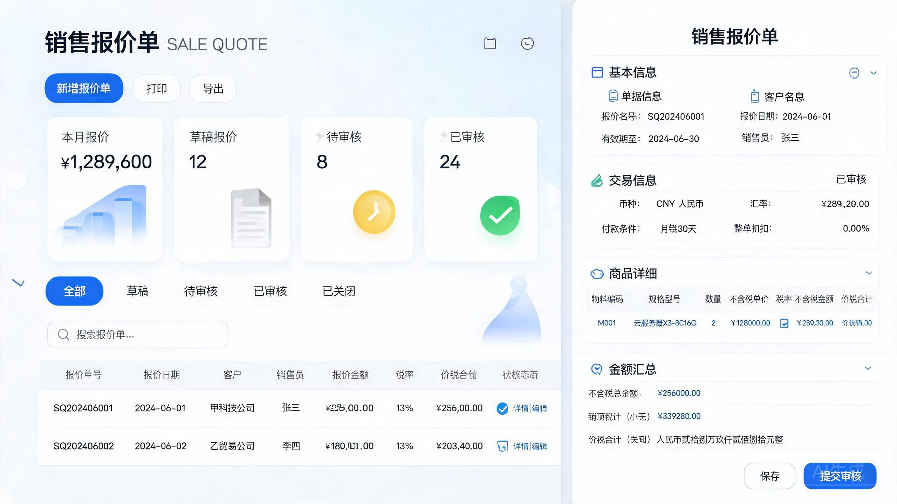
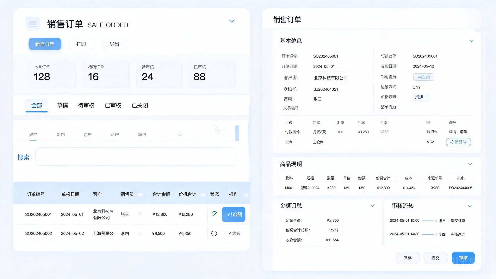
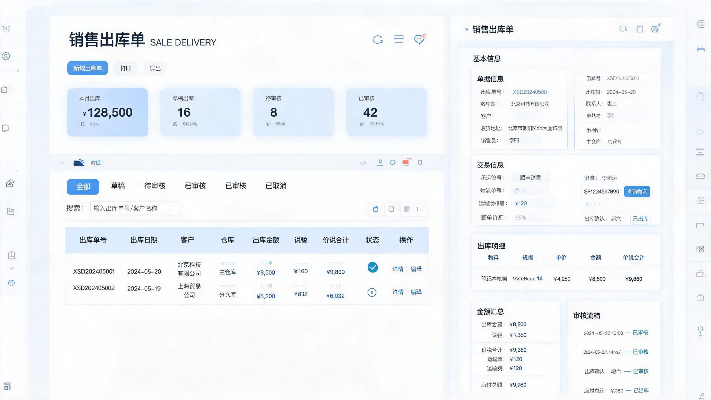
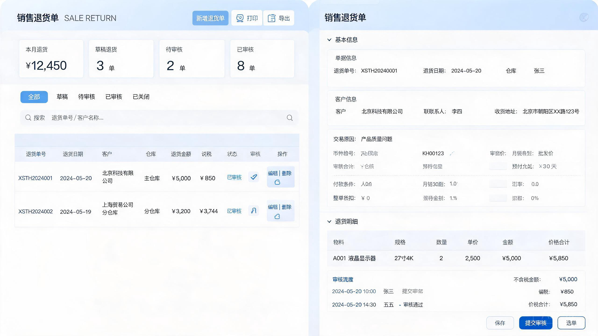
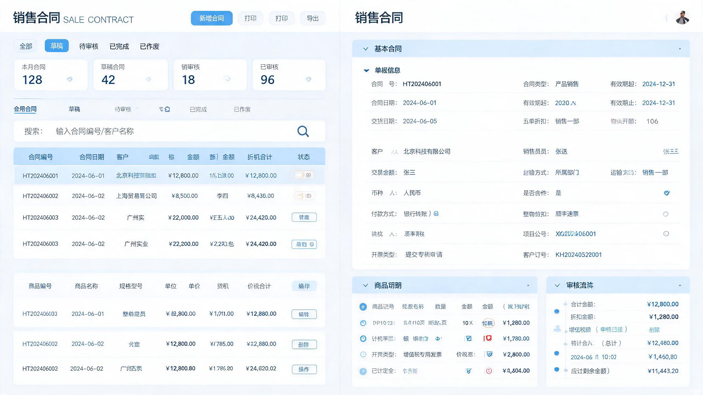
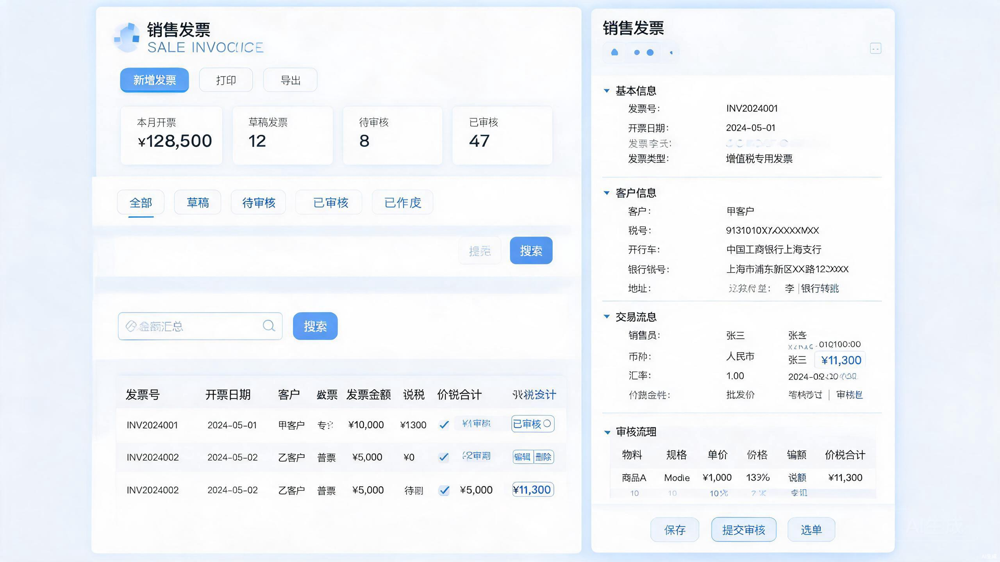

# 销售管理模块操作手册

> 本手册适用于智能 ERP 系统「销售管理」模块，涵盖销售报价、销售订单、销售发货、销售退货、销售合同、销售发票六大子模块。手册从功能说明、界面描述、操作步骤、业务流程、注意事项五个维度进行详细说明，帮助销售人员、销售主管、仓储人员及财务人员快速掌握系统的日常操作。

---

## 目录

1. [模块总览](#一模块总览)
2. [销售报价](#二销售报价)
3. [销售订单](#三销售订单)
4. [销售发货](#四销售发货)
5. [销售退货](#五销售退货)
6. [销售合同](#六销售合同)
7. [销售发票](#七销售发票)
8. [业务流程与下推关系](#八业务流程与下推关系)
9. [通用操作说明](#九通用操作说明)
10. [常见问题与注意事项](#十常见问题与注意事项)

---

## 一、模块总览

销售管理模块是 ERP 系统的核心业务模块之一，负责企业从客户询价、报价、签约、发货到开票、退货的全流程管理。模块以「单据流转」为主线，通过下推机制实现单据之间的数据传递，避免重复录入，保证业务数据的一致性与可追溯性。

### 1.1 子模块构成

| 子模块 | 单据类型代码 | 主要功能 |
| --- | --- | --- |
| 销售报价 | SALE_QUOTE | 响应客户询价，制定报价方案 |
| 销售订单 | SALE_ORDER | 确认客户订货需求，生成正式订单 |
| 销售发货 | SALE_DELIVERY | 处理商品出库，扣减库存 |
| 销售退货 | SALE_RETURN | 处理客户退货，回退库存 |
| 销售合同 | SALE_CONTRACT | 管理销售合同与框架协议 |
| 销售发票 | SALE_INVOICE | 开具销售发票，税务合规管理 |

### 1.2 单据状态体系

销售模块所有单据遵循统一的状态机管理，主要状态如下：

| 状态 | 含义 | 可执行操作 |
| --- | --- | --- |
| 草稿 | 新建未提交，可编辑 | 保存、提交、编辑、删除、取消、作废 |
| 待审核 | 已提交待审批，不可编辑 | 审核、驳回 |
| 已生效 | 审核通过，生效中 | 重置草稿、结案、下推、复制、打印 |
| 已关闭 | 业务完结或手动结案 | 反结案 |
| 已取消 | 业务终止 | — |
| 已作废 | 单据作废，不参与业务 | 反作废 |

> 说明：每张单据同时维护「单据状态」与「审核状态」两个维度，审核状态包含「待审核 / 已生效 / 已取消」。只有处于「已生效」状态的单据才允许下推生成下游单据。

### 1.3 通用界面布局

销售模块各子模块的列表页与编辑页采用统一的设计风格，便于用户快速上手。

**列表页通用结构：**
- **页面头部**：返回按钮、页面标题（含英文标识徽章）、副标题说明、新增 / 打印 / 导出操作按钮。
- **数据概览卡片**：四张统计卡片，展示本月新增、草稿、待审核、已生效数量，支持悬停高亮。
- **搜索栏**：左侧状态切换 Tab（全部 / 草稿 / 待审核 / 已生效 / 已关闭），右侧关键字搜索框、搜索 / 重置按钮、列设置入口。
- **数据表格**：支持多选、序号、单据编号链接、客户头像、金额右对齐、状态彩色标签、审核状态标签、操作列。
- **分页区**：显示总记录数，支持每页 20/50/100 条切换、页码跳转。

**编辑页通用结构：**
- **页面头部**：返回列表按钮、单据标题、单据编号、状态标签、保存 / 提交 / 下推 / 更多操作按钮。
- **基本信息卡片**（可折叠）：分「单据信息 / 客户信息 / 交易信息 / 自定义字段 / 其他」分区展示表头字段。
- **商品明细卡片**（可折叠）：明细表格，支持从物料库选择、添加明细、列设置、行删除，底部展示金额汇总。
- **附件资料卡片**（可折叠）：文件上传组件。
- **审核流转卡片**（可折叠）：以时间线形式展示「创建 → 提交审核 → 审核通过 → 结案」流转节点。
- **底部操作按钮区**：统一的 BillActions 组件，按当前状态动态显示可用操作。

---

## 二、销售报价

### 2.1 功能说明

销售报价单用于响应客户询价，记录向客户提供的商品报价方案，包括报价商品、数量、单价、税率、折扣、有效期等关键信息。报价单审核后可作为源头单据下推生成销售订单或销售合同，实现「询价 → 报价 → 订单」的业务闭环。

**核心能力：**
- 录入报价商品明细，自动计算金额、税额、价税合计。
- 支持整单折扣、行折扣、价格等级调价。
- 支持多币种与本位币折算。
- 支持有效期管理（有效期起止、交货日期）。
- 支持批次号、生产日期、有效期至等批次与效期管理。
- 支持附件上传、操作日志、打印预览。
- 支持自定义字段扩展（表头与明细）。

### 2.2 界面描述



**列表页（SaleQuoteList）：**
- 顶部标题「销售报价单 SALE QUOTE」，副标题「快速响应客户询价 · 灵活配置报价方案」。
- 右上角操作区：新增报价单（紫色渐变主按钮）、打印、导出。
- 四张统计卡片：本月报价、草稿报价、待审核、已生效。
- 状态 Tab：全部 / 草稿 / 待审核 / 已生效 / 已关闭，每个 Tab 显示对应数量。
- 搜索框：支持输入「报价单号 / 客户名称」搜索，回车即查。
- 表格列：选择框、序号、报价单号（可点击跳转编辑）、报价日期、客户（带首字母头像）、销售员、报价金额（¥格式）、税率（%）、价税合计（紫色加粗）、状态（彩色圆点+标签）、审核状态、审计列、操作列。
- 分页：共 N 条记录，支持页码与每页条数切换。

**编辑页（SaleQuoteEdit）：**
- 顶部显示「新增销售报价单」或「销售报价单 + 单据编号 + 状态标签」。
- 草稿态显示「保存」「提交审核」按钮；已生效态显示「下推」按钮；更多操作下拉包含审核、取消报价单、操作日志、打印。
- **基本信息卡片**分为四个分区：
  - 单据信息：报价单号（保存后自动生成）、报价日期（必填）、有效期起、有效期止、交货日期。
  - 客户信息：客户（必填，选择后自动带出编号、简称、联系人、电话、收货地址）、客户编号、客户简称、联系人、联系电话、收货地址。
  - 交易信息：销售员（必填）、币种（必填）、汇率、付款条件、结算方式、价格等级、整单折扣、预付金额。
  - 其他：备注（多行文本）。
  - 自定义字段区：根据系统配置动态显示。
- **商品明细卡片**：标题显示「商品明细 共 N 行」，右侧提供「从物料库选择」「添加明细」按钮。明细表格列含图片、物料、规格、单位、数量、单价、税率%、折扣率%、折扣额、金额、税额、价税合计、批次号、生产日期、有效期至、操作（删除）。底部金额汇总区展示合计数量、折前金额、折扣金额、合计税额、价税合计，以及本位币折算与预付信息。
- **附件资料卡片**：支持上传图片、PDF、Word、Excel 等文件，下推时附件会带到后续单据。
- **审核流转卡片**：时间线展示「创建报价 → 提交审核 → 审核通过」。

### 2.3 操作步骤

#### 2.3.1 新增报价单

1. 进入「销售管理 → 销售报价」列表页。
2. 点击右上角「新增报价单」按钮，进入编辑页。
3. 在「基本信息」卡片中填写：
   - 选择「报价日期」（必填，默认当天）。
   - 按需填写「有效期起」「有效期止」「交货日期」。
   - 选择「客户」（必填），系统自动带出客户编号、简称、联系人、联系电话、收货地址、默认销售员、付款条件、税率等信息。
   - 选择「销售员」（必填）、「币种」（必填），系统自动带出汇率。
   - 按需选择「付款条件」「结算方式」「价格等级」，填写「整单折扣」。
4. 在「商品明细」卡片中添加明细，可选择以下方式：
   - **从物料库选择**：点击按钮打开物料选择弹窗，支持按编码 / 名称 / 规格搜索与按分类筛选，勾选后点击「确认添加」。
   - **添加明细**：直接在表格行内选择物料，系统自动带出规格、单位、销售单价、税率。
5. 在明细行中填写「数量」「单价」「税率」「折扣率」，系统自动计算折扣额、金额、税额、价税合计。
6. 若物料启用批次 / 效期管理，填写「批次号」「生产日期」，系统自动计算「有效期至」（带红色 `*` 标识为必填）。
7. 在「金额汇总」区核对合计金额，按需填写「预付金额」。
8. 在「其他」分区填写「备注」（可选）。
9. 在「附件资料」卡片上传相关附件（可选）。
10. 点击顶部「保存」按钮保存为草稿，或点击「提交审核」直接提交进入审核流程。

#### 2.3.2 编辑报价单

1. 在列表页点击「报价单号」链接，或在操作列点击「编辑」。
2. 仅「草稿」状态的报价单可编辑，其他状态字段只读。
3. 修改所需字段后点击「保存」。

#### 2.3.3 删除报价单

1. 在列表页操作列点击「删除」。
2. 仅「草稿」状态的报价单可删除，已在审核流程或已生效的单据不可删除。
3. 在确认弹窗中点击「确定」完成删除。

#### 2.3.4 提交审核

1. 在编辑页点击「提交审核」，或在列表页操作菜单选择「提交」。
2. 系统弹出确认框「确认提交报价单 XXX 进行审核?」。
3. 点击「确定」，单据状态变为「待审核」，不可再编辑。

#### 2.3.5 审核 / 驳回

1. 在列表页或编辑页的「更多操作」下拉中选择「审核」。
2. 系统提示「确认审核报价单 XXX? 审核后不可修改」。
3. 点击「确定」完成审核，状态变为「已生效」，可执行下推操作。
4. 如需驳回，在「更多操作」中选择「驳回」，填写驳回原因后确认。

#### 2.3.6 取消 / 作废 / 重置草稿

- **取消报价单**：草稿态在「更多操作」中选择「取消报价单」，填写取消原因后确认。
- **作废**：通过底部 BillActions 按钮区的「作废」操作，填写作废原因。
- **重置草稿**：已生效单据可通过「重置草稿」回退到待审核状态（需有相应权限）。

#### 2.3.7 搜索与筛选

- **关键字搜索**：在搜索框输入「报价单号 / 客户名称」，点击「搜索」或回车查询。
- **状态筛选**：点击状态 Tab（全部 / 草稿 / 待审核 / 已生效 / 已关闭）快速过滤。
- **重置**：点击「重置」按钮清空搜索条件并重新加载。
- **列设置**：点击搜索栏右侧的齿轮按钮，在抽屉中自定义显示 / 隐藏表格列。

#### 2.3.8 打印

1. 在列表页勾选一行报价单，点击「打印」按钮（一次仅支持打印一张）。
2. 或在编辑页「更多操作」中选择「打印」。
3. 系统弹出打印预览对话框，支持预览后打印。

#### 2.3.9 导出

1. 在列表页点击「导出」按钮。
2. 系统按当前查询条件导出报价单数据为 Excel 文件。

#### 2.3.10 下推生成下游单据

1. 打开一张「已生效」的报价单。
2. 顶部出现「下推」按钮，点击后选择目标单据类型（销售订单 / 销售合同）。
3. 在下推界面勾选要带走的明细行与数量，确认后自动生成下游单据并带入客户、物料、价格等信息。

### 2.4 业务流程说明

销售报价的业务流程：**客户询价 → 录入报价单 → 保存草稿 → 提交审核 → 审核通过 → 下推销售订单 / 销售合同 → 报价单关闭**。

报价单审核后即可作为源头单据向下游流转，下推时明细行可部分携带（按数量分次下推），便于一张报价单对应多笔订单的场景。

### 2.5 注意事项

- 报价单号在保存后由系统按编码规则自动生成，不可手动修改。
- 选择客户后会自动带出该客户的默认销售员、付款条件、税率、收货地址，请核对后再保存。
- 启用批次 / 效期管理的物料，批次号与生产日期为必填项。
- 已生效的报价单不可直接修改，如需调整应先「重置草稿」回到待审核或驳回至草稿。
- 报价单的有效期止到期后，建议手动「关闭」以免被误用。
- 外币报价会按汇率自动折算本位币金额，请确认汇率准确。

---

## 三、销售订单

### 3.1 功能说明

销售订单是确认客户订货需求的正式单据，是销售业务的核心凭证，也是后续发货、开票、收款的重要依据。销售订单可由销售报价单下推生成，也可手工创建，审核后可下推生成销售发货单、销售发票。

**核心能力：**
- 录入订货明细，自动计算金额、税额、价税合计、折扣。
- 支持关联商机（CRM），实现「商机 → 订单」闭环。
- 支持多币种、价格等级调价、整单折扣、定金管理。
- 支持运输方式、仓库、收货地址等物流信息管理。
- 支持来源单据追溯（来源单号、来源行号）。
- 支持 Excel 批量导入、模板下载。
- 支持结案 / 反结案管理订单生命周期。
- 支持自定义字段扩展。

### 3.2 界面描述



**列表页（SaleOrderList）：**
- 顶部标题「销售订单 SALE ORDER」，副标题「高效管理销售全流程 · 实时追踪订单状态」。
- 操作区：新增订单、打印、导出。
- 四张统计卡片：本月订单、草稿订单、待审核、已生效。
- 表格列：订单编号（可点击跳转）、单据日期、客户（带头像）、销售员、合计金额、折扣额（橙色）、价税合计（紫色加粗）、状态、审核状态、审计列、操作列。
- 支持批量打印、Excel 导入（列表页含导入弹窗，提供模板下载、文件上传、导入结果统计）。

**编辑页（SaleOrderEdit）：**
- 顶部状态标签含「已结案」标识（结案后显示）。
- **基本信息卡片**分区：
  - 单据信息：订单编号（自动生成）、订单日期（必填）、交货日期。
  - 客户信息：客户（必填）、商机（可选，关联 CRM 商机）、客户编号、客户简称、联系人、联系电话、收货地址。
  - 交易信息：销售员（必填）、币种（必填）、汇率、付款条件、运输方式（快递 / 物流 / 自提 / 空运 / 海运）、仓库（必填）、价格等级、整单折扣。
  - 其他：备注。
- **商品明细卡片**：明细表格在报价基础上增加「成本」「来源单号」「来源行号」列，来源单号可点击跳转至源头单据。顶部提供「选单」按钮（从销售报价下推）、「从物料库选择」「添加明细」按钮。
- **金额汇总区**：展示合计数量、折前金额、折扣金额、合计税额、价税合计、本位币折算、定金信息（定金金额、付款方式：现金 / 银行转账 / 支付宝 / 微信支付）。
- **审核流转卡片**：时间线含「创建订单 → 提交审核 → 审核通过 → 订单结案」。
- **更多操作下拉**：选单、审核、驳回、重置草稿、结案、反结案、作废、反作废、取消订单、删除、复制、操作日志、打印。

### 3.3 操作步骤

#### 3.3.1 新增订单

1. 进入「销售管理 → 销售订单」列表页，点击「新增订单」。
2. 填写基本信息：选择客户（必填，自动带出客户编号、联系人、收货地址、默认销售员、付款条件、币种、价格等级）、商机（可选）、销售员（必填）、币种（必填）、仓库（必填）、运输方式、交货日期。
3. 添加商品明细：通过「选单」从销售报价带入、「从物料库选择」或「添加明细」手工添加。
4. 填写数量、单价、税率、折扣率，系统自动计算金额与价税合计。
5. 在金额汇总区填写定金金额与付款方式（可选）。
6. 填写备注，上传附件（可选）。
7. 点击「保存」存为草稿，或「提交」直接进入审核流程。

#### 3.3.2 通过选单从报价下推

1. 在编辑页（草稿态）点击「选单」按钮。
2. 在弹出的来源单据选择界面中，选择一张或多张已生效的销售报价单。
3. 勾选要带入的明细行与数量，确认后明细自动填入，并记录「来源单号」「来源行号」。

#### 3.3.3 批量导入订单

1. 在列表页打开「导入」弹窗。
2. 第一步：点击「下载销售订单导入模板」，获取 Excel 模板。
3. 按模板格式填写数据（支持 .xlsx / .xls / .csv，大小不超过 10MB）。
4. 第二步：将文件拖入上传区或点击选择文件。
5. 点击「开始导入」，系统显示导入结果统计（总记录数 / 成功 / 失败）。
6. 若有失败记录，弹窗展示错误详情（行号、字段、错误信息），可修正后重新导入。

#### 3.3.4 编辑 / 删除

- 编辑：仅草稿态可编辑，修改后点击「保存」。
- 删除：仅草稿态可删除，在操作列点击「删除」并确认。

#### 3.3.5 提交 / 审核 / 驳回 / 重置草稿

- **提交**：编辑页点击「提交」，确认后状态变为「待审核」。
- **审核**：更多操作中选择「审核」，确认后状态变为「已生效」，可下推发货 / 开票。
- **驳回**：更多操作中选择「驳回」，填写驳回原因，单据回到草稿态可继续修改。
- **重置草稿**：已生效单据可通过「重置草稿」回退到待审核（需权限）。

#### 3.3.6 结案 / 反结案

- **结案**：已生效订单业务完结后，通过「更多操作 → 结案」结束订单，状态标签显示「已结案」，不再参与下推。
- **反结案**：误结案或需继续业务时，通过「反结案」恢复到已生效态。

#### 3.3.7 取消 / 作废 / 复制

- **取消订单**：草稿态在更多操作中选择「取消订单」，填写取消原因。
- **作废 / 反作废**：通过底部按钮区操作，作废后单据不参与业务，可反作废恢复。
- **复制**：通过「复制」基于现有订单快速生成一张新的草稿订单，常用于重复订货场景。

#### 3.3.8 搜索 / 筛选 / 列设置 / 打印 / 导出

操作方式与销售报价一致：关键字搜索（订单号 / 客户名称）、状态 Tab 切换、列设置抽屉、勾选单行打印、导出 Excel。

### 3.4 业务流程说明

销售订单业务流程：**报价下推或手工新增 → 保存草稿 → 提交审核 → 审核通过 → 下推发货单 / 销售发票 → 全部发货后结案**。

订单是连接前端报价与后端履约的枢纽，审核后才能下推发货与开票。订单的结案标志整个履约完成。

### 3.5 注意事项

- 仓库为必填项，请根据实际库存所在的仓库选择。
- 关联商机后，若订单未选客户且商机有客户，系统会自动带出商机的客户。
- 价格等级变更会按调价比例自动调整明细行的单价（基于基础单价）。
- 来源单号可点击跳转至源头报价单，便于追溯。
- 已生效订单不可直接修改，需重置草稿或驳回后再调整。
- 导入失败时请重点关注错误提示中的行号与字段，修正后重新导入。
- 结案前请确认所有发货与开票业务已完成。

---

## 四、销售发货

### 4.1 功能说明

销售发货单（销售出库单）记录商品实际出库信息，审核后扣减库存，是仓储发货与财务对账的关键单据。发货单可由销售订单下推生成，也可手工创建，审核后可下推生成销售发票。

**核心能力：**
- 录入出库明细，自动计算金额、税额、价税合计。
- 支持承运商、物流单号、运输费管理，集成物流轨迹查询。
- 支持多仓库出库、多币种结算。
- 支持整单折扣、价格等级调价。
- 审核后自动扣减库存，取消 / 作废后自动回退库存。
- 支持来源订单追溯。
- 支持结案 / 反结案、作废 / 反作废。

### 4.2 界面描述



**列表页（SaleDeliveryList）：**
- 顶部标题「销售出库单 SALE DELIVERY」，副标题「高效管理出库流程 · 实时追踪库存变化」。
- 操作区：新增出库单、打印、导出。
- 四张统计卡片：本月出库、草稿出库、待审核、已生效。
- 表格列：出库单号、出库日期、客户（带头像）、仓库、出库金额、税额、价税合计、状态、审核状态、审计列、操作列。
- 操作列支持查看、编辑、提交、审核、驳回、重置草稿、结案、反结案、作废、反作废、删除等完整状态操作。

**编辑页（SaleDeliveryEdit）：**
- **基本信息卡片**分区：
  - 单据信息：出库单号（自动生成）、出库日期（必填）。
  - 客户信息：客户（必填）、客户编号、联系人、联系电话、收货地址。
  - 交易信息：销售员（必填）、币种（必填）、汇率、付款条件、结算方式、价格等级、仓库（必填）、承运商、物流单号（带「查询物流」按钮）、运输费、整单折扣。
  - 其他：备注。
- **出库明细卡片**：提供「选单」（从销售订单下推）、「从物料库选择」、「添加明细」按钮。
- **金额汇总区**与**审核流转卡片**同其他单据。
- **物流查询**：填写物流单号后可点击「查询物流」打开物流轨迹追踪抽屉。

### 4.3 操作步骤

#### 4.3.1 新增出库单

1. 进入「销售管理 → 销售发货」列表页，点击「新增出库单」。
2. 填写出库日期（必填）、客户（必填，自动带出收货地址等信息）、销售员（必填）、币种（必填）、仓库（必填）。
3. 按需填写承运商、物流单号、运输费。
4. 通过「选单」从销售订单带入明细，或「从物料库选择」/「添加明细」。
5. 填写数量、单价、税率等，系统自动计算金额。
6. 点击「保存」或「提交审核」。

#### 4.3.2 从销售订单下推

1. 打开一张已生效的销售订单，点击顶部「下推」按钮，选择下推为「销售发货」。
2. 或在出库单编辑页（草稿态）点击「选单」，选择来源销售订单。
3. 勾选要发货的明细行与数量，确认后自动带入并记录来源单号。

#### 4.3.3 查询物流轨迹

1. 在出库单编辑页填写「物流单号」。
2. 点击物流单号旁的「查询物流」按钮。
3. 系统弹出物流追踪抽屉，展示承运商与物流轨迹节点。

#### 4.3.4 提交 / 审核 / 库存影响

- **提交**：草稿态点击「提交审核」。
- **审核**：审核通过后系统自动扣减对应仓库的库存，请确认库存充足。
- 审核提示：「确认审核出库单 XXX? 审核后将扣减库存且不可修改」。

#### 4.3.5 结案 / 反结案 / 作废 / 反作废 / 取消 / 删除

操作方式与销售订单一致，通过操作列或更多操作菜单执行。作废已生效的出库单会自动回退已扣减的库存。

#### 4.3.6 搜索 / 打印 / 导出 / 列设置

与销售报价操作一致：按出库单号 / 客户名称搜索、状态 Tab、勾选单行打印、导出 Excel、列设置。

### 4.4 业务流程说明

销售发货业务流程：**销售订单下推或手工新增 → 保存草稿 → 提交审核 → 审核通过（扣减库存）→ 下推销售发票 → 发货完结结案**。

发货单审核即产生库存变动，是实物出库的系统凭证；作废或取消已生效发货单会回退库存。

### 4.5 注意事项

- 仓库为必填项，审核后从该仓库扣减库存，请确保仓库与库存正确。
- 物流单号填写后可使用物流轨迹查询，承运商需与单号匹配。
- 运输费会计入单据金额，请按实际填写。
- 已生效出库单不可修改，如需调整应先重置草稿。
- 作废已生效出库单会自动回退库存，请谨慎操作并核对库存账实。
- 发货数量不应超过来源订单的未发货数量。

---

## 五、销售退货

### 5.1 功能说明

销售退货单记录客户退货信息，审核后回退库存（增加库存），是与销售发货反向的业务单据。退货单可由销售发货单下推生成，也可手工创建。退货单需记录退货原因，便于后续质量分析与售后处理。

**核心能力：**
- 录入退货明细，自动计算金额、税额、价税合计。
- 必填退货原因，支持退货追溯。
- 支持预付比例、预付金额、整单折扣管理。
- 审核后自动回退库存（增加库存）。
- 支持来源发货单追溯。
- 支持结案 / 作废等状态管理。

### 5.2 界面描述



**列表页（SaleReturnList）：**
- 顶部标题「销售退货单 SALE RETURN」，副标题「便捷处理退货流程 · 智能回退库存」。
- 操作区：新增退货单、打印、导出。
- 四张统计卡片：本月退货、草稿退货、待审核、已生效。
- 表格列：退货单号、退货日期、客户（带头像）、仓库、退货金额、税额、价税合计、状态、审核状态、审计列、操作列。

**编辑页（SaleReturnEdit）：**
- **基本信息卡片**分区：
  - 单据信息：退货单号（自动生成）、退货日期（必填）。
  - 客户信息：客户（必填）、仓库（必填）、销售员（必填）、客户编号、联系人、联系电话、收货地址、退货原因（必填，文本输入）。
  - 交易信息：币种（必填）、汇率、价格等级、付款条件、结算方式、预付比例%、预付金额、整单折扣%。
  - 其他：备注。
- **退货明细卡片**：提供「选单」（从销售发货下推）、「从物料库选择」、「添加明细」按钮，明细表格底部含金额汇总。
- **审核流转卡片**展示退货单流转节点。

### 5.3 操作步骤

#### 5.3.1 新增退货单

1. 进入「销售管理 → 销售退货」列表页，点击「新增退货单」。
2. 填写退货日期（必填）、客户（必填）、仓库（必填）、销售员（必填）。
3. 填写「退货原因」（必填），如「质量问题」「错发」「客户拒收」等。
4. 添加退货明细：通过「选单」从销售发货单带入，或手工添加。
5. 填写数量、单价、税率，系统自动计算金额。
6. 按需填写预付比例、预付金额、整单折扣。
7. 点击「保存」或「提交审核」。

#### 5.3.2 从销售发货下推

1. 打开一张已生效的销售发货单，点击「下推」按钮，选择下推为「销售退货」。
2. 或在退货单编辑页（草稿态）点击「选单」，选择来源发货单。
3. 勾选要退货的明细行与数量，确认后自动带入。

#### 5.3.3 提交 / 审核 / 库存影响

- **提交**：草稿态点击「提交审核」。
- **审核**：审核通过后系统自动回退库存（增加对应仓库库存），提示「确认审核退货单 XXX? 审核后将回退库存且不可修改」。

#### 5.3.4 取消 / 作废 / 删除 / 编辑

与销售发货一致：仅草稿态可编辑 / 删除；取消需填写取消原因；作废后可反作废。

#### 5.3.5 搜索 / 打印 / 导出 / 列设置

按退货单号 / 客户名称搜索、状态 Tab、勾选单行打印、导出 Excel、列设置。

### 5.4 业务流程说明

销售退货业务流程：**客户提出退货 → 录入退货单（填写退货原因）→ 保存草稿 → 提交审核 → 审核通过（回退库存）→ 退货完结**。

退货单审核即增加库存，是实物入库（退货）的系统凭证。

### 5.5 注意事项

- 退货原因为必填项，请如实填写以便售后分析。
- 仓库为必填项，审核后库存回退至该仓库。
- 退货数量不应超过来源发货单的未退货数量。
- 已生效退货单不可修改，需重置草稿后调整。
- 作废已生效退货单会自动冲销已回退的库存，请谨慎操作。
- 退货涉及退款时，请同步在财务模块处理退款单据。

---

## 六、销售合同

### 6.1 功能说明

销售合同用于管理企业与客户签订的销售合同、框架协议、年度合同等，是规范交易流程、明确权责的重要凭证。合同可由销售报价下推生成，也可手工创建，审核后可下推生成销售订单。合同支持有效期、定金、计税方式、开票类型等丰富的交易条款管理。

**核心能力：**
- 支持合同类型管理：销售合同 / 框架协议 / 年度合同。
- 支持有效期起止、交货日期管理。
- 支持所属部门、销售员、承运商、拣货人等多角色协作。
- 支持是否含税、计税方式（价内税 / 价外税）、是否开票、是否代发等交易条款。
- 支持开票类型（增值税专票 / 普票 / 电子发票）。
- 支持定金金额、项目号、客户订单号管理。
- 支持附件上传（合同扫描件等）。
- 支持来源报价追溯与下推销售订单。

### 6.2 界面描述



**列表页（SaleContractList）：**
- 顶部标题「销售合同 SALE CONTRACT」，副标题「合同管理 · 规范交易流程」。
- 操作区：新增合同、打印、导出。
- 四张统计卡片：本月合同、草稿合同、待审核、已生效。
- 搜索栏支持合同号 / 客户名称搜索，并支持日期范围筛选。
- 表格列：合同编号、合同日期、客户（带头像）、销售员、合计金额、折扣额、价税合计、状态、审核状态、审计列、操作列。

**编辑页（SaleContractEdit）：**
- **基本信息卡片**分区字段最为丰富：
  - 单据信息：合同号（自动生成）、合同日期（必填）、合同类型（销售合同 / 框架协议 / 年度合同）、有效期起、有效期止、交货日期。
  - 客户信息：客户（必填）、客户编号、客户简称、联系人、联系电话、收货地址。
  - 交易信息：销售员（必填）、所属部门、币种（必填）、汇率、付款条件、付款方式（现金 / 银行转账 / 支付宝 / 微信支付 / 支票）、运输方式（快递 / 物流 / 自提 / 空运 / 海运）、仓库（必填）、价格等级、整单折扣、定金金额、是否含税（是 / 否）、计税方式（价内税 / 价外税）、是否开票（是 / 否）、是否代发（是 / 否）、物流公司、物流单号、拣货人、开票类型（增值税专票 / 普票 / 电子发票）、项目号、客户订单号。
  - 其他：备注。
- **商品明细卡片**与**金额汇总区**同其他单据。
- **更多操作**：选单、审核、取消合同、操作日志、打印。

### 6.3 操作步骤

#### 6.3.1 新增合同

1. 进入「销售管理 → 销售合同」列表页，点击「新增合同」。
2. 填写单据信息：合同日期（必填）、合同类型、有效期起止、交货日期。
3. 选择客户（必填），自动带出客户编号、简称、联系人、收货地址。
4. 填写交易信息：销售员（必填）、所属部门、币种（必填）、付款条件、付款方式、运输方式、仓库（必填）、价格等级、整单折扣、定金金额。
5. 设置税务与开票条款：是否含税、计税方式、是否开票、开票类型。
6. 按需填写物流公司、物流单号、拣货人、项目号、客户订单号。
7. 添加商品明细：通过「选单」从报价带入，或手工添加。
8. 填写备注，上传合同附件（如扫描件）。
9. 点击「保存」或「提交审核」。

#### 6.3.2 从销售报价下推

1. 打开一张已生效的销售报价单，点击「下推」按钮，选择下推为「销售合同」。
2. 或在合同编辑页（草稿态）点击「选单」，选择来源报价单。
3. 勾选要带入的明细行与数量，确认后自动带入。

#### 6.3.3 提交 / 审核 / 取消

- **提交**：草稿态点击「提交审核」，确认后进入审核流程。
- **审核**：更多操作中选择「审核」，确认后合同生效，可下推销售订单。提示「确认审核合同 XXX? 审核后不可修改」。
- **取消合同**：草稿态在更多操作中选择「取消合同」，填写取消原因。

#### 6.3.4 编辑 / 删除

仅草稿态可编辑 / 删除，操作方式同其他单据。

#### 6.3.5 日期范围筛选

合同列表支持按日期范围筛选：在搜索栏选择日期范围，查询时自动按 startDate / endDate 过滤合同日期。

#### 6.3.6 搜索 / 打印 / 导出 / 列设置

按合同号 / 客户名称搜索、状态 Tab、勾选单行打印、导出 Excel、列设置。

### 6.4 业务流程说明

销售合同业务流程：**报价下推或手工新增 → 录入合同条款 → 保存草稿 → 提交审核 → 审核通过 → 下推销售订单 → 合同执行完毕关闭**。

合同是规范化交易的起点，框架协议与年度合同可长期有效，按需下推多笔订单。

### 6.5 注意事项

- 合同类型决定合同的业务属性，框架协议与年度合同通常有效期较长。
- 「是否含税」与「计税方式」影响金额计算，请按实际业务设置。
- 「是否开票」与「开票类型」决定后续开票行为，需与客户确认。
- 定金金额需与客户实际付款一致，便于财务对账。
- 合同附件建议上传双方签字盖章的扫描件，作为存档凭证。
- 有效期止到期后建议手动关闭合同。
- 项目号与客户订单号便于按项目 / 客户口径统计与追溯。

---

## 七、销售发票

### 7.1 功能说明

销售发票记录企业向客户开具的发票信息，是税务合规与财务对账的核心单据。发票可由销售订单或销售发货单下推生成，也可手工创建。发票需记录发票类型、税号、开户行、银行账号等开票要素。

**核心能力：**
- 支持发票类型管理：增值税专用发票 / 增值税普通发票。
- 录入客户开票要素：税号、开户行、银行账号、地址。
- 录入开票明细，自动计算金额、税额、价税合计。
- 支持多币种、价格等级、付款条件、结算方式。
- 支持来源单据（订单 / 发货单）追溯。
- 支持审核 / 取消 / 作废等状态管理。

### 7.2 界面描述



**列表页（SaleInvoiceList）：**
- 顶部标题「销售发票 SALE INVOICE」，副标题「规范发票管理 · 确保税务合规」。
- 操作区：新增发票、打印、导出。
- 四张统计卡片：本月开票、草稿发票、待审核、已生效。
- 表格列：发票号、开票日期、客户（带头像）、发票类型、发票金额、税额、价税合计、状态、审核状态、审计列、操作列。

**编辑页（SaleInvoiceEdit）：**
- **基本信息卡片**分区：
  - 单据信息：发票号（自动生成）、开票日期（必填）、发票类型（必填：增值税专用发票 / 增值税普通发票）。
  - 客户信息：客户（必填）、税号（纳税人识别号）、开户行、银行账号、销售员（必填）、地址。
  - 交易信息：币种（必填）、汇率、价格等级、付款条件、结算方式。
  - 其他：备注。
- **商品明细卡片**：提供「选单」（从销售订单 / 发货单下推）、「从物料库选择」、「添加明细」按钮，明细表格含物料、规格、数量、单价、税率、金额、税额、价税合计等列。
- **金额汇总区**与**审核流转卡片**同其他单据。
- **更多操作**：选单、审核、取消发票、操作日志、打印。

### 7.3 操作步骤

#### 7.3.1 新增发票

1. 进入「销售管理 → 销售发票」列表页，点击「新增发票」。
2. 填写单据信息：开票日期（必填）、发票类型（必填）。
3. 选择客户（必填），按需填写税号、开户行、银行账号、地址等开票要素。
4. 选择销售员（必填）、币种（必填），按需选择价格等级、付款条件、结算方式。
5. 添加开票明细：通过「选单」从销售订单 / 发货单带入，或手工添加。
6. 填写数量、单价、税率，系统自动计算金额、税额、价税合计。
7. 填写备注（可选）。
8. 点击「保存」或「提交审核」。

#### 7.3.2 从订单 / 发货单下推

1. 打开一张已生效的销售订单或销售发货单，点击「下推」按钮，选择下推为「销售发票」。
2. 或在发票编辑页（草稿态）点击「选单」，选择来源单据。
3. 勾选要开票的明细行与数量，确认后自动带入。

#### 7.3.3 提交 / 审核 / 取消

- **提交**：草稿态点击「提交审核」。
- **审核**：更多操作中选择「审核」，确认后发票生效。提示「确认审核发票 XXX? 审核后不可修改」。
- **取消发票**：草稿态在更多操作中选择「取消发票」，填写取消原因。

#### 7.3.4 编辑 / 删除

仅草稿态可编辑 / 删除，操作方式同其他单据。

#### 7.3.5 搜索 / 打印 / 导出 / 列设置

按发票号 / 客户名称搜索、状态 Tab、勾选单行打印、导出 Excel、列设置。

### 7.4 业务流程说明

销售发票业务流程：**订单 / 发货单下推或手工新增 → 录入开票要素 → 保存草稿 → 提交审核 → 审核通过 → 发票生效（用于税务申报与财务对账）**。

发票审核后即作为有效开票凭证，是税务合规的依据。

### 7.5 注意事项

- 发票类型一旦审核不可修改，请开票前仔细确认（专票 / 普票）。
- 税号、开户行、银行账号为客户开票要素，增值税专用发票必须完整准确。
- 开票金额应与实际业务一致，不得虚开。
- 已生效发票不可修改，如需调整应先重置草稿或作废后重开。
- 作废发票需符合税务作废规则，请与财务确认。
- 发票号由系统自动生成，遵循编码规则。

---

## 八、业务流程与下推关系

### 8.1 总体业务流转图

销售模块各单据之间通过「下推」机制实现数据流转，总体流程如下：

```
销售报价 ──下推──┐
                ├──> 销售合同 ──下推──> 销售订单
销售报价 ──下推──┘                          │
                                            ├──下推──> 销售发货 ──下推──> 销售发票
                                            │
                                            └──下推──> 销售发票
销售发货 ──下推──> 销售退货
```

### 8.2 下推规则说明

| 源单据 | 目标单据 | 下推条件 | 携带数据 |
| --- | --- | --- | --- |
| 销售报价 | 销售订单 | 报价已生效 | 客户、明细、价格、税率、附件 |
| 销售报价 | 销售合同 | 报价已生效 | 客户、明细、价格、附件 |
| 销售合同 | 销售订单 | 合同已生效 | 客户、明细、交易条款 |
| 销售订单 | 销售发货 | 订单已生效 | 客户、明细、仓库、收货地址 |
| 销售订单 | 销售发票 | 订单已生效 | 客户、明细、开票要素 |
| 销售发货 | 销售发票 | 发货已生效 | 客户、明细、开票要素 |
| 销售发货 | 销售退货 | 发货已生效 | 客户、明细、仓库 |

### 8.3 下推操作要点

1. **下推入口**：打开已生效的源单据，顶部出现「下推」按钮（PushDownButton 组件）。
2. **选择目标**：点击下推按钮后选择目标单据类型。
3. **明细选择**：在下推界面勾选要携带的明细行，可按数量部分下推（如一张订单分多次发货）。
4. **数据带入**：系统自动带入客户、物料、价格、税率、附件等信息，可在目标单据中调整。
5. **来源追溯**：目标单据明细行记录「来源单号」「来源行号」，可点击跳转回源单据。
6. **数量控制**：下推数量不应超过源单据的未下推数量，系统会进行校验。

### 8.4 典型业务场景

**场景一：标准销售流程**
客户询价 → 销售报价 → 审核报价 → 下推销售订单 → 审核订单 → 下推销售发货 → 审核发货（出库）→ 下推销售发票 → 审核发票（开票）。

**场景二：合同驱动的长期合作**
签订年度合同 → 审核合同 → 按需下推多笔销售订单 → 每笔订单下推发货与开票。

**场景三：退货处理**
客户退货 → 从原发货单下推销售退货单 → 填写退货原因 → 审核退货单（回退库存）→ 财务处理退款。

---

## 九、通用操作说明

### 9.1 列表页通用操作

| 操作 | 说明 |
| --- | --- |
| 新增 | 点击右上角主按钮进入编辑页新建单据 |
| 打印 | 勾选单行后点击打印，一次仅支持一张，弹出打印预览 |
| 导出 | 按当前查询条件导出 Excel |
| 搜索 | 输入关键字（单据号 / 客户名称）后点击搜索或回车 |
| 状态 Tab | 切换全部 / 草稿 / 待审核 / 已生效 / 已关闭 |
| 重置 | 清空搜索条件并重新加载 |
| 列设置 | 点击齿轮按钮，在抽屉中自定义显示列 |
| 分页 | 支持每页 20/50/100 条切换、页码跳转 |
| 查看详情 | 点击单据编号链接跳转编辑页 |
| 行操作 | 操作列按钮按单据状态动态显示（查看 / 编辑 / 删除 / 提交 / 审核等） |

### 9.2 编辑页通用操作

| 操作 | 说明 |
| --- | --- |
| 保存 | 草稿态保存单据 |
| 提交审核 | 草稿态提交进入审核流程 |
| 下推 | 已生效态下推生成下游单据 |
| 选单 | 草稿态从上游单据带入明细 |
| 审核 | 待审核态审核通过 |
| 驳回 | 待审核态驳回至草稿 |
| 重置草稿 | 已生效态回退至待审核 |
| 结案 / 反结案 | 已生效态结束 / 恢复业务 |
| 作废 / 反作废 | 作废单据 / 恢复作废 |
| 取消 | 草稿态取消单据（需填原因） |
| 删除 | 草稿态删除单据 |
| 复制 | 基于现有单据快速复制新建 |
| 操作日志 | 查看单据的全操作记录 |
| 打印 | 弹出打印预览 |
| 折叠卡片 | 点击卡片标题栏可折叠 / 展开，折叠状态本地保存 |

### 9.3 明细录入通用操作

- **从物料库选择**：打开物料选择弹窗，支持按编码 / 名称 / 规格搜索、按分类筛选、分页、多选确认。
- **添加明细**：直接在表格行内选择物料，自动带出规格、单位、销售单价、税率。
- **行内编辑**：数量、单价、税率、折扣率等可直接在表格中编辑，系统自动计算金额、税额、价税合计。
- **删除行**：点击行尾删除按钮移除明细行。
- **列设置**：明细表格标题栏的齿轮按钮可自定义明细列显示。

### 9.4 审核流转卡片

编辑页底部的「审核流转」卡片以时间线形式展示单据生命周期：
- **创建**：显示创建时间。
- **提交审核**：显示已提交 / 未提交。
- **审核通过**：显示审核时间。
- **结案**（订单等）：结案后显示已结案节点。

---

## 十、常见问题与注意事项

### 10.1 常见问题

**Q1：为什么单据无法编辑？**
A：只有「草稿」状态（或驳回后的可编辑态）的单据可编辑。待审核、已生效、已关闭、已作废的单据字段只读。如需修改已生效单据，应先「重置草稿」或「驳回」。

**Q2：为什么无法删除单据？**
A：仅草稿态单据可删除。已进入审核流程或已生效的单据不可删除，可改用「作废」处理。

**Q3：下推按钮为什么没有出现？**
A：下推按钮仅在源单据「已生效」状态时出现。请先完成审核再下推。

**Q4：选单按钮为什么是灰色的？**
A：选单按钮仅在草稿态可用。已提交或已生效的单据不可再选单带入。

**Q5：打印时提示「一次只能打印一张单据」？**
A：批量打印一次仅支持一张，请只勾选一行后再点击打印。

**Q6：导入订单失败怎么办？**
A：导入弹窗会显示失败记录的行号、字段、错误信息，按提示修正 Excel 数据后重新导入。常见原因：必填字段为空、数据格式不符、客户 / 物料不存在。

**Q7：外币单据的金额如何折算？**
A：系统按「汇率」字段将外币金额折算为本位币（CNY），在金额汇总区的「本位币折算」区块展示。请确认汇率准确。

**Q8：批次 / 效期管理的物料如何处理？**
A：启用批次或效期管理的物料，明细行的「批次号」「生产日期」为必填（带红色 `*` 标识），「有效期至」由系统按物料保质期自动计算。

### 10.2 全局注意事项

1. **权限控制**：审核、重置草稿、作废等敏感操作需相应权限，无权限时按钮不显示或操作被拒绝。
2. **数据一致性**：单据审核会产生库存、财务等联动影响，作废已生效单据会自动冲销，请谨慎操作。
3. **附件管理**：报价单的附件在下推时会带到后续单据，请注意附件的合规性。
4. **编码规则**：所有单据编号由系统按编码规则自动生成，不可手动修改。
5. **操作日志**：所有单据的增删改审核操作均记录在操作日志中，可在「更多操作 → 操作日志」中查看，便于审计追溯。
6. **自定义字段**：表头与明细均支持自定义字段扩展，由系统管理员在基础数据中配置，配置后在各单据中动态显示。
7. **折叠记忆**：编辑页各卡片的折叠状态会保存在浏览器本地，下次打开保持上次状态。
8. **库存影响**：销售发货审核扣减库存，销售退货审核增加库存，请确保仓库与数量正确。
9. **税务合规**：销售发票是税务凭证，开票要素（税号、开户行、银行账号）必须准确，发票类型与金额不可虚开。
10. **业务闭环**：建议遵循「报价 → 订单 → 发货 → 开票」的标准流程，通过下推保证数据一致与可追溯，避免手工重复录入导致的差错。

---

> **文档版本**：V1.0
> **适用模块**：智能 ERP 系统 - 销售管理
> **最后更新**：2026-08-15
> **反馈渠道**：如在使用过程中发现问题或有改进建议，请通过系统「反馈」功能提交。
