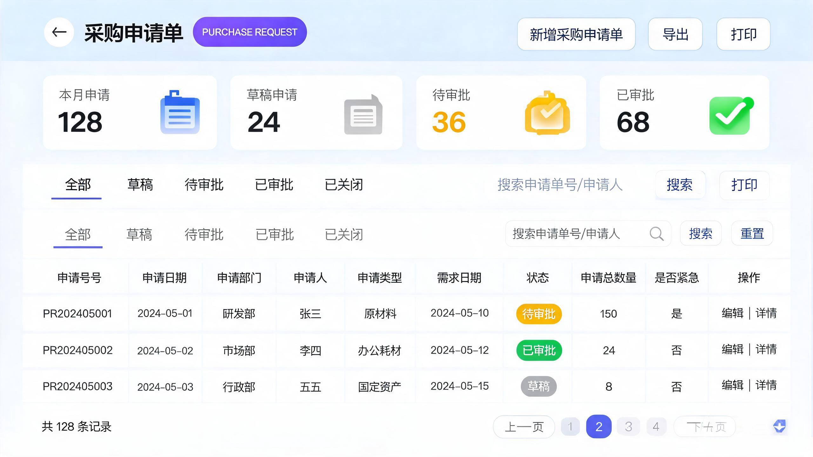
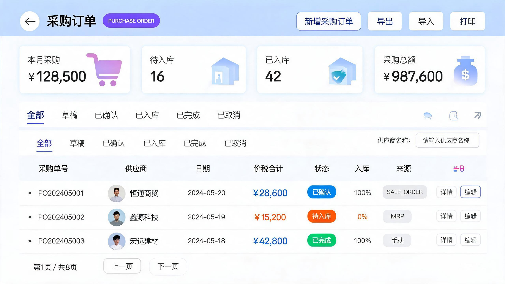
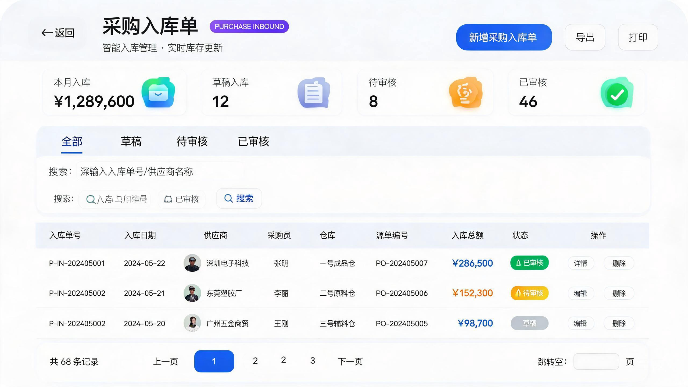
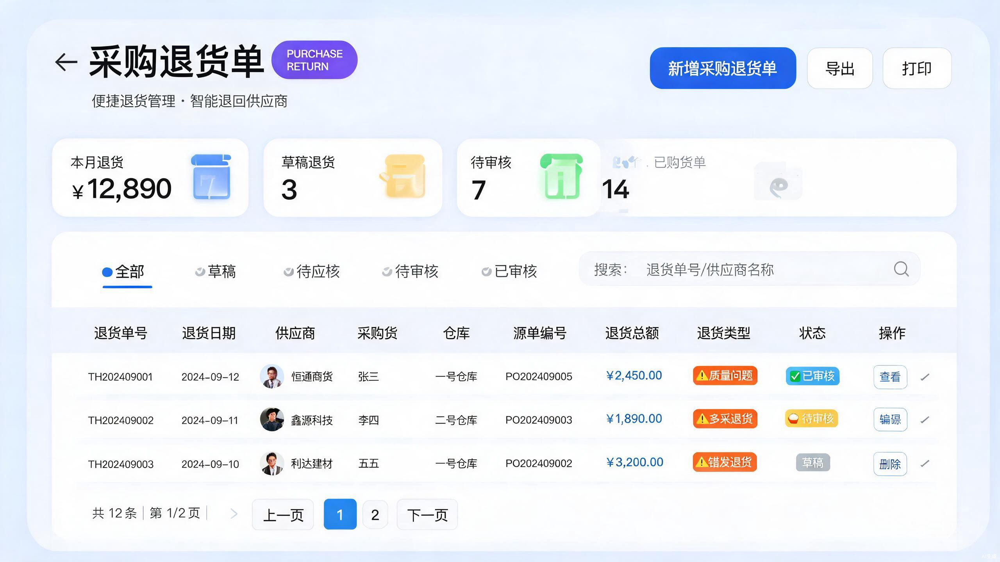
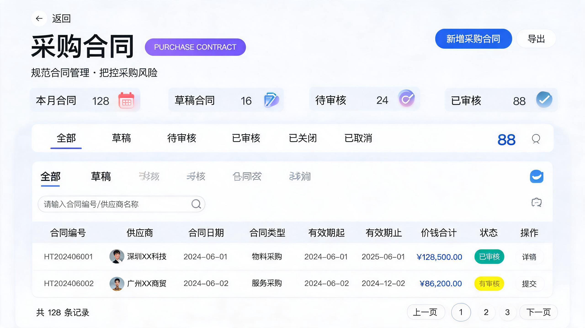
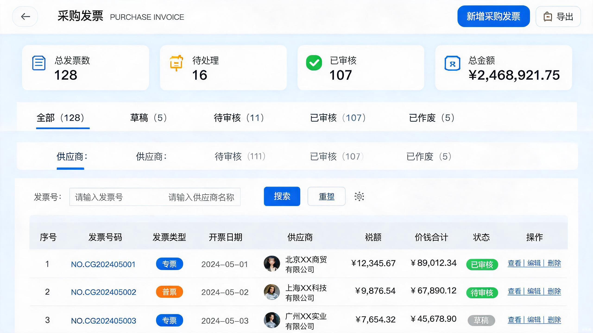

# 采购管理模块操作手册

> 本手册适用于智能 ERP 系统「采购管理」模块，涵盖采购申请、采购订单、采购入库、采购退货、采购合同、采购发票六大子模块。手册从功能说明、界面描述、操作步骤、业务流程、注意事项五个维度进行详细说明，帮助采购员、采购主管、仓储人员及财务人员快速掌握系统的日常操作。

---

## 目录

1. [模块总览](#一模块总览)
2. [采购申请](#二采购申请)
3. [采购订单](#三采购订单)
4. [采购入库](#四采购入库)
5. [采购退货](#五采购退货)
6. [采购合同](#六采购合同)
7. [采购发票](#七采购发票)
8. [业务流程与下推关系](#八业务流程与下推关系)
9. [通用操作说明](#九通用操作说明)
10. [常见问题与注意事项](#十常见问题与注意事项)

---

## 一、模块总览

采购管理模块是 ERP 系统的核心业务模块之一，负责企业从采购需求提出、询价比价、合同签订、订单下达、到货入库到发票核对的采购全流程管理。模块以「单据流转」为主线，通过下推机制实现单据之间的数据传递，避免重复录入，保证采购数据的一致性、可追溯性与财务准确性。

### 1.1 子模块构成

| 子模块 | 单据类型代码 | 主要功能 |
| --- | --- | --- |
| 采购申请 | PURCHASE_REQUEST | 提出采购需求，规范采购源头 |
| 采购订单 | PURCHASE_ORDER | 向供应商下达正式采购订单 |
| 采购入库 | PURCHASE_INBOUND | 处理到货验收入库，增加库存 |
| 采购退货 | PURCHASE_RETURN | 处理不合格品退回供应商 |
| 采购合同 | PURCHASE_CONTRACT | 管理采购合同与框架协议 |
| 采购发票 | PURCHASE_INVOICE | 登记采购发票，税务与应付核算 |

### 1.2 单据状态体系

采购模块所有单据遵循统一的状态机管理，主要状态如下：

| 状态 | 含义 | 可执行操作 |
| --- | --- | --- |
| 草稿 | 新建未提交，可编辑 | 保存、提交、编辑、删除、取消、作废 |
| 待审核 | 已提交待审批，不可编辑 | 审核、驳回 |
| 已生效 | 审核通过，生效中 | 重置草稿、结案、下推、复制、打印 |
| 已关闭 | 业务完结或手动结案 | 反结案 |
| 已取消 | 业务终止 | — |
| 已作废 | 单据作废，不参与业务 | 反作废 |

> 说明：每张单据同时维护「单据状态」与「审核状态」两个维度，审核状态包含「待审核 / 已生效 / 已取消」。只有处于「已生效」状态的单据才允许下推生成下游单据。

### 1.3 通用界面布局

采购模块各子模块的列表页与编辑页采用统一的设计风格，便于用户快速上手。

**列表页通用结构：**
- **页面头部**：返回按钮、页面标题（含英文标识徽章）、副标题说明、新增 / 打印 / 导出操作按钮。
- **数据概览卡片**：四张统计卡片，展示本月新增、草稿、待审核、已生效数量，支持悬停高亮。
- **搜索栏**：左侧状态切换 Tab（全部 / 草稿 / 待审核 / 已生效 / 已关闭），右侧关键字搜索框、搜索 / 重置按钮、列设置入口。
- **数据表格**：支持多选、序号、单据编号链接、供应商头像、金额右对齐、状态彩色标签、审核状态标签、操作列。
- **分页区**：显示总记录数，支持每页 20/50/100 条切换、页码跳转。

**编辑页通用结构：**
- **页面头部**：返回列表按钮、单据标题、单据编号、状态标签、保存 / 提交 / 下推 / 更多操作按钮。
- **基本信息卡片**（可折叠）：分「单据信息 / 供应商信息 / 交易信息 / 自定义字段 / 其他」分区展示表头字段。
- **商品明细卡片**（可折叠）：明细表格，支持从物料库选择、添加明细、列设置、行删除，底部展示金额汇总。
- **附件资料卡片**（可折叠）：文件上传组件。
- **审核流转卡片**（可折叠）：以时间线形式展示「创建 → 提交审核 → 审核通过 → 结案」流转节点。
- **底部操作按钮区**：统一的 BillActions 组件，按当前状态动态显示可用操作。

---

## 二、采购申请

### 2.1 功能说明

采购申请单用于各部门提出采购需求，是采购业务的源头单据。采购申请经审核后可下推生成采购订单，实现「需求 → 采购」的规范化管理，避免无序采购和重复采购。

**核心能力：**
- 录入采购需求明细，自动计算金额、税额、价税合计。
- 支持需求日期、建议供应商、建议仓库等需求信息管理。
- 支持多币种与本位币折算。
- 支持来源单据追溯（如生产订单、销售订单触发的采购需求）。
- 支持附件上传、操作日志、打印预览。
- 支持自定义字段扩展（表头与明细）。

### 2.2 界面描述



**列表页（PurchaseRequestList）：**
- 顶部标题「采购申请 PURCHASE REQUEST」，副标题「规范采购源头 · 提升采购效率」。
- 右上角操作区：新增采购申请（蓝色渐变主按钮）、打印、导出。
- 四张统计卡片：本月申请、草稿申请、待审核、已生效。
- 状态 Tab：全部 / 草稿 / 待审核 / 已生效 / 已关闭，每个 Tab 显示对应数量。
- 搜索框：支持输入「申请单号 / 供应商名称」搜索，回车即查。
- 表格列：选择框、序号、申请单号（可点击跳转编辑）、申请日期、供应商（带首字母头像）、申请人、申请金额（¥格式）、税率（%）、价税合计（紫色加粗）、状态（彩色圆点+标签）、审核状态、操作列。
- 分页：共 N 条记录，支持页码与每页条数切换。

**编辑页（PurchaseRequestEdit）：**
- 顶部显示「新增采购申请」或「采购申请 + 单据编号 + 状态标签」。
- 草稿态显示「保存」「提交审核」按钮；已生效态显示「下推」按钮；更多操作下拉包含审核、取消申请单、操作日志、打印。
- **基本信息卡片**分为四个分区：
  - 单据信息：申请单号（保存后自动生成）、申请日期（必填）、需求日期、建议交货日期。
  - 供应商信息：建议供应商（可选，选择后自动带出编号、简称、联系人、电话、收货地址）、供应商编号、供应商简称、联系人、联系电话、收货地址。
  - 交易信息：申请人（必填）、申请部门、币种（必填）、汇率、付款条件、结算方式、建议仓库。
  - 其他：备注（多行文本）。
  - 自定义字段区：根据系统配置动态显示。
- **商品明细卡片**：标题显示「商品明细 共 N 行」，右侧提供「从物料库选择」「添加明细」按钮。明细表格列含图片、物料、规格、单位、数量、单价、税率%、金额、税额、价税合计、需求日期、建议供应商、操作（删除）。底部金额汇总区展示合计数量、合计金额、合计税额、价税合计，以及本位币折算信息。
- **附件资料卡片**：支持上传图片、PDF、Word、Excel 等文件，下推时附件会带到后续单据。
- **审核流转卡片**：时间线展示「创建申请 → 提交审核 → 审核通过」。

### 2.3 操作步骤

#### 2.3.1 新增采购申请

1. 进入「采购管理 → 采购申请」列表页。
2. 点击右上角「新增采购申请」按钮，进入编辑页。
3. 在「基本信息」卡片中填写：
   - 选择「申请日期」（必填，默认当天）。
   - 按需填写「需求日期」「建议交货日期」。
   - 选择「建议供应商」（可选），系统自动带出供应商编号、简称、联系人、联系电话、收货地址。
   - 选择「申请人」（必填）、「申请部门」、「币种」（必填），系统自动带出汇率。
   - 按需选择「付款条件」「结算方式」「建议仓库」。
4. 在「商品明细」卡片中添加明细，可选择以下方式：
   - **从物料库选择**：点击按钮打开物料选择弹窗，支持按编码 / 名称 / 规格搜索与按分类筛选，勾选后点击「确认添加」。
   - **添加明细**：直接在表格行内选择物料，系统自动带出规格、单位、采购单价、税率。
5. 在明细行中填写「数量」「单价」「税率」，系统自动计算金额、税额、价税合计。
6. 按需填写明细行的「需求日期」「建议供应商」。
7. 在「金额汇总」区核对合计金额。
8. 在「其他」分区填写「备注」（可选）。
9. 在「附件资料」卡片上传相关附件（可选）。
10. 点击顶部「保存」按钮保存为草稿，或点击「提交审核」直接提交进入审核流程。

#### 2.3.2 编辑采购申请

1. 在列表页点击「申请单号」链接，或在操作列点击「编辑」。
2. 仅「草稿」状态的采购申请可编辑，其他状态字段只读。
3. 修改所需字段后点击「保存」。

#### 2.3.3 删除采购申请

1. 在列表页操作列点击「删除」。
2. 仅「草稿」状态的采购申请可删除，已在审核流程或已生效的单据不可删除。
3. 在确认弹窗中点击「确定」完成删除。

#### 2.3.4 提交审核

1. 在编辑页点击「提交审核」，或在列表页操作菜单选择「提交」。
2. 系统弹出确认框「确认提交采购申请 XXX 进行审核?」。
3. 点击「确定」，单据状态变为「待审核」，不可再编辑。

#### 2.3.5 审核 / 驳回

1. 在列表页或编辑页的「更多操作」下拉中选择「审核」。
2. 系统提示「确认审核采购申请 XXX? 审核后不可修改」。
3. 点击「确定」完成审核，状态变为「已生效」，可执行下推操作。
4. 如需驳回，在「更多操作」中选择「驳回」，填写驳回原因后确认。

#### 2.3.6 取消 / 作废 / 重置草稿

- **取消申请单**：草稿态在「更多操作」中选择「取消申请单」，填写取消原因后确认。
- **作废**：通过底部 BillActions 按钮区的「作废」操作，填写作废原因。
- **重置草稿**：已生效单据可通过「重置草稿」回退到待审核状态（需有相应权限）。

#### 2.3.7 搜索与筛选

- **关键字搜索**：在搜索框输入「申请单号 / 供应商名称」，点击「搜索」或回车查询。
- **状态筛选**：点击状态 Tab（全部 / 草稿 / 待审核 / 已生效 / 已关闭）快速过滤。
- **重置**：点击「重置」按钮清空搜索条件并重新加载。
- **列设置**：点击搜索栏右侧的齿轮按钮，在抽屉中自定义显示 / 隐藏表格列。

#### 2.3.8 打印

1. 在列表页勾选一行采购申请，点击「打印」按钮（一次仅支持打印一张）。
2. 或在编辑页「更多操作」中选择「打印」。
3. 系统弹出打印预览对话框，支持预览后打印。

#### 2.3.9 导出

1. 在列表页点击「导出」按钮。
2. 系统按当前查询条件导出采购申请数据为 Excel 文件。

#### 2.3.10 下推生成下游单据

1. 打开一张「已生效」的采购申请。
2. 顶部出现「下推」按钮，点击后选择目标单据类型（采购订单）。
3. 在下推界面勾选要带走的明细行与数量，确认后自动生成下游单据并带入供应商、物料、价格等信息。

### 2.4 业务流程说明

采购申请的业务流程：**采购需求提出 → 录入采购申请单 → 保存草稿 → 提交审核 → 审核通过 → 下推采购订单 → 申请单关闭**。

采购申请审核后即可作为源头单据向下游流转，下推时明细行可部分携带（按数量分次下推），便于一张申请单对应多笔订单的场景。

### 2.5 注意事项

- 采购申请单号在保存后由系统按编码规则自动生成，不可手动修改。
- 选择建议供应商后会自动带出该供应商的联系人、电话、收货地址，请核对后再保存。
- 已生效的采购申请不可直接修改，如需调整应先「重置草稿」回到待审核或驳回至草稿。
- 建议在申请阶段填写准确的需求日期，便于后续采购计划与到货跟踪。
- 外币申请会按汇率自动折算本位币金额，请确认汇率准确。

---

## 三、采购订单

### 3.1 功能说明

采购订单是向供应商下达的正式采购单据，是采购业务的核心凭证，也是后续入库、开票、付款的重要依据。采购订单可由采购申请下推生成，也可手工创建，审核后可下推生成采购入库单、采购发票。

**核心能力：**
- 录入采购明细，自动计算金额、税额、价税合计、折扣。
- 支持多币种、价格等级调价、整单折扣、预付管理。
- 支持运输方式、仓库、收货地址等物流信息管理。
- 支持来源单据追溯（来源单号、来源行号）。
- 支持 Excel 批量导入、模板下载。
- 支持结案 / 反结案管理订单生命周期。
- 支持自定义字段扩展。

### 3.2 界面描述



**列表页（PurchaseOrderList）：**
- 顶部标题「采购订单 PURCHASE ORDER」，副标题「高效管理采购全流程 · 实时追踪订单状态」。
- 操作区：新增订单、打印、导出。
- 四张统计卡片：本月订单、草稿订单、待审核、已生效。
- 表格列：订单编号（可点击跳转）、单据日期、供应商（带头像）、采购员、合计金额、折扣额（橙色）、价税合计（紫色加粗）、状态、审核状态、审计列、操作列。
- 支持批量打印、Excel 导入（列表页含导入弹窗，提供模板下载、文件上传、导入结果统计）。

**编辑页（PurchaseOrderEdit）：**
- 顶部状态标签含「已结案」标识（结案后显示）。
- **基本信息卡片**分区：
  - 单据信息：订单编号（自动生成）、订单日期（必填）、交货日期。
  - 供应商信息：供应商（必填）、供应商编号、供应商简称、联系人、联系电话、收货地址。
  - 交易信息：采购员（必填）、币种（必填）、汇率、付款条件、运输方式（快递 / 物流 / 自提 / 空运 / 海运）、仓库（必填）、价格等级、整单折扣。
  - 其他：备注。
- **商品明细卡片**：明细表格增加「来源单号」「来源行号」列，来源单号可点击跳转至源头单据。顶部提供「选单」按钮（从采购申请下推）、「从物料库选择」「添加明细」按钮。
- **金额汇总区**：展示合计数量、折前金额、折扣金额、合计税额、价税合计、本位币折算、预付信息（预付金额、付款方式：现金 / 银行转账 / 支付宝 / 微信支付）。
- **审核流转卡片**：时间线含「创建订单 → 提交审核 → 审核通过 → 订单结案」。
- **更多操作下拉**：选单、审核、驳回、重置草稿、结案、反结案、作废、反作废、取消订单、删除、复制、操作日志、打印。

### 3.3 操作步骤

#### 3.3.1 新增订单

1. 进入「采购管理 → 采购订单」列表页，点击「新增订单」。
2. 填写基本信息：选择供应商（必填，自动带出供应商编号、联系人、收货地址、默认采购员、付款条件、币种、价格等级）、采购员（必填）、币种（必填）、仓库（必填）、运输方式、交货日期。
3. 添加商品明细：通过「选单」从采购申请带入、「从物料库选择」或「添加明细」手工添加。
4. 填写数量、单价、税率、折扣率，系统自动计算金额与价税合计。
5. 在金额汇总区填写预付金额与付款方式（可选）。
6. 填写备注，上传附件（可选）。
7. 点击「保存」存为草稿，或「提交」直接进入审核流程。

#### 3.3.2 通过选单从采购申请下推

1. 在编辑页（草稿态）点击「选单」按钮。
2. 在弹出的来源单据选择界面中，选择一张或多张已生效的采购申请。
3. 勾选要带入的明细行与数量，确认后明细自动填入，并记录「来源单号」「来源行号」。

#### 3.3.3 批量导入订单

1. 在列表页打开「导入」弹窗。
2. 第一步：点击「下载采购订单导入模板」，获取 Excel 模板。
3. 按模板格式填写数据（支持 .xlsx / .xls / .csv，大小不超过 10MB）。
4. 第二步：将文件拖入上传区或点击选择文件。
5. 点击「开始导入」，系统显示导入结果统计（总记录数 / 成功 / 失败）。
6. 若有失败记录，弹窗展示错误详情（行号、字段、错误信息），可修正后重新导入。

#### 3.3.4 编辑 / 删除

- 编辑：仅草稿态可编辑，修改后点击「保存」。
- 删除：仅草稿态可删除，在操作列点击「删除」并确认。

#### 3.3.5 提交 / 审核 / 驳回 / 重置草稿

- **提交**：编辑页点击「提交」，确认后状态变为「待审核」。
- **审核**：更多操作中选择「审核」，确认后状态变为「已生效」，可下推入库 / 开票。
- **驳回**：更多操作中选择「驳回」，填写驳回原因，单据回到草稿态可继续修改。
- **重置草稿**：已生效单据可通过「重置草稿」回退到待审核（需权限）。

#### 3.3.6 结案 / 反结案

- **结案**：已生效订单业务完结后，通过「更多操作 → 结案」结束订单，状态标签显示「已结案」，不再参与下推。
- **反结案**：误结案或需继续业务时，通过「反结案」恢复到已生效态。

#### 3.3.7 取消 / 作废 / 复制

- **取消订单**：草稿态在更多操作中选择「取消订单」，填写取消原因。
- **作废 / 反作废**：通过底部按钮区操作，作废后单据不参与业务，可反作废恢复。
- **复制**：通过「复制」基于现有订单快速生成一张新的草稿订单，常用于重复采购场景。

#### 3.3.8 搜索 / 筛选 / 列设置 / 打印 / 导出

操作方式与采购申请一致：关键字搜索（订单号 / 供应商名称）、状态 Tab 切换、列设置抽屉、勾选单行打印、导出 Excel。

### 3.4 业务流程说明

采购订单业务流程：**采购申请下推或手工新增 → 保存草稿 → 提交审核 → 审核通过 → 下推采购入库单 / 采购发票 → 全部入库后结案**。

订单是连接前端申请与后端入库的枢纽，审核后才能下推入库与开票。订单的结案标志整个履约完成。

### 3.5 注意事项

- 仓库为必填项，请根据实际入库所在的仓库选择。
- 关联采购申请后，明细行的来源单号会自动记录，便于追溯。
- 已生效的订单不能直接修改，如需变更应先重置草稿回到草稿。
- 订单结案后将不能再下推入库单，请确认所有入库业务完成后再结案。
- 批量导入时请严格按模板格式填写，否则会因校验失败导致导入失败。

---

## 四、采购入库

### 4.1 功能说明

采购入库单用于记录供应商到货验收后入库的业务，是采购业务的关键履约单据。入库单审核后会扣减采购订单的未入库数量、增加仓库库存、生成库存流水，并可作为下游单据下推生成采购发票。入库单可由采购订单下推生成，也可手工创建。

**核心能力：**
- 录入入库明细，自动计算金额、税额、价税合计。
- 支持批次号、生产日期、有效期至等批次与效期管理。
- 支持仓库、库位、收货人、验收人等仓储信息管理。
- 支持来源单据追溯（来源单号、来源行号）。
- 审核后自动增加库存、生成库存流水、更新订单未入库数量。
- 支持附件上传、操作日志、打印预览。
- 支持自定义字段扩展。

### 4.2 界面描述



**列表页（PurchaseInboundList）：**
- 顶部标题「采购入库 PURCHASE INBOUND」，副标题「到货验收 · 库存自动增加」。
- 操作区：新增入库单、打印、导出。
- 四张统计卡片：本月入库、草稿入库、待审核、已生效。
- 状态 Tab：全部 / 草稿 / 待审核 / 已生效 / 已关闭。
- 表格列：入库编号（可点击跳转）、入库日期、供应商（带头像）、采购员、仓库、入库数量、入库金额、状态、审核状态、操作列。

**编辑页（PurchaseInboundEdit）：**
- 顶部显示「新增采购入库」或「采购入库 + 单据编号 + 状态标签」。
- 草稿态显示「保存」「提交审核」按钮；已生效态显示「下推」按钮。
- **基本信息卡片**分区：
  - 单据信息：入库编号（自动生成）、入库日期（必填）、验收人。
  - 供应商信息：供应商（必填）、供应商编号、供应商简称、联系人、联系电话。
  - 交易信息：采购员（必填）、币种（必填）、汇率、仓库（必填）、库位、收货人、运输方式、车牌号。
  - 其他：备注。
- **商品明细卡片**：明细表格列含物料、规格、单位、数量、单价、税率%、金额、税额、价税合计、批次号、生产日期、有效期至、来源单号、来源行号、操作（删除）。顶部提供「选单」按钮（从采购订单下推）、「从物料库选择」「添加明细」按钮。
- **金额汇总区**：展示合计数量、合计金额、合计税额、价税合计、本位币折算信息。
- **审核流转卡片**：时间线含「创建入库 → 提交审核 → 审核通过 → 入库结案」。
- **更多操作下拉**：选单、审核、驳回、重置草稿、结案、反结案、作废、反作废、取消入库单、删除、操作日志、打印。

### 4.3 操作步骤

#### 4.3.1 新增入库单

1. 进入「采购管理 → 采购入库」列表页，点击「新增入库单」。
2. 填写基本信息：选择供应商（必填）、采购员（必填）、币种（必填）、仓库（必填）、入库日期（必填）、验收人。
3. 添加商品明细：通过「选单」从采购订单带入、「从物料库选择」或「添加明细」手工添加。
4. 填写数量、单价、税率，系统自动计算金额与价税合计。
5. 若物料启用批次 / 效期管理，填写「批次号」「生产日期」，系统自动计算「有效期至」。
6. 填写备注，上传附件（可选）。
7. 点击「保存」存为草稿，或「提交」直接进入审核流程。

#### 4.3.2 通过选单从采购订单下推

1. 在编辑页（草稿态）点击「选单」按钮。
2. 在弹窗中选择一张或多张已生效的采购订单。
3. 勾选要带入的明细行与数量，确认后明细自动填入，并记录「来源单号」「来源行号」。

#### 4.3.3 编辑 / 删除

- 编辑：仅草稿态可编辑，修改后点击「保存」。
- 删除：仅草稿态可删除，在操作列点击「删除」并确认。

#### 4.3.4 提交 / 审核 / 驳回 / 重置草稿

- **提交**：编辑页点击「提交」，确认后状态变为「待审核」。
- **审核**：更多操作中选择「审核」，审核通过后系统自动增加库存、生成库存流水、更新采购订单的未入库数量。
- **驳回**：更多操作中选择「驳回」，填写驳回原因，单据回到草稿态。
- **重置草稿**：已生效单据可通过「重置草稿」回退到待审核（需权限），重置草稿会自动回退已增加的库存与库存流水。

#### 4.3.5 结案 / 反结案

- **结案**：已生效入库单业务完结后，通过「更多操作 → 结案」结束入库单。
- **反结案**：误结案或需继续业务时，通过「反结案」恢复到已生效态。

#### 4.3.6 取消 / 作废

- **取消入库单**：草稿态在更多操作中选择「取消入库单」，填写取消原因。
- **作废 / 反作废**：通过底部按钮区操作，作废后会回退已增加的库存与库存流水，可反作废恢复。

#### 4.3.7 搜索 / 筛选 / 列设置 / 打印 / 导出

操作方式与采购申请一致：关键字搜索（入库单号 / 供应商名称）、状态 Tab 切换、列设置抽屉、勾选单行打印、导出 Excel。

### 4.4 业务流程说明

采购入库业务流程：**采购订单下推或手工新增 → 到货验收 → 录入入库明细 → 保存草稿 → 提交审核 → 审核通过（增加库存、生成流水、更新订单数量）→ 下推采购发票 → 入库单结案**。

入库单是采购履约的核心节点，审核即代表实物入库完成，库存与财务数据同步更新。

### 4.5 注意事项

- 仓库为必填项，请根据实际入库所在的仓库选择。
- 启用批次 / 效期管理的物料，批次号与生产日期为必填项，否则无法审核通过。
- 入库数量不能超过来源采购订单的未入库数量（如系统启用了数量校验）。
- 已生效的入库单不能直接修改，如需变更应先重置草稿回到草稿。
- 入库单审核后会增加库存，请确保实物已验收合格后再审核。
- 作废已生效的入库单会自动回退库存，请谨慎操作。

---

## 五、采购退货

### 5.1 功能说明

采购退货单用于处理验收不合格或后续发现质量问题的物料退回供应商的业务，是采购业务的逆向流转单据。退货单审核后会扣减仓库库存、生成库存流水，并可作为下游单据下推生成采购发票（红字）或应付冲销。退货单可由采购入库单下推生成，也可手工创建。

**核心能力：**
- 录入退货明细，自动计算金额、税额、价税合计。
- 支持退货原因、责任归属等退货信息管理。
- 支持仓库、库位、退回人等仓储信息管理。
- 支持来源单据追溯（来源单号、来源行号，常来源于采购入库）。
- 审核后自动扣减库存、生成库存流水、更新入库单已退货数量。
- 支持附件上传、操作日志、打印预览。
- 支持自定义字段扩展。

### 5.2 界面描述



**列表页（PurchaseReturnList）：**
- 顶部标题「采购退货 PURCHASE RETURN」，副标题「逆向退货处理 · 库存自动扣减」。
- 操作区：新增退货单、打印、导出。
- 四张统计卡片：本月退货、草稿退货、待审核、已生效。
- 状态 Tab：全部 / 草稿 / 待审核 / 已生效 / 已关闭。
- 表格列：退货编号（可点击跳转）、退货日期、供应商（带头像）、采购员、仓库、退货数量、退货金额、状态、审核状态、操作列。

**编辑页（PurchaseReturnEdit）：**
- 顶部显示「新增采购退货」或「采购退货 + 单据编号 + 状态标签」。
- 草稿态显示「保存」「提交审核」按钮；已生效态显示「下推」按钮。
- **基本信息卡片**分区：
  - 单据信息：退货编号（自动生成）、退货日期（必填）、退货人。
  - 供应商信息：供应商（必填）、供应商编号、供应商简称、联系人、联系电话。
  - 交易信息：采购员（必填）、币种（必填）、汇率、仓库（必填）、库位、运输方式、退货原因（必填，下拉选择：质量不合格 / 规格不符 / 多收 / 损坏 / 其他）、责任归属。
  - 其他：备注。
- **商品明细卡片**：明细表格列含物料、规格、单位、数量、单价、税率%、金额、税额、价税合计、批次号、来源单号、来源行号、操作（删除）。顶部提供「选单」按钮（从采购入库下推）、「从物料库选择」「添加明细」按钮。
- **金额汇总区**：展示合计数量、合计金额、合计税额、价税合计、本位币折算信息。
- **审核流转卡片**：时间线含「创建退货 → 提交审核 → 审核通过 → 退货结案」。
- **更多操作下拉**：选单、审核、驳回、重置草稿、结案、反结案、作废、反作废、取消退货单、删除、操作日志、打印。

### 5.3 操作步骤

#### 5.3.1 新增退货单

1. 进入「采购管理 → 采购退货」列表页，点击「新增退货单」。
2. 填写基本信息：选择供应商（必填）、采购员（必填）、币种（必填）、仓库（必填）、退货日期（必填）、退货人、退货原因（必填）。
3. 添加商品明细：通过「选单」从采购入库带入、「从物料库选择」或「添加明细」手工添加。
4. 填写退货数量、单价、税率，系统自动计算金额与价税合计。
5. 填写备注，上传附件（可选）。
6. 点击「保存」存为草稿，或「提交」直接进入审核流程。

#### 5.3.2 通过选单从采购入库下推

1. 在编辑页（草稿态）点击「选单」按钮。
2. 在弹窗中选择一张或多张已生效的采购入库单。
3. 勾选要带入的明细行与退货数量，确认后明细自动填入，并记录「来源单号」「来源行号」。

#### 5.3.3 编辑 / 删除

- 编辑：仅草稿态可编辑，修改后点击「保存」。
- 删除：仅草稿态可删除，在操作列点击「删除」并确认。

#### 5.3.4 提交 / 审核 / 驳回 / 重置草稿

- **提交**：编辑页点击「提交」，确认后状态变为「待审核」。
- **审核**：更多操作中选择「审核」，审核通过后系统自动扣减库存、生成库存流水、更新采购入库单的已退货数量。
- **驳回**：更多操作中选择「驳回」，填写驳回原因，单据回到草稿态。
- **重置草稿**：已生效单据可通过「重置草稿」回退到待审核（需权限），重置草稿会自动回退已扣减的库存与库存流水。

#### 5.3.5 结案 / 反结案

- **结案**：已生效退货单业务完结后，通过「更多操作 → 结案」结束退货单。
- **反结案**：误结案或需继续业务时，通过「反结案」恢复到已生效态。

#### 5.3.6 取消 / 作废

- **取消退货单**：草稿态在更多操作中选择「取消退货单」，填写取消原因。
- **作废 / 反作废**：通过底部按钮区操作，作废后会回退已扣减的库存与库存流水，可反作废恢复。

#### 5.3.7 搜索 / 筛选 / 列设置 / 打印 / 导出

操作方式与采购申请一致：关键字搜索（退货单号 / 供应商名称）、状态 Tab 切换、列设置抽屉、勾选单行打印、导出 Excel。

### 5.4 业务流程说明

采购退货业务流程：**采购入库下推或手工新增 → 验收不合格 → 录入退货明细 → 保存草稿 → 提交审核 → 审核通过（扣减库存、生成流水、更新入库单退货数量）→ 下推采购发票（红字）→ 退货单结案**。

退货单是采购逆向流转的核心节点，审核即代表实物退回完成，库存与财务数据同步更新。

### 5.5 注意事项

- 仓库为必填项，请根据实际退货所在的仓库选择。
- 退货数量不能超过来源采购入库单的可退货数量（如系统启用了数量校验）。
- 退货原因为必填项，请如实选择以便后续质量分析与责任追溯。
- 已生效的退货单不能直接修改，如需变更应先重置草稿回到草稿。
- 退货单审核后会扣减库存，请确保实物已退回后再审核。
- 作废已生效的退货单会自动回退库存扣减，请谨慎操作。

---

## 六、采购合同

### 6.1 功能说明

采购合同用于管理与供应商签订的采购合同与框架协议，是采购业务的契约性单据。合同可手工创建，也可由采购申请或采购订单下推生成。合同审核后可作为源头单据下推生成采购订单，实现「合同 → 订单」的契约化采购管理。

**核心能力：**
- 录入合同明细，自动计算金额、税额、价税合计。
- 支持合同编号、合同名称、合同类型、签订日期、生效日期、到期日期等合同信息管理。
- 支持多币种与本位币折算。
- 支持合同金额、累计执行金额、剩余金额等执行情况跟踪。
- 支持附件上传（合同扫描件等）、操作日志、打印预览。
- 支持自定义字段扩展。

### 6.2 界面描述



**列表页（PurchaseContractList）：**
- 顶部标题「采购合同 PURCHASE CONTRACT」，副标题「契约化采购管理 · 合同执行全程跟踪」。
- 操作区：新增合同、打印、导出。
- 四张统计卡片：本月合同、草稿合同、待审核、已生效。
- 状态 Tab：全部 / 草稿 / 待审核 / 已生效 / 已关闭。
- 表格列：合同编号（可点击跳转）、合同名称、合同类型、签订日期、供应商（带头像）、合同金额、累计执行、剩余金额、状态、审核状态、操作列。

**编辑页（PurchaseContractEdit）：**
- 顶部显示「新增采购合同」或「采购合同 + 合同编号 + 状态标签」。
- 草稿态显示「保存」「提交审核」按钮；已生效态显示「下推」按钮；更多操作下拉包含选单、审核、取消合同、操作日志、打印。
- **基本信息卡片**分区：
  - 单据信息：合同号（保存后自动生成）、合同名称（必填）、合同类型（框架协议 / 一次性合同 / 长期合同 / 临时合同）、签订日期（必填）、生效日期、到期日期。
  - 供应商信息：供应商（必填）、供应商编号、供应商简称、联系人、联系电话、收货地址。
  - 交易信息：采购员（必填）、币种（必填）、汇率、付款条件、结算方式、整单折扣。
  - 其他：备注。
  - 自定义字段区：根据系统配置动态显示。
- **商品明细卡片**：明细表格列含物料、规格、单位、数量、单价、税率%、金额、税额、价税合计、操作（删除）。顶部提供「从物料库选择」「添加明细」按钮。
- **金额汇总区**：展示合计数量、合计金额、合计税额、价税合计、本位币折算信息。
- **附件资料卡片**：支持上传合同扫描件、补充协议等文件。
- **审核流转卡片**：时间线含「创建合同 → 提交审核 → 审核通过 → 合同结案」。

### 6.3 操作步骤

#### 6.3.1 新增合同

1. 进入「采购管理 → 采购合同」列表页，点击「新增合同」。
2. 填写基本信息：选择供应商（必填）、采购员（必填）、币种（必填）、合同名称（必填）、合同类型、签订日期（必填）、生效日期、到期日期。
3. 添加商品明细：通过「从物料库选择」或「添加明细」手工添加。
4. 填写数量、单价、税率，系统自动计算金额与价税合计。
5. 在「附件资料」卡片上传合同扫描件（推荐）。
6. 填写备注（可选）。
7. 点击「保存」存为草稿，或「提交」直接进入审核流程。

#### 6.3.2 编辑 / 删除

- 编辑：仅草稿态可编辑，修改后点击「保存」。
- 删除：仅草稿态可删除，在操作列点击「删除」并确认。

#### 6.3.3 提交 / 审核 / 驳回 / 重置草稿

- **提交**：编辑页点击「提交审核」，确认后状态变为「待审核」。
- **审核**：更多操作中选择「审核」，确认后状态变为「已生效」，可下推采购订单。
- **驳回**：更多操作中选择「驳回」，填写驳回原因，单据回到草稿态。
- **重置草稿**：已生效单据可通过「重置草稿」回退到待审核（需权限）。

#### 6.3.4 取消 / 作废

- **取消合同**：草稿态在更多操作中选择「取消合同」，填写取消原因。
- **作废 / 反作废**：通过底部按钮区操作，作废后合同不参与业务，可反作废恢复。

#### 6.3.5 搜索 / 筛选 / 列设置 / 打印 / 导出

操作方式与采购申请一致：关键字搜索（合同号 / 供应商名称 / 合同名称）、状态 Tab 切换、列设置抽屉、勾选单行打印、导出 Excel。

#### 6.3.6 下推生成下游单据

1. 打开一张「已生效」的采购合同。
2. 顶部出现「下推」按钮，点击后选择目标单据类型（采购订单）。
3. 在下推界面勾选要带走的明细行与数量，确认后自动生成采购订单并带入供应商、物料、价格等信息。

### 6.4 业务流程说明

采购合同业务流程：**合同谈判 → 录入采购合同 → 保存草稿 → 提交审核 → 审核通过 → 下推采购订单 → 合同执行跟踪 → 合同结案**。

合同是契约化采购的核心，审核后可作为源头单据向下游流转，下推时明细行可部分携带（按数量分次下推），便于一份合同对应多笔订单的场景。

### 6.5 注意事项

- 合同号在保存后由系统按编码规则自动生成，不可手动修改。
- 合同名称为必填项，请填写完整准确的合同名称便于检索。
- 建议上传合同扫描件作为附件，便于后续查阅与归档。
- 合同的生效日期与到期日期用于控制合同的有效期，到期后建议手动「关闭」。
- 已生效的合同不可直接修改，如需变更应先「重置草稿」回到待审核或驳回至草稿。
- 合同执行情况（累计执行金额、剩余金额）由系统根据下推的采购订单自动汇总，无需手工维护。

---

## 七、采购发票

### 7.1 功能说明

采购发票用于登记供应商开具的采购发票，是采购业务与财务核算的衔接单据。发票可由采购入库单、采购订单下推生成，也可手工创建。发票审核后会生成应付账款、更新税务核算数据，实现「采购 → 入库 → 开票 → 付款」的财务闭环。

**核心能力：**
- 录入发票明细，自动计算金额、税额、价税合计。
- 支持专票 / 普票 / 电子发票等发票类型管理。
- 支持发票号、开票日期、税率等发票信息管理。
- 支持多币种与本位币折算。
- 支持来源单据追溯（来源单号、来源行号，常来源于采购入库或采购订单）。
- 审核后自动生成应付账款、更新税务核算数据。
- 支持附件上传（发票照片 / 电子发票文件）、操作日志、打印预览。
- 支持自定义字段扩展。

### 7.2 界面描述



**列表页（PurchaseInvoiceList）：**
- 顶部标题「采购发票 PURCHASE INVOICE」，副标题「精准发票管理 · 智能税务核算」。
- 操作区：新增采购发票、导出。
- 四张统计卡片：本月发票、草稿发票、待审核、已生效。
- 状态 Tab：全部 / 草稿 / 待审核 / 已生效 / 已作废。
- 搜索框：支持输入「发票号 / 供应商名称」搜索，回车即查。
- 表格列：序号、发票号（可点击跳转编辑）、发票类型（专票 / 普票标签）、发票日期、供应商（带头像）、税额、价税合计、状态、审核状态、操作列。
- 分页：共 N 条记录，支持页码与每页条数切换。

**编辑页（PurchaseInvoiceEdit）：**
- 顶部显示「新增采购发票」或「采购发票 + 发票号 + 状态标签」。
- 草稿态显示「保存」「提交审核」按钮；已生效态显示「下推」按钮；更多操作下拉包含选单、审核、取消发票、操作日志、打印。
- **基本信息卡片**分区：
  - 单据信息：发票号（必填）、发票类型（必填，专票 / 普票 / 电子发票）、发票代码、开票日期（必填）、发票日期。
  - 供应商信息：供应商（必填）、供应商编号、供应商简称、联系人、联系电话。
  - 交易信息：采购员（必填）、币种（必填）、汇率、税率（必填）、付款条件、结算方式。
  - 其他：备注。
  - 自定义字段区：根据系统配置动态显示。
- **商品明细卡片**：明细表格列含物料、规格、单位、数量、单价、税率%、金额、税额、价税合计、来源单号、来源行号、操作（删除）。顶部提供「选单」按钮（从采购入库 / 采购订单下推）、「从物料库选择」「添加明细」按钮。
- **金额汇总区**：展示合计数量、合计金额、合计税额、价税合计、本位币折算信息。
- **附件资料卡片**：支持上传发票照片、电子发票文件。
- **审核流转卡片**：时间线含「创建发票 → 提交审核 → 审核通过」。

### 7.3 操作步骤

#### 7.3.1 新增发票

1. 进入「采购管理 → 采购发票」列表页，点击「新增采购发票」。
2. 填写基本信息：填写发票号（必填）、选择发票类型（必填）、开票日期（必填）、选择供应商（必填）、采购员（必填）、币种（必填）、税率（必填）。
3. 添加商品明细：通过「选单」从采购入库 / 采购订单带入、「从物料库选择」或「添加明细」手工添加。
4. 填写数量、单价、税率，系统自动计算金额、税额、价税合计。
5. 在「附件资料」卡片上传发票照片或电子发票文件（推荐）。
6. 填写备注（可选）。
7. 点击「保存」存为草稿，或「提交」直接进入审核流程。

#### 7.3.2 通过选单从入库 / 订单下推

1. 在编辑页（草稿态）点击「选单」按钮。
2. 在弹窗中选择一张或多张已生效的采购入库单或采购订单。
3. 勾选要带入的明细行与数量，确认后明细自动填入，并记录「来源单号」「来源行号」。

#### 7.3.3 编辑 / 删除

- 编辑：仅草稿态可编辑，修改后点击「保存」。
- 删除：仅草稿态可删除，在操作列点击「删除」并确认。

#### 7.3.4 提交 / 审核 / 驳回 / 重置草稿

- **提交**：编辑页点击「提交审核」，确认后状态变为「待审核」。
- **审核**：更多操作中选择「审核」，审核通过后系统自动生成应付账款、更新税务核算数据。
- **驳回**：更多操作中选择「驳回」，填写驳回原因，单据回到草稿态。
- **重置草稿**：已生效单据可通过「重置草稿」回退到待审核（需权限），重置草稿会自动回退已生成的应付账款与税务数据。

#### 7.3.5 取消 / 作废

- **取消发票**：草稿态在更多操作中选择「取消发票」，填写取消原因。
- **作废 / 反作废**：通过底部按钮区操作，作废后会回退已生成的应付账款与税务数据，可反作废恢复。

#### 7.3.6 搜索 / 筛选 / 列设置 / 打印 / 导出

操作方式与采购申请一致：关键字搜索（发票号 / 供应商名称）、状态 Tab 切换、列设置抽屉、勾选单行打印、导出 Excel。

### 7.4 业务流程说明

采购发票业务流程：**采购入库 / 订单下推或手工新增 → 收到供应商发票 → 录入发票明细 → 保存草稿 → 提交审核 → 审核通过（生成应付账款、更新税务数据）→ 财务付款 → 发票结案**。

发票是采购与财务的衔接节点，审核即代表发票核销完成，应付账款与税务数据同步更新。

### 7.5 注意事项

- 发票号为必填项，请准确填写供应商开具的发票号码。
- 发票类型为必填项，专票与普票的税务处理方式不同，请如实选择。
- 建议上传发票照片或电子发票文件作为附件，便于后续查阅与归档。
- 已生效的发票不能直接修改，如需变更应先重置草稿回到草稿。
- 发票审核后会生成应付账款，请确保发票信息准确后再审核。
- 作废已生效的发票会自动回退应付账款与税务数据，请谨慎操作。
- 发票的金额、税额应与供应商开具的纸质 / 电子发票一致，避免税务风险。

---

## 八、业务流程与下推关系

### 8.1 整体业务流程

采购模块的整体业务流程遵循「需求 → 订单 → 入库 → 开票 → 付款」的主线，各单据之间通过下推机制实现数据传递与状态联动。

**正向流程：**
```
采购申请 → 采购订单 → 采购入库 → 采购发票 → 应付账款
                                    ↑
                            采购合同（可选，契约源头）
```

**逆向流程：**
```
采购入库 → 采购退货 → 采购发票（红字）→ 应付冲销
```

### 8.2 下推关系矩阵

| 源单据 | 目标单据 | 下推条件 | 携带数据 |
| --- | --- | --- | --- |
| 采购申请 | 采购订单 | 源单已生效 | 供应商、物料、数量、单价、税率、需求日期 |
| 采购合同 | 采购订单 | 源单已生效 | 供应商、物料、数量、单价、税率、合同号 |
| 采购订单 | 采购入库 | 源单已生效 | 供应商、物料、数量、单价、税率、仓库、批次 |
| 采购订单 | 采购发票 | 源单已生效 | 供应商、物料、数量、单价、税率、订单号 |
| 采购入库 | 采购发票 | 源单已生效 | 供应商、物料、数量、单价、税率、入库单号 |
| 采购入库 | 采购退货 | 源单已生效 | 供应商、物料、数量、单价、税率、仓库、批次 |

### 8.3 业务联动说明

- **采购申请 → 采购订单**：申请单审核后可下推生成订单，下推时按数量分次携带，便于一张申请对应多笔订单。
- **采购订单 → 采购入库**：订单审核后可下推生成入库单，入库单审核后自动更新订单的已入库数量与未入库数量。
- **采购订单 → 采购发票**：订单审核后可下推生成发票，发票审核后自动生成应付账款。
- **采购入库 → 采购发票**：入库单审核后可下推生成发票，发票金额通常与入库金额一致。
- **采购入库 → 采购退货**：入库单审核后可下推生成退货单，退货单审核后自动扣减库存、更新入库单的已退货数量。
- **采购合同 → 采购订单**：合同审核后可下推生成订单，系统自动累计合同的执行金额与剩余金额。

### 8.4 库存与财务影响

| 单据 | 审核 | 重置草稿 | 作废 |
| --- | --- | --- | --- |
| 采购入库 | 增加库存、生成库存流水、更新订单数量 | 回退库存与库存流水 | 回退库存与库存流水 |
| 采购退货 | 扣减库存、生成库存流水、更新入库退货数量 | 回退库存扣减 | 回退库存扣减 |
| 采购发票 | 生成应付账款、更新税务数据 | 回退应付账款与税务数据 | 回退应付账款与税务数据 |

---

## 九、通用操作说明

### 9.1 通用按钮说明

采购模块所有单据共用一套通用按钮组件（BillActions / BillRowActions），按钮的可见性与可用性由当前单据状态决定。

| 按钮 | 适用状态 | 说明 |
| --- | --- | --- |
| 保存 | 草稿 | 保存为草稿，宽松校验，允许必填项为空 |
| 提交 | 草稿 | 提交进入审核流程，完整校验必填项 |
| 审核 | 待审核 | 审核通过，单据生效 |
| 驳回 | 待审核 | 驳回至草稿，需填写驳回原因 |
| 重置草稿 | 已生效 | 回退至待审核（需权限） |
| 结案 | 已生效 | 结束单据生命周期 |
| 反结案 | 已结案 | 恢复至已生效 |
| 作废 | 已生效 | 作废单据，需填写作废原因 |
| 反作废 | 已作废 | 恢复至作废前状态 |
| 删除 | 草稿 | 删除单据 |
| 下推 | 已生效 | 下推生成下游单据 |
| 选单 | 草稿 | 选择上游单据带入明细 |
| 复制 | 已生效 | 基于现有单据复制生成新草稿 |
| 打印 | 所有状态 | 打印预览 |
| 操作日志 | 所有状态 | 查看单据操作记录 |

### 9.2 状态机说明

采购模块统一的状态机如下：

```
草稿(0) → 提交 → 待审核(1) → 审核 → 已生效(2)
                                  ↓
                              重置草稿 → 待审核(1)
                                  ↓
                              结案 → 已结案
                                  ↓
                              反结案 → 已生效(2)
                                  ↓
                              作废 → 已作废(7)
                                  ↓
                              反作废 → 已生效(2)
```

**双终态**：已结案、已作废。两者均不可修改 / 编辑 / 删除 / 提交 / 审核 / 重置草稿 / 作废 / 关闭，仅允许对应的反操作。

### 9.3 草稿保存说明

- **保存**按钮仅存为草稿，宽松校验，允许必填项为空。
- **提交**按钮进入审批流程，完整校验必填项与业务规则，无需先保存。
- 草稿状态的单据可随时编辑、删除。
- 已生效及以上状态的单据不可直接修改，必须先「重置草稿 → 草稿」才能编辑字段。

### 9.4 列设置说明

- 列设置面板通过 JavaScript 动态计算位置，跟随页面滚动自适应调整。
- 列设置面板宽度自适应（320~380px），不使用固定宽度。
- 列设置面板无遮罩层，打开时仍可操作页面其他元素。
- 列设置面板支持点击外部 / ESC 键 / 关闭按钮三种关闭方式。
- 列设置不锁定页面滚动。
- 列设置功能统一使用 ColumnSettingDrawer 组件，所有页面自动生效。

### 9.5 搜索与筛选说明

- **关键字搜索**：在搜索框输入单据编号或供应商名称，点击「搜索」或回车查询。
- **状态筛选**：点击状态 Tab（全部 / 草稿 / 待审核 / 已生效 / 已关闭 / 已作废）快速过滤。
- **重置**：点击「重置」按钮清空搜索条件并重新加载。
- **列设置**：点击搜索栏右侧的齿轮按钮，在抽屉中自定义显示 / 隐藏表格列。

### 9.6 打印与导出说明

- **打印**：在列表页勾选一行单据，点击「打印」按钮（一次仅支持打印一张）；或在编辑页「更多操作」中选择「打印」，系统弹出打印预览对话框。
- **导出**：在列表页点击「导出」按钮，系统按当前查询条件导出数据为 Excel 文件。

### 9.7 附件上传说明

- 支持上传图片（JPG / PNG / GIF）、PDF、Word、Excel 等常见文件格式。
- 单个文件大小不超过 10MB。
- 附件在单据下推时会自动带到后续单据。
- 已上传的附件可预览、下载、删除。

### 9.8 操作日志说明

- 在编辑页「更多操作」中选择「操作日志」可查看单据的完整操作记录。
- 日志包含操作时间、操作人、操作类型、操作内容、备注等信息。
- 日志按时间倒序展示，便于追溯单据流转过程。

---

## 十、常见问题与注意事项

### 10.1 常见问题

**Q1：为什么无法编辑已生效的采购订单？**
A：已生效状态的单据不可直接修改。如需调整，请先通过「更多操作 → 重置草稿」回到待审核或「驳回」至草稿状态，再进行编辑。

**Q2：采购入库单审核后库存没有增加？**
A：请确认：
1. 入库单的仓库字段已正确填写。
2. 入库单状态已变为「已生效」。
3. 检查库存流水记录是否已生成。
4. 若仍未增加，请联系系统管理员检查库存服务是否正常。

**Q3：采购订单下推采购入库时提示「无可用明细」？**
A：可能是该订单的所有明细已全部入库。请在采购订单编辑页查看明细行的「已入库数量」与「未入库数量」，未入库数量为 0 的明细不可再下推。

**Q4：采购退货单审核后提示库存不足？**
A：退货单审核会扣减库存，若当前仓库的库存不足以扣减（且系统启用了不允许负库存的配置），审核会失败。请先确认仓库有足够库存，或调整仓库后重试。

**Q5：采购发票的金额与入库金额不一致怎么办？**
A：采购发票的金额可以与入库金额不一致（例如供应商分批开票或合并开票）。请根据实际收到的发票金额录入，系统会以发票金额为准生成应付账款。

**Q6：作废已生效的入库单后库存没有回退？**
A：请确认：
1. 入库单状态已变为「已作废」。
2. 检查库存流水记录是否有回退记录。
3. 若仍未回退，请联系系统管理员检查库存服务是否正常。

**Q7：批量导入采购订单失败怎么办？**
A：请检查：
1. 文件格式是否为 .xlsx / .xls / .csv，大小是否超过 10MB。
2. 数据是否严格按模板格式填写（必填项是否为空、数据类型是否正确）。
3. 导入结果弹窗会显示失败记录的行号、字段、错误信息，可根据提示修正后重新导入。

**Q8：采购合同的执行金额为什么没有更新？**
A：合同的累计执行金额由系统根据下推生成的采购订单自动汇总。请确认：
1. 采购订单是通过合同「下推」生成的（而非手工新建）。
2. 采购订单已生效。
3. 若仍未更新，请联系系统管理员检查合同执行统计服务是否正常。

### 10.2 注意事项

- **单据编号**：所有采购单据的编号在保存后由系统按编码规则自动生成，不可手动修改。
- **必填项**：提交审核时系统会校验必填项，请确保供应商、日期、币种、仓库、明细等必填项已填写完整。
- **批次与效期**：启用批次 / 效期管理的物料，入库时批次号与生产日期为必填项，否则无法审核通过。
- **状态联动**：已生效单据的下推、库存、财务影响是自动联动的，请确保操作前已确认业务准确性。
- **作废谨慎**：作废已生效的单据会自动回退库存与财务数据，请谨慎操作，避免影响业务数据准确性。
- **权限控制**：审核、重置草稿、作废、反作废等操作需要相应权限，无权限时按钮会自动隐藏。
- **外币处理**：外币单据会按汇率自动折算本位币金额，请确认汇率准确。
- **附件管理**：建议上传合同扫描件、发票照片等附件，便于后续查阅与归档。
- **数据备份**：批量操作前建议先导出数据备份，避免误操作导致数据丢失。
- **并发操作**：多人同时操作同一单据时，后保存者会覆盖前者的修改，建议避免并发编辑同一单据。

---

> 本手册基于智能 ERP 系统当前版本编写，如系统升级后界面或功能有变化，请以系统实际表现为准。如有疑问请联系系统管理员或参考系统内置帮助文档。
