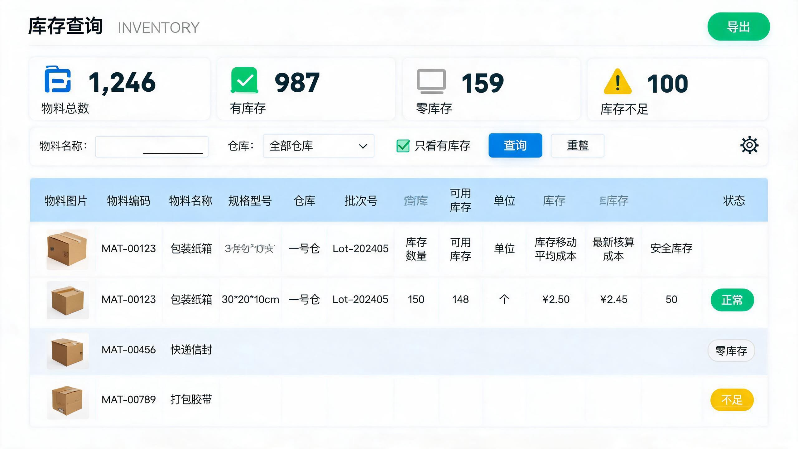
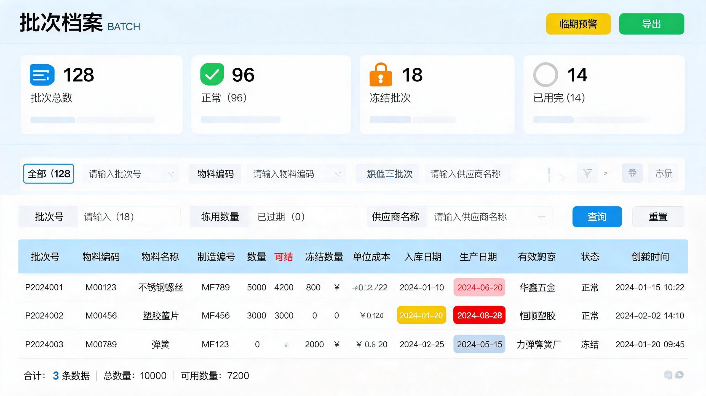
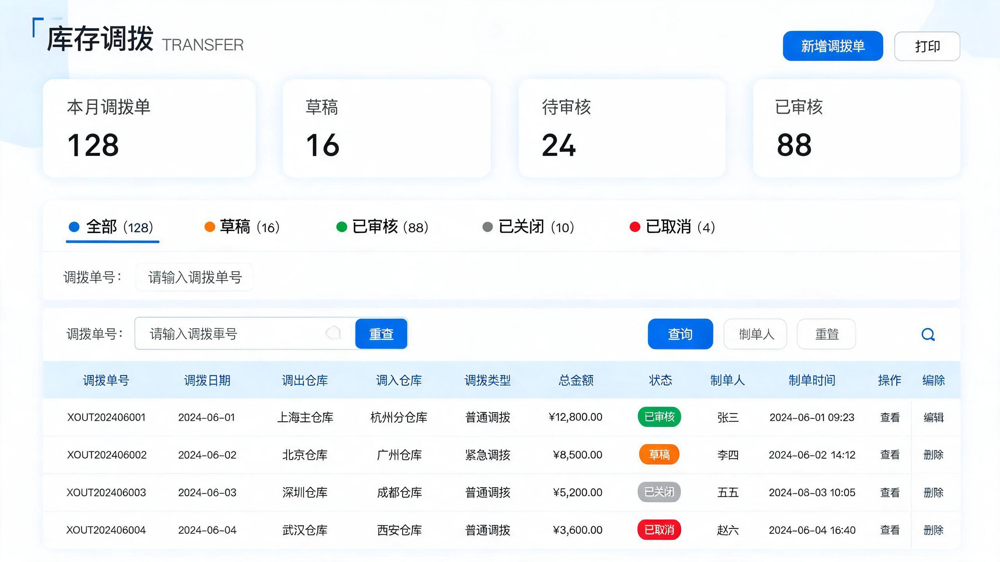
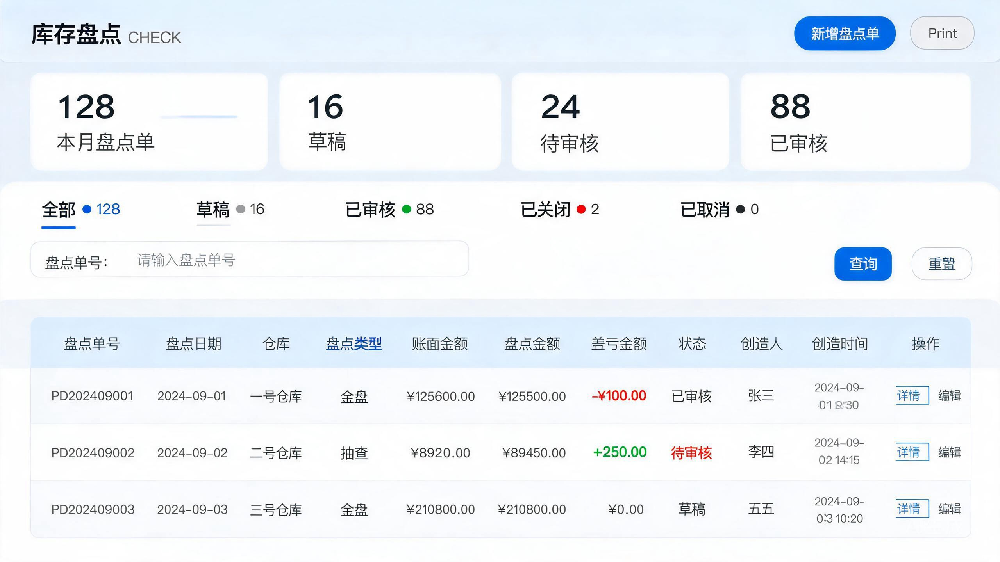
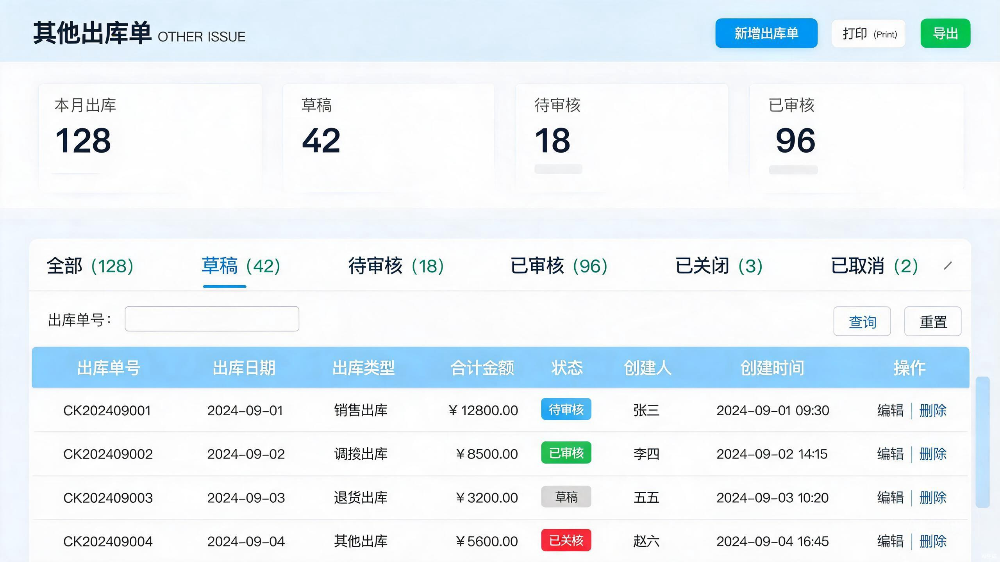
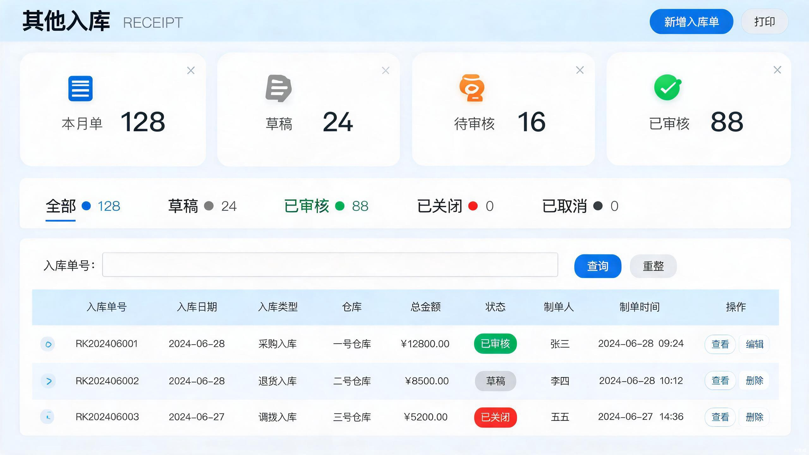
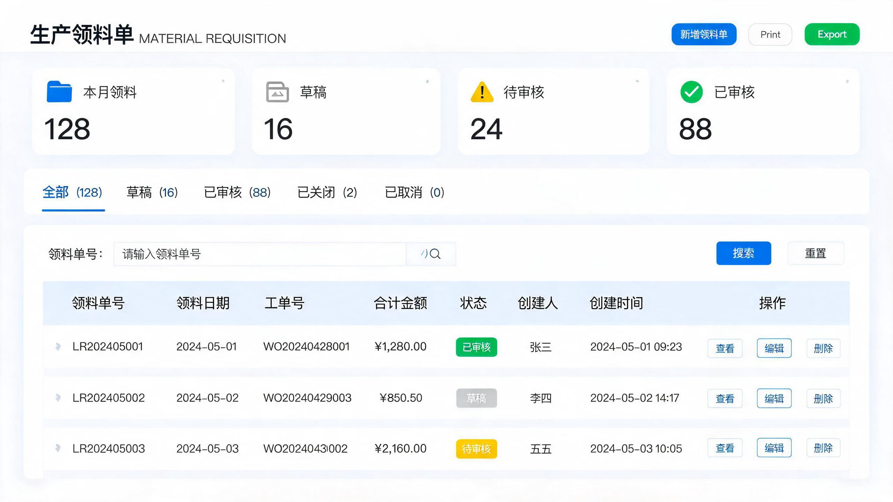
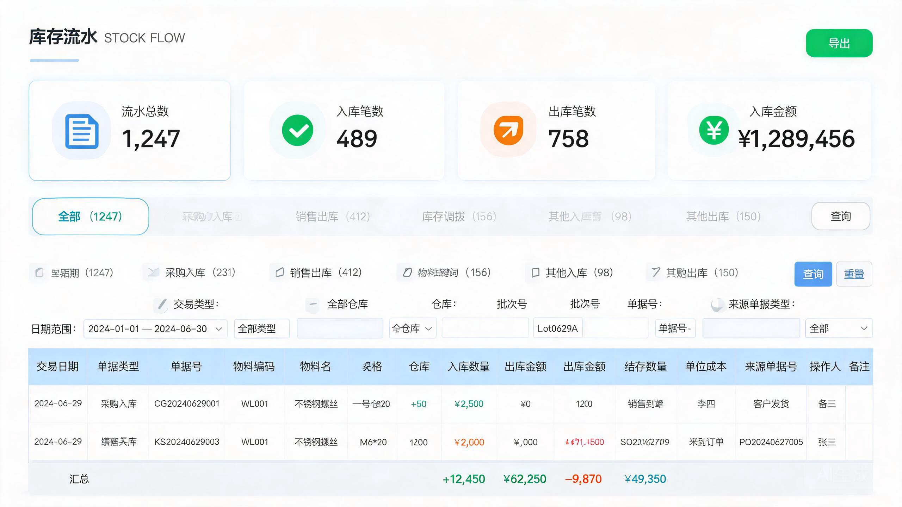

# 库存管理模块操作手册

> 模块代号：INVENTORY
> 适用版本：智能 ERP 系统
> 文档目的：指导用户使用库存管理模块的各个子功能，包括库存查询、批次管理、库存调拨、库存盘点、其他出库、其他入库、生产领料单以及库存流水。

---

## 目录

1. [模块概述](#1-模块概述)
2. [库存查询（InventoryList）](#2-库存查询inventorylist)
3. [批次管理（BatchList）](#3-批次管理batchlist)
4. [库存调拨（StockTransferList / StockTransferEdit）](#4-库存调拨stocktransferlist--stocktransferedit)
5. [库存盘点（StockCheckList / StockCheckEdit）](#5-库存盘点stockchecklist--stockcheckedit)
6. [其他出库（OtherIssueList / OtherIssueEdit）](#6-其他出库otherissuelist--otherissueedit)
7. [其他入库（OtherReceiptList / OtherReceiptEdit）](#7-其他入库otherreceiptlist--otherreceiptedit)
8. [生产领料单（MaterialRequisitionList / MaterialRequisitionEdit）](#8-生产领料单materialrequisitionlist--materialrequisitionedit)
9. [库存流水（StockFlowList）](#9-库存流水stockflowlist)
10. [通用功能与约定](#10-通用功能与约定)

---

## 1. 模块概述

库存管理模块是 ERP 系统的核心业务模块之一，承担物资从入库到出库全生命周期的库存账务管理职责。本模块以"实时库存"为中心，向上承接采购入库、生产入库、其他入库等业务产生的库存增加，向下衔接销售出库、生产领料、其他出库等业务产生的库存减少，并通过库存调拨、库存盘点实现库存的内部调整与账实校准。

### 1.1 模块功能架构

| 子模块 | 核心职责 | 单据性质 |
| --- | --- | --- |
| 库存查询 | 实时展示各仓库/批次的库存数量、可用量、成本与安全库存状态 | 查询类（无单据） |
| 批次管理 | 维护物料批次档案，记录批次入库、生产、有效期信息，提供临期预警 | 查询类（无单据） |
| 库存调拨 | 跨仓库物资转移，支持同价/异价调拨，审核后即时影响库存 | 业务单据（带审批流程） |
| 库存盘点 | 定期清查库存，比对账面与实际数量，生成盘盈盘亏数据 | 业务单据（带审批流程） |
| 其他出库 | 处理非销售/生产类的出库业务（如报废、样品、损耗等） | 业务单据（带审批流程） |
| 其他入库 | 处理非采购/生产类的入库业务（如赠品、归还、盘盈等） | 业务单据（带审批流程） |
| 生产领料单 | 管理生产工单的物料领用，追踪工单物料消耗 | 业务单据（带审批流程） |
| 库存流水 | 全链路记录每一笔库存变动，支持出入库追溯 | 查询类（系统自动生成） |

### 1.2 单据状态流转约定

本模块的业务单据（库存调拨、库存盘点、其他出库、其他入库、生产领料单）均采用统一的状态机管理，常见状态包括：

- **草稿**：单据新建或保存后的初始状态，可编辑、可删除、可取消。
- **待审核**：草稿单据"提交审核"后进入此状态，等待有审核权限的用户处理。
- **已生效**：审核通过后的状态，此时单据已落地库存影响（出库扣减、入库增加、调拨双仓变动、盘点盈亏调整等），不可再编辑，但可重置草稿或关闭。
- **已关闭**：已生效单据完成业务闭环后关闭，停止后续操作。
- **已取消**：单据作废，不再参与业务流程。

> 重置草稿（部分单据支持）会将"已生效"单据回退至"待审核"状态，并冲销此前产生的库存影响。

### 1.3 进入方式

在系统左侧导航菜单中点击「库存管理」即可进入模块首页，再通过首页卡片或子菜单进入各子模块。每个子模块页面左上角均提供「返回」按钮，可回到库存管理首页。

---

## 2. 库存查询（InventoryList）

### 2.1 功能说明

库存查询是库存管理模块的入口功能，用于实时监控各仓库物料的库存状态。页面汇总展示物料总数、有库存、零库存、库存不足四项关键指标，并支持按物料编码/名称、仓库筛选，以及"只看有库存"快速过滤，方便用户第一时间掌握库存健康度。

该页面为纯查询页面，**不提供新增、编辑、删除等单据操作**，但提供数据导出能力，便于线下分析与对账。

### 2.2 界面描述

页面自上而下分为四个区域：

1. **页面标题栏**：左侧显示"库存查询 INVENTORY"标题及副标题"实时监控库存状态 · 智能预警库存不足"，右侧提供「导出」按钮（绿色）。
2. **数据概览卡片**：四张统计卡片横向排列，分别展示：
   - 物料总数（紫色图标）
   - 有库存（绿色图标）
   - 零库存（橙色图标）
   - 库存不足（红色图标，统计库存数量低于安全库存的物料数）
3. **搜索筛选区**：右侧排列搜索条件，包括：
   - 物料编码/名称输入框（支持回车查询）
   - 仓库下拉选择（可搜索）
   - "只看有库存"复选框
   - 「查询」「重置」按钮
   - 列设置按钮（齿轮图标）
4. **数据表格区**：展示库存明细，包含物料图片、物料编码、物料名称、规格型号、仓库、批次号、库存数量、可用库存、单位、库存移动平均成本、最新核算成本、安全库存、状态等列。状态列以彩色圆点+标签形式展示（正常-绿色、零库存-橙色、不足-红色、未知-蓝色）。表格底部显示总记录数与分页器。

### 2.3 操作步骤

#### 2.3.1 查询库存

1. 在「物料编码/名称」输入框中输入关键字（支持模糊匹配），或在「仓库」下拉中选择目标仓库。
2. 如仅需查看有库存的物料，勾选「只看有库存」复选框。
3. 点击「查询」按钮（或在输入框中按回车键）执行查询。
4. 表格区域刷新结果，统计卡片同步更新。

#### 2.3.2 重置筛选

点击「重置」按钮，清空所有筛选条件并重新加载全部数据。

#### 2.3.3 导出库存

1. 点击页面右上角「导出」按钮（绿色）。
2. 系统调用后端导出接口生成文件，弹出"导出成功"提示后，文件自动下载到本地。

#### 2.3.4 列设置

1. 点击搜索区右侧的齿轮图标按钮，打开列设置抽屉。
2. 在抽屉中勾选或取消勾选需要显示的列（物料编码、物料名称、规格型号、仓库、批次号、单位）。
3. 关闭抽屉后，表格按新设置刷新列显示。设置按页面维度持久化保存。

### 2.4 注意事项

- 库存数量、可用库存、单位成本均保留 4 位小数，确保精密物料计量精度。
- "库存不足"状态以物料档案中维护的「安全库存」为判定依据，若未维护安全库存则不会判定为不足。
- 列设置仅控制列的显隐，不影响数据本身。
- 该页面数据为实时快照，不保留历史库存状态。

---

## 3. 批次管理（BatchList）

### 3.1 功能说明

批次管理用于全程追溯物料批次信息，覆盖批次号、物料编码、制造编号、数量、可用/冻结数量、单位成本、入库日期、生产日期、有效期至、供应商等关键字段，并提供临期预警功能，帮助用户及时处理即将到期的批次库存。

页面提供状态分类 Tab 切换（全部/正常/冻结/已用完/已过期），并支持按批次号、物料编码/名称、供应商名称进行搜索。

### 3.2 界面描述

页面自上而下分为四个区域：

1. **页面标题栏**：左侧显示"批次档案 BATCH"标题及副标题"全程追溯物料批次 · 智能预警临期库存"，右侧提供「临期预警」按钮（橙色）和「导出」按钮（绿色）。
2. **数据概览卡片**：四张统计卡片横向排列：
   - 批次总数（紫色图标）
   - 正常批次（绿色图标）
   - 冻结批次（橙色图标）
   - 已用完（蓝色图标）
3. **状态 Tab 与搜索区**：
   - 状态 Tab：全部、正常、冻结、已用完、已过期，每个 Tab 右侧带数量徽标。
   - 搜索区：批次号、物料编码/名称、供应商名称三个输入框，配「查询」「重置」按钮和列设置齿轮按钮。
4. **数据表格区**：列含批次号（带链接图标）、物料编码、物料名称、制造编号、数量、可用数量（绿色）、冻结数量（橙色）、单位成本（带¥）、入库日期、生产日期、有效期至（彩色标签，按剩余天数变色）、供应商、状态（彩色圆点+标签）、创建时间。表格底部显示合计行（数量、可用数量、冻结数量汇总）及分页器。

### 3.3 操作步骤

#### 3.3.1 按状态筛选

1. 在状态 Tab 区域点击目标状态（如「冻结」）。
2. 表格自动按所选状态过滤数据并刷新，统计卡片同步更新。

#### 3.3.2 按条件搜索

1. 在「批次号」「物料编码/名称」「供应商名称」任一或多个输入框中输入关键字。
2. 点击「查询」按钮（或在输入框按回车）执行搜索。
3. 点击「重置」可清空所有条件并恢复至"全部"状态。

#### 3.3.3 临期预警

1. 点击页面右上角「临期预警」按钮（橙色）。
2. 系统弹出"临期预警（30天内到期）"对话框，列出所有 30 天内到期的批次。
3. 对话框表格展示批次号、物料编码、物料名称、库存数量、到期日期、剩余天数（剩余 ≤7 天显示红色，其余显示橙色）。
4. 查看完毕后点击「关闭」按钮关闭对话框。
5. 若 30 天内无临期批次，系统将提示"30天内无临期批次"。

#### 3.3.4 导出

点击「导出」按钮导出批次档案数据（注：当前版本导出功能开发中，可使用浏览器打印或后端导出接口作为替代）。

### 3.4 注意事项

- 有效期至列以彩色标签呈现：已过期为红色，7 天内到期为橙色，30 天内到期为橙色，30 天以上为绿色。
- 批次状态由系统根据库存与有效期自动维护，正常/冻结/已用完/已过期。
- 表格底部合计行仅汇总数量、可用数量、冻结数量三列。
- 临期预警默认查询 30 天内到期的批次，如需更短周期，请联系管理员调整接口参数。

---

## 4. 库存调拨（StockTransferList / StockTransferEdit）

### 4.1 功能说明

库存调拨用于跨仓库物资转移业务，支持「同价调拨」（调拨前后成本不变）和「异价调拨」（调拨时重新定价）两种类型。调拨单审核通过后，系统自动执行"调出仓库扣减库存 + 调入仓库增加库存"，并同步生成库存流水记录。

调拨单带完整审批流程，支持新增、编辑、提交审核、审核、重置草稿、关闭、取消、删除、打印、选单等操作。

### 4.2 界面描述

#### 4.2.1 调拨单列表

1. **页面标题栏**：左侧"库存调拨 TRANSFER"标题及副标题"跨仓库物资转移 · 支持同价/异价调拨"，右侧「新增调拨单」按钮（蓝色）和「打印」按钮（灰色，需先勾选行）。
2. **数据概览卡片**：本月调拨单、草稿、待审核、已生效四项。
3. **状态 Tab**：全部、草稿、已生效、已关闭、已取消，每个 Tab 带彩色圆点与数量徽标。
4. **搜索区**：调拨单号输入框，配「查询」「重置」按钮与列设置齿轮按钮。
5. **数据表格区**：列含选择框、序号、调拨单号（蓝色链接，可点击进入编辑）、调拨日期、调出仓库、调入仓库、调拨类型、总金额、状态（彩色圆点+标签）、制单人、制单时间、审计列，以及右侧固定的操作列（查看/编辑/删除按钮，按状态动态显示）。

#### 4.2.2 调拨单编辑

新增/编辑页面采用上下两段式布局：

- **顶部标题栏**：显示「库存调拨单」或「新增库存调拨单」标题、调拨单号、审批状态标签。右侧操作区根据状态显示「保存」「提交审核」按钮，以及「更多操作」下拉菜单（含选单、审核、重置草稿、关闭、取消单据、删除、打印、操作日志等）。
- **基本信息卡片**（可折叠）：分「单据信息」「仓库信息」「交易信息」「其他（备注）」四个分区。
  - 单据信息：调拨单号（保存后自动生成）、调拨日期、调拨类型（同价/异价）、经办人。
  - 仓库信息：调出仓库、调入仓库、币种、汇率。
  - 交易信息：折前金额、折扣金额、合计税额、价税合计（均为系统自动计算，只读）。
- **调拨明细卡片**（可折叠）：明细表格，列含序号、图片、物料（下拉选择，支持搜索）、规格、单位、数量、单价、税率%、折扣率%、折扣额、金额、税额、价税合计、成本、批次号、调出货位、调入货位、来源单号、来源行号等。表头提供「选单」「从物料库选择」「添加明细」按钮。

### 4.3 操作步骤

#### 4.3.1 新增调拨单

1. 在列表页点击右上角「新增调拨单」按钮，进入编辑页面。
2. 在「基本信息」卡片填写：
   - 调拨日期（必填）
   - 调拨类型（必填，选「同价调拨」或「异价调拨」）
   - 经办人（选填）
   - 调出仓库、调入仓库（均为必填，且不能相同）
   - 币种（必填）、汇率
3. 在「调拨明细」卡片添加明细行：
   - 点击「添加明细」手动新增一行；或点击「从物料库选择」从物料档案中批量选择物料；或点击「选单」从上游单据（如采购入库单）引入。
   - 在每行选择物料、输入数量、单价、税率、折扣率等，系统自动计算金额、税额、价税合计。
   - 可填写批次号、调出货位、调入货位，实现精细化库位管理。
4. 在「其他」分区填写备注（选填）。
5. 点击顶部「保存」按钮，系统保存单据并自动生成调拨单号，单据状态为"草稿"。

#### 4.3.2 提交审核

1. 在编辑页（草稿状态）点击顶部「提交审核」按钮。
2. 单据状态由"草稿"变为"待审核"，等待有审核权限的用户处理。

#### 4.3.3 审核调拨单

1. 在列表页找到"待审核"状态的调拨单，点击单号进入编辑页。
2. 点击「更多操作」→「审核」。
3. 系统弹出确认框，提示"审核调拨单后将执行：调出仓库扣减库存 + 调入仓库增加库存"，确认后单据变为"已生效"。

#### 4.3.4 重置草稿

1. 对"已生效"状态的单据，点击「更多操作」→「重置草稿」。
2. 确认后单据回到"待审核"状态，并冲销此前产生的库存影响。

#### 4.3.5 关闭/取消

- **关闭**：对"已生效"单据，点击「更多操作」→「关闭」，在弹窗中输入关闭原因，单据变为"已关闭"。
- **取消**：对"草稿"单据，点击「更多操作」→「取消单据」，输入取消原因，单据变为"已取消"。

#### 4.3.6 编辑与删除

- **编辑**：在列表页点击调拨单号或操作列「编辑」按钮，可对"草稿"状态单据进行修改。"已生效"及以上状态不可编辑。
- **删除**：在操作列点击「删除」按钮（仅"草稿"状态可见），确认后删除单据。

#### 4.3.7 打印

1. 在列表页勾选要打印的调拨单（一次仅可勾选一行）。
2. 点击「打印」按钮，弹出打印预览对话框。
3. 在预览对话框中确认内容后执行打印。也可在编辑页通过「更多操作」→「打印」直接打印当前单据。

#### 4.3.8 搜索

在列表页「调拨单号」输入框输入关键字，点击「查询」搜索；点击「重置」清空条件。也可通过状态 Tab 快速切换不同状态的单据。

### 4.4 注意事项

- 调出仓库与调入仓库不能为同一仓库，系统会校验。
- 调拨单审核后会立即影响库存账面，请务必核对调出仓库存是否充足，避免出现负库存。
- 异价调拨会改变调入仓库的成本核算，需在明细中正确填写单价。
- "已生效"单据如需修改，必须先重置草稿回到"待审核"再撤回至"草稿"（视流程配置）。
- 重置草稿会冲销库存影响，请确保下游无依赖该库存变动的业务已处理。

---

## 5. 库存盘点（StockCheckList / StockCheckEdit）

### 5.1 功能说明

库存盘点用于定期清查仓库实际库存与账面库存的差异，支持「动态盘点」「全月盘点」「全年盘点」三种类型。盘点单审核后，系统根据盘盈盘亏数据自动调整库存账面，确保账实相符。

盘点单带审批流程，支持新增、编辑、审核、关闭、取消、删除、打印等操作。

### 5.2 界面描述

#### 5.2.1 盘点单列表

1. **页面标题栏**：左侧"库存盘点 CHECK"标题及副标题"定期清查库存 · 确保账实相符"，右侧「新增盘点单」按钮（蓝色）和「打印」按钮（灰色）。
2. **数据概览卡片**：本月盘点单、草稿、待审核、已生效四项。
3. **状态 Tab**：全部、草稿、已生效、已关闭、已取消，带彩色圆点与数量。
4. **搜索区**：盘点单号输入框，配「查询」「重置」按钮与列设置齿轮按钮。
5. **数据表格区**：列含选择框、序号、盘点单号（蓝色链接）、盘点日期、仓库、盘点类型、账面金额、盘点金额、盈亏金额（盈为绿色、亏为红色）、状态、创建人、创建时间、审计列，以及右侧固定的操作列。

#### 5.2.2 盘点单编辑

- **顶部标题栏**：显示「库存盘点单」或「新增库存盘点单」标题、盘点单号、状态标签。右侧操作区根据状态显示「保存」「审核」按钮及「更多操作」下拉菜单（关闭、取消单据、删除、打印、操作日志）。
- **基本信息卡片**（可折叠）：分「单据信息」「仓库信息」「盘点金额」「其他」四个分区。
  - 单据信息：盘点单号（自动生成）、盘点日期、盘点类型（动态/全月/全年）、经办人。
  - 仓库信息：仓库、币种、汇率。
  - 盘点金额：账面金额、盘点金额、盈亏金额（系统自动计算，只读）。
- **盘点明细卡片**（可折叠）：明细表格，列含序号、图片、物料、规格、单位、仓库、货位、批号、账面数量、实盘数量、盈亏数量、单位成本、账面金额、盘点金额、盈亏金额等。表头提供「从物料库选择」「添加明细」按钮。

### 5.3 操作步骤

#### 5.3.1 新增盘点单

1. 在列表页点击「新增盘点单」按钮进入编辑页。
2. 填写基本信息：
   - 盘点日期（必填）
   - 盘点类型（必填，选「动态盘点」「全月盘点」或「全年盘点」）
   - 经办人（选填）
   - 仓库（必填）
   - 币种（必填）、汇率
3. 添加盘点明细：
   - 点击「添加明细」或「从物料库选择」添加物料行。
   - 系统自动带出物料的账面数量；用户在「实盘数量」列填写实际盘点数量。
   - 系统自动计算盈亏数量、盈亏金额。
4. 填写备注（选填）。
5. 点击「保存」按钮，单据状态为"草稿"。

#### 5.3.2 审核盘点单

1. 在草稿状态下，点击顶部「审核」按钮。
2. 系统审核通过后，单据变为"已生效"，并根据盈亏数据自动调整库存（盘盈入库、盘亏出库）。

#### 5.3.3 关闭/取消/删除

- **关闭**：对"已生效"单据，通过「更多操作」→「关闭」执行。
- **取消**：对"草稿"单据，通过「更多操作」→「取消单据」执行。
- **删除**：对"草稿"且已保存的单据，通过「更多操作」→「删除」执行。

#### 5.3.4 打印

通过列表勾选单据后点击「打印」，或在编辑页通过「更多操作」→「打印」执行。

#### 5.3.5 搜索

在列表页输入盘点单号查询，或通过状态 Tab 切换。

### 5.4 注意事项

- 盘点单审核后会立即调整库存账面，请在审核前仔细核对盈亏数据。
- 实盘数量为 0 时表示该物料在仓库中无实物，若账面有库存则会产生盘亏。
- 建议在盘点期间暂停相关仓库的出入库业务，避免账面数量动态变化导致盘点不准。
- 盘点金额、盈亏金额均为系统自动计算，用户不可直接修改。
- 全月/全年盘点建议在月末/年末统一执行，作为财务结账的依据。

---

## 6. 其他出库（OtherIssueList / OtherIssueEdit）

### 6.1 功能说明

其他出库用于管理非销售、非生产类的出库业务，例如样品出库、报废处理、损耗、内部领用等。出库类型支持「销售出库」「生产领料」「退货出库」「其他」四类。出库单审核后扣减对应仓库库存。

出库单带审批流程，支持新增、编辑、提交审核、审核、重置草稿、关闭、取消、删除、打印、导出等操作。

### 6.2 界面描述

#### 6.2.1 出库单列表

1. **页面标题栏**：左侧"其他出库单 OTHER ISSUE"标题及副标题"管理非销售类出库业务 · 实时追踪库存变动"，右侧「新增出库单」按钮（蓝色）、「打印」按钮、「导出」按钮（绿色）。
2. **数据概览卡片**：本月出库、草稿、待审核、已生效四项。
3. **状态 Tab**：全部、草稿、待审核、已生效、已关闭、已取消，带数量徽标。
4. **搜索区**：出库单号输入框，配「搜索」「重置」按钮与列设置齿轮按钮。
5. **数据表格区**：列含选择框、序号、出库单号（蓝色链接）、出库日期、出库类型、合计金额（带¥）、状态（彩色圆点+标签）、创建人、创建时间、审计列，以及右侧固定的操作列。

#### 6.2.2 出库单编辑

- **顶部标题栏**：显示「其他出库单」或「新增其他出库单」标题、出库单号、审批状态标签。右侧操作区根据状态显示「保存」「提交审核」按钮及「更多操作」下拉菜单（审核、重置草稿、关闭、取消单据、删除、打印、操作日志）。
- **基本信息卡片**（可折叠）：分「单据信息」「仓库信息」「交易信息」「其他」四个分区。
  - 单据信息：出库单号、出库日期、出库类型（销售出库/生产领料/退货出库/其他）、经办人、部门。
  - 仓库信息：出库仓库、币种、汇率。
  - 交易信息：折前金额、折扣金额、合计税额、价税合计（自动计算，只读）。
- **出库明细卡片**（可折叠）：明细表格，列含序号、图片、物料、规格、单位、数量、单价、税率%、折扣率%、折扣额、金额、税额、价税合计、批次号、货位、来源单号、来源行号等。

### 6.3 操作步骤

#### 6.3.1 新增出库单

1. 在列表页点击「新增出库单」按钮进入编辑页。
2. 填写基本信息：出库日期、出库类型、经办人、部门、出库仓库、币种、汇率。
3. 添加出库明细：通过「添加明细」「从物料库选择」或「选单」添加物料行，填写数量、单价、税率等。
4. 填写备注。
5. 点击「保存」按钮，单据状态为"草稿"。

#### 6.3.2 提交审核与审核

1. 在草稿状态点击「提交审核」，单据变为"待审核"。
2. 有审核权限的用户在编辑页点击「更多操作」→「审核」，单据变为"已生效"，库存扣减生效。

#### 6.3.3 重置草稿/关闭/取消/删除

- **重置草稿**：对"已生效"单据，通过「更多操作」→「重置草稿」回退至"待审核"，冲销库存扣减。
- **关闭**：对"已生效"单据，通过「更多操作」→「关闭」执行。
- **取消**：对"草稿"单据，通过「更多操作」→「取消单据」执行。
- **删除**：对"草稿"且已保存的单据，通过「更多操作」→「删除」执行。

#### 6.3.4 打印与导出

- **打印**：在列表勾选单据后点击「打印」，或在编辑页通过「更多操作」→「打印」。
- **导出**：在列表页点击「导出」按钮导出出库单数据。

#### 6.3.5 搜索

在列表页输入出库单号搜索，或通过状态 Tab 切换不同状态。

### 6.4 注意事项

- 出库单审核后会扣减出库仓库的库存，请确保库存充足，避免负库存。
- 出库类型为"销售出库""生产领料"时，建议优先使用销售出库单、生产领料单等专用单据，本单据主要用于其他类型出库。
- 重置草稿会冲销库存影响，请谨慎操作。
- 出库明细中的批次号、货位信息有助于实现批次追溯与库位精细管理。

---

## 7. 其他入库（OtherReceiptList / OtherReceiptEdit）

### 7.1 功能说明

其他入库用于管理非采购、非生产类的入库业务，例如赠品入库、归还入库、盘盈入库、样品退回等。入库类型支持「采购入库」「生产入库」「退货入库」「其他」四类。入库单审核后增加对应仓库库存。

入库单带审批流程，支持新增、编辑、提交审核、审核、关闭、取消、删除、打印等操作。

### 7.2 界面描述

#### 7.2.1 入库单列表

1. **页面标题栏**：左侧"其他入库 RECEIPT"标题及副标题"非采购/生产类入库 · 灵活记录各类入库业务"，右侧「新增入库单」按钮（蓝色）、「打印」按钮（灰色）。
2. **数据概览卡片**：本月入库单、草稿、待审核、已生效四项。
3. **状态 Tab**：全部、草稿、已生效、已关闭、已取消，带彩色圆点与数量。
4. **搜索区**：入库单号输入框，配「查询」「重置」按钮与列设置齿轮按钮。
5. **数据表格区**：列含选择框、序号、入库单号（蓝色链接）、入库日期、入库类型、仓库、总金额、状态（彩色圆点+标签）、制单人、制单时间、审计列，以及右侧固定的操作列。

#### 7.2.2 入库单编辑

- **顶部标题栏**：显示「其他入库单」或「新增其他入库单」标题、入库单号、审批状态标签。右侧操作区根据状态显示「保存」「提交审核」按钮及「更多操作」下拉菜单（审核、关闭、取消单据、删除、打印、操作日志）。
- **基本信息卡片**（可折叠）：分「单据信息」「仓库信息」「交易信息」「其他」四个分区。
  - 单据信息：入库单号、入库日期、入库类型（采购入库/生产入库/退货入库/其他）、经办人。
  - 仓库信息：入库仓库、币种、汇率。
  - 交易信息：合计金额（自动计算，只读）。
- **入库明细卡片**（可折叠）：明细表格，列含物料、数量、单价、金额、批次号、货位等。

### 7.3 操作步骤

#### 7.3.1 新增入库单

1. 在列表页点击「新增入库单」按钮进入编辑页。
2. 填写基本信息：入库日期、入库类型、经办人、入库仓库、币种、汇率。
3. 添加入库明细：选择物料，填写数量、单价，系统自动计算金额。
4. 填写备注。
5. 点击「保存」按钮，单据状态为"草稿"。

#### 7.3.2 提交审核与审核

1. 在草稿状态点击「提交审核」，单据变为"待审核"。
2. 有审核权限的用户在编辑页点击「更多操作」→「审核」，单据变为"已生效"，库存增加生效。

#### 7.3.3 关闭/取消/删除

- **关闭**：对"已生效"单据，通过「更多操作」→「关闭」执行。
- **取消**：对"草稿"单据，通过「更多操作」→「取消单据」执行。
- **删除**：对"草稿"且已保存的单据，通过「更多操作」→「删除」执行。

#### 7.3.4 打印

通过列表勾选单据后点击「打印」，或在编辑页通过「更多操作」→「打印」执行。

#### 7.3.5 搜索

在列表页输入入库单号查询，或通过状态 Tab 切换。

### 7.4 注意事项

- 入库类型为"采购入库""生产入库"时，建议优先使用采购入库单、生产入库单等专用单据，本单据主要用于其他类型入库。
- 入库单审核后会增加入库仓库的库存，并按移动平均法更新单位成本。
- 入库明细中的批次号、货位信息有助于实现批次追溯与库位精细管理。
- 当前版本未提供重置草稿功能，"已生效"单据如需调整，请通过关闭后新建冲销单据处理。

---

## 8. 生产领料单（MaterialRequisitionList / MaterialRequisitionEdit）

### 8.1 功能说明

生产领料单用于管理生产工单的物料领用业务，记录领料人、领料部门、领料仓库、关联工单号等信息，并支持按物料明细填写领料数量与单价。领料单审核后扣减对应仓库库存，并作为工单物料成本归集的依据。

领料单带审批流程，支持新增、编辑、审核、关闭、取消、删除、打印、导出等操作。

### 8.2 界面描述

#### 8.2.1 领料单列表

1. **页面标题栏**：左侧"生产领料单 MATERIAL REQUISITION"标题及副标题"管理生产物料领用 · 追踪工单物料消耗"，右侧「新增领料单」按钮（蓝色）、「打印」按钮、「导出」按钮（绿色）。
2. **数据概览卡片**：本月领料、草稿、待审核、已生效四项。
3. **状态 Tab**：全部、草稿、已生效、已关闭、已取消，带数量徽标。
4. **搜索区**：领料单号输入框，配「搜索」「重置」按钮与列设置齿轮按钮。
5. **数据表格区**：列含选择框、序号、领料单号（蓝色链接）、领料日期、工单号、合计金额（带¥）、状态（彩色圆点+标签）、创建人、创建时间、审计列，以及右侧固定的操作列。

#### 8.2.2 领料单编辑

- **顶部标题栏**：显示「生产领料单」或「新增生产领料单」标题、领料单号、状态标签。右侧操作区根据状态显示「保存」「审核」按钮及「更多操作」下拉菜单（关闭、取消单据、删除、打印、操作日志）。
- **基本信息卡片**（可折叠）：分「单据信息」「仓库与部门」「金额信息」「其他」四个分区。
  - 单据信息：领料单号、领料日期、工单号、领料人。
  - 仓库与部门：仓库、部门、币种、汇率。
  - 金额信息：合计金额（自动计算，只读）。
- **领料明细卡片**（可折叠）：明细表格，列含物料、规格、单位、数量、单价、金额、批次号、货位等。

### 8.3 操作步骤

#### 8.3.1 新增领料单

1. 在列表页点击「新增领料单」按钮进入编辑页。
2. 填写基本信息：领料日期、工单号（关联生产工单）、领料人、仓库、部门、币种、汇率。
3. 添加领料明细：选择物料，填写数量、单价，系统自动计算金额。
4. 填写备注。
5. 点击「保存」按钮，单据状态为"草稿"。

#### 8.3.2 审核领料单

1. 在草稿状态下，点击顶部「审核」按钮。
2. 系统审核通过后，单据变为"已生效"，库存扣减生效，物料成本归集到对应工单。

#### 8.3.3 关闭/取消/删除

- **关闭**：对"已生效"单据，通过「更多操作」→「关闭」执行。
- **取消**：对"草稿"单据，通过「更多操作」→「取消单据」执行。
- **删除**：对"草稿"且已保存的单据，通过「更多操作」→「删除」执行。

#### 8.3.4 打印与导出

- **打印**：在列表勾选单据后点击「打印」，或在编辑页通过「更多操作」→「打印」。
- **导出**：在列表页点击「导出」按钮导出领料单数据。

#### 8.3.5 搜索

在列表页输入领料单号搜索，或通过状态 Tab 切换。

### 8.4 注意事项

- 领料单审核后会扣减仓库库存，请确保库存充足。
- 工单号字段用于关联生产工单，建议填写以便后续工单成本归集与物料消耗分析。
- 领料明细中的批次号、货位信息有助于实现批次追溯与库位精细管理。
- 当前版本未提供重置草稿功能，"已生效"单据如需调整，请通过关闭后新建冲销单据处理。
- 领料人、部门信息将作为工单物料成本的责任归属依据，请准确填写。

---

## 9. 库存流水（StockFlowList）

### 9.1 功能说明

库存流水用于实时记录每一笔库存变动，是库存账务的"账本"。所有出入库业务（采购入库、销售出库、其他出入库、库存调拨、库存盘点、生产领料等）审核后均会自动生成对应的库存流水记录，支持全链路出入库追溯。

该页面为纯查询页面，**不提供新增、编辑、删除等单据操作**，但提供强大的多维筛选与导出能力，是库存对账与差异分析的核心工具。

### 9.2 界面描述

页面自上而下分为四个区域：

1. **页面标题栏**：左侧"库存流水 STOCK FLOW"标题及副标题"实时记录库存变动 · 全链路出入库追溯"，右侧「导出」按钮（绿色）。
2. **数据概览卡片**：流水总数、入库笔数、出库笔数、入库金额四项。
3. **状态 Tab 与搜索区**：
   - 状态 Tab：全部、采购入库、销售出库、库存调拨、其他入库、其他出库，带数量徽标。
   - 搜索区：日期范围选择器、单据类型下拉、仓库下拉、物料编码/名称输入框、批次号输入框、单据号/来源单号/备注输入框、来源单据类型下拉，配「查询」「重置」按钮与列设置齿轮按钮。
4. **数据表格区**：列含序号、交易日期、单据类型（彩色圆点+标签）、单据号（带链接）、物料编码、物料名称、规格、仓库、批次号、入库数量（绿色+号）、入库金额（绿色）、出库数量（橙色-号）、出库金额（橙色）、结存数量、单位成本、来源单据类型、来源单据号、操作人、备注、审计列。表格底部显示合计行及分页器。

### 9.3 操作步骤

#### 9.3.1 按业务类型筛选

1. 在状态 Tab 区域点击目标业务类型（如「采购入库」）。
2. 表格自动按所选类型过滤数据并刷新，统计卡片同步更新。
3. 也可在搜索区「单据类型」下拉中选择更细分的类型（如采购退货、销售退货入库、生产入库、委外发料等）。

#### 9.3.2 多条件搜索

1. 在搜索区设置一个或多个条件：
   - 日期范围（选择起止日期）
   - 单据类型（下拉选择）
   - 仓库（下拉选择）
   - 物料编码/名称（输入框）
   - 批次号（输入框）
   - 单据号/来源单号/备注（输入框）
   - 来源单据类型（下拉选择）
2. 点击「查询」按钮执行搜索。
3. 点击「重置」清空所有条件并恢复至"全部"。

#### 9.3.3 导出流水

1. 设置好筛选条件（可选）。
2. 点击页面右上角「导出」按钮。
3. 系统按当前筛选条件导出流水数据到本地。

#### 9.3.4 列设置

点击搜索区右侧齿轮按钮，在抽屉中勾选/取消需要显示的列，设置按页面维度持久化保存。

### 9.4 注意事项

- 库存流水由系统自动生成，用户不可手动新增或修改，确保流水数据的真实性与不可篡改性。
- 入库数量与金额以绿色"+号"显示，出库数量与金额以橙色"-号"显示，便于快速识别资金流向。
- 结存数量为该笔业务发生后的库存结余，可用于重建库存账面。
- 通过"来源单据类型"与"来源单据号"可追溯到上游业务单据，实现全链路追溯。
- 单据类型与系统枚举对齐，包括：采购入库（PURCHASE_IN）、采购退货（PURCHASE_RETURN）、销售出库（SALE_OUT）、销售退货入库（SALE_RETURN_IN）、其他入库（OTHER_IN）、其他出库（OTHER_OUT）、库存调拨（STOCK_TRANSFER）、库存盘点（STOCK_CHECK）、生产入库（PRODUCTION_IN）、生产领料（PRODUCTION_OUT）、委外入库（SUBCONTRACT_INBOUND）、委外发料（SUBCONTRACT_PICK）。
- 表格底部合计行仅汇总当前页的入库/出库数量与金额，跨页汇总请使用导出功能。

---

## 10. 通用功能与约定

### 10.1 通用界面元素

| 元素 | 说明 |
| --- | --- |
| 页面标题栏 | 显示模块标题、英文代号、副标题，右侧为操作按钮区 |
| 返回按钮 | 左上角，点击返回库存管理首页 |
| 数据概览卡片 | 4 张彩色卡片，展示关键统计指标 |
| 状态 Tab | 按单据状态快速切换，带数量徽标 |
| 搜索区 | 提供关键字输入、下拉选择、日期范围等筛选条件 |
| 列设置 | 齿轮按钮，控制表格列的显隐，按页面维度持久化 |
| 数据表格 | 展示明细数据，支持选择、排序、悬浮提示 |
| 操作列 | 表格右侧固定列，按单据状态动态显示操作按钮 |
| 分页器 | 表格底部，支持切换页码、每页条数、跳转 |

### 10.2 通用操作约定

- **审计列**：业务单据列表均包含审计列，展示创建人、创建时间、审核人、审核时间等信息，便于追溯操作历史。
- **操作日志**：编辑页「更多操作」→「操作日志」可查看单据的完整操作历史（创建、提交、审核、重置草稿、关闭、取消等）。
- **打印预览**：所有业务单据均支持打印，打印前会弹出预览对话框确认内容。
- **来源单据追溯**：业务单据明细中的「来源单号」「来源行号」字段可链接到上游单据，实现上下游追溯。
- **选单**：部分单据（如库存调拨、其他出库）支持「选单」功能，可从上游单据（如采购入库单）引入明细，避免重复录入。

### 10.3 权限与审批

本模块业务单据均带审批流程，建议按以下原则分配权限：

- **制单员**：负责新增、编辑、提交审核、取消、删除草稿单据。
- **审核员**：负责审核、重置草稿、关闭已生效单据，不应与制单员为同一人。
- **查询员**：仅可查询、导出数据，不可修改单据。

具体权限角色由系统管理员在权限管理模块中配置。

### 10.4 数据精度

- 数量字段：默认保留 4 位小数，确保精密物料计量精度。
- 金额字段：默认保留 2 位小数。
- 单位成本：保留 4 位小数。
- 汇率：保留 6 位小数。

### 10.5 常见问题

#### Q1：单据审核后发现数据填错了怎么办？
A：对支持重置草稿的单据（如库存调拨、其他出库），可通过「更多操作」→「重置草稿」回退至"待审核"状态，再撤回至"草稿"修改后重新审核。对不支持重置草稿的单据（如库存盘点、其他入库、生产领料单），建议关闭原单据后新建冲销单据处理。

#### Q2：库存查询显示库存不足，但实际仓库有货怎么办？
A：请检查：(1) 是否选错了仓库；(2) 是否勾选了"只看有库存"；(3) 物料档案中的「安全库存」是否设置过高；(4) 是否有未审核的出库单据已占用库存。如仍有疑问，请联系仓库管理员实地盘点。

#### Q3：批次管理中"已过期"批次的库存如何处理？
A：建议通过「其他出库单」以"报废"或"其他"类型将过期批次库存出库处理，并在出库明细中填写对应批次号，确保批次档案同步更新。

#### Q4：库存流水能否手动修改？
A：不可以。库存流水由系统自动生成且不可篡改，确保库存账务的真实性。如需调整库存，请通过对应的业务单据（盘点、调拨、其他出入库等）处理。

#### Q5：导出的数据包含哪些字段？
A：导出数据通常包含列表页当前显示的所有字段（含审计列），按当前筛选条件导出。如需更多字段，请联系管理员调整后端导出接口。

---

> **文档维护说明**
> 本手册基于库存管理模块前端 Vue 页面（InventoryList、BatchList、StockTransferList/Edit、StockCheckList/Edit、OtherIssueList/Edit、OtherReceiptList/Edit、MaterialRequisitionList/Edit、StockFlowList）编写，反映当前系统功能。如系统升级导致功能变更，请同步更新本手册。界面示意图为示意性渲染图，实际界面以系统部署版本为准。
