# 生产管理模块操作手册

> 本手册适用于智能 ERP 系统「生产管理」模块，涵盖工单管理、生产入库、生产退料、生产补料、工序汇报、工序流转、生产组装、生产拆解、MRP 物料需求计划、工艺路线、工作中心、工作站、生产排程看板共十三个子模块。手册从功能说明、界面描述、操作步骤、业务流程、注意事项五个维度进行详细说明，帮助计划员、生产主管、车间操作工、仓管员及质量人员快速掌握系统的日常操作。

---

## 目录

1. [模块总览](#一模块总览)
2. [工单管理](#二工单管理)
3. [生产入库](#三生产入库)
4. [生产退料](#四生产退料)
5. [生产补料](#五生产补料)
6. [工序汇报](#六工序汇报)
7. [工序流转](#七工序流转)
8. [生产组装](#八生产组装)
9. [生产拆解](九生产拆解)
10. [MRP 物料需求计划](#十mrp-物料需求计划)
11. [工艺路线](#十一工艺路线)
12. [工作中心](#十二工作中心)
13. [工作站](#十三工作站)
14. [生产排程看板](#十四生产排程看板)
15. [业务流程与下推关系](#十五业务流程与下推关系)
16. [通用操作说明](#十六通用操作说明)
17. [常见问题与注意事项](#十七常见问题与注意事项)

---

## 一、模块总览

生产管理模块是 ERP 系统的核心业务模块之一，覆盖从物料需求计划（MRP）运算、工单创建下达、车间作业执行、物料领退补、工序转移、产成品入库到生产排程看板监控的全流程管理。模块以「工单」为业务主线，通过下推机制串联生产入库、退料、补料、报工、转移、委外等下游单据，实现车间执行的数字化、可追溯化管理。

### 1.1 子模块构成

| 子模块 | 单据类型代码 | 主要功能 |
| --- | --- | --- |
| 工单管理 | WorkOrder | 生产订单创建、下达、执行、完工、关闭 |
| 生产入库 | PRODUCTION_RECEIPT | 产成品完工入库，增加库存 |
| 生产退料 | RETURN | 生产过程多余物料退回仓库 |
| 生产补料 | SUPPLEMENT | 生产过程因报废/损耗补充领料 |
| 工序汇报 | OperationReport | 工序作业报工，记录合格量、报废量、工时 |
| 工序流转 | ProcessTransfer | 工序间物料转移，追踪在制品流转 |
| 生产组装 | Assemble | 多种物料组装为成品，消耗原料增加成品 |
| 生产拆解 | Disassemble | 成品拆卸为原材料，回收资源 |
| MRP 物料需求计划 | MrpPlan | 净需求运算，生成建议计划单 |
| 工艺路线 | Routing | 工序定义、工时定额、工作中心绑定 |
| 工作中心 | WorkCenter | 产能、费率、负责人、委外配置 |
| 工作站 | Workstation | 工序级配置，归属工作中心 |
| 生产排程看板 | ScheduleBoard | 已下达/执行中工单卡片化可视化排程 |

### 1.2 单据状态体系

生产模块单据遵循统一的状态机管理，主要状态如下：

| 状态 | 含义 | 可执行操作 |
| --- | --- | --- |
| 草稿 | 新建未提交，可编辑 | 保存、提交、编辑、删除、取消 |
| 待审核 | 已提交待审批，不可编辑 | 审核、驳回 |
| 已生效 | 审核通过，生效中 | 重置草稿、关闭、下推、复制、打印 |
| 已下达 | 工单已下达车间 | 开始生产、下推领料/报工/转移/入库/委外 |
| 执行中 | 工单正在生产 | 完工、下推领料/报工/转移/入库/委外 |
| 已完工 | 工单生产完成 | 关闭工单 |
| 已关闭 | 业务完结或手动关闭 | 反关闭 |
| 已取消 | 业务终止 | — |

> 说明：每张单据同时维护「单据状态」与「关闭状态」两个维度，单据状态包含「草稿/已生效/已下达/执行中/已完工/已关闭/已取消」，关闭状态用于区分业务关闭与作废。只有处于「已生效」「已下达」「执行中」状态的单据才允许下推生成下游单据。

### 1.3 通用界面布局

生产模块各子模块的列表页与编辑页采用统一的设计风格，便于用户快速上手。

**列表页通用结构：**
- **页面头部**：返回按钮、页面标题（含英文标识徽章）、副标题说明、新增 / 导出操作按钮。
- **数据概览卡片**：四张统计卡片，展示本月新增、草稿、执行中/已生效、已完工/已关闭等数量，支持悬停高亮。
- **搜索栏**：左侧状态切换 Tab（全部 / 草稿 / 已下达 / 执行中 / 已完工 等），右侧关键字搜索框、优先级筛选、搜索 / 重置按钮、列设置入口。
- **数据表格**：支持序号、单据编号链接、产品/物料信息、完成进度条、计划日期、来源、状态彩色标签、审核状态、审计列、操作列。
- **分页区**：显示总记录数，支持每页 20/50/100 条切换、页码跳转。

**编辑页通用结构：**
- **页面头部**：返回列表按钮、单据标题、单据编号、紧急标签、状态标签、保存 / 提交审核 / 下达工单 / 刷新 / 更多操作按钮。
- **基本信息卡片**（可折叠）：分「单据信息 / 计划信息 / BOM 与工艺路线 / 数量与金额 / 仓库与经办人 / 其他」分区展示表头字段。
- **明细卡片**（可折叠）：明细表格，支持从物料库选择、添加明细、列设置、行删除，底部展示金额与数量汇总。
- **审核流转卡片**（可折叠）：以流程图形式展示「创建 → 审核通过 → 单据关闭」流转节点。
- **底部操作按钮区**：统一的 BillActions 组件，按当前状态动态显示可用操作。

---

## 二、工单管理

### 2.1 功能说明

生产工单（WorkOrder）是生产管理的核心单据，用于下达生产任务、追踪生产进度、记录完工情况。工单支持手工创建，也支持从销售订单、MRP 计划下推生成；下达后可下推领料、报工、工序转移、入库、委外等下游单据，形成完整的车间执行闭环。

**核心能力：**
- 录入工单基本信息、计划开始/完工日期、优先级（普通/加急/紧急）、BOM、工艺路线、仓库。
- 支持紧急工单标记（红色「急」标签）。
- 支持工单下达、开始生产、完工、关闭等状态流转。
- 支持下推领料、报工、工序转移、入库、委外加工等操作。
- 实时显示工单完成进度（百分比+完工量/计划量）、当前工序。
- 支持附件上传、操作日志、打印预览。
- 支持自定义字段扩展。

### 2.2 界面描述

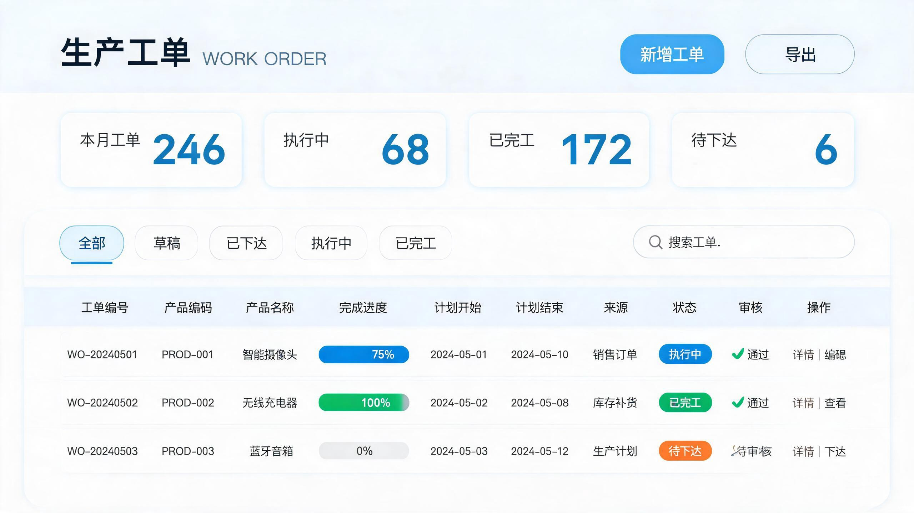

**列表页（WorkOrderList）：**
- 顶部标题「生产工单 WORK ORDER」，副标题「高效追踪生产进度 · 实时监控工单状态」。
- 右上角操作区：新增工单（紫色渐变主按钮）、导出。
- 四张统计卡片：本月工单、执行中、已完工、待下达。
- 状态 Tab：全部 / 草稿 / 已下达 / 执行中 / 已完工，每个 Tab 显示对应数量。
- 搜索框：支持输入「工单号 / 产品编码 / 名称」搜索，回车即查；优先级下拉筛选。
- 表格列：序号、工单号（紧急工单带红色「急」标签，可点击跳转编辑）、产品编码、产品名称（带规格型号）、完成进度（百分比+完工量/计划量+进度条+当前工序）、计划日期（开始/完工）、来源（手工/MRP/销售）、状态（彩色圆点+标签）、审计列、操作列（查看/编辑/删除）。
- 分页：共 N 条记录，支持页码与每页条数切换。

**编辑页（WorkOrderEdit）：**
- 顶部标题栏：返回列表、单据标题、工单编号、紧急标签、状态标签、保存 / 下达工单 / 刷新 / 更多操作按钮（更多操作含选单、开始生产、完工、关闭工单、下推领料/报工/转移/入库/委外、打印、操作日志）。
- 基本信息卡片：单据信息（工单编号、工单日期、工单状态、优先级）、计划信息（计划开始、计划完工、提前期、实际开始、实际完工）、其他（备注）。
- BOM / 工艺路线卡片：BOM 清单、BOM 版本、仓库、工艺路线、工艺版本。
- 生产明细卡片：进度流程 Tab（报工进度条、入库进度条、报废量、当前工序时间线）、成品明细、原料明细、下推操作按钮。
- 审核流转卡片：创建单据 → 审核通过 → 单据关闭时间线。

### 2.3 操作步骤

#### 2.3.1 新增工单
1. 进入「生产管理 → 生产工单」列表页。
2. 点击右上角「新增工单」按钮，跳转至工单编辑页。
3. 在「基本信息」卡片填写：工单日期（必填）、优先级（普通/加急/紧急）。
4. 在「计划信息」卡片填写：计划开始日期、计划完工日期，提前期自动计算。
5. 在「BOM / 工艺路线」卡片选择：BOM 清单（可选，选中后自动带出版本）、仓库（必填）、工艺路线（可选，选中后自动带出版本）。
6. 在「生产明细」卡片可添加成品明细、原料明细，或通过「选单」从销售订单/MRP 计划下推。
7. 点击「保存」按钮保存草稿，系统自动生成工单编号。
8. 草稿状态下可继续编辑或点击「下达工单」按钮将工单状态变为「已下达」。

#### 2.3.2 编辑工单
1. 在列表页点击工单号链接，或点击操作列「编辑」按钮。
2. 仅「草稿」状态工单可编辑；「已下达」「执行中」「已完工」「已关闭」状态工单字段只读。
3. 修改字段后点击「保存」。

#### 2.3.3 下达工单
1. 在编辑页或列表「更多操作」中选择「下达工单」。
2. 系统弹窗确认「确认下达工单 XXX？下达后不可修改」。
3. 点击「确定」后工单状态变为「已下达」，可执行开始生产、下推领料/报工等操作。

#### 2.3.4 开始生产
1. 在编辑页「更多操作」中选择「开始生产」（仅「已下达」状态可见）。
2. 系统弹窗确认，确认后工单状态变为「执行中」，自动记录实际开始日期。

#### 2.3.5 完工
1. 在编辑页「更多操作」中选择「完工」（仅「执行中」状态可见）。
2. 系统弹窗确认，确认后工单状态变为「已完工」，自动记录实际完工日期。

#### 2.3.6 关闭工单
1. 在编辑页「更多操作」中选择「关闭工单」（仅「已完工」状态可见）。
2. 在弹窗中输入关闭原因。
3. 确认后工单状态变为「已关闭」。

#### 2.3.7 下推操作
工单处于「已下达」或「执行中」时，可从「更多操作」下推生成下游单据：
- **下推领料**：生成生产领料单，扣减原料库存。
- **下推报工**：生成作业汇报单，记录工序合格量、报废量、工时。
- **下推工序转移**：生成工序转移单，转移在制品。
- **下推入库**：生成生产入库单，增加成品库存。
- **下推委外**：生成委外加工单，外协生产。

#### 2.3.8 搜索与筛选
- 在搜索框输入「工单号 / 产品编码 / 名称」关键字，回车或点击「搜索」按钮查询。
- 点击状态 Tab 切换「全部 / 草稿 / 已下达 / 执行中 / 已完工」筛选。
- 优先级下拉筛选「普通 / 加急 / 紧急」。
- 点击「重置」清空所有筛选条件。

#### 2.3.9 删除工单
1. 在列表操作列或编辑页「更多操作」中选择「删除」（仅「草稿」状态可删）。
2. 系统弹窗确认，确认后删除工单。

#### 2.3.10 导出
1. 点击列表页右上角「导出」按钮。
2. 系统按当前查询条件导出 Excel 文件。

### 2.4 业务流程说明

```
销售订单/MRP计划 → [下推] → 生产工单(草稿) → [下达] → 已下达
                                                                  ↓
                                                            [开始生产]
                                                                  ↓
                                                              执行中 ←→ [下推领料/报工/转移/委外]
                                                                  ↓
                                                            [完工] → 已完工 → [关闭] → 已关闭
```

### 2.5 注意事项
- 工单编号由系统自动生成，不可手工修改。
- 工单下达后不可修改业务字段，仅可执行状态流转与下推操作。
- 紧急工单（优先级=紧急）会带红色「急」标签，便于车间优先排产。
- 工单完成进度由后端进度接口实时计算，列表页对缺少进度数据的工单会懒加载补充。
- 关闭工单需填写关闭原因，便于后续追溯。

---

## 三、生产入库

### 3.1 功能说明

生产入库单（PRODUCTION_RECEIPT）用于记录产成品完工入库业务，关联生产工单，将合格品/不合格品入库，审核后增加库存。支持多仓库、多货位、批次号、生产日期、有效期至等批次效期管理。

**核心能力：**
- 录入入库基本信息、生产订单、仓库、经办人、部门、币别、汇率。
- 支持从物料库批量选择物料添加明细。
- 自动计算总数量、合格数量、不合格数量、总金额。
- 支持批次号、生产日期、有效期至管理（按物料批次/保质期控制自动联动）。
- 审核后增加库存，重置草稿回退库存。
- 支持附件上传、操作日志、打印预览。

### 3.2 界面描述

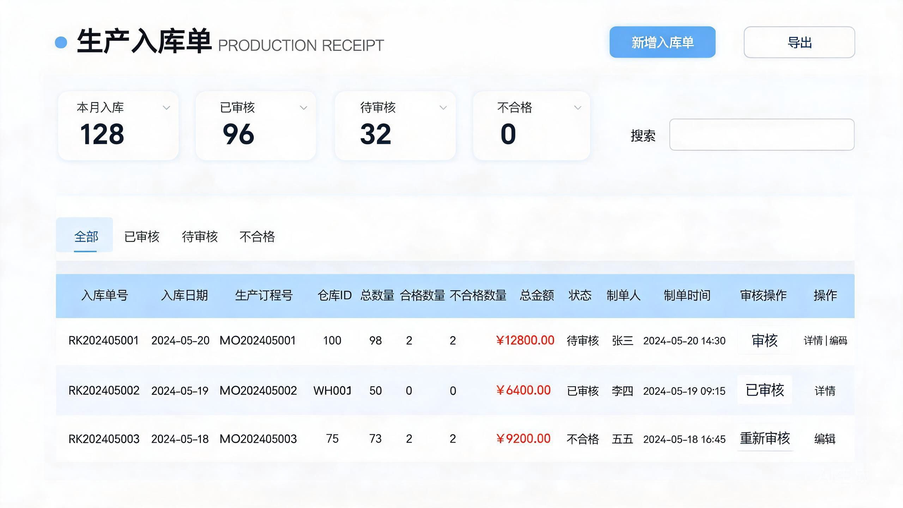

**列表页（ProductionReceiptList）：**
- 顶部标题「生产入库单 PRODUCTION RECEIPT」，副标题「管理生产入库业务 · 实时追踪库存变动」。
- 右上角操作区：新增入库单、导出。
- 四张统计卡片：本月入库、已生效、待审核、不合格。
- 状态 Tab：全部 / 草稿 / 已生效 / 已关闭 / 已取消。
- 搜索框：支持输入「入库单号」搜索。
- 表格列：序号、入库单号（可点击跳转编辑）、入库日期、生产订单号、仓库ID、总数量、合格数量、不合格数量、总金额、状态（彩色圆点+标签）、制单人、制单时间、审计列、操作列。
- 分页：共 N 条记录。

**编辑页（ProductionReceiptEdit）：**
- 顶部标题栏：返回列表、单据标题、入库单号、状态标签、保存 / 提交审核 / 更多操作按钮（关闭、取消、删除、打印、操作日志）。
- 基本信息卡片：单据信息（入库单号、入库日期、生产订单、工单号）、仓库与经办人（仓库、经办人、部门、币别、汇率）、数量与金额（总数量、合格数量、不合格数量、总金额）、其他（备注）。
- 入库明细卡片：明细表格（物料、规格、单位、数量、合格数量、不合格数量、单价、金额、仓库、货位、批次号、生产日期、有效期至、操作），支持「从物料库选择」批量添加。
- 金额汇总区：总数量、合格数量、不合格数量、合计金额。
- 审核流转卡片：创建单据 → 审核通过 → 单据关闭时间线。

### 3.3 操作步骤

#### 3.3.1 新增入库单
1. 进入「生产管理 → 生产入库」列表页。
2. 点击右上角「新增入库单」按钮，跳转至编辑页。
3. 在「基本信息」卡片填写：入库日期（必填）、生产订单（选择工单，自动带出工单号）、仓库（必填）、经办人、部门、币别（必填）、汇率。
4. 在「入库明细」卡片点击「从物料库选择」按钮，弹出物料选择弹窗，支持按编码/名称/规格搜索、按分类筛选，多选确认添加；或点击「添加明细」逐行添加。
5. 在明细行选择物料（自动带出规格、单位、单价）、填写数量、合格数量、不合格数量、单价（自动计算金额）、仓库、货位、批次号（如物料启用批次控制则必填）、生产日期、有效期至（按物料保质期天数自动计算）。
6. 系统自动汇总总数量、合格数量、不合格数量、合计金额。
7. 点击「保存」按钮保存草稿，系统自动生成入库单号。
8. 草稿状态下可点击「提交审核」按钮提交审批，或从「更多操作」选择取消、删除。

#### 3.3.2 编辑入库单
1. 在列表页点击入库单号链接，或点击操作列「编辑」按钮。
2. 仅「草稿」状态可编辑。

#### 3.3.3 审核入库单
1. 在编辑页点击「提交审核」按钮，或从「更多操作」选择审核（需有审批权限）。
2. 系统弹窗确认「审核生产入库单后将增加库存。是否继续？」。
3. 确认后单据状态变为「已生效」，库存增加。

#### 3.3.4 关闭入库单
1. 在编辑页「更多操作」中选择「关闭」（仅「已生效」状态可见）。
2. 在弹窗中输入关闭原因。
3. 确认后单据状态变为「已关闭」。

#### 3.3.5 取消入库单
1. 在编辑页「更多操作」中选择「取消单据」（仅「草稿」状态可见）。
2. 在弹窗中输入取消原因。
3. 确认后单据状态变为「已取消」。

#### 3.3.6 搜索与筛选
- 在搜索框输入「入库单号」关键字，回车或点击「搜索」按钮查询。
- 点击状态 Tab 切换「全部 / 草稿 / 已生效 / 已关闭 / 已取消」筛选。
- 点击「重置」清空所有筛选条件。

#### 3.3.7 删除入库单
1. 仅「草稿」状态可删除。
2. 系统弹窗确认，确认后删除。

#### 3.3.8 导出
1. 点击列表页右上角「导出」按钮。

### 3.4 业务流程说明

```
生产工单(已下达/执行中) → [下推入库] → 生产入库单(草稿) → [提交审核] → 已生效(增加库存)
                                                                            ↓
                                                                      [关闭] → 已关闭
                                                                            
                                                            [取消] → 已取消
```

### 3.5 注意事项
- 入库单号由系统自动生成，保存后自动带出。
- 审核入库单会触发库存增加，重置草稿会回退库存。
- 启用批次控制的物料，批次号为必填项；启用保质期控制的物料，生产日期选择后有效期至自动按保质期天数计算。
- 不合格数量大于 0 的入库单会在统计卡片「不合格」中体现，便于质量追溯。
- 明细行仓库默认跟随表头仓库，可逐行修改。

---

## 四、生产退料

### 4.1 功能说明

生产退料单（RETURN）用于记录生产过程中多余物料退回仓库的业务，关联生产工单，审核后增加库存。退料单支持来源单号回溯（可关联原领料单），便于核算工单实际物料消耗。

**核心能力：**
- 录入退料基本信息、工单号、仓库、退料人、部门、币别、汇率。
- 支持从物料库批量选择物料添加明细。
- 自动计算合计金额。
- 支持可退数量回填（基于原领料单已领数量-已退数量）。
- 审核后增加库存。
- 支持附件上传、操作日志、打印预览。

### 4.2 界面描述

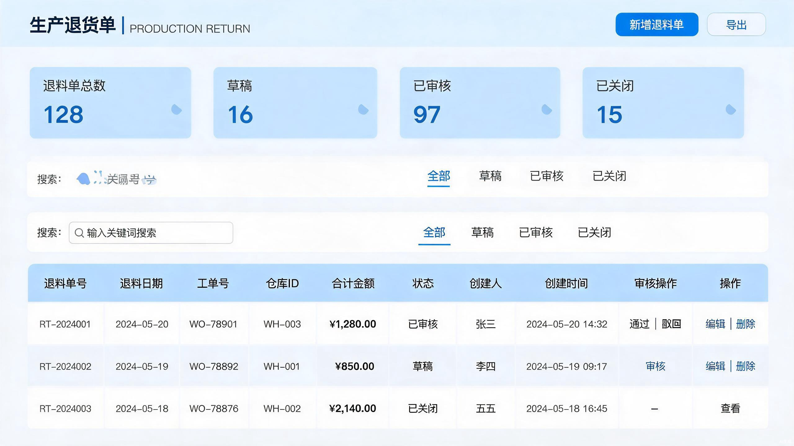

**列表页（ProductionReturnList）：**
- 顶部标题「生产退货单 PRODUCTION RETURN」，副标题「管理生产过程中的物料退回 · 优化库存管理」。
- 右上角操作区：新增退料单、导出。
- 四张统计卡片：退料单总数、草稿、已生效、已关闭。
- 状态 Tab：全部 / 草稿 / 已生效 / 已关闭 / 已取消。
- 搜索框：支持输入「退料单号」搜索。
- 表格列：序号、退料单号（可点击跳转编辑）、退料日期、工单号、仓库ID、合计金额、状态、创建人、创建时间、审计列、操作列。
- 分页：共 N 条记录。

**编辑页（ProductionReturnEdit）：**
- 顶部标题栏：返回列表、单据标题、退料单号、状态标签、保存 / 提交审核 / 更多操作按钮。
- 基本信息卡片：单据信息（退料单号、退料日期、工单号）、仓库与经办人（仓库、退料人、部门、币别、汇率）、其他（退料原因）。
- 退料明细卡片：明细表格（物料、规格、单位、来源单号、可退数量、退料数量、单价、金额、仓库、货位、批次号、操作），支持「从物料库选择」批量添加。
- 金额汇总区：合计金额。
- 审核流转卡片：创建 → 审核通过 → 关闭时间线。

### 4.3 操作步骤

#### 4.3.1 新增退料单
1. 进入「生产管理 → 生产退料」列表页。
2. 点击右上角「新增退料单」按钮，跳转至编辑页。
3. 在「基本信息」卡片填写：退料日期（必填）、工单号、仓库（必填）、退料人、部门、币别（必填）、汇率、退料原因。
4. 在「退料明细」卡片点击「从物料库选择」批量添加，或点击「添加明细」逐行添加。
5. 在明细行选择物料（自动带出规格、单位、可退数量、单价）、填写退料数量（不可超过可退数量）、仓库、货位、批次号。
6. 系统自动计算合计金额。
7. 点击「保存」按钮保存草稿，系统自动生成退料单号。
8. 草稿状态下可点击「提交审核」按钮提交审批。

#### 4.3.2 编辑/审核/关闭/取消/删除/搜索/导出
操作方式与「生产入库」基本一致，参见 [3.3 操作步骤](#33-操作步骤)。

### 4.4 业务流程说明

```
生产工单(已下达/执行中) → [领料后剩余] → 生产退料单(草稿) → [提交审核] → 已生效(增加库存)
                                                                                ↓
                                                                          [关闭] → 已关闭
                                                                            
                                                              [取消] → 已取消
```

### 4.5 注意事项
- 退料单的 billType 固定为 RETURN。
- 退料数量不可超过可退数量（基于原领料单已领数量-已退数量计算）。
- 来源单号可关联原领料单，便于追溯。
- 审核退料单会触发库存增加。

---

## 五、生产补料

### 5.1 功能说明

生产补料单（SUPPLEMENT）用于记录生产过程中因报废、损耗等原因需要补充领料的业务，关联生产工单与来源报工单（可选），审核后扣减库存。补料单支持基于报工报废数量自动回填明细。

**核心能力：**
- 录入补料基本信息、工单号、来源报工单、仓库、经办人、部门、币别、汇率。
- 支持来源报工单选择（仅展示有报废的报工单，自动带出报废工序、报废数量）。
- 支持从物料库批量选择物料添加明细。
- 自动计算合计金额。
- 审核后扣减库存。
- 支持附件上传、操作日志、打印预览。

### 5.2 界面描述

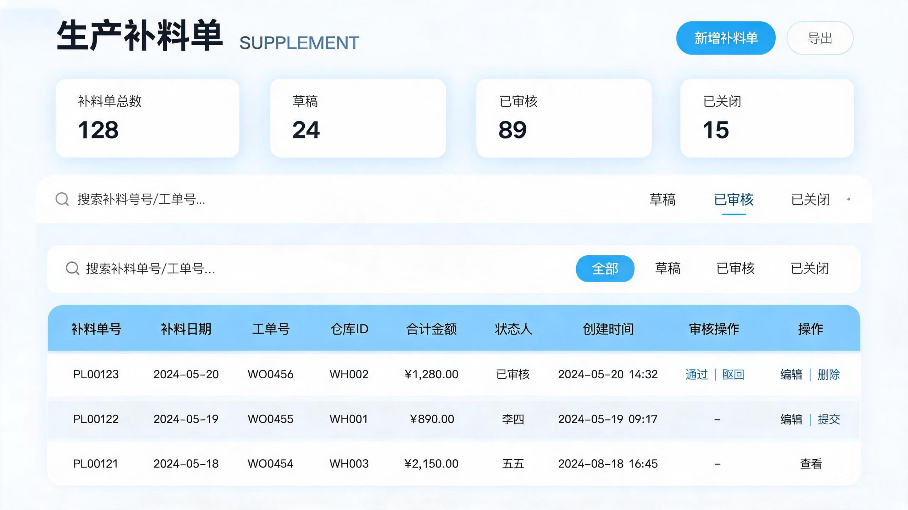

**列表页（ProductionSupplementList）：**
- 顶部标题「生产补料单 SUPPLEMENT」，副标题「管理生产过程中的物料补料 · 确保生产顺利进行」。
- 右上角操作区：新增补料单、导出。
- 四张统计卡片：补料单总数、草稿、已生效、已关闭。
- 状态 Tab：全部 / 草稿 / 已生效 / 已关闭 / 已取消。
- 搜索框：支持输入「补料单号」搜索。
- 表格列：序号、补料单号、补料日期、工单号、仓库ID、合计金额、状态、创建人、创建时间、审计列、操作列。
- 分页：共 N 条记录。

**编辑页（ProductionSupplementEdit）：**
- 顶部标题栏：返回列表、单据标题、补料单号、状态标签、保存 / 提交审核 / 更多操作按钮。
- 基本信息卡片：单据信息（补料单号、补料日期、工单号、来源报工单）、仓库与经办人（仓库、经办人、部门、币别、汇率）、其他（补料原因）。
- 补料明细卡片：明细表格，支持「从物料库选择」批量添加。
- 金额汇总区：合计金额。

### 5.3 操作步骤

#### 5.3.1 新增补料单
1. 进入「生产管理 → 生产补料」列表页。
2. 点击右上角「新增补料单」按钮，跳转至编辑页。
3. 在「基本信息」卡片填写：补料日期（必填）、工单号（必填，输入后才能选择来源报工单）、来源报工单（可选，下拉仅展示该工单下有报废的报工单）、仓库（必填）、经办人、部门、币别（必填）、汇率、补料原因。
4. 在「补料明细」卡片添加物料明细，填写补料数量、单价、仓库、货位、批次号。
5. 系统自动计算合计金额。
6. 点击「保存」按钮保存草稿，点击「提交审核」提交审批。

#### 5.3.2 编辑/审核/关闭/取消/删除/搜索/导出
操作方式与「生产入库」基本一致。

### 5.4 业务流程说明

```
报工单(有报废) → [补料] → 生产补料单(草稿) → [提交审核] → 已生效(扣减库存)
                                                              ↓
                                                        [关闭] → 已关闭
                                                          
                                            [取消] → 已取消
```

### 5.5 注意事项
- 补料单的 billType 固定为 SUPPLEMENT。
- 来源报工单选择后，可自动带出报废工序、报废数量作为补料参考。
- 审核补料单会触发库存扣减。
- 补料单常用于因质量报废、损耗等导致的物料追加领用场景。

---

## 六、工序汇报

### 6.1 功能说明

作业汇报单（OperationReport）用于记录生产工序作业报工，关联生产工单与工序，记录合格数量、报废数量、实际工时、操作工、工作中心、使用设备等。报工审核后累计工单完工量、工序进度。

**核心能力：**
- 录入报工基本信息、汇报日期、使用设备、工单号、工序号、工序名称、工作中心、操作工。
- 录入合格数量、报废数量、实际工时，自动计算报工数量、不合格数量。
- 支持下推生产补料单（基于报废数量）。
- 审核后累计工单完工量、工序进度。
- 支持附件上传、操作日志、打印预览。

### 6.2 界面描述

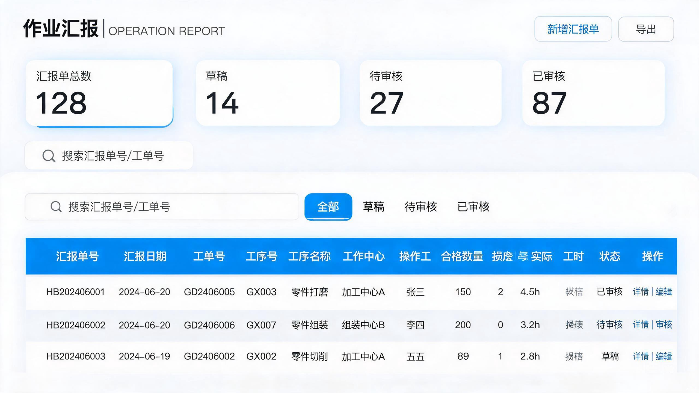

**列表页（OperationReportList）：**
- 顶部标题「作业汇报 OPERATION REPORT」，副标题「记录生产工序作业汇报 · 追踪生产进度与质量」。
- 右上角操作区：新增汇报单、导出。
- 四张统计卡片：汇报单总数、草稿、待审核、已生效。
- 状态 Tab：全部 / 草稿 / 待审核 / 已生效。
- 搜索框：支持输入「汇报单号 / 工单号」搜索。
- 表格列：序号、汇报单号（可点击跳转编辑）、汇报日期、工单号、工序号、工序名称、工作中心、操作工、合格数量（绿色）、报废数量（红色）、实际工时、状态、审计列、操作列。
- 分页：共 N 条记录。

**编辑页（OperationReportEdit）：**
- 顶部标题栏：返回列表、单据标题、汇报单号、状态标签、保存 / 提交审核 / 下推（已生效状态显示下推按钮）/ 更多操作按钮（审核、重置草稿、删除、打印、操作日志）。
- 基本信息卡片：单据信息（汇报单号、汇报日期、使用设备）、工单与工序（工单号、工序号、工序名称、工作中心、操作工）、数量与工时（合格数量、报废数量、实际工时、报工数量、不合格数量）、其他（备注）。

### 6.3 操作步骤

#### 6.3.1 新增汇报单
1. 进入「生产管理 → 作业汇报」列表页。
2. 点击右上角「新增汇报单」按钮，跳转至编辑页。
3. 在「基本信息」卡片填写：汇报日期（必填）、使用设备、工单号（必填，选择后才能选择工序）、工序号（必填，选择后自动带出工序名称）、工作中心（必填）、操作工（必填）。
4. 在「数量与工时」填写：合格数量（必填）、报废数量、实际工时（必填）。系统自动计算报工数量 = 合格数量 + 报废数量，不合格数量 = 报废数量。
5. 在「其他」填写备注。
6. 点击「保存」按钮保存草稿，点击「提交审核」提交审批。

#### 6.3.2 审核汇报单
1. 在「更多操作」中选择「审核」（仅「待审核」状态可见，需有审批权限）。
2. 审核通过后单据状态变为「已生效」，累计工单完工量、工序进度。

#### 6.3.3 重置草稿
1. 在「更多操作」中选择「重置草稿」（仅「已生效」状态可见）。
2. 重置草稿后回退工单完工量、工序进度。

#### 6.3.4 下推补料
1. 工序汇报单审核后，可在编辑页点击「下推」按钮，基于报废数量下推生成生产补料单。

#### 6.3.5 搜索与筛选
- 在搜索框输入「汇报单号 / 工单号」关键字查询。
- 点击状态 Tab 切换「全部 / 草稿 / 待审核 / 已生效」筛选。

#### 6.3.6 删除/导出
操作方式与其他单据一致。

### 6.4 业务流程说明

```
生产工单(执行中) → [报工] → 作业汇报单(草稿) → [提交审核] → 已生效(累计完工量/工序进度)
                                                                ↓
                                                          [下推] → 生产补料单
                                                          
                                              [重置草稿] → 待审核
```

### 6.5 注意事项
- 汇报单号由系统自动生成。
- 工单号选择后才可选工序，工序选择后自动带出工序名称、工作中心。
- 报工数量 = 合格数量 + 报废数量，由系统自动计算。
- 审核汇报单会累计工单完工量、更新工序进度，影响工单完成百分比。
- 报废数量大于 0 的汇报单可下推生成生产补料单。

---

## 七、工序流转

### 7.1 功能说明

工序转移单（ProcessTransfer）用于记录生产工序间物料转移业务，关联生产工单、物料、工作中心、转出/接收仓库，追踪在制品在工序间的流转。

**核心能力：**
- 录入转移基本信息、转移日期、工单号、物料编码/名称/规格型号、工作中心、转出仓库、接收仓库。
- 录入转移明细（工序、转移数量等）。
- 审核后更新在制品流转记录。
- 支持下推下游单据。
- 支持附件上传、操作日志、打印预览。

### 7.2 界面描述

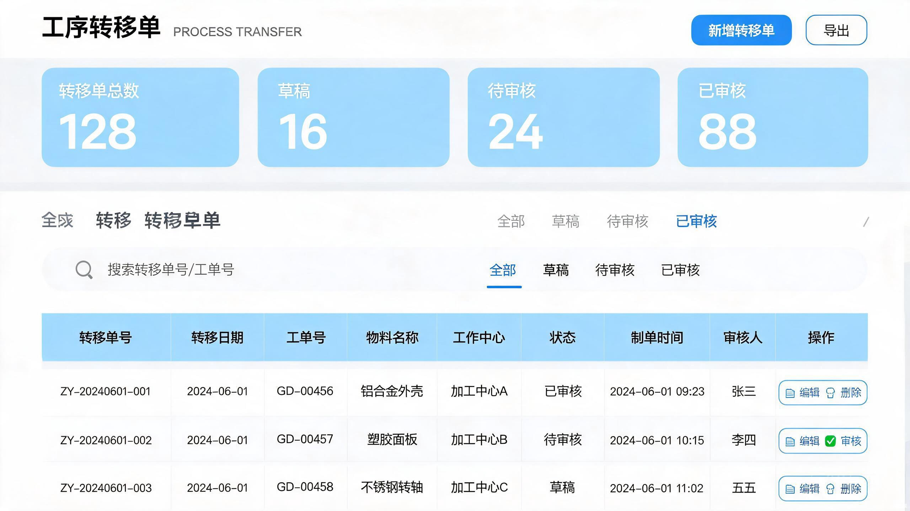

**列表页（ProcessTransferList）：**
- 顶部标题「工序转移单 PROCESS TRANSFER」，副标题「管理生产工序间物料转移 · 追踪生产进度流转」。
- 右上角操作区：新增转移单、导出。
- 四张统计卡片：转移单总数、草稿、待审核、已生效。
- 状态 Tab：全部 / 草稿 / 待审核 / 已生效。
- 搜索框：支持输入「转移单号 / 工单号 / 物料」搜索。
- 表格列：序号、转移单号、转移日期、工单号、物料名称、工作中心、状态、制单时间、审计列、操作列。
- 分页：共 N 条记录。

**编辑页（ProcessTransferEdit）：**
- 顶部标题栏：返回列表、单据标题、转移单号、状态标签、保存 / 提交审核 / 下推 / 更多操作按钮（审核、重置草稿、删除、打印、操作日志）。
- 基本信息卡片：单据信息（转移单号、转移日期、单据状态）、工单与物料（工单号、物料编码、物料名称、规格型号、工作中心、转出仓库、接收仓库）、其他（备注）。
- 转移明细卡片：明细表格（添加明细、行删除）。

### 7.3 操作步骤

#### 7.3.1 新增转移单
1. 进入「生产管理 → 工序转移」列表页。
2. 点击右上角「新增转移单」按钮，跳转至编辑页。
3. 在「基本信息」卡片填写：转移日期（必填）、工单号（必填，选择后自动带出物料编码/名称/规格型号）、工作中心（必填）、转出仓库、接收仓库、备注。
4. 在「转移明细」卡片点击「添加明细」逐行添加，填写工序、转移数量等。
5. 点击「保存」按钮保存草稿，点击「提交审核」提交审批。

#### 7.3.2 审核/重置草稿/下推/搜索/删除/导出
操作方式与其他单据一致。

### 7.4 业务流程说明

```
生产工单(执行中) → [工序转移] → 工序转移单(草稿) → [提交审核] → 已生效(更新在制品流转)
                                                                ↓
                                                          [下推] → 下游单据
                                                          
                                              [重置草稿] → 待审核
```

### 7.5 注意事项
- 转移单号由系统自动生成。
- 工单号选择后自动带出物料编码/名称/规格型号，不可手工修改。
- 转出仓库与接收仓库可不同，便于跨仓库工序流转。
- 审核转移单会更新在制品流转记录。

---

## 八、生产组装

### 8.1 功能说明

生产组装单（Assemble）用于管理多种物料组装为成品的业务，消耗原料库存、增加成品库存。支持含税计算、多币种、自定义字段、审批流程、复制、作废、重置草稿等操作。

**核心能力：**
- 录入组装基本信息、单据日期、生产部门、成品仓库、原料仓库。
- 录入交易信息：是否含税、计税方式、交易币别、汇率、税率。
- 录入成品明细（入库物料）与原料明细（出库物料）。
- 自动计算单据金额。
- 支持审批流程（提交 → 审批 → 通过/驳回）。
- 支持复制、作废、重置草稿、撤销。
- 支持附件上传、操作日志、打印预览、自定义字段。

### 8.2 界面描述

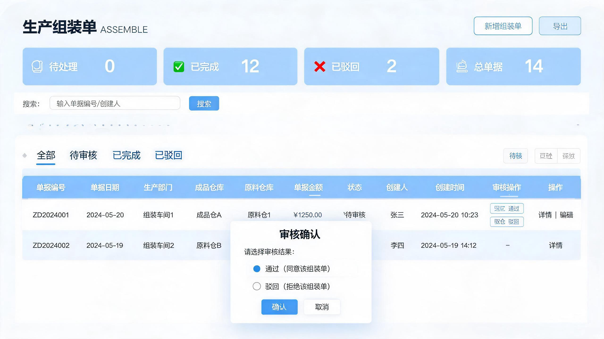

**列表页（ProduceAssembleList）：**
- 顶部标题「生产组装单 ASSEMBLE」，副标题「管理产品组装业务 · 追踪物料消耗」。
- 右上角操作区：新增组装单、导出。
- 四张统计卡片。
- 状态 Tab：全部 / 草稿 / 待审批 / 已审批 / 已完成 / 已作废 等。
- 搜索框：支持输入「单据编号」搜索。
- 表格列：序号、单据编号（可点击跳转编辑）、单据日期、生产部门、成品仓库、原料仓库、单据金额、状态、创建人、创建时间、审计列、操作列。
- 审批弹窗：审批意见（同意/驳回）、备注。
- 分页：共 N 条记录。

**编辑页（ProduceAssembleEdit）：**
- 顶部标题栏：返回列表、单据标题、单据编号、状态标签、保存 / 提交审核 / 刷新 / 更多操作按钮（审批、撤销、删除、作废、重置草稿、复制、打印、操作日志）。
- 基本信息卡片：单据信息（单据编号、单据日期、生产部门、成品仓库、原料仓库）、交易信息（是否含税、计税方式、交易币别、汇率、单据金额、税率%）、自定义字段分区。

### 8.3 操作步骤

#### 8.3.1 新增组装单
1. 进入「生产管理 → 生产组装」列表页。
2. 点击右上角「新增组装单」按钮，跳转至编辑页。
3. 在「基本信息」卡片填写：单据日期、生产部门、成品仓库（必填）、原料仓库（必填）。
4. 在「交易信息」填写：是否含税（开关）、计税方式（不含税/含税）、交易币别、汇率、税率。
5. 在成品明细与原料明细中添加物料。
6. 系统自动计算单据金额。
7. 点击「保存」按钮保存草稿（状态=0），点击「提交审核」提交审批（状态=1）。

#### 8.3.2 审批
1. 在列表或编辑页「更多操作」中选择「审批」（仅状态=1 且有审批权限可见）。
2. 在审批弹窗选择「同意」或「驳回」，填写备注。
3. 同意后状态变为「已审批」（状态=6），驳回后回到草稿。

#### 8.3.3 撤销/作废/重置草稿/复制
- 撤销：状态=1 时可撤销，回到草稿。
- 作废：状态=6（已审批）时可作废。
- 重置草稿：状态=6 时可重置为草稿。
- 复制：基于当前单据复制生成新单据。

#### 8.3.4 搜索/删除/导出
操作方式与其他单据一致。

### 8.4 业务流程说明

```
新增组装单(状态=0 草稿) → [提交审核] → 待审批(状态=1) → [审批同意] → 已审批(状态=6)
                                                ↓                        ↓
                                          [撤销] → 草稿            [作废] / [重置草稿]
                                                                  
                                            [审批驳回] → 草稿
```

### 8.5 注意事项
- 组装单状态以数字编码（0=草稿、1=待审批、6=已审批等）。
- 审批流程需有审批权限的用户执行。
- 作废后不可参与业务，但可重置草稿恢复。
- 组装单审核后会同时影响成品库存（增加）与原料库存（扣减）。

---

## 九、生产拆解

### 9.1 功能说明

生产拆卸单（Disassemble）用于管理成品拆卸为原材料的业务，回收原材料资源。功能与生产组装单基本对称：消耗成品库存、增加原料库存。支持含税计算、多币种、自定义字段、审批流程、复制、作废、重置草稿等操作。

**核心能力：**
- 录入拆卸基本信息、单据日期、生产部门、成品仓库、原料仓库。
- 录入交易信息：是否含税、计税方式、交易币别、汇率、税率。
- 录入成品明细（出库物料）与原料明细（入库物料）。
- 自动计算单据金额。
- 支持审批流程（提交 → 审批 → 通过/驳回）。
- 支持复制、作废、重置草稿、撤销。

### 9.2 界面描述

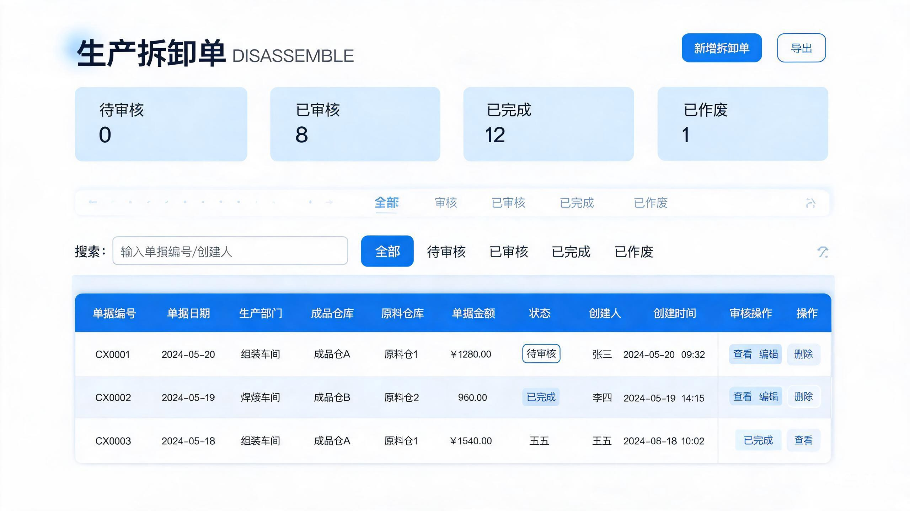

**列表页（ProduceDisassembleList）：**
- 顶部标题「生产拆卸单 DISASSEMBLE」，副标题「管理产品拆卸业务 · 回收原材料资源」。
- 右上角操作区：新增拆卸单、导出。
- 状态 Tab、搜索框、表格列与「生产组装」基本一致：单据编号、单据日期、生产部门、成品仓库、原料仓库、单据金额、状态、创建人、创建时间、审计列、操作列。
- 审批弹窗：审批意见（同意/驳回）、备注。

**编辑页（ProduceDisassembleEdit）：**
- 顶部标题栏、基本信息卡片、交易信息、明细卡片等结构与「生产组装」对称。

### 9.3 操作步骤

操作步骤与「生产组装」基本一致，参见 [8.3 操作步骤](#83-操作步骤)。区别在于：
- 拆卸单的成品明细为出库物料（扣减成品库存），原料明细为入库物料（增加原料库存）。
- 拆卸单常用于成品退货拆解、不良品拆解回收等场景。

### 9.4 业务流程说明

```
新增拆卸单(草稿) → [提交审核] → 待审批 → [审批同意] → 已审批(扣减成品/增加原料)
                                            ↓
                                      [作废] / [重置草稿]
                                      
                                [审批驳回] → 草稿
```

### 9.5 注意事项
- 拆卸单与组装单的状态编码、审批流程一致。
- 拆卸单审核后会扣减成品库存、增加原料库存。
- 拆卸单常用于成品退货拆解、不良品拆解回收等场景，需确保成品仓库有足够库存。

---

## 十、MRP 物料需求计划

### 10.1 功能说明

MRP 物料需求计划（MrpPlan）是生产计划的核心运算工具，基于销售订单/销售预测/手工录入/安全库存等需求来源，结合现有库存、在途采购、在制工单，运算净需求（净需求 = 毛需求 - 现有库存 - 在途量 + 安全库存），生成建议计划单（计划订单、采购建议、生产建议）。

**核心能力：**
- 向导式五步运算流程：需求来源 → 运算配置 → 执行运算 → 结果审核 → 下推执行。
- 需求来源支持：销售订单、销售预测、手工录入。
- 运算参数：计划展望期、时界、批量规则（逐批法/固定批量/经济批量）、固定批量、最小订货量、运算方案名称。
- 运算范围开关：考虑现有库存、在途采购、在制工单、安全库存等。
- 运算结果审核后可下推生成生产工单、采购申请等。
- 支持 MRP 计划方案列表管理、历史运算记录查看。

### 10.2 界面描述

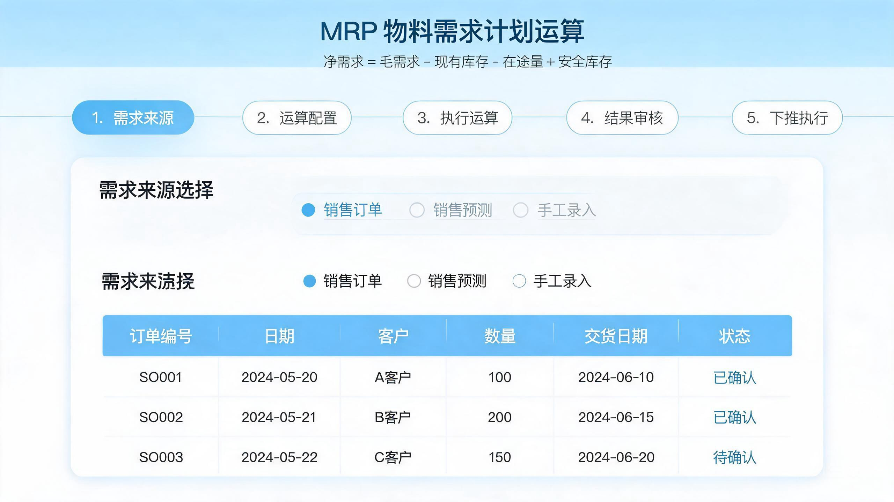

**运算页（MrpList）：**
- 顶部标题「MRP 物料需求计划运算」，副标题「净需求 = 毛需求 - 现有库存 - 在途量 + 安全库存」。
- 右上角：运算历史按钮。
- 步骤条：需求来源 → 运算配置 → 执行运算 → 结果审核 → 下推执行（5 步）。
- 步骤一「需求来源选择」：单选切换（销售订单/销售预测/手工录入）。
  - 销售订单来源：工具栏（订单号/客户名称搜索、日期范围筛选、查询/重置）、已选择 N 单标签、销售订单表格（订单号、订单日期、客户、金额、交货日期、状态、明细查看）、分页。
  - 销售预测来源：销售预测表格（预测编号、预测日期、物料编码、物料名称、预测数量、开始日期、结束日期）。
  - 手工录入：添加需求/清空按钮、需求表格（物料编码、需求数量、需求日期、优先级、操作）。
- 步骤二「运算参数配置」：计划展望期、时界、批量规则、固定批量、最小订货量、运算方案名称；运算范围开关（考虑现有库存、在途采购、在制工单、安全库存等）。

**计划列表页（MrpPlanList）：**
- 顶部标题「MRP 计划 MRP PLAN」，副标题「管理物料需求计划 · 优化生产物料分配」。
- 右上角操作区：新增 MRP 计划、导出。
- 四张统计卡片：方案总数、草稿、已生效、已执行。
- 状态 Tab：全部 / 草稿 / 已生效 / 已执行。
- 搜索框：支持输入「方案编号 / 方案名称」搜索。
- 表格列：序号、方案编号（可点击跳转编辑）、方案名称、运算日期、计划展望期(天)、需求来源、批量规则、时界(天)、状态、审计列、操作列。
- 分页：共 N 条记录。

**编辑页（MrpPlanEdit）：**
- 顶部标题栏：返回列表、单据标题、方案编号、状态标签、保存 / 提交审核 / 下推 / 更多操作按钮（重置草稿、执行方案、删除、打印、操作日志）。
- 基本信息卡片：方案信息（方案编号、方案名称、运算日期、计划展望期、需求来源、时界）、运算范围（包含销售订单、包含预测、考虑安全库存、考虑在途采购、考虑在制工单等开关）、批量规则与参数。

### 10.3 操作步骤

#### 10.3.1 执行 MRP 运算
1. 进入「生产管理 → MRP 物料需求计划运算」页面。
2. 步骤一：选择需求来源类型（销售订单/销售预测/手工录入）。
   - 销售订单：搜索并勾选需要参与运算的销售订单，点击「下一步：运算配置」。
   - 销售预测：勾选销售预测记录。
   - 手工录入：点击「+ 添加需求」逐行录入物料编码、需求数量、需求日期、优先级。
3. 步骤二：配置运算参数（计划展望期、时界、批量规则、固定批量、最小订货量、运算方案名称），开关运算范围（考虑现有库存、在途采购、在制工单、安全库存），点击「下一步：执行运算」。
4. 步骤三：执行运算，查看运算结果。
5. 步骤四：结果审核，审核通过后进入下推执行。
6. 步骤五：下推执行，可下推生成生产工单、采购申请等。
7. 点击「运算历史」按钮可查看历史运算记录。

#### 10.3.2 新增 MRP 计划方案
1. 进入「生产管理 → MRP 计划」列表页。
2. 点击右上角「新增 MRP 计划」按钮，跳转至编辑页。
3. 在「基本信息」卡片填写：方案名称（必填）、运算日期（必填）、计划展望期（必填）、需求来源（销售订单/预测/安全库存/手工录入）、时界。
4. 在「运算范围」开启相应开关（包含销售订单、包含预测、考虑安全库存、考虑在途采购、考虑在制工单）。
5. 配置批量规则与参数。
6. 点击「保存」按钮保存草稿，点击「提交审核」提交审批。

#### 10.3.3 执行方案
1. 在编辑页「更多操作」中选择「执行方案」（仅「已生效」状态可见）。
2. 执行后状态变为「已执行」。

#### 10.3.4 重置草稿
1. 在编辑页「更多操作」中选择「重置草稿」（仅「已生效」状态可见）。
2. 重置草稿后回到草稿状态。

#### 10.3.5 搜索/删除/导出
操作方式与其他单据一致。

### 10.4 业务流程说明

```
销售订单/预测/手工 → [MRP运算] → MRP计划方案(草稿) → [提交审核] → 已生效 → [执行方案] → 已执行
                                                                       ↓
                                                                 [下推] → 生产工单/采购申请
                                                                 
                                                     [重置草稿] → 草稿
```

### 10.5 注意事项
- MRP 运算公式：净需求 = 毛需求 - 现有库存 - 在途量 + 安全库存。
- 需求来源可多选（销售订单 + 预测 + 手工录入），通过运算范围开关控制是否纳入运算。
- 批量规则影响净需求的取整：逐批法按净需求直接生成；固定批量按固定批量倍数取整；经济批量按经济订货量取整。
- 时界（Time Fence）用于限制计划期内某些时段不允许自动调整。
- 已执行的方案不可再修改，如需调整需重置草稿后重新执行。

---

## 十一、工艺路线

### 11.1 功能说明

工艺路线（Routing）用于管理生产工艺路线，定义工序序列、工时定额、工作中心绑定、是否主工艺/替代工艺等。工艺路线可被生产工单引用，作为车间作业的工序标准。

**核心能力：**
- 录入工艺路线基本信息：编码、名称、版本、是否主工艺、物料、BOM、生效/失效日期、总工时、备注。
- 录入工序明细：工序编码、工序名称、工作中心类型、工时定额、工序顺序等。
- 支持主工艺路线与替代工艺路线区分。
- 支持生效/失效日期管理。
- 支持审批流程、附件上传、操作日志、打印预览。

### 11.2 界面描述

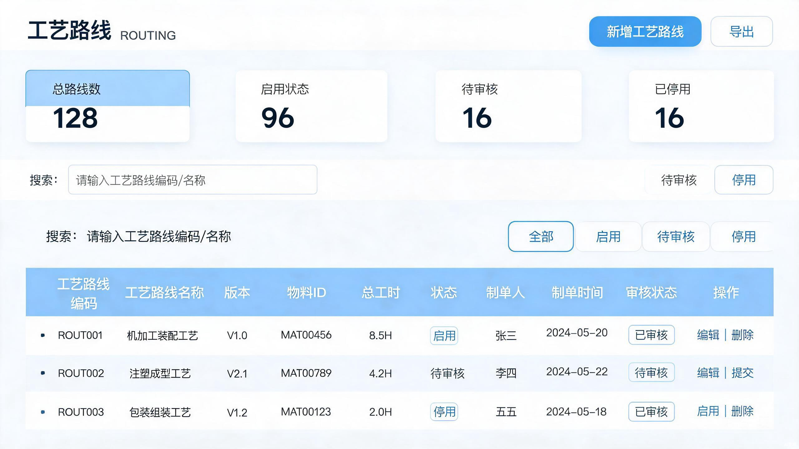

**列表页（RoutingList）：**
- 顶部标题「工艺路线 ROUTING」，副标题「管理生产工艺路线 · 追踪工序工时」。
- 右上角操作区：新增工艺路线、导出。
- 四张统计卡片。
- 状态 Tab、搜索框（支持「工艺路线编码 / 名称」搜索）。
- 表格列：序号、工艺路线编码（可点击跳转编辑）、工艺路线名称、版本、物料ID、总工时、状态、制单人、制单时间、审计列、操作列。
- 分页：共 N 条记录。

**新增/编辑弹窗：**
- 基本信息表单：工艺路线编码、工艺路线名称、版本、是否主工艺（主工艺路线/替代工艺路线）、物料、BOM、生效日期、失效日期、总工时（自动汇总）、备注。
- 工序明细表格：添加工序、行编辑（工序编码、工序名称、工作中心类型、工时定额、工序顺序等）。

### 11.3 操作步骤

#### 11.3.1 新增工艺路线
1. 进入「生产管理 → 工艺路线」列表页。
2. 点击右上角「新增工艺路线」按钮，弹出新增弹窗。
3. 填写基本信息：工艺路线编码（留空自动生成）、工艺路线名称（必填）、版本（如 V1.0）、是否主工艺、物料、BOM、生效日期、失效日期、备注。
4. 在工序明细表格点击「添加工序」逐行添加，填写工序编码、工序名称、工作中心类型（加工/装配/检验/包装/入库）、工时定额、工序顺序。
5. 总工时由系统自动汇总各工序工时。
6. 点击「保存」按钮保存。

#### 11.3.2 编辑/删除/搜索/导出
操作方式与其他单据一致。

### 11.4 业务流程说明

```
工艺路线(草稿) → [审核] → 已生效 → [被生产工单引用] → 工单工序进度
                              ↓
                        [重置草稿] → 草稿
```

### 11.5 注意事项
- 工艺路线编码可留空自动生成。
- 主工艺路线与替代工艺路线通过「是否主工艺」区分，同一物料仅可有一条主工艺路线。
- 生效日期与失效日期控制工艺路线的有效期，过期工艺路线不可被新工单引用。
- 总工时由各工序工时定额自动汇总，不可手工修改。

---

## 十二、工作中心

### 12.1 功能说明

工作中心（WorkCenter）是生产产能与费率的基础配置，定义工作中心编码、名称、类型、部门、负责人、位置、产能类型（人工工时/机器工时）、产能单位、日产能、人工费率、制造费用率、最大人数、是否委外、效率等。工作中心被工艺路线、工序、工单引用。

**核心能力：**
- 录入工作中心基本信息：编码、名称、类型（设备/设备组/生产线/车间/工作单元）、部门、负责人、位置。
- 录入产能配置：产能类型（人工工时/机器工时）、产能单位（小时/件数）、日产能、效率(%)、最大人数。
- 录入费率配置：人工费率、制造费用率。
- 支持委外标识（是否委外）。
- 支持审批流程、附件上传、操作日志、打印预览。

### 12.2 界面描述

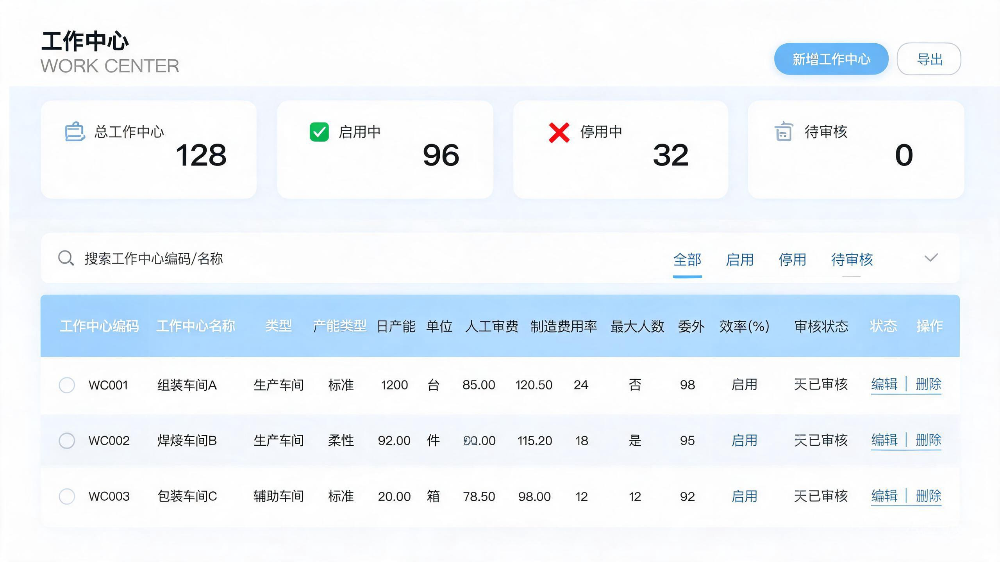

**列表页（WorkCenterList）：**
- 顶部标题「工作中心 WORK CENTER」，副标题「管理生产工作中心 · 配置产能与费率」。
- 右上角操作区：新增工作中心、导出。
- 四张统计卡片。
- 状态 Tab、搜索框（支持「工作中心编码 / 名称」搜索）。
- 表格列：序号、工作中心编码、工作中心名称、类型、产能类型、日产能、产能单位、人工费率、制造费用率、最大人数、委外、效率(%)、状态、审计列、操作列。
- 分页：共 N 条记录。

**新增/编辑弹窗：**
- 基本信息表单：工作中心编码、工作中心名称、类型、部门、负责人、位置、产能类型、产能单位、日产能、效率(%)、最大人数、人工费率、制造费用率、是否委外、备注。

### 12.3 操作步骤

#### 12.3.1 新增工作中心
1. 进入「生产管理 → 工作中心」列表页。
2. 点击右上角「新增工作中心」按钮，弹出新增弹窗。
3. 填写工作中心编码（如 WC001）、名称（如 一车间装配中心）、类型、部门、负责人、位置。
4. 填写产能配置：产能类型、产能单位、日产能、效率(%)、最大人数。
5. 填写费率配置：人工费率、制造费用率。
6. 设置是否委外。
7. 点击「保存」按钮保存。

#### 12.3.2 编辑/删除/搜索/导出
操作方式与其他单据一致。

### 12.4 业务流程说明

```
工作中心(草稿) → [审核] → 已生效 → [被工艺路线/工序/工单引用]
                              ↓
                        [重置草稿] → 草稿
```

### 12.5 注意事项
- 工作中心编码建议按规范命名（如 WC001、WC002）。
- 委外工作中心（isOutsourced=是）会带「是」标签，便于委外业务识别。
- 人工费率与制造费用率用于成本核算，建议定期更新。
- 日产能与效率影响 MRP 运算的产能校验与车间排程。

---

## 十三、工作站

### 13.1 功能说明

工作站（Workstation）是工序级配置，归属工作中心，定义工序编码、工序名称、所属工作中心、工序类型（加工/装配/检验/包装/入库）、位置、状态等。工作站被工艺路线的工序明细、工单的报工引用。

**核心能力：**
- 录入工作站基本信息：工序编码、工序名称、所属工作中心、工序类型、位置、状态。
- 支持按工作中心筛选工序。
- 支持审批流程、操作日志、打印预览。

### 13.2 界面描述

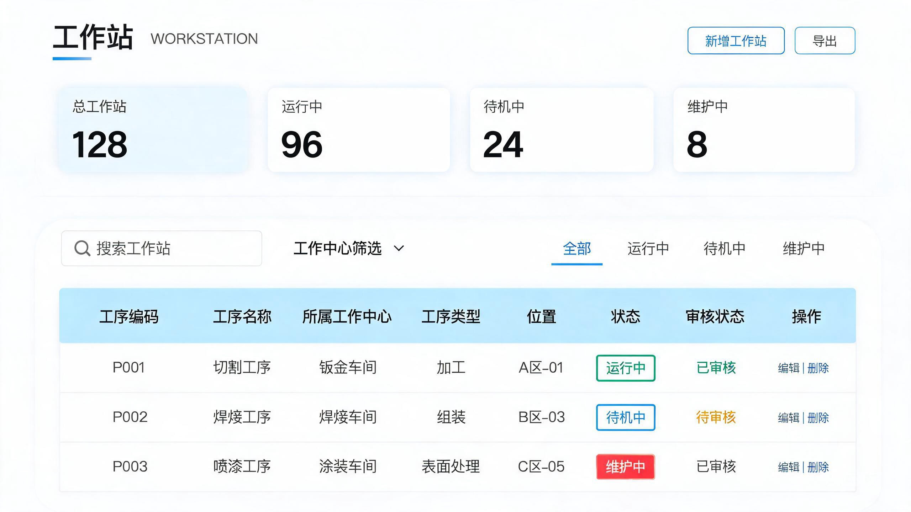

**列表页（WorkstationList）：**
- 顶部标题「工作站 WORKSTATION」，副标题「管理生产工作站 · 配置工序信息」。
- 右上角操作区：新增工作站、导出。
- 四张统计卡片。
- 搜索框（支持「工序编码 / 名称」搜索）+ 工作中心筛选下拉。
- 状态 Tab。
- 表格列：序号、工序编码、工序名称、所属工作中心、工序类型、位置、状态、审计列、操作列。
- 分页：共 N 条记录。

**新增/编辑弹窗：**
- 表单：工序编码、工序名称、所属工作中心、工序类型、位置、状态（启用/停用）。

### 13.3 操作步骤

#### 13.3.1 新增工作站
1. 进入「生产管理 → 工作站」列表页。
2. 点击右上角「新增工作站」按钮，弹出新增弹窗。
3. 填写工序编码（如 WS001）、工序名称（如 装配工序）、所属工作中心（必填）、工序类型、位置、状态。
4. 点击「保存」按钮保存。

#### 13.3.2 编辑/删除/搜索/导出
操作方式与其他单据一致。

### 13.4 业务流程说明

```
工作站(启用) → [被工艺路线工序引用] → 工单报工
                  ↓
            [停用] → 不可被新工单引用
```

### 13.5 注意事项
- 工序编码建议按规范命名（如 WS001、WS002）。
- 工作站必须归属一个工作中心。
- 工序类型影响工艺路线工序的工作中心类型选择。
- 启用/停用状态控制工作站是否可被新工单引用，停用的工作站不影响存量工单。

---

## 十四、生产排程看板

### 14.1 功能说明

车间排程看板（ScheduleBoard）是生产排程的可视化工具，实时跟踪已下达与执行中工单，按计划开始日期升序展示，以卡片形式呈现工单状态、产品信息、当前工序、计划日期、工作中心、完成进度等关键信息，支持按关键字、工作中心、状态筛选。

**核心能力：**
- 卡片化展示已下达/执行中工单，按计划开始日期升序排序。
- 卡片显示：工单号、紧急标签、状态胶囊、产品名称/编码/规格、当前工序、计划开始/完工日期、工作中心、完成进度条（百分比+完工量/计划量）。
- 筛选：关键字（工单号/产品编码/名称）、工作中心、状态（已下达/执行中/全部）。
- 统计卡片：工单总数、已下达、执行中、即将到期(3天内)。
- 点击卡片可跳转工单详情。

### 14.2 界面描述

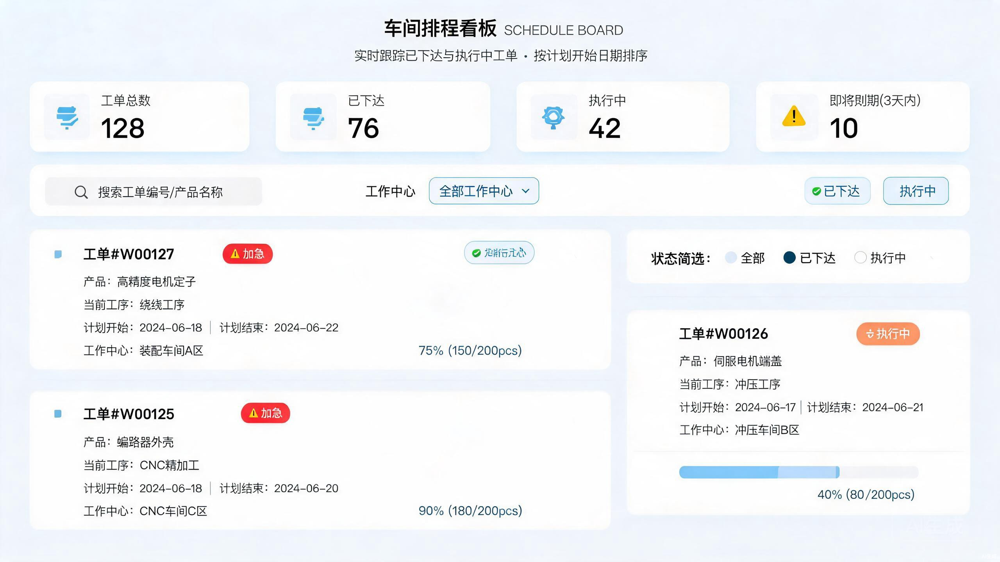

**看板页（ProductionScheduleBoard）：**
- 顶部标题「车间排程看板 SCHEDULE BOARD」，副标题「实时跟踪已下达与执行中工单 · 按计划开始日期排序」。
- 右上角：刷新按钮。
- 四张统计卡片：工单总数、已下达、执行中、即将到期(3天内)。
- 筛选栏：关键字搜索框、工作中心下拉筛选、状态单选切换（已下达/执行中/全部）、共 N 张工单。
- 工单卡片网格：每张卡片显示工单号、紧急标签、状态胶囊、产品名称/编码/规格、当前工序标签、计划开始/完工日期、工作中心、完成进度条（百分比+完工量/计划量）。
- 空状态：无符合条件工单时显示「暂无符合条件的工单」+「重置筛选」按钮。

### 14.3 操作步骤

#### 14.3.1 查看排程看板
1. 进入「生产管理 → 车间排程看板」页面。
2. 系统自动加载已下达与执行中工单，按计划开始日期升序展示。

#### 14.3.2 筛选工单
1. 在搜索框输入「工单号 / 产品编码 / 名称」关键字。
2. 在工作中心下拉筛选特定工作中心的工单。
3. 在状态单选切换「已下达 / 执行中 / 全部」。
4. 系统实时刷新卡片列表。

#### 14.3.3 查看工单详情
1. 点击工单卡片，跳转至工单编辑页。
2. 在编辑页可查看进度流程、成品/原料明细、下推操作等。

#### 14.3.4 重置筛选
1. 点击空状态下的「重置筛选」按钮，或手动清空关键字、工作中心、状态筛选。

#### 14.3.5 刷新数据
1. 点击右上角「刷新」按钮，重新加载工单数据。

### 14.4 业务流程说明

```
工单(已下达/执行中) → [排程看板展示] → [点击卡片] → 工单详情/下推操作
                          ↓
                    [筛选/刷新]
```

### 14.5 注意事项
- 看板仅展示「已下达」与「执行中」工单，草稿/已完工/已关闭工单不在看板展示。
- 工单按计划开始日期升序排序，便于车间按计划顺序排产。
- 即将到期(3天内)统计基于计划完工日期，红色卡片提示优先处理。
- 紧急工单（优先级=紧急）卡片带红色「急」标签。
- 进度条颜色按完成度变化：≥100% 深绿、80-99% 绿色、50-80% 蓝色、<50% 灰色。

---

## 十五、业务流程与下推关系

### 15.1 核心业务流程

生产模块以「工单」为业务主线，通过下推机制串联各下游单据，形成完整的车间执行闭环：

```
销售订单/MRP计划
       ↓ [下推]
   生产工单(草稿) → [下达] → 已下达 → [开始生产] → 执行中 → [完工] → 已完工 → [关闭] → 已关闭
                                  ↓              ↓                                    ↑
                            [下推领料]      [下推报工]                                  |
                            [下推委外]      [下推转移]                                  |
                                  ↓              ↓                                  [生产入库]
                            生产领料单      作业汇报单 → [报废补料] → 生产补料单 → [审核] → 扣减库存
                            (扣减库存)        ↓
                                          [下推转移]
                                             ↓
                                         工序转移单 → [审核] → 更新在制品流转
                                         
                                         [下推入库]
                                             ↓
                                         生产入库单 → [审核] → 增加库存
                                         
                            [多余退料] → 生产退料单 → [审核] → 增加库存
```

### 15.2 单据下推关系矩阵

| 源单据 | 目标单据 | 触发条件 | 说明 |
| --- | --- | --- | --- |
| 销售订单 | 生产工单 | 销售订单已生效 | 按销售需求生成工单 |
| MRP 计划 | 生产工单 | MRP 计划已执行 | 按净需求生成工单 |
| 生产工单 | 生产领料单 | 工单已下达/执行中 | 按BOM扣减原料库存 |
| 生产工单 | 作业汇报单 | 工单已下达/执行中 | 记录工序合格量/报废量/工时 |
| 生产工单 | 工序转移单 | 工单已下达/执行中 | 转移在制品 |
| 生产工单 | 生产入库单 | 工单已下达/执行中 | 增加成品库存 |
| 生产工单 | 委外加工单 | 工单已下达/执行中 | 外协生产 |
| 作业汇报单 | 生产补料单 | 汇报单已生效且有报废 | 基于报废数量补料 |
| 生产领料单 | 生产退料单 | 领料单已生效 | 退回剩余物料 |

### 15.3 状态流转矩阵

| 单据 | 草稿 → 待审核 → 已生效 → 已关闭 | 特殊状态 |
| --- | --- | --- |
| 生产工单 | 草稿 → 已下达 → 执行中 → 已完工 → 已关闭 | 已取消 |
| 生产入库单 | 草稿 → 已生效 → 已关闭 | 已取消 |
| 生产退料单 | 草稿 → 已生效 → 已关闭 | 已取消 |
| 生产补料单 | 草稿 → 已生效 → 已关闭 | 已取消 |
| 作业汇报单 | 草稿 → 待审核 → 已生效 | 重置草稿 → 待审核 |
| 工序转移单 | 草稿 → 待审核 → 已生效 | 重置草稿 → 待审核 |
| 生产组装单 | 草稿(0) → 待审批(1) → 已审批(6) | 作废、重置草稿、撤销 |
| 生产拆卸单 | 草稿(0) → 待审批(1) → 已审批(6) | 作废、重置草稿、撤销 |
| MRP 计划 | 草稿 → 已生效 → 已执行 | 重置草稿 → 草稿 |
| 工艺路线 | 草稿 → 已生效 | 重置草稿 → 草稿 |
| 工作中心 | 草稿 → 已生效 | 重置草稿 → 草稿 |
| 工作站 | 启用/停用 | — |

---

## 十六、通用操作说明

### 16.1 列表页通用操作

| 操作 | 说明 |
| --- | --- |
| 搜索 | 在搜索框输入关键字，回车或点击「搜索」按钮查询 |
| 状态筛选 | 点击状态 Tab 切换不同状态的单据列表 |
| 重置 | 清空所有筛选条件，恢复默认列表 |
| 列设置 | 点击齿轮图标，打开列设置抽屉，可显示/隐藏列、调整列顺序 |
| 新增 | 点击「新增」按钮，跳转至编辑页 |
| 编辑 | 点击单据号链接或操作列「编辑」按钮，跳转至编辑页 |
| 查看 | 点击操作列「查看」按钮，以只读模式查看单据 |
| 删除 | 点击操作列「删除」按钮，仅草稿状态可删 |
| 导出 | 点击「导出」按钮，按当前查询条件导出 Excel |
| 分页 | 切换每页 20/50/100 条，跳转页码 |

### 16.2 编辑页通用操作

| 操作 | 说明 |
| --- | --- |
| 保存 | 点击「保存」按钮，保存草稿（仅草稿状态可保存） |
| 提交审核 | 点击「提交审核」按钮，提交审批流程 |
| 下推 | 在已生效状态点击「下推」按钮，生成下游单据 |
| 重置草稿 | 在「更多操作」中选择「重置草稿」，回退至待审核（仅已生效状态可见） |
| 关闭 | 在「更多操作」中选择「关闭」，输入关闭原因（仅已生效状态可见） |
| 取消 | 在「更多操作」中选择「取消单据」，输入取消原因（仅草稿状态可见） |
| 删除 | 在「更多操作」中选择「删除」（仅草稿状态可删） |
| 复制 | 在「更多操作」中选择「复制」，基于当前单据复制生成新单据 |
| 打印 | 在「更多操作」中选择「打印」，预览并打印单据 |
| 操作日志 | 在「更多操作」中选择「操作日志」，查看单据全生命周期操作记录 |
| 折叠/展开 | 点击卡片标题栏，折叠/展开卡片内容（折叠状态记忆到 localStorage） |

### 16.3 物料选择弹窗通用操作

| 操作 | 说明 |
| --- | --- |
| 搜索 | 输入「物料编码 / 名称 / 规格」关键字，回车搜索 |
| 分类筛选 | 在分类下拉中选择物料分类，筛选物料 |
| 多选 | 勾选物料行，支持多选 |
| 确认添加 | 点击「确认添加（N 项）」按钮，将选中物料添加至明细 |
| 分页 | 切换每页条数，跳转页码 |

### 16.4 明细表格通用操作

| 操作 | 说明 |
| --- | --- |
| 添加明细 | 点击「添加明细」按钮，逐行添加空明细 |
| 从物料库选择 | 点击「从物料库选择」按钮，弹出物料选择弹窗，批量添加 |
| 选择物料 | 在明细行的物料下拉中选择物料，自动带出规格、单位、单价 |
| 录入数量/单价 | 在明细行的输入框录入数量、单价，自动计算金额 |
| 批次/效期 | 启用批次控制的物料批次号必填；启用保质期控制的物料生产日期/有效期至自动联动 |
| 行删除 | 点击明细行操作列的删除按钮，删除该行 |
| 合计 | 表格底部 show-summary 自动汇总数量、金额 |

---

## 十七、常见问题与注意事项

### 17.1 常见问题

**Q1：工单下达后无法编辑业务字段？**
A：工单下达后状态变为「已下达」，业务字段只读，仅可执行状态流转（开始生产、完工、关闭）与下推操作。如需修改，需关闭工单后重新创建。

**Q2：生产入库单审核后库存未增加？**
A：请检查：1) 单据状态是否变为「已生效」；2) 物料是否启用了批次/保质期控制且批次号/生产日期/有效期至是否完整；3) 货位是否有效；4) 联系系统管理员检查后端库存接口日志。

**Q3：作业汇报单审核后工单完工量未累计？**
A：请检查：1) 汇报单是否绑定正确的工单号与工序号；2) 工单状态是否为「执行中」（已完工工单不再累计）；3) 重置草稿汇报单后重新审核。

**Q4：MRP 运算结果净需求为 0？**
A：请检查运算范围开关：1) 是否开启了「考虑现有库存」（现有库存充足时净需求为 0）；2) 是否开启了「考虑在途采购」「考虑在制工单」（在途/在制量充足时净需求为 0）；3) 检查需求来源是否选择了有效销售订单/预测。

**Q5：工序转移单的转出/接收仓库必须不同吗？**
A：不强制不同，但建议不同仓库便于追踪在制品流转。同一仓库的不同货位也可作为转移目标。

**Q6：生产组装单与生产拆卸单的区别？**
A：组装单消耗原料、增加成品（多物→1物）；拆卸单消耗成品、增加原料（1物→多物）。两者状态编码、审批流程一致。

**Q7：车间排程看板看不到我的工单？**
A：看板仅展示「已下达」与「执行中」工单。草稿、已完工、已关闭、已取消工单不在看板展示。请检查工单状态。

### 17.2 注意事项

1. **单据编号自动生成**：所有生产模块单据编号由系统按规则自动生成，不可手工修改。
2. **状态流转不可逆**：除重置草稿/反关闭等显式操作外，状态流转不可逆，请谨慎操作。
3. **批次/效期管理**：启用批次控制的物料批次号必填；启用保质期控制的物料生产日期/有效期至自动联动保质期天数。
4. **下推关系追溯**：所有下推生成的下游单据都会回写来源单号，便于追溯。
5. **审批权限**：审批、重置草稿等操作需有相应权限，无权限时按钮不可见。
6. **折叠状态记忆**：编辑页卡片折叠状态会记忆到 localStorage，下次打开保持上次折叠状态。
7. **导出范围**：导出 Excel 按当前查询条件（关键字、状态、分页）导出，非全量数据。
8. **委外工作中心**：工作中心配置「是否委外=是」时，可在工单下推委外加工单时优先选择。
9. **紧急工单标识**：工单优先级=紧急时带红色「急」标签，车间排程看板优先处理。
10. **即将到期提醒**：排程看板「即将到期(3天内)」统计基于计划完工日期，红色卡片提示优先处理。

---

## 附录：模块菜单路径

| 子模块 | 菜单路径 |
| --- | --- |
| 工单管理 | 生产管理 → 生产工单 |
| 生产入库 | 生产管理 → 生产入库 |
| 生产退料 | 生产管理 → 生产退料 |
| 生产补料 | 生产管理 → 生产补料 |
| 工序汇报 | 生产管理 → 作业汇报 |
| 工序流转 | 生产管理 → 工序转移 |
| 生产组装 | 生产管理 → 生产组装 |
| 生产拆解 | 生产管理 → 生产拆卸 |
| MRP 物料需求计划 | 生产管理 → MRP 运算 / MRP 计划 |
| 工艺路线 | 生产管理 → 工艺路线 |
| 工作中心 | 生产管理 → 工作中心 |
| 工作站 | 生产管理 → 工作站 |
| 生产排程看板 | 生产管理 → 车间排程看板 |

---

> 本手册版本：v1.0  
> 最后更新：2026-08-15  
> 适用对象：计划员、生产主管、车间操作工、仓管员、质量人员、系统管理员  
> 反馈渠道：如发现手册错误或操作异常，请联系系统管理员或在系统内提交反馈。
