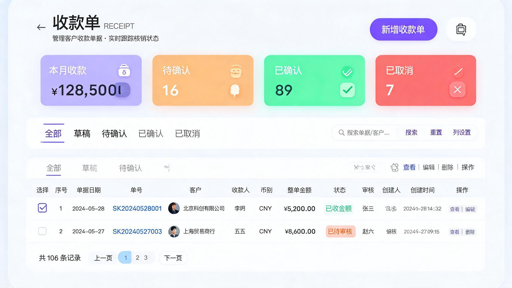
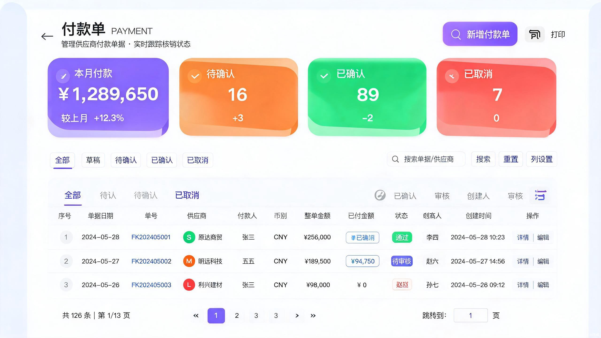
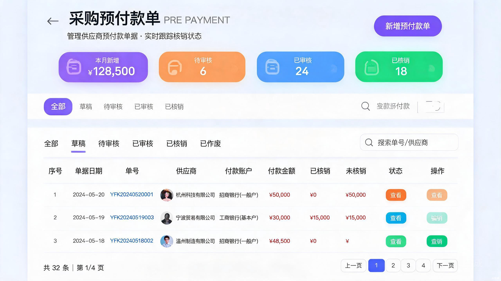
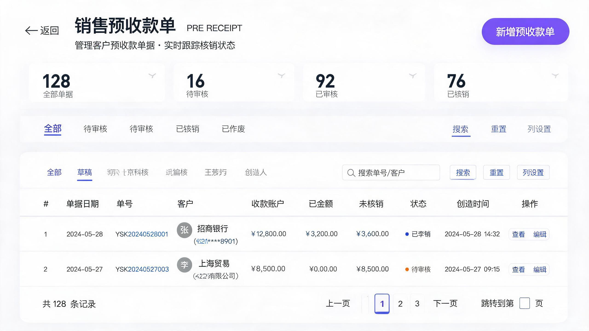
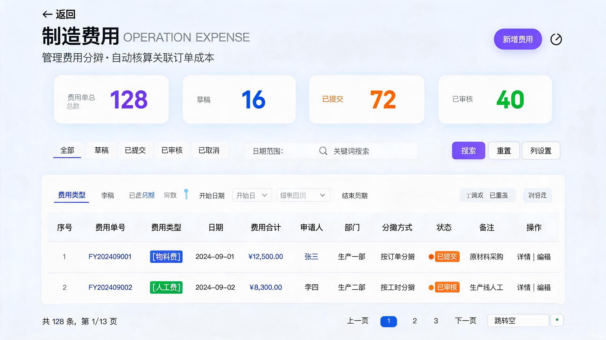
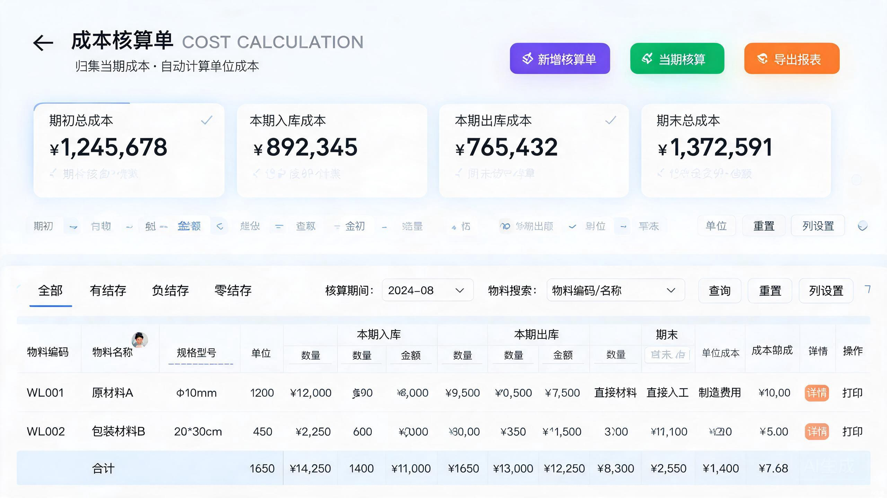
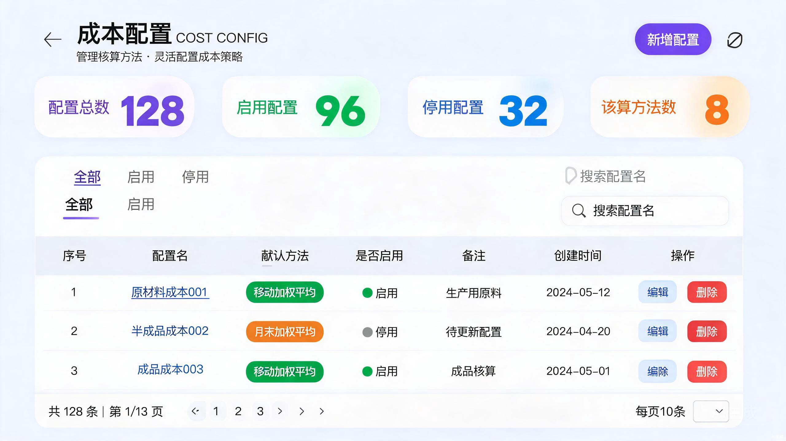
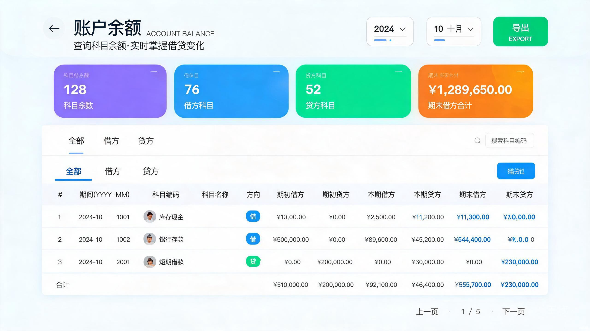
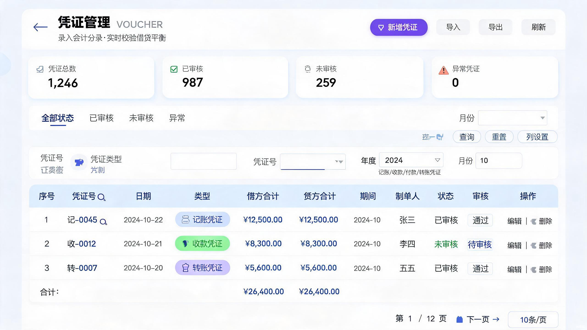

# 财务管理模块操作手册

> 模块代号：FINANCE
> 适用版本：智能 ERP 系统
> 文档目的：指导用户使用财务管理模块的各个子功能，包括收款单、付款单、采购预付款、销售预收款、制造费用、成本核算、成本配置、账户余额以及凭证管理。

---

## 目录

1. [模块概述](#1-模块概述)
2. [收款单（PaymentReceiptList / PaymentReceiptEdit）](#2-收款单paymentreceiptlist--paymentreceivedit)
3. [付款单（PaymentVoucherList / PaymentVoucherEdit）](#3-付款单paymentvoucherlist--paymentvoucheredit)
4. [采购预付款（PurchasePrePaymentList / PurchasePrePaymentEdit）](#4-采购预付款purchaseprepaymentlist--purchaseprepaymentedit)
5. [销售预收款（SalePreReceiptList / SalePreReceiptEdit）](#5-销售预收款saleprereceiptlist--saleprereceiptedit)
6. [制造费用（OperationExpenseList / OperationExpenseEdit）](#6-制造费用operationexpenselist--operationexpenseedit)
7. [成本核算（CostCalculationList / CostCalculationEdit）](#7-成本核算costcalculationlist--costcalculationedit)
8. [成本配置（CostConfigList）](#8-成本配置costconfiglist)
9. [账户余额（AccountBalanceList）](#9-账户余额accountbalancelist)
10. [凭证管理（VoucherList）](#10-凭证管理voucherlist)
11. [通用功能与约定](#11-通用功能与约定)

---

## 1. 模块概述

财务管理模块是 ERP 系统的核心账务模块之一，承担企业资金收付、往来核销、费用归集、成本核算及会计凭证管理等全流程财务职责。本模块以"资金流"与"成本流"为中心，向上衔接销售收款与采购付款业务，向下贯通费用分摊、成本核算与会计凭证生成，实现业务数据向财务数据的自动转换与实时反映。

### 1.1 模块功能架构

| 子模块 | 核心职责 | 单据性质 |
| --- | --- | --- |
| 收款单 | 记录客户收款业务，支持预收款核销与应收单核销，确认后影响账户余额 | 业务单据（带审批流程） |
| 付款单 | 记录供应商付款业务，支持预付款核销与应付单核销，确认后影响账户余额 | 业务单据（带审批流程） |
| 采购预付款 | 管理向供应商预付的款项，支持审核、核销、作废全流程 | 业务单据（带审批流程） |
| 销售预收款 | 管理向客户预收的款项，支持审核、核销、作废全流程 | 业务单据（带审批流程） |
| 制造费用 | 录入各项费用支出并按对象分摊，审核后自动归集到成本核算 | 业务单据（带审批流程） |
| 成本核算 | 归集当期成本数据，自动计算产品单位成本与成本构成 | 业务单据（带审批流程） |
| 成本配置 | 维护成本核算方法策略，控制启用状态 | 配置类（无审批流程） |
| 账户余额 | 查询各会计科目的期初、本期发生与期末余额 | 查询类（系统自动生成） |
| 凭证管理 | 录入与管理会计分录，实时校验借贷平衡 | 业务单据（带审批流程） |

> 说明：本模块中收款单、付款单、采购预付款、销售预收款、制造费用、成本核算、凭证管理均为系统内置审批流程的业务单据，遵循统一的单据状态机管理。

### 1.2 单据状态流转约定

本模块业务单据采用统一的状态机管理，常见状态包括：

- **草稿**：单据新建或保存后的初始状态，可编辑、可删除、可取消。
- **待审核 / 待确认**：草稿单据提交后进入此状态，等待有审核权限的用户处理。
- **已生效 / 已确认**：审核/确认通过后的状态，单据已落地财务影响（账户余额变动、核销生效、成本归集等），不可再编辑。
- **已核销**：预收/预付款单据在审核后完成核销的状态。
- **已取消 / 已作废**：单据作废，不再参与业务流程。

> 预收/预付款单据采用数字状态码：0 草稿 / 1 待审核 / 2 已生效 / 3 已核销 / 4 已作废。

### 1.3 进入方式

在系统左侧导航菜单中点击「财务管理」即可进入模块首页，再通过首页卡片或子菜单进入各子模块。每个子模块页面左上角均提供「返回」按钮，可回到财务管理首页。

---

## 2. 收款单（PaymentReceiptList / PaymentReceiptEdit）

### 2.1 功能说明

收款单用于记录企业向客户收取款项的业务单据，是应收账款管理的核心入口。收款单支持多账户收款明细录入，并具备两项核心核销能力：

- **预收款核销**：将本次收款金额与客户已生效的销售预收款单进行核销冲抵。
- **应收单核销**：将本次收款金额与客户的应收单（来源单据）进行核销冲抵，自动结案。

收款单确认后，将影响账户余额并联动应收账款台账。单据编号前缀为 **SK**。

### 2.2 界面描述

**列表页**自上而下分为四个区域：

1. **页面标题栏**：左侧显示"收款单 RECEIPT"标题及副标题"管理客户收款单据 · 实时跟踪核销状态"，右侧提供「新增收款单」按钮（紫色渐变）和「打印」按钮。
2. **数据概览卡片**：四张统计卡片横向排列，分别展示本月收款（紫色）、待确认（橙色）、已确认（绿色）、已取消（红色）。
3. **搜索筛选区**：左侧为状态标签页（全部 / 草稿 / 待确认 / 已确认 / 已取消，带数量徽标），右侧为单号/客户名称搜索框、搜索/重置按钮、列设置按钮。
4. **数据表格区**：展示收款单明细，包含单据日期、单号（蓝色可点击链接）、客户（带首字母头像）、收款人、币别、整单金额、已收金额、状态（彩色圆点+标签）、审核状态、创建人、创建时间及操作列。表格底部显示总记录数与分页器。

**编辑页**采用可折叠卡片布局，包含以下区域：

- **基本信息**：分为单据信息（单号、收款日期、单据流水）、客户信息（客户、客户名称、收款人、部门）、交易信息（币种、汇率、结算方式、收款账户）、其他（备注）。
- **收款明细**：明细表格包含账户、银行账号、收款金额、收款本位币、备注列，支持添加/删除明细行。
- **预收款核销**：通过弹窗选择客户已生效且未核销完的销售预收款单，表格展示单据类型、单据日期、来源单号、金额、已核金额、未核金额、本次核销金额、结案状态。
- **应收单核销**：通过弹窗选择客户未结清的应收单，表格展示应收单号、单据日期、来源单据、应收金额、已收金额、未收金额、本次收款金额、是否结案，底部带合计行。
- **金额汇总**：展示收款金额合计、预收款核销合计、应收单核销合计、实际收款（转入预收）。
- **审核流转**：以流程图展示创建单据 → 提交确认 → 确认收款三个节点。

### 2.3 操作步骤

#### 2.3.1 新增收款单

1. 在收款单列表页点击右上角「新增收款单」按钮，进入编辑页。
2. 在「基本信息」卡片中填写收款日期（必填）、选择客户（必填，选择后自动带出客户名称与默认币种）、收款人、部门。
3. 在「交易信息」中选择币种（必填）、汇率、结算方式、收款账户。
4. 在「收款明细」卡片中点击「添加明细」，选择账户、输入银行账号与收款金额，系统自动按汇率计算收款本位币金额。
5. （可选）在「预收款核销」卡片中点击「选择预收款」，在弹窗中勾选当前客户已生效且未核销完的预收款单，确认后录入本次核销金额（不可超过未核金额）。
6. （可选）在「应收单核销」卡片中点击「选应收单」，在弹窗中勾选当前客户未结清的应收单，确认后录入本次收款金额。
7. 点击顶部「保存」按钮保存为草稿，或点击「提交确认」直接提交为待确认状态。

#### 2.3.2 编辑收款单

1. 在列表页点击单号链接或操作列的「编辑」按钮进入编辑页。
2. 仅草稿状态的单据允许编辑，修改字段后点击「保存」。

#### 2.3.3 删除收款单

1. 在列表页操作列点击「删除」按钮。
2. 在确认弹窗中点击「确定」，仅草稿状态的单据可删除。

#### 2.3.4 提交确认与确认收款

1. **提交确认**：在编辑页点击「提交确认」按钮，单据状态由"草稿"变为"待确认"。
2. **确认收款**：待确认状态下，点击顶部「确认收款」按钮，在确认弹窗中点击「确定」，单据状态变为"已确认"，确认后不可修改。

#### 2.3.5 取消单据

在草稿状态下，点击顶部「取消」按钮并确认，单据状态变为"已取消"。

#### 2.3.6 搜索与筛选

- 在搜索框输入单号或客户名称关键字，点击「搜索」或按回车键查询。
- 点击状态标签页可按状态快速过滤。
- 点击「重置」清空所有筛选条件。

#### 2.3.7 打印

- **单张打印**：在编辑页点击「打印」按钮，打开打印预览弹窗。
- **批量打印**：在列表页勾选一行单据后点击「打印」按钮（一次仅支持打印一张）。

### 2.4 业务流程说明

收款单的完整业务流程为：**新建收款单 → 录入收款明细 → 选择预收款/应收单核销 → 保存草稿 → 提交确认 → 确认收款**。确认收款后，系统自动应用预收款核销（调用核销接口更新预收款单的已核金额），并将实际收款金额转入客户预收账款。应收单核销明细在确认后更新应收单的已收金额与结案状态。

### 2.5 注意事项

- 切换客户时，若已存在核销明细，系统将提示并清空已选预收款核销与应收单核销明细，请谨慎操作。
- 本次核销金额不可超过来源单据的未核/未收金额，系统会自动校验并截断。
- 收款明细至少需要一行才能保存。
- 已确认的单据不可再编辑，如需调整请走重置草稿流程或新建冲销单据。

---

## 3. 付款单（PaymentVoucherList / PaymentVoucherEdit）

### 3.1 功能说明

付款单用于记录企业向供应商支付款项的业务单据，是应付账款管理的核心入口。付款单支持多账户付款明细录入，并具备两项核心核销能力：

- **预付款核销**：将本次付款金额与供应商已生效的采购预付款单进行核销冲抵。
- **应付单核销**：将本次付款金额与供应商的应付单进行核销冲销，自动结案。

付款单确认后，将影响账户余额并联动应付账款台账。单据编号前缀为 **FK**。

### 3.2 界面描述

**列表页**布局与收款单类似，自上而下分为：

1. **页面标题栏**：左侧显示"付款单 PAYMENT"标题及副标题"管理供应商付款单据 · 实时跟踪核销状态"，右侧提供「新增付款单」与「打印」按钮。
2. **数据概览卡片**：本月付款（紫色）、待确认（橙色）、已确认（绿色）、已取消（红色）。
3. **搜索筛选区**：状态标签页（全部 / 草稿 / 待确认 / 已确认 / 已取消）与单号/供应商名称搜索框。
4. **数据表格区**：包含单据日期、单号、供应商（带首字母头像）、付款人、币别、整单金额、已付金额、状态、审核状态、创建人、创建时间及操作列。

**编辑页**采用可折叠卡片布局，包含：

- **基本信息**：单据信息（单号 FK 前缀、付款日期、单据流水）、供应商信息（供应商、供应商名称、付款人、部门）、交易信息（币种、汇率、结算方式、付款账户）、其他（备注）。
- **付款明细**：账户、银行账号、付款金额、付款本位币、备注。
- **预付款核销**：通过弹窗选择供应商已生效且未核销完的采购预付款单。
- **应付单核销**：通过弹窗选择供应商未结清的应付单，录入本次付款金额。
- **金额汇总**：付款金额合计、预付款核销合计、应付单核销合计、实际付款（转入预付）。
- **审核流转**：创建单据 → 提交确认 → 确认付款。

### 3.3 操作步骤

#### 3.3.1 新增付款单

1. 在付款单列表页点击「新增付款单」按钮，进入编辑页。
2. 填写付款日期（必填）、选择供应商（必填）、付款人、部门。
3. 选择币种（必填）、汇率、结算方式、付款账户。
4. 在「付款明细」中点击「添加明细」，选择账户、输入银行账号与付款金额。
5. （可选）在「预付款核销」中点击「选择预付款」，勾选供应商已生效且未核销完的预付款单，录入本次核销金额。
6. （可选）在「应付单核销」中点击「选应付单」，勾选供应商未结清的应付单，录入本次付款金额。
7. 点击「保存」保存为草稿，或点击「提交确认」直接提交。

#### 3.3.2 编辑 / 删除

- **编辑**：点击单号或操作列「编辑」进入编辑页，仅草稿状态可编辑。
- **删除**：在操作列点击「删除」并确认，仅草稿状态可删除。

#### 3.3.3 提交确认与确认付款

1. **提交确认**：在编辑页点击「提交确认」，单据变为"待确认"。
2. **确认付款**：待确认状态下点击「确认付款」并确认，单据变为"已确认"，不可再修改。

#### 3.3.4 搜索与打印

- 在搜索框输入单号或供应商名称查询，或通过状态标签页过滤。
- 点击「重置」清空筛选条件。
- 在编辑页或列表页（勾选一行后）点击「打印」进行单据打印。

### 3.4 业务流程说明

付款单的完整业务流程为：**新建付款单 → 录入付款明细 → 选择预付款/应付单核销 → 保存草稿 → 提交确认 → 确认付款**。确认付款后，系统自动应用预付款核销，并将实际付款金额转入供应商预付账款，同时更新应付单的已付金额与结案状态。

### 3.5 注意事项

- 切换供应商时会清空已选核销明细，请先确认供应商再进行核销操作。
- 本次核销/付款金额不可超过来源单据的未核/未付金额。
- 付款明细至少需要一行才能保存。
- 已确认的单据不可编辑。

---

## 4. 采购预付款（PurchasePrePaymentList / PurchasePrePaymentEdit）

### 4.1 功能说明

采购预付款单用于管理企业向供应商预先支付的款项。预付款单审核后可用于后续采购业务的核销冲抵，支持关联采购订单。单据编号前缀为 **YFK**。预付款单采用数字状态码管理：0 草稿 / 1 待审核 / 2 已生效 / 3 已核销 / 4 已作废。

### 4.2 界面描述

**列表页**自上而下分为：

1. **页面标题栏**：左侧显示"采购预付款单 PRE PAYMENT"标题及副标题"管理供应商预付款单据 · 实时跟踪核销状态"，右侧提供「新增预付款单」按钮。
2. **数据概览卡片**：本月新增（紫色）、待审核（橙色）、已生效（蓝色）、已核销（绿色）。
3. **搜索筛选区**：状态标签页（全部 / 草稿 / 待审核 / 已生效 / 已核销 / 已作废）与单号/供应商名称搜索框。
4. **数据表格区**：包含单据日期、单号（YFK 前缀，蓝色链接）、供应商（带首字母头像）、付款账户、付款金额、已核销、未核销、状态及操作列。

**编辑页**采用可折叠卡片布局，包含：

- **基本信息**：单据信息（单号、付款日期、关联采购订单）、供应商信息（供应商、付款人）、交易信息（币别、汇率、付款账户、付款金额、本位币金额）、其他（备注）。
- **核销明细**：账户、银行账号、付款金额、付款本位币、已核金额、已核本位币、退回金额、退回本位币、备注，底部带金额汇总（付款金额、已核销、未核销）。
- **附件资料**：支持上传图片、PDF、Word、Excel 等文件。
- **审核流转**：创建单据 → 提交审核 → 审核通过 → 核销完成四个节点。

**核销弹窗**：在列表页或编辑页触发核销时弹出，展示单号、供应商、未核销金额，可添加核销行录入来源单号、来源类型（采购订单 / 采购入库单 / 采购发票）、核销金额。

### 4.3 操作步骤

#### 4.3.1 新增预付款单

1. 在列表页点击「新增预付款单」按钮，进入编辑页。
2. 填写付款日期（必填），点击关联订单右侧搜索按钮选择采购订单（可选）。
3. 点击供应商右侧搜索按钮，在弹窗中双击选择供应商（必填）。
4. 选择币别、汇率，点击付款账户右侧搜索按钮选择账户。
5. 输入付款金额（必填），系统自动计算本位币金额。
6. （可选）在核销明细中添加明细行，录入账户、银行账号等信息。
7. 在备注中填写说明信息，上传附件（可选）。
8. 点击「保存」保存为草稿，或点击「提交审核」提交为待审核状态。

#### 4.3.2 编辑 / 删除

- **编辑**：点击单号或操作列「编辑」进入编辑页，仅草稿（状态 0）状态可编辑。
- **删除**：在操作列点击「删除」并确认，仅草稿状态可删除。

#### 4.3.3 审核与作废

1. **审核**：待审核（状态 1）状态下，在编辑页点击「审核」按钮并确认，单据变为"已生效"（状态 2）。
2. **作废**：已生效（状态 2）状态下，在编辑页点击「作废」按钮并确认，单据变为"已作废"（状态 4）。

#### 4.3.4 核销

1. 已生效（状态 2）状态下，在编辑页点击「核销」按钮或在列表页操作列点击核销，打开核销弹窗。
2. 查看单号、供应商与未核销金额信息。
3. 点击「添加核销行」，录入来源单号、选择来源类型、输入核销金额。
4. 核销总额不可超过未核销金额，确认后点击「确认核销」，单据在核销完成后变为"已核销"（状态 3）。

#### 4.3.5 搜索与筛选

- 在搜索框输入单号或供应商名称查询。
- 通过状态标签页按状态过滤。
- 点击「重置」清空筛选条件。

#### 4.3.6 打印

在编辑页点击「打印」按钮，打开打印预览弹窗。

### 4.4 业务流程说明

采购预付款单的完整业务流程为：**新建预付款单 → 选择供应商与付款账户 → 保存草稿 → 提交审核 → 审核通过 → 核销 → 已核销**。审核通过的预付款单可用于付款单的预付款核销，核销完成后单据结案。

### 4.5 注意事项

- 供应商、付款账户通过弹窗选择，不可直接输入。
- 核销总额不可超过未核销金额，否则系统会提示。
- 已生效/已核销的单据不可编辑，作废后不可恢复。
- 外币业务时，系统按汇率自动折算本位币金额。

---

## 5. 销售预收款（SalePreReceiptList / SalePreReceiptEdit）

### 5.1 功能说明

销售预收款单用于管理企业向客户预先收取的款项。预收款单审核后可用于后续销售业务的核销冲抵，支持关联销售订单。单据编号前缀为 **YSK**。预收款单采用数字状态码管理：0 草稿 / 1 待审核 / 2 已生效 / 3 已核销 / 4 已作废。

### 5.2 界面描述

**列表页**自上而下分为：

1. **页面标题栏**：左侧显示"销售预收款单 PRE RECEIPT"标题及副标题"管理客户预收款单据 · 实时跟踪核销状态"，右侧提供「新增预收款单」按钮。
2. **数据概览卡片**：四张统计卡片展示各项状态数量。
3. **搜索筛选区**：状态标签页（全部 / 草稿 / 待审核 / 已生效 / 已核销 / 已作废）与单号/客户名称搜索框。
4. **数据表格区**：包含单据日期、单号（YSK 前缀，蓝色链接）、客户（带首字母头像）、收款账户、收款金额、已核销、未核销、状态、创建人、创建时间及操作列。

**编辑页**采用可折叠卡片布局，包含：

- **基本信息**：单据信息（单号、收款日期、关联销售订单）、客户信息（客户、收款人）、交易信息（币别、汇率、收款账户、收款金额、本位币金额）、其他（备注）。
- **核销明细**：账户、银行账号、收款金额、收款本位币、已核金额、已核本位币、退回金额、退回本位币、备注，底部带金额汇总（收款金额、已核销、未核销）。
- **附件资料**：支持上传多种格式文件。
- **审核流转**：创建单据 → 提交审核 → 审核通过 → 核销完成四个节点。

**核销弹窗**：展示单号、客户、未核销金额，可添加核销行录入来源单号、来源类型（销售订单 / 销售出库单 / 销售发票）、核销金额。

### 5.3 操作步骤

#### 5.3.1 新增预收款单

1. 在列表页点击「新增预收款单」按钮，进入编辑页。
2. 填写收款日期（必填），点击关联订单右侧搜索按钮选择销售订单（可选）。
3. 点击客户右侧搜索按钮，在弹窗中双击选择客户（必填）。
4. 选择币别、汇率，点击收款账户右侧搜索按钮选择账户。
5. 输入收款金额（必填），系统自动计算本位币金额。
6. 填写备注，上传附件（可选）。
7. 点击「保存」保存为草稿，或点击「提交审核」提交为待审核状态。

#### 5.3.2 编辑 / 删除

- **编辑**：点击单号或操作列「编辑」进入编辑页，仅草稿（状态 0）状态可编辑。
- **删除**：在操作列点击「删除」并确认，仅草稿状态可删除。

#### 5.3.3 审核与作废

1. **审核**：待审核（状态 1）状态下，在编辑页点击「审核」按钮并确认，单据变为"已生效"（状态 2）。
2. **作废**：已生效（状态 2）状态下，在编辑页点击「作废」按钮并确认，单据变为"已作废"（状态 4）。

#### 5.3.4 核销

1. 已生效状态下，在编辑页点击「核销」按钮或在列表页操作列点击核销，打开核销弹窗。
2. 查看单号、客户与未核销金额。
3. 点击「添加核销行」，录入来源单号、选择来源类型、输入核销金额。
4. 核销总额不可超过未核销金额，确认后点击「确认核销」，核销完成后单据变为"已核销"（状态 3）。

#### 5.3.5 搜索与打印

- 在搜索框输入单号或客户名称查询，通过状态标签页过滤。
- 点击「重置」清空筛选条件。
- 在编辑页点击「打印」按钮进行单据打印。

### 5.4 业务流程说明

销售预收款单的完整业务流程为：**新建预收款单 → 选择客户与收款账户 → 保存草稿 → 提交审核 → 审核通过 → 核销 → 已核销**。审核通过的预收款单可用于收款单的预收款核销，核销完成后单据结案。

### 5.5 注意事项

- 客户、收款账户通过弹窗选择，不可直接输入。
- 核销总额不可超过未核销金额。
- 已生效/已核销的单据不可编辑，作废后不可恢复。
- 外币业务时，系统按汇率自动折算本位币金额。

---

## 6. 制造费用（OperationExpenseList / OperationExpenseEdit）

### 6.1 功能说明

制造费用模块用于录入企业各项费用支出并按对象进行分摊，审核后自动归集到对应产品的成本核算单。费用类型涵盖人工费用、制造费用、水电费、办公费、出差、宴请、快递及其他。分摊方式支持按对象（生产入库、采购入库、销售退货等单据）进行自动或手动分摊，实现费用向成本的转化。

### 6.2 界面描述

**列表页**自上而下分为：

1. **页面标题栏**：左侧显示"制造费用 OPERATION EXPENSE"标题及副标题"管理费用分摊 · 自动核算关联订单成本"，右侧提供「新增费用」按钮和「刷新」按钮。
2. **数据概览卡片**：费用单总数（紫色）、草稿（蓝色）、已提交（橙色）、已生效（绿色）。
3. **搜索筛选区**：状态标签页（全部 / 草稿 / 已提交 / 已生效 / 已取消）与筛选条件（费用类型下拉、日期范围选择器、关键字搜索框、搜索/重置/列设置按钮）。
4. **数据表格区**：包含费用单号（蓝色链接，固定左侧）、费用类型（彩色标签）、日期、费用合计、申请人、部门、分摊方式、状态、备注及操作列。

**编辑页**采用可折叠卡片布局，包含：

- **基本信息**：单据信息（费用单号、费用日期、状态）、申请人信息（申请人、部门、分摊方式）、其他（备注）。
- **费用明细**：费用类型、费用金额、备注，底部带费用合计行。
- **分摊明细**：分摊对象类型、分摊对象（单号）、费用类型、分摊基数、比例%、分摊金额、备注，顶部带差额提示栏（显示分摊合计/费用合计/差额，平衡时显示"已平"），支持「自动分摊」与「新增分摊行」。
- **附件资料**：支持上传多种格式文件。
- **审核流转**：创建单据 → 提交审核 → 审核通过三个节点。

### 6.3 操作步骤

#### 6.3.1 新增费用单

1. 在列表页点击「新增费用」按钮，进入编辑页。
2. 在「基本信息」中填写费用日期（必填），系统自动带出申请人，选择部门与分摊方式（必填）。
3. 在「费用明细」中点击「新增费用行」，选择费用类型、输入费用金额、填写备注，系统自动计算费用合计。
4. 在「分摊明细」中点击「自动分摊」（需先选择分摊方式）或「新增分摊行」手动添加分摊行：
   - 选择分摊对象类型（如生产入库、采购入库、销售退货等）。
   - 选择分摊对象（具体单号）。
   - 选择费用类型，输入分摊基数与比例（或直接输入分摊金额）。
5. 确认差额提示栏显示"已平"（分摊合计 = 费用合计）。
6. 填写备注，上传附件（可选）。
7. 点击「保存」保存为草稿，或点击「提交审核」提交。

#### 6.3.2 编辑 / 删除

- **编辑**：点击费用单号或操作列「编辑」进入编辑页，仅草稿状态可编辑。
- **删除**：在编辑页「更多操作」下拉菜单中点击「删除」，仅草稿状态可删除。

#### 6.3.3 提交审核与审核

1. **提交审核**：在编辑页点击「提交审核」按钮，单据状态变为"已提交"。
2. **审核**：已提交状态下，在编辑页「更多操作」下拉菜单中点击「审核」，单据状态变为"已生效"。

#### 6.3.4 搜索与筛选

- 通过费用类型下拉、日期范围选择器、关键字搜索框组合筛选。
- 通过状态标签页按状态过滤。
- 点击「重置」清空筛选条件。

#### 6.3.5 打印与操作日志

- 在编辑页「更多操作」下拉菜单中点击「打印」进行单据打印。
- 点击「操作日志」查看单据变更记录。

### 6.4 业务流程说明

制造费用的完整业务流程为：**新建费用单 → 录入费用明细 → 配置分摊明细（自动/手动） → 保存草稿 → 提交审核 → 审核通过**。审核通过后，关联"入库类型单据"（生产入库/采购入库/销售退货）的费用将自动汇总到对应产品的成本核算单，参与当期成本核算。

### 6.5 注意事项

- 分摊合计必须等于费用合计（差额为 0）才能正常审核，系统通过差额提示栏实时校验。
- 使用「自动分摊」前需先选择分摊方式。
- 关联入库类型单据的费用，审核后将影响产品成本核算，请确保分摊对象准确。
- 费用类型包括：人工费用、制造费用、水电费、办公费、出差、宴请、快递、其他。

---

## 7. 成本核算（CostCalculationList / CostCalculationEdit）

### 7.1 功能说明

成本核算模块用于归集当期各项成本数据（直接材料、直接人工、制造费用），自动计算产品的单位成本与成本构成。支持按期间查询成本报表，提供"当期核算"功能自动归集指定期间所有已生效的费用分摊、领料单、报工单数据。核算方法支持实际成本法、标准成本法、作业成本法。

### 7.2 界面描述

**列表页（成本报表）**自上而下分为：

1. **页面标题栏**：左侧显示"成本核算单 COST CALCULATION"标题及副标题"归集当期成本 · 自动计算单位成本"，右侧提供「新增核算单」按钮、「当期核算」按钮（绿色）和「导出报表」按钮（橙色）。
2. **数据概览卡片**：四张统计卡片。
3. **搜索筛选区**：状态标签页（全部 / 有结存 / 负结存 / 零结存）与核算期间月份选择器（YYYY-MM）、物料编码/名称搜索框、查询/重置/列设置按钮。
4. **成本报表表格**：采用分组表头，包含物料编码、物料名称（带首字母头像）、规格型号、单位、期初（数量/金额）、本期入库（数量/金额）、本期出库（数量/金额）、期末（数量/金额）、成本构成（直接材料/直接人工/制造费用）、单位成本及操作列（详情/打印），底部带合计行。

**编辑页**采用可折叠卡片布局，包含：

- **基本信息**：单据信息（核算名称、核算日期、核算方法、状态）、商品信息（商品、商品编码、数量）、其他（备注）。
- **成本明细**：成本类型（直接材料/直接人工/制造费用）、成本项目、商品、单位、数量、单价、金额，支持添加/删除行。
- **成本汇总**：直接材料、直接人工、制造费用、总成本、单位成本。
- **附件**：支持上传附件。
- **审核流转**：创建单据 → 核算完成 → 确认成本三个节点。

**当期核算弹窗**：选择核算期间（YYYY年MM月）后确认，系统自动归集该期间所有已生效的费用分摊、领料单、报工单数据，为每个有成本数据的物料自动计算成本。

### 7.3 操作步骤

#### 7.3.1 查询成本报表

1. 在列表页的核算期间选择器中选择目标月份（YYYY-MM）。
2. （可选）在物料编码/名称搜索框中输入关键字。
3. 点击「查询」按钮，表格刷新展示该期间各物料的成本数据。
4. 通过状态标签页可按结存情况过滤（有结存/负结存/零结存）。

#### 7.3.2 当期核算

1. 点击右上角「当期核算」按钮，打开确认弹窗。
2. 在弹窗中选择核算期间（必填）。
3. 阅读提示信息后点击「确认核算」，系统自动归集该期间所有已生效的费用分摊、领料单、报工单数据并计算成本。
4. 核算完成后，成本报表自动刷新。

#### 7.3.3 新增核算单

1. 点击「新增核算单」按钮，进入编辑页。
2. 填写核算名称（必填）、核算日期（必填）、选择核算方法（必填：实际成本法/标准成本法/作业成本法）。
3. 填写商品名称、商品编码、数量（必填）。
4. 在「成本明细」中点击「添加行」，选择成本类型、录入成本项目、商品、单位、数量、单价，系统自动计算金额。
5. 系统自动汇总直接材料、直接人工、制造费用及总成本、单位成本。
6. 点击「保存」保存为草稿，或点击「提交核算」直接提交为"已核算"状态。

#### 7.3.4 确认成本

1. 已核算状态下，在编辑页点击「确认」按钮，单据状态变为"已确认"。
2. 已确认的单据不可再修改。

#### 7.3.5 导出报表与打印

- 点击右上角「导出报表」按钮，导出成本报表数据。
- 在列表页操作列点击「打印」或在编辑页点击「打印」按钮，进行单据打印。

### 7.4 业务流程说明

成本核算的完整业务流程为：**当期核算（自动归集）或 新建核算单 → 录入成本明细 → 提交核算 → 确认成本**。当期核算会自动汇总制造费用分摊单（关联入库类型）、领料单、报工单等数据，按物料计算期初、本期入库、本期出库、期末及成本构成，最终得出单位成本。

### 7.5 注意事项

- 查询成本报表前需先选择核算期间，否则表格为空。
- 期末数量为负数时，系统以红色标识，提示检查出入库数据是否准确。
- 当期核算会自动归集已生效数据，请确保相关费用分摊单、领料单、报工单已生效完毕。
- 已确认的核算单不可修改，如需调整请走重置草稿流程。

---

## 8. 成本配置（CostConfigList）

### 8.1 功能说明

成本配置模块用于维护成本核算方法策略，控制各配置的启用状态。支持配置移动加权平均、月末加权平均、固定成本等核算方法，为成本核算提供方法基础。本模块为配置类功能，无审批流程。

### 8.2 界面描述

**列表页**自上而下分为：

1. **页面标题栏**：左侧显示"成本配置 COST CONFIG"标题及副标题"管理核算方法 · 灵活配置成本策略"，右侧提供「新增配置」按钮和「刷新」按钮。
2. **数据概览卡片**：配置总数（紫色）、启用配置（绿色）、停用配置（蓝色）、核算方法数（橙色）。
3. **搜索筛选区**：状态标签页（全部 / 启用 / 停用）与配置名搜索框、搜索/重置/列设置按钮。
4. **数据表格区**：包含配置名（蓝色可点击链接）、默认方法（彩色标签）、是否启用（绿色"启用"或灰色"停用"圆点+标签）、备注、创建时间及操作列（编辑/删除）。

**新增/编辑弹窗**：包含配置名（必填）、默认方法（必填：移动加权平均/月末加权平均/固定成本）、是否启用（开关）、备注字段。

### 8.3 操作步骤

#### 8.3.1 新增配置

1. 在列表页点击「新增配置」按钮，打开新增弹窗。
2. 输入配置名（必填）。
3. 选择默认方法（必填）：移动加权平均、月末加权平均或固定成本。
4. 通过开关设置是否启用（默认启用）。
5. 填写备注（可选）。
6. 点击「保存」按钮，保存成功后弹窗关闭，列表自动刷新。

#### 8.3.2 编辑配置

1. 在列表页点击配置名链接或操作列「编辑」按钮，打开编辑弹窗。
2. 修改各字段后点击「保存」。

#### 8.3.3 删除配置

1. 在操作列点击「删除」按钮。
2. 在确认弹窗中点击「确定」完成删除。

#### 8.3.4 搜索与筛选

- 在配置名搜索框中输入关键字，点击「搜索」或按回车键查询（前端过滤）。
- 通过状态标签页按启用/停用状态过滤。
- 点击「重置」清空筛选条件。

### 8.4 业务流程说明

成本配置为基础配置功能，流程简单：**新增配置 → 设置默认方法与启用状态 → 保存**。配置完成后，成本核算模块可根据配置的核算方法进行成本计算。

### 8.5 注意事项

- 配置名不可为空，默认方法必须选择。
- 删除配置前请确认该配置未被成本核算单引用。
- 同时只建议启用一个配置作为默认核算方法。

---

## 9. 账户余额（AccountBalanceList）

### 9.1 功能说明

账户余额模块用于查询各会计科目的期初余额、本期借贷发生额与期末余额，实时掌握借贷变化。支持按年度、月份、科目编码筛选，并提供数据导出能力。本模块为纯查询页面，不提供新增、编辑、删除等操作。

### 9.2 界面描述

页面自上而下分为四个区域：

1. **页面标题栏**：左侧显示"账户余额 ACCOUNT BALANCE"标题及副标题"查询科目余额 · 实时掌握借贷变化"，右侧提供年度选择器、月份下拉选择和「导出」按钮（绿色）。
2. **数据概览卡片**：科目总数（紫色）、借方科目（蓝色）、贷方科目（绿色）、期末借方合计（橙色）。
3. **搜索筛选区**：状态标签页（全部 / 借方 / 贷方）与科目编码搜索框、搜索/重置/列设置按钮。
4. **余额表格区**：包含期间（YYYY-MM）、科目编码（蓝色）、科目名称（带首字母头像）、方向（借-蓝色/贷-绿色圆点+标签）、期初借方、期初贷方、本期借方、本期贷方、期末借方（蓝色加粗）、期末贷方（蓝色加粗），底部带合计行。

### 9.3 操作步骤

#### 9.3.1 查询余额

1. 在页面标题栏右侧选择年度与月份。
2. （可选）在科目编码搜索框中输入编码关键字。
3. 点击「搜索」按钮或在输入框中按回车键执行查询。
4. 通过状态标签页可按借方/贷方方向过滤。

#### 9.3.2 重置筛选

点击「重置」按钮，恢复默认年度与月份（当前年月），清空科目编码筛选。

#### 9.3.3 导出

1. 点击右上角「导出」按钮。
2. 系统将当前列表数据导出为 CSV 文件（文件名格式：科目余额表_YYYY-MM.csv），包含期间、科目编码、科目名称、方向、期初借方、期初贷方、本期借方、本期贷方、期末借方、期末贷方等字段。
3. 若列表无数据，系统会提示"暂无数据可导出"。

### 9.4 业务流程说明

账户余额为查询类功能，数据由系统根据已生效的凭证自动汇总生成。流程为：**选择年度与月份 → 输入筛选条件 → 查询 → 查看/导出**。余额数据来源于凭证管理的会计分录，凭证审核后自动更新对应科目的余额。

### 9.5 注意事项

- 本页面为只读查询，不可直接修改余额数据，余额由凭证审核后自动更新。
- 导出格式为 CSV（含 BOM 头，兼容 Excel 中文显示）。
- 切换年度与月份后需点击搜索才会重新加载数据。
- 期末借方/贷方合计为当前列表数据的汇总，非全量数据汇总。

---

## 10. 凭证管理（VoucherList）

### 10.1 功能说明

凭证管理模块用于录入与管理会计分录，是连接业务数据与会计账务的桥梁。支持记账凭证、收款凭证、付款凭证、转账凭证四种类型，录入时实时校验借贷平衡（借方合计必须等于贷方合计），不平衡时禁止保存。凭证审核后自动更新账户余额。

### 10.2 界面描述

**列表页**自上而下分为：

1. **页面标题栏**：左侧显示"凭证管理 VOUCHER"标题及副标题"录入会计分录 · 实时校验借贷平衡"，右侧提供「新增凭证」按钮、「导入」按钮、「导出」按钮和「刷新」按钮。
2. **数据概览卡片**：四张统计卡片。
3. **搜索筛选区**：状态标签页与筛选条件（凭证号输入框、凭证类型下拉、年度输入框、月份输入框、查询/重置/列设置按钮）。
4. **凭证列表表格**：包含凭证号（蓝色链接）、日期、类型（彩色标签）、借方合计、贷方合计（蓝色）、期间（YYYY-MM）、制单人、状态（彩色圆点+标签）、审核状态及操作列，底部带合计行。

**新增/编辑弹窗**：包含凭证日期、凭证类型、会计期间（自动带出）、制单人、备注，以及凭证分录表格（序号、科目编码、科目名称、方向、借方金额、贷方金额、摘要），底部展示借方合计、贷方合计、差额，借贷不平衡时显示红色提示并禁用保存按钮。

**详情弹窗**：以描述列表形式展示凭证号、日期、类型、期间、制单人、审核人、状态、审核状态、记账人、备注，以及分录明细表格。

### 10.3 操作步骤

#### 10.3.1 新增凭证

1. 在列表页点击「新增凭证」按钮，打开新增弹窗。
2. 选择凭证日期（必填）、凭证类型（必填：记账凭证/收款凭证/付款凭证/转账凭证）。
3. 系统根据日期自动带出会计期间（年度-月份）。
4. 填写制单人、备注。
5. 在凭证分录表格中点击「增加行」添加分录：
   - 选择科目编码（必填，下拉可搜索）。
   - 系统自动带出科目名称。
   - 选择方向（借/贷）。
   - 输入借方金额或贷方金额（同一行只能填一方）。
   - 填写摘要。
6. 确认底部合计栏显示"借方合计 = 贷方合计"（差额为 0），否则保存按钮不可点击。
7. 点击「保存」按钮完成新增。

#### 10.3.2 编辑凭证

1. 在列表页点击凭证号链接或操作列「编辑」按钮，打开编辑弹窗。
2. 修改分录内容，确保借贷平衡后保存。

#### 10.3.3 删除凭证

1. 在操作列点击「删除」按钮。
2. 在确认弹窗中点击「确定」完成删除。

#### 10.3.4 查看详情

在操作列点击「查看」按钮，打开详情弹窗，查看凭证完整信息与分录明细。

#### 10.3.5 搜索与筛选

- 在凭证号输入框中输入凭证号查询。
- 通过凭证类型下拉按类型筛选。
- 输入年度与月份按会计期间筛选。
- 点击「查询」执行搜索，点击「重置」清空筛选条件。

#### 10.3.6 导入与导出

- **导入**：点击「导入」按钮，按系统模板上传凭证数据。
- **导出**：点击「导出」按钮，将当前列表数据导出。

### 10.4 业务流程说明

凭证管理的完整业务流程为：**新增凭证 → 录入分录 → 校验借贷平衡 → 保存 → 提交审核 → 审核通过 → 记账**。凭证审核通过后，系统自动更新账户余额表对应科目的期初、本期发生与期末余额。借贷必须平衡（借方合计 = 贷方合计）才能保存。

### 10.5 注意事项

- 凭证分录的借方合计必须等于贷方合计，否则无法保存，系统会实时提示"借贷不平衡"。
- 同一行分录只能填写借方金额或贷方金额中的一方，不可同时填写。
- 科目编码通过下拉选择，选择后自动带出科目名称。
- 凭证审核后将影响账户余额，请确保分录科目与金额准确。
- 会计期间由凭证日期自动带出，无需手动输入。

---

## 12. 报表中心（ReportingCenter）

### 12.1 功能说明

财务管理模块的报表中心提供全面的财务数据分析与报表功能，支持按期间、科目、业务类型等多维度查询财务数据。报表中心整合了收款、付款、预收预付、成本核算、账户余额等核心财务数据，提供标准财务报表模板与自定义查询能力，帮助用户快速获取财务分析结果。

### 12.2 报表类型

财务管理模块提供以下核心报表：

| 报表类型 | 功能描述 | 数据来源 |
| --- | --- | --- |
| 收款汇总表 | 按客户、期间统计收款金额与核销情况 | 收款单、销售预收款单 |
| 付款汇总表 | 按供应商、期间统计付款金额与核销情况 | 付款单、采购预付款单 |
| 应收账款账龄分析 | 按客户、账龄区间分析应收账款 | 应收单、收款单核销记录 |
| 应付账款账龄分析 | 按供应商、账龄区间分析应付账款 | 应付单、付款单核销记录 |
| 成本构成分析表 | 按物料、成本类型分析成本构成 | 成本核算单、制造费用分摊单 |
| 账户余额变动表 | 按科目、期间分析余额变动情况 | 账户余额表、凭证管理 |
| 财务科目汇总表 | 按科目、期间汇总借贷发生额 | 凭证管理、账户余额 |

### 12.3 界面描述

**报表中心页面**自上而下分为：

1. **页面标题栏**：左侧显示"财务报表中心 FINANCIAL REPORTS"标题及副标题"多维度财务数据分析 · 支持自定义查询"，右侧提供「新增报表」按钮、「导出报表」按钮（橙色）和「刷新」按钮。
2. **报表类型选择区**：横向排列的报表类型卡片，每个卡片显示报表名称、图标和简要说明，点击卡片进入对应报表查询页面。
3. **搜索筛选区**：根据不同报表类型提供对应的筛选条件，如期间选择器（年度/月份）、客户/供应商选择、科目编码搜索、状态过滤等。
4. **报表数据展示区**：采用表格或图表形式展示报表数据，支持数据导出、打印和自定义列设置。

### 12.4 操作步骤

#### 12.4.1 选择报表类型

1. 在报表中心页面点击对应的报表类型卡片（如"收款汇总表"）。
2. 进入该报表的查询页面，页面标题栏显示对应报表名称。

#### 12.4.2 设置筛选条件

1. 在搜索筛选区选择查询期间（必填：年度与月份）。
2. （可选）根据报表类型选择客户、供应商、科目编码等筛选条件。
3. 点击「查询」按钮执行报表查询。

#### 12.4.3 查看报表数据

1. 查询结果以表格形式展示在报表数据展示区。
2. 表格支持列设置（通过齿轮按钮自定义显示列）。
3. 支持分页显示（每页20/50/100条）。

#### 12.4.4 导出报表

1. 点击右上角「导出报表」按钮。
2. 系统将当前报表数据导出为Excel文件（文件名格式：报表类型_YYYY-MM.xlsx）。
3. 导出包含筛选条件和报表数据。

#### 12.4.5 打印报表

1. 在报表数据展示区点击「打印」按钮。
2. 打开打印预览弹窗，支持打印设置和预览。

### 12.5 业务流程说明

报表中心的业务流程为：**选择报表类型 → 设置筛选条件 → 执行查询 → 查看分析结果 → 导出/打印**。报表数据基于已生效的财务单据自动汇总生成，确保数据的准确性和一致性。

### 12.6 注意事项

- 报表数据来源于已生效的财务单据，未审核单据不参与报表计算。
- 查询期间必须选择，否则报表无数据。
- 导出报表支持Excel格式，包含完整的筛选条件和数据明细。
- 报表中心为只读功能，不可直接修改报表数据。

---

## 11. 通用功能与约定

### 11.1 通用页面元素

财务管理模块各子模块列表页均采用统一的页面布局风格，包含以下通用元素：

- **返回按钮**：页面左上角，点击返回财务管理首页。
- **数据概览卡片**：页面顶部展示关键统计指标，以彩色图标区分。
- **状态标签页**：左侧按单据状态快速过滤，带数量徽标。
- **搜索筛选区**：右侧提供关键字搜索与条件筛选，支持回车查询。
- **列设置**：通过齿轮按钮打开列设置抽屉，可自定义表格列的显示与隐藏，配置按页面持久化保存。
- **分页器**：表格底部展示总记录数与分页控件，支持切换每页条数（20/50/100）。
- **审核列**：列表表格中统一包含审核相关列（审核人、审核时间等），由 AuditColumns 组件统一渲染。

### 11.2 单据操作按钮约定

各业务单据的编辑页顶部操作栏根据单据状态动态显示不同按钮：

| 单据状态 | 可用操作 |
| --- | --- |
| 草稿 | 保存、提交审核/确认、取消/作废、删除、打印、操作日志 |
| 待审核/待确认 | 审核/确认、打印、操作日志 |
| 已生效/已确认 | 核销（预收预付）、作废、打印、操作日志 |
| 已核销/已关闭 | 打印、操作日志 |
| 已取消/已作废 | 打印、操作日志 |

### 11.3 金额与币别约定

- 所有金额默认保留两位小数，单位成本保留四位小数。
- 外币业务按汇率自动折算本位币金额，汇率精度为六位小数。
- 选择客户/供应商时自动带出其默认币种与汇率。
- 表格中金额列右对齐，使用等宽数字字体（tabular-nums）。

### 11.4 核销机制说明

财务管理模块的核销机制贯穿收款单、付款单、采购预付款、销售预收款四个子模块：

- **预收/预付款核销**：审核后的预收/预付款单可作为核销来源，在收款单/付款单中选择并录入本次核销金额，核销金额不可超过未核金额。
- **应收/应付单核销**：收款单/付款单可选择未结清的应收/应付单进行核销，录入本次收/付款金额，核销完成后单据自动结案。
- 核销操作在单据确认/审核后自动生效，更新来源单据的已核/已收/已付金额。

### 11.5 审批流程说明

本模块中收款单、付款单、采购预付款、销售预收款、制造费用、成本核算、凭证管理均为系统内置审批流程的业务单据。单据从草稿提交后进入审批流程，经有权限用户审核/确认后生效。审核后的单据将落地财务影响（账户余额变动、核销生效、成本归集、凭证记账等），不可直接编辑，如需调整需通过重置草稿或新建冲销单据处理。

### 11.6 操作日志

各业务单据编辑页均提供「操作日志」按钮，点击后弹出变更记录对话框，可查看该单据的完整操作历史，包括创建、修改、提交、审核、核销等操作的详细信息。
