# 系统管理模块操作手册

> 本手册覆盖智能ERP系统"系统管理"模块下的全部13个子模块，详细说明每个子模块的功能定位、界面布局、操作步骤与注意事项。本模块主要由系统管理员和超级管理员使用，用于维护用户、角色、权限、字典、自定义字段、打印模板、操作日志、系统参数、主题、序列号配置及AI数据策略等基础设置。

---

## 目录

1. [用户管理](#1-用户管理)
2. [角色管理](#2-角色管理)
3. [员工权限](#3-员工权限)
4. [字段权限](#4-字段权限)
5. [数据字典](#5-数据字典)
6. [自定义字段配置](#6-自定义字段配置)
7. [打印模板](#7-打印模板)
8. [操作日志](#8-操作日志)
9. [系统参数](#9-系统参数)
10. [设置中心](#10-设置中心)
11. [主题设置](#11-主题设置)
12. [序列号配置](#12-序列号配置)
13. [AI数据策略](#13-ai数据策略)

---

## 1. 用户管理

### 1.1 功能说明

用户管理用于维护ERP系统的登录账号。每个用户代表一位可登录系统的操作员，可关联真实员工、分配角色、设置启用状态等。用户管理是权限体系的第一道入口：先建用户、再分配角色、最后通过角色决定可访问的菜单和数据范围。

主要功能包括：
- 用户的增、删、改、查
- 分配角色（一个用户可绑定多个角色，权限取并集）
- 重置密码（管理员可强制重置，用户首次登录后修改）
- 启用/禁用账号
- 区分管理员账号与普通账号
- 支持按用户编码、用户名、真实姓名、邮箱、手机号等关键字检索

### 1.2 界面描述

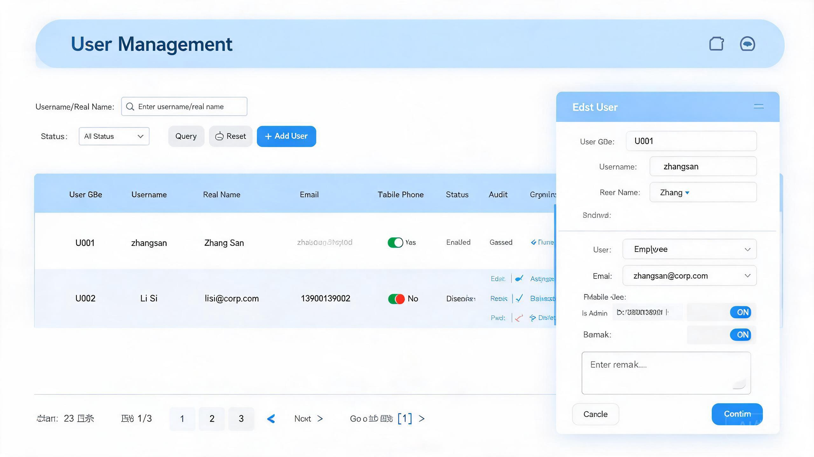

界面自上而下分为三个区域：
1. **顶部搜索栏**：提供用户编码、用户名、真实姓名、邮箱、手机号、状态等多个查询条件，以及"查询""重置""新增用户"三个按钮。
2. **中间数据表格**：以表格形式列出所有用户，列包括：用户编码、用户名、真实姓名、邮箱、手机号、是否管理员（红色"管理员"或灰色"普通"标签）、状态（绿色"启用"或灰色"禁用"标签）、创建人、创建时间、修改人、修改时间。
3. **操作列**：每行末尾提供"编辑""分配角色""重置密码""删除"四个操作按钮。

### 1.3 操作步骤

#### 新增用户
1. 在用户管理页面右上角点击"新增用户"按钮，系统弹出新增用户对话框。
2. 在对话框中依次填写：
   - **用户编码**：系统可自动生成（推荐），也可手动输入，例如 `U20260815001`。
   - **用户名**：登录账号，例如 `zhangsan`，必须唯一。
   - **真实姓名**：关联的员工姓名，例如 `张三`。
   - **邮箱**：用于找回密码和接收系统通知。
   - **手机号**：用于短信验证码登录。
   - **是否管理员**：勾选后该用户拥有跨模块超级权限，建议仅给IT管理员勾选。
   - **状态**：默认"启用"，禁用后用户无法登录。
   - **初始密码**：可手动设置，留空则使用系统默认初始密码。
3. 点击"保存"按钮完成新增。新用户首次登录时系统会提示修改密码。

#### 编辑用户
1. 在用户列表中找到目标用户，点击该行的"编辑"按钮。
2. 在弹出的编辑对话框中修改需要变更的字段。
3. 点击"保存"按钮提交修改。注意：用户名一旦创建不建议修改，否则会影响历史单据的操作人记录。

#### 分配角色
1. 在用户列表中点击"分配角色"按钮。
2. 在弹窗左侧"未分配角色"列表中勾选要分配的角色，点击向右箭头移到右侧"已分配角色"列表。
3. 点击"保存"完成角色分配。一个用户可分配多个角色，最终权限为所有角色权限的并集。

#### 重置密码
1. 在用户列表中点击"重置密码"按钮。
2. 系统弹出确认提示："确认将该用户密码重置为初始密码？"
3. 点击"确认"后密码被重置为系统默认初始密码，并通知用户尽快登录修改。

#### 删除用户
1. 在用户列表中点击"删除"按钮。
2. 系统弹出二次确认提示。
3. 点击"确认"完成删除。**注意**：若该用户已产生操作日志或关联业务单据，系统会拒绝删除并提示"该用户已产生业务数据，无法删除，建议改为禁用"。

### 1.4 注意事项

- **唯一性约束**：用户编码、用户名、邮箱、手机号必须唯一，重复时系统会报错并明确提示冲突字段。
- **管理员账号**：`admin`为系统内置超级管理员，不可删除、不可禁用，建议仅用于系统初始化和紧急维护。
- **删除限制**：已产生业务数据的用户不能删除，请改用"禁用"操作。
- **密码安全**：初始密码建议包含大小写字母+数字+特殊符号，长度不少于8位；用户首次登录后系统强制要求修改密码。
- **多租户隔离**：在多租户架构下，用户信息存储在`erp_platform`平台库中，跨租户共享；但业务数据按租户隔离。

---

## 2. 角色管理

### 2.1 功能说明

角色管理是ERP权限体系的核心。系统通过"用户—角色—权限"三层模型实现权限控制：用户绑定角色，角色关联菜单权限和数据权限。一个角色代表一类岗位（如销售员、采购员、财务、库管等），相同岗位的用户可复用同一角色，避免逐人配置。

主要功能包括：
- 角色的增、删、改、查
- 为角色分配菜单权限（决定可见菜单和可访问页面）
- 为角色分配数据权限（决定可见数据范围：全部、本部门、本部门及下级、仅本人）
- 复制角色（快速创建相似岗位的角色）
- 启用/禁用角色

### 2.2 界面描述

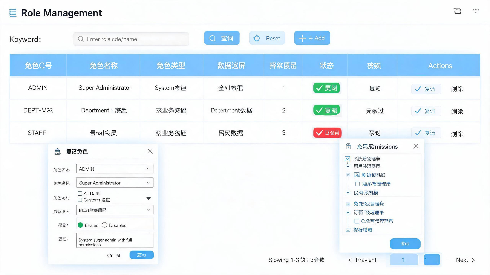

界面分为左右两部分：
1. **左侧角色列表**：以表格形式展示所有角色，列包括：角色编码、角色名称、角色描述、数据范围、状态、创建时间。每行有"编辑""分配权限""复制""删除"操作按钮。
2. **右侧权限分配树**：点击"分配权限"后弹出权限分配弹窗，左侧为菜单权限树（带复选框），右侧为数据权限范围下拉选择。

### 2.3 操作步骤

#### 新增角色
1. 点击角色列表顶部的"新增角色"按钮。
2. 在弹窗中填写：
   - **角色编码**：自动生成（推荐），或手动输入如 `SALE_MANAGER`。
   - **角色名称**：如 `销售经理`。
   - **角色描述**：简要说明角色职责。
   - **数据范围**：选择"全部数据""本部门及下级""本部门""仅本人"之一。
   - **状态**：默认启用。
3. 点击"保存"完成新增。

#### 分配菜单权限
1. 在角色列表中点击"分配权限"按钮。
2. 在弹窗左侧的菜单权限树中：
   - 勾选父节点会自动勾选所有子节点。
   - 取消父节点会自动取消所有子节点。
   - 可单独勾选某个子菜单。
3. 点击"保存"完成权限分配。**提示**：`ADMIN`和`GENERAL_MANAGER`角色默认拥有通配符`*`权限，无需逐项分配。

#### 复制角色
1. 在角色列表中找到要复制的源角色，点击"复制"按钮。
2. 系统弹出确认提示，输入新角色编码和名称。
3. 点击"确认"后系统复制源角色的所有权限到新角色，新角色可独立编辑修改。

#### 删除角色
1. 点击角色行的"删除"按钮。
2. 系统弹出二次确认。
3. 点击"确认"完成删除。**注意**：若该角色已分配给用户，系统会拒绝删除并提示"该角色已分配给N个用户，请先解除关联再删除"。

### 2.4 注意事项

- **内置角色不可删除**：系统预置的13个默认角色（`ADMIN`、`GENERAL_MANAGER`、`SALE_MANAGER`、`SALE_CLERK`、`PURCHASE_MANAGER`、`PURCHASE_CLERK`、`FINANCE_MANAGER`、`FINANCE_CLERK`、`INVENTORY_MANAGER`、`INVENTORY_CLERK`、`PRODUCTION_MANAGER`、`PRODUCTION_CLERK`、`VIEWER`）不可删除，仅可修改名称和描述。
- **角色ID固定**：13个默认角色的`role_id`为1-13，与后端`SecurityUtils.java`中的`role_code`严格对应，请勿重置角色ID序列。
- **数据范围影响**：选择"本部门及下级"时，需先在部门管理中维护好部门层级关系，否则数据范围会失效。
- **权限生效延迟**：修改角色权限后，对应用户需重新登录或等待Token刷新后权限才生效。

---

## 3. 员工权限

### 3.1 功能说明

员工权限用于精细化控制员工可访问的数据范围。除了菜单权限和数据范围权限外，某些业务场景需要更细粒度的控制，例如：
- 某个销售员只能查看自己负责的客户
- 某个库管员只能管理指定仓库的库存
- 某个采购员只能采购指定物料分类

员工权限模块通过"仓库权限""客户权限""供应商权限""物料分类权限"四个维度实现细粒度数据控制。

### 3.2 界面描述

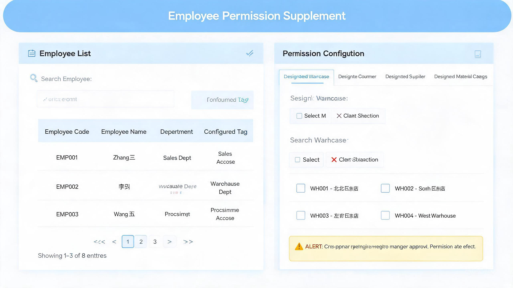

界面采用左右两栏布局：
1. **左侧员工列表**：展示所有员工，支持按姓名、工号搜索。
2. **右侧权限配置区**：选中员工后显示四个Tab页签：
   - **仓库权限**：勾选该员工可操作的仓库。
   - **客户权限**：勾选该员工可查看/编辑的客户。
   - **供应商权限**：勾选该员工可查看/编辑的供应商。
   - **物料分类权限**：勾选该员工可操作的物料分类。

### 3.3 操作步骤

#### 配置员工仓库权限
1. 在左侧员工列表中点击目标员工。
2. 在右侧切换到"仓库权限"Tab。
3. 勾选该员工可操作的仓库（可多选），或点击"全选"勾选所有仓库。
4. 点击"保存"完成配置。配置后该员工在录入出库单、入库单、调拨单等业务时，仓库下拉框仅显示已授权的仓库。

#### 配置员工客户权限
1. 选中员工后切换到"客户权限"Tab。
2. 勾选可负责的客户。
3. 点击"保存"。配置后该员工在销售订单、销售出库单、销售退货单等单据中，客户下拉框仅显示已授权客户。

#### 配置供应商权限
1. 切换到"供应商权限"Tab。
2. 勾选可对接的供应商。
3. 点击"保存"。配置后该员工在采购订单、采购入库单等单据中，供应商下拉框仅显示已授权供应商。

#### 配置物料分类权限
1. 切换到"物料分类权限"Tab。
2. 在分类树中勾选可操作的物料分类。
3. 点击"保存"。配置后该员工在物料选择弹窗中仅能选择已授权分类下的物料。

### 3.4 注意事项

- **不配置=全部可见**：若员工未配置任何细粒度权限，则默认可见全部数据。配置后即按配置过滤，未勾选的数据不可见。
- **管理员豁免**：`ADMIN`角色和`isAdmin=1`的用户不受员工权限限制，可访问全部数据。
- **权限叠加规则**：员工权限与角色的数据范围权限叠加生效，取**交集**（即两者都允许的才可见）。
- **批量配置**：可使用"批量授权"功能，选中多个员工统一分配相同的仓库/客户/供应商权限，避免逐人配置。

---

## 4. 字段权限

### 4.1 功能说明

字段权限用于控制角色在指定页面上对某些字段的可见性和可编辑性。例如：
- 普通销售员不能看到销售订单的"成本价""毛利"字段
- 普通员工不能看到员工的"薪资""银行账号"字段
- 库管员不能修改销售出库单的"单价"字段

字段权限通过"角色 + 页面 + 字段"三维组合实现精细化控制，支持三种权限级别：可见可编辑、只读、隐藏。

### 4.2 界面描述

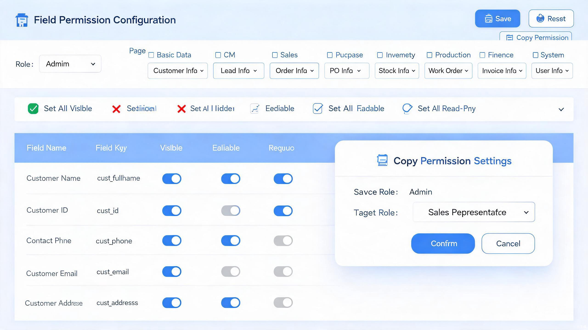

界面分为左右两栏：
1. **左侧角色与页面选择**：先选择角色，再选择要配置的页面（如销售订单、采购订单、物料等）。
2. **右侧字段权限表**：展示所选页面的所有字段，列包括：字段名称、字段标识、字段类型、默认权限、自定义权限。每行可通过下拉框设置"可见可编辑""只读""隐藏"三种权限。

### 4.3 操作步骤

#### 配置字段权限
1. 在左侧角色列表中选择目标角色，例如"销售员"。
2. 在页面列表中选择要配置的页面，例如"销售订单"。
3. 在右侧字段权限表中，找到要控制的字段：
   - **成本价**：设置为"隐藏"。
   - **毛利**：设置为"隐藏"。
   - **单价**：设置为"只读"。
4. 点击"保存"完成配置。
5. 销售员用户下次登录后，销售订单页面将不再显示成本价和毛利字段，单价字段变为只读不可编辑。

#### 恢复默认权限
1. 选择角色和页面。
2. 点击右上角"恢复默认"按钮。
3. 系统弹出确认提示，点击"确认"后该角色在该页面的所有字段权限恢复为默认值（全部可见可编辑）。

### 4.4 注意事项

- **必填字段不可隐藏**：表单的必填字段不能设置为"隐藏"，否则会导致表单无法提交。系统会自动阻止这种配置并提示"必填字段不可隐藏"。
- **关键字段谨慎配置**：单据编号、客户、供应商、物料等关键字段建议保持可见可编辑，避免影响业务流程。
- **权限继承**：若角色未对该页面配置字段权限，则继承默认权限（全部可见可编辑）。
- **预览效果**：配置完成后，建议用对应角色的账号登录验证字段权限是否生效，避免配置错误影响业务。

---

## 5. 数据字典

### 5.1 功能说明

数据字典用于维护系统中的枚举值和下拉选项。例如：客户等级（A/B/C/D）、供应商类型（厂家/经销商/个人）、付款方式（现金/银行/支票）、单据状态（草稿/待审核/已生效）等。通过集中管理字典数据，可保证全系统使用统一的枚举值，避免硬编码。

主要功能包括：
- 字典类型的增、删、改、查
- 字典数据（枚举值）的维护
- 字典项的排序、启用/禁用
- 字典数据缓存刷新

### 5.2 界面描述

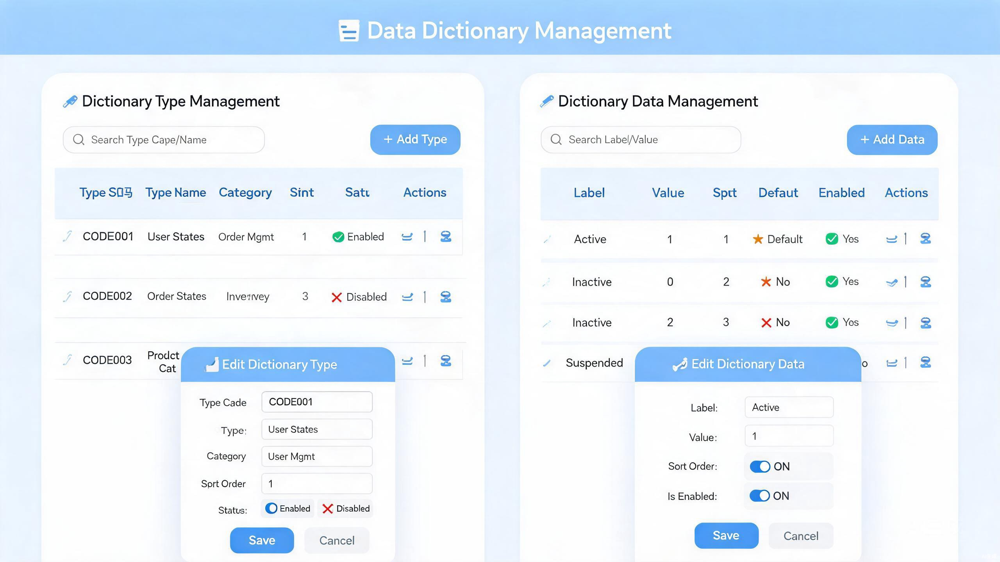

界面采用左右两栏布局：
1. **左侧字典类型列表**：以表格形式展示所有字典类型，列包括：字典编码、字典名称、描述、状态、操作。支持按名称搜索。
2. **右侧字典数据列表**：选中左侧某个字典类型后，右侧展示该类型下的所有字典项，列包括：字典项编码、字典项名称、排序、状态、备注、操作。

### 5.3 操作步骤

#### 新增字典类型
1. 在左侧字典类型列表顶部点击"新增类型"按钮。
2. 在弹窗中填写：
   - **字典编码**：如 `customer_level`，唯一标识。
   - **字典名称**：如 `客户等级`。
   - **描述**：简要说明用途。
   - **状态**：默认启用。
3. 点击"保存"完成新增。

#### 维护字典数据
1. 在左侧字典类型列表中选中目标字典，例如"客户等级"。
2. 在右侧字典数据列表顶部点击"新增数据"按钮。
3. 在弹窗中填写：
   - **字典项编码**：如 `A`。
   - **字典项名称**：如 `A级客户`。
   - **排序**：数字越小越靠前，例如 `1`。
   - **状态**：默认启用。
   - **备注**：可选。
4. 点击"保存"。重复此步骤录入B、C、D等级。
5. 客户基础资料页面的"客户等级"下拉框将自动显示这些字典项。

#### 修改字典数据
1. 在右侧字典数据列表中找到要修改的字典项，点击"编辑"。
2. 修改字段后点击"保存"。
3. 修改后需点击列表顶部"刷新缓存"按钮，使新值在所有引用处即时生效。

#### 禁用字典项
1. 找到要禁用的字典项，点击"禁用"按钮。
2. 禁用后该字典项不再出现在下拉选项中，但已使用该值的历史单据仍可正常显示。

### 5.4 注意事项

- **字典编码不可修改**：字典类型编码和字典项编码创建后不可修改，因为业务表通过编码关联字典值。
- **删除限制**：已被业务数据引用的字典项不能删除，建议改为禁用。
- **缓存刷新**：新增、修改、删除字典数据后，需点击"刷新缓存"按钮或重启后端服务，否则前端下拉框可能仍显示旧数据。
- **系统内置字典**：系统预置的字典（如`bill_status`单据状态、`settlement_type`结算方式）请勿随意修改或删除，否则会影响业务流程。

---

## 6. 自定义字段配置

### 6.1 功能说明

自定义字段配置允许企业在不修改代码的情况下，为业务实体（客户、供应商、物料、销售订单等）增加额外字段。例如：
- 为客户增加"企业规模""行业类别""信用评级"字段
- 为物料增加"保质期天数""储存条件"字段
- 为销售订单增加"内部备注""预计发货日期"字段

自定义字段会自动出现在对应实体的新增/编辑表单中，支持文本、数字、日期、下拉选择、公式计算等多种类型，无需开发介入。

主要功能包括：
- 选择业务实体（客户/供应商/物料/销售订单/采购订单等）
- 新增/编辑/删除自定义字段
- 配置字段属性（必填、列表显示、可搜索、启用）
- 配置字段类型特定属性（下拉选项、小数位、公式等）
- 刷新字段缓存

### 6.2 界面描述

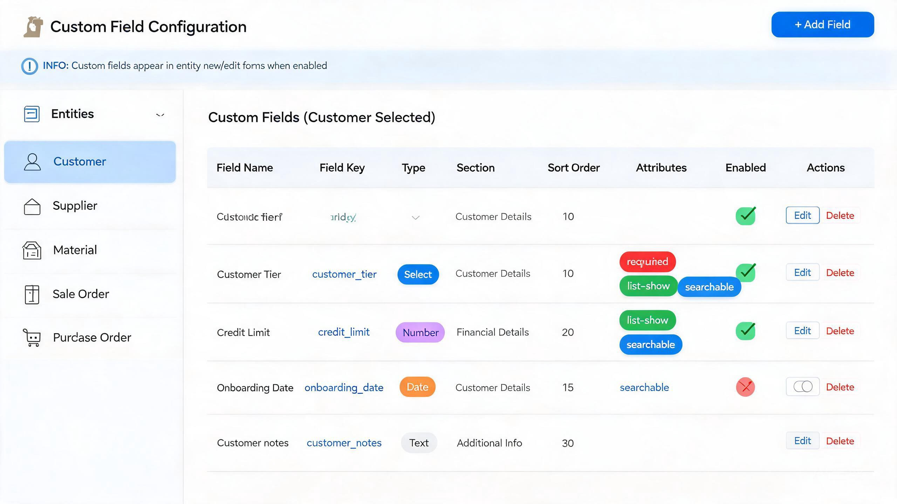

界面分为左右两部分：
1. **左侧实体导航**：以菜单形式列出所有支持自定义字段的业务实体，包括客户、供应商、物料、销售订单、采购订单等，点击切换实体。
2. **右侧字段定义表**：展示当前实体已配置的自定义字段，列包括：字段名称、字段标识（蓝色代码样式）、类型（标签样式显示文本/数字/日期/下拉选择/公式）、分区、排序、属性（必填/列表显示/可搜索标签）、启用状态、操作（编辑/删除）。顶部有"+新增字段"按钮和字段计数提示。

### 6.3 操作步骤

#### 新增自定义字段
1. 在左侧实体导航中选择目标实体，例如"客户"。
2. 在右侧字段定义表顶部点击"+新增字段"按钮。
3. 在弹窗中填写基本信息：
   - **字段名称**：如"企业规模"。
   - **字段类型**：选择"下拉选择"。
   - **所属分区**：如"自定义信息"（用于在表单中分组显示）。
   - **排序**：数字越小越靠前。
   - **默认值**：新增记录时的默认值（可选）。
   - **输入提示**：表单中的占位提示文字（可选）。
4. 根据字段类型配置特定属性：
   - **下拉选择**：在"下拉选项配置"区点击"+添加选项"，逐个录入选项的显示文本和存储值，例如"大型企业=large""中型企业=medium""小型企业=small"。
   - **数字**：在"数字字段配置"区设置小数位数、最小值、最大值。
   - **公式**：在"公式配置"区输入计算公式，例如`{amount} * {taxRate}`，支持引用其他字段。
5. 配置字段属性：
   - **必填**：勾选后表单提交时强制校验非空。
   - **列表显示**：勾选后该字段会出现在列表页的表格列中。
   - **可搜索**：勾选后字段值会同步到`ext_data`列，支持下拉过滤查询。
   - **启用**：勾选后字段生效，取消则字段不出现在表单中。
6. 点击"保存"完成新增。新字段会自动出现在客户的新增/编辑表单中。

#### 编辑自定义字段
1. 在字段定义表中找到要修改的字段，点击"编辑"。
2. 修改字段配置后点击"保存"。
3. 点击页面顶部"刷新缓存"按钮，使修改即时生效。

#### 删除自定义字段
1. 在字段定义表中点击"删除"按钮。
2. 系统弹出二次确认："删除后已录入该字段值的历史数据将保留但不再显示，确认删除？"
3. 点击"确认"完成删除。

### 6.4 注意事项

- **字段标识创建后不可修改**：字段标识（fieldKey）创建后不可修改，因为已录入的数据通过标识关联。
- **公式字段实时计算**：公式字段在表单输入时前端实时计算，保存时后端也会重新计算一次确保结果正确。
- **可搜索字段影响性能**：开启"可搜索"后字段值会写入`ext_data`列并建立索引，大量可搜索字段可能影响写入性能，建议仅对关键查询字段开启。
- **删除字段数据保留**：删除自定义字段后，已录入的值仍保留在数据库的`ext_data`JSON列中，但前端不再显示。如需恢复可重新创建相同标识的字段。
- **缓存刷新**：新增、修改、删除字段后，需点击页面顶部"刷新缓存"按钮，否则前端表单可能仍显示旧配置。

---

## 7. 打印模板

### 7.1 功能说明

打印模板用于自定义业务单据（销售订单、采购订单、出库单、入库单等）的打印格式。企业可根据自身需求设计单据样式，包括：
- 公司Logo和抬头
- 单据头部信息（单号、日期、客户、业务员等）
- 明细表格（物料编码、名称、数量、单价、金额等）
- 合计和签字区
- 页脚（公司地址、电话、开户行等）

系统支持可视化模板编辑、字段插入、模板复制、设置默认模板等功能。

### 7.2 界面描述

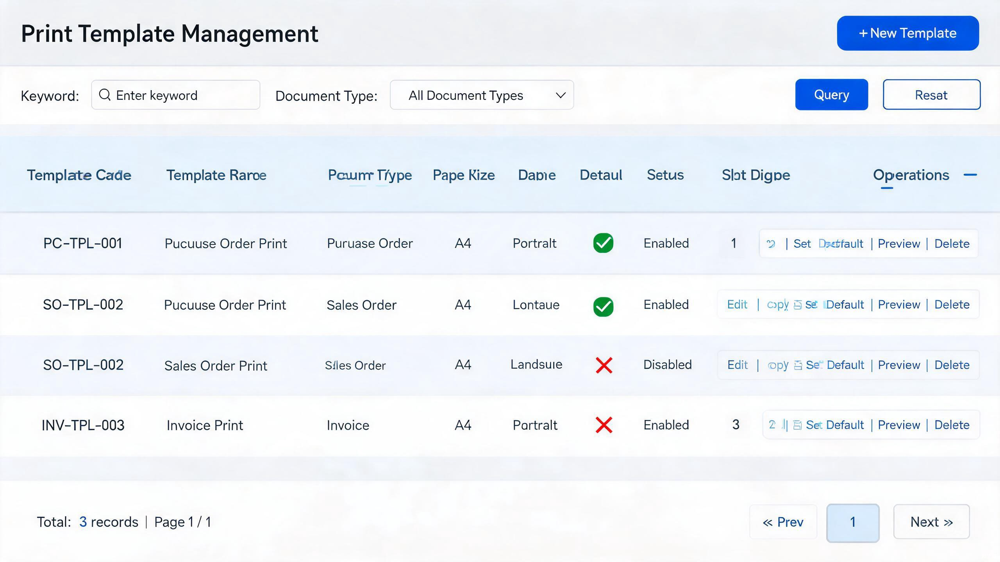

界面分为两个区域：
1. **顶部搜索栏**：提供关键词输入（模板编码/名称）、单据类型下拉、查询/重置按钮，以及右上角"+新增模板"主按钮。
2. **模板列表表格**：列包括：模板编码、模板名称、单据类型、纸张（A4）、方向（横向/纵向）、默认（绿色"默认"标签）、状态（启用/停用）、排序、操作（编辑/复制/设为默认/预览/删除）。底部有分页器。

### 7.3 操作步骤

#### 新增打印模板
1. 点击右上角"+新增模板"按钮，系统弹出全屏编辑器。
2. 在编辑器右侧填写基础信息：
   - **模板编码**：如`sale_order_standard`。
   - **模板名称**：如`销售订单标准模板`。
   - **单据类型**：选择"销售订单"。
   - **纸张大小**：A4、A5、Letter等。
   - **纸张方向**：纵向或横向。
   - **排序**：数字越小越靠前。
3. 在编辑器左侧"可用字段"面板中：
   - **表头字段**：点击字段名可插入到编辑器光标位置，例如点击"单据编号"插入`${billNo}`占位符。
   - **表尾字段**：同上操作，插入合计、签字等字段。
   - **快捷操作**：点击"一键生成标准模板"可快速生成包含表头、明细表格、表尾的完整模板；点击"插入明细表格"可单独插入明细行循环块。
4. 在编辑器中间区域设计模板内容，使用HTML+CSS语法，支持表格、图片、样式等。
5. 点击"预览效果"按钮查看渲染效果。
6. 点击"保存"完成模板创建。

#### 复制模板
1. 在模板列表中找到要复制的源模板，点击"复制"按钮。
2. 系统复制源模板的全部内容到新模板，编码和名称自动加`_copy`后缀。
3. 进入新模板编辑器修改编码、名称和内容后保存。

#### 设为默认模板
1. 在模板列表中找到要设为默认的模板，点击"设为默认"按钮。
2. 该模板的"默认"列显示绿色"默认"标签，同单据类型下其他模板自动取消默认。
3. 在业务单据页面点击"打印"时，系统默认使用该模板。

#### 预览模板
1. 在模板列表中点击"预览"按钮。
2. 系统使用示例数据渲染模板，弹窗展示打印效果。
3. 可在预览弹窗中点击"打印"直接发送到打印机，或点击"导出PDF"保存为PDF文件。

### 7.4 注意事项

- **单据类型不可修改**：模板创建后单据类型不可修改，如需变更请复制模板后重新创建。
- **字段占位符**：模板中字段占位符格式为`${字段名}`，必须与左侧"可用字段"面板中显示的一致，否则渲染时会显示空白。
- **明细表格循环**：明细行必须用`<!--明细开始-->`和`<!--明细结束-->`标签包裹，系统会按数据行数循环渲染。
- **默认模板唯一性**：每种单据类型只能有一个默认模板，设置新默认时会自动取消旧默认。
- **编码唯一**：模板编码全局唯一，重复时系统会报错。

---

## 8. 操作日志

### 8.1 功能说明

操作日志记录用户在系统中执行的所有关键操作，用于审计追溯、问题排查和安全监控。日志内容包括：操作时间、操作人、部门、操作类型（新增/编辑/删除/审核/重置草稿/登录/登出/导出）、模块名称、操作内容、操作结果（成功/失败）、单据编号、IP地址、耗时等。

主要功能包括：
- 按模块分组浏览日志
- 按操作类型、关键词、日期范围筛选
- 查看日志详情
- 日志导出（Excel）

### 8.2 界面描述

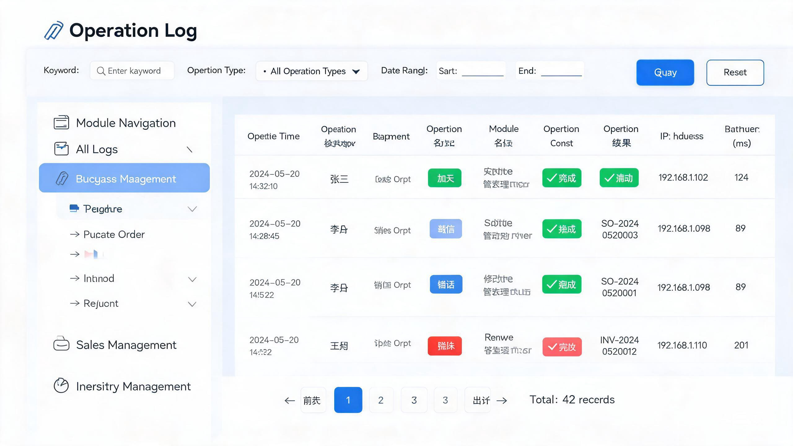

界面采用左右两栏布局：
1. **左侧模块导航**：以菜单形式分组展示模块，包括"全部日志"、采购管理（采购申请单、采购合同、采购订单、采购入库单、采购退货单、采购发票）、销售管理（销售报价单、销售合同、销售订单、销售出库单、销售退货单、销售发票）、库存管理（其他入库单、其他出库单、库存调拨单等）、财务管理等。
2. **右侧日志列表**：顶部为筛选栏（当前模块标签、关键词输入、操作类型下拉、日期范围选择器、查询/重置按钮），下方为日志表格，列包括：操作时间、操作人、部门、操作类型（彩色标签）、模块名称、操作内容、操作结果（绿色"成功"/红色"失败"标签）、单据编号、IP地址、耗时(ms)。底部有分页器。

### 8.3 操作步骤

#### 查看全部日志
1. 在左侧模块导航中点击"全部日志"。
2. 右侧展示所有模块的操作日志，按时间倒序排列。

#### 按模块查看日志
1. 在左侧模块导航中展开目标模块（如"销售管理"）。
2. 点击子菜单（如"销售订单"）。
3. 右侧仅显示销售订单模块的日志。

#### 筛选日志
1. 在右侧筛选栏中输入关键词（如单据编号、操作内容关键字）。
2. 选择操作类型（如"审核"）。
3. 选择日期范围（如最近7天）。
4. 点击"查询"按钮执行筛选。
5. 点击"重置"按钮清空所有筛选条件。

#### 查看日志详情
1. 在日志列表中点击某行日志的"详情"按钮（或双击该行）。
2. 系统弹出详情弹窗，展示完整的操作内容、请求参数、响应结果、异常堆栈（若失败）等信息。

#### 导出日志
1. 按需筛选日志（建议缩小范围避免数据量过大）。
2. 点击筛选栏右侧"导出"按钮。
3. 系统将当前筛选结果导出为Excel文件并下载。

### 8.4 注意事项

- **日志不可删除**：操作日志为审计数据，不允许任何用户删除或修改，仅支持查询和导出。
- **日志保留期**：默认保留365天，超过保留期的日志会被定时任务自动归档到历史表，可在"系统参数"中调整保留期。
- **性能影响**：操作日志记录采用异步写入，对业务操作性能影响极小（小于5ms），可放心开启全量日志。
- **AI调用日志**：AI助手的调用记录也会写入操作日志，模块名称为"AI助手"，可通过日志详情查看AI请求和响应的元信息。
- **失败日志价值**：建议定期关注"失败"日志，可能是用户操作失误或系统Bug的信号。

---

## 9. 系统参数

### 9.1 功能说明

系统参数用于集中配置ERP系统的全局行为开关和参数值。所有影响系统行为的可配置项都集中在此处，避免散落在各处难以维护。系统参数按业务域分组：
- **基础设置**：系统标题、版本号、小数位、日期格式、字体大小等
- **业务参数**：库存（是否允许负库存）、采购（采购单价上限）、销售（售价下限）、生产、委外等
- **CRM参数**：公海回收规则、领取上限等
- **审批与AI**：审批流程开关、AI功能开关、AI厂商选择等

### 9.2 界面描述

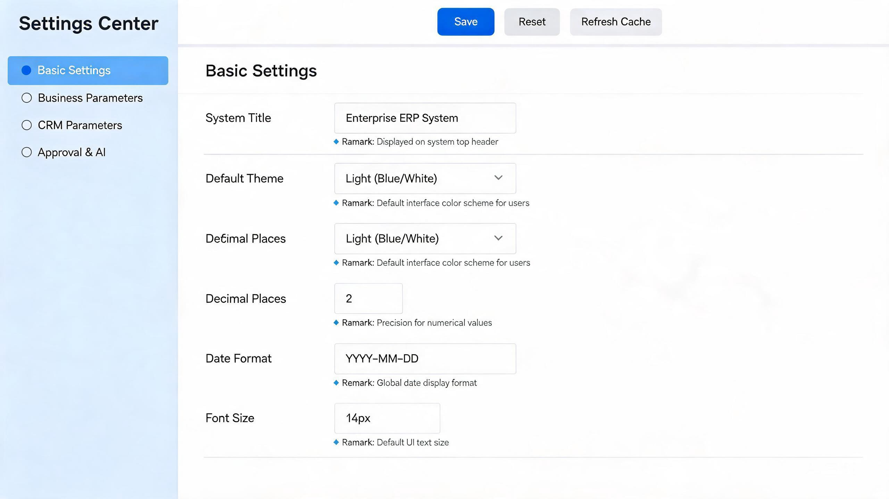

界面分为左右两部分：
1. **左侧分组导航**：以菜单形式列出参数分组，包括基础设置、业务参数、CRM参数、审批与AI。
2. **右侧内容区**：根据所选分组展示对应的参数表单。每个参数项包含：参数名称（标签）、参数值（输入框/下拉/开关）、参数说明（备注文字）。顶部有"保存""重置""刷新缓存"按钮。

### 9.3 操作步骤

#### 修改基础设置
1. 在左侧导航中选择"基础设置"。
2. 在右侧表单中修改参数：
   - **系统标题**：如"智能ERP管理系统"。
   - **小数位**：金额保留小数位数，默认2位。
   - **日期格式**：如`yyyy-MM-dd`或`yyyy-MM-dd HH:mm:ss`。
   - **字体大小**：默认14px。
3. 点击"保存"按钮提交修改。
4. 点击"刷新缓存"按钮使修改即时生效。

#### 修改业务参数
1. 在左侧导航中选择"业务参数"。
2. 右侧以折叠面板形式展示子分组：库存、采购、销售、生产、委外。
3. 展开目标子分组，例如"库存"，修改：
   - **是否允许负库存**：默认"否"，开启后出库时库存不足也允许出库（影响库存校验逻辑）。
   - **库存预警上限**：如1000，超过则触发预警。
4. 点击"保存"提交。

#### 修改CRM参数
1. 选择"CRM参数"分组。
2. 修改公海回收规则：
   - **公海回收天数**：如30天未跟进自动回收至公海。
   - **领取上限**：每个销售员最多领取的客户数。
3. 点击"保存"提交。

#### 修改审批与AI参数
1. 选择"审批与AI"分组。
2. 在子菜单中切换"审批参数"或"AI参数"。
3. 审批参数：是否启用审批流程、默认审批人等。
4. AI参数：是否启用AI助手、选择AI厂商（Qwen/DeepSeek/Claude）、API Key等。
5. 点击"保存"提交。

### 9.4 注意事项

- **修改后需保存+刷新缓存**：修改参数后需点击"保存"按钮提交到数据库，再点击"刷新缓存"按钮使新值在系统中即时生效。仅保存不刷新缓存的话，需等待后端服务重启才会生效。
- **重置功能**：点击"重置"按钮可将当前分组所有参数恢复为最近一次保存的值（不是出厂默认值）。
- **业务参数影响范围广**：`inventory.negative.allowed`（是否允许负库存）等参数直接影响业务流程，修改前请充分评估影响，建议先在测试环境验证。
- **AI API Key加密存储**：AI参数中的API Key采用AES-GCM加密存储，不会明文写入数据库，可在"AI数据策略"页面查看安全说明。

---

## 10. 设置中心

### 10.1 功能说明

设置中心是ERP系统的统一配置入口，采用酷管王风格的三栏布局，将所有设置项按"系统、业务、权限、其他"四大类组织。设置中心是系统参数、自定义字段、序列号配置、主题设置、AI数据策略等子模块的容器，用户无需记忆每个配置页面的入口，统一从设置中心进入。

设置中心还展示当前系统的版本信息、用户量、到期时间、付费代码等授权信息，以及客服联系方式。

### 10.2 界面描述

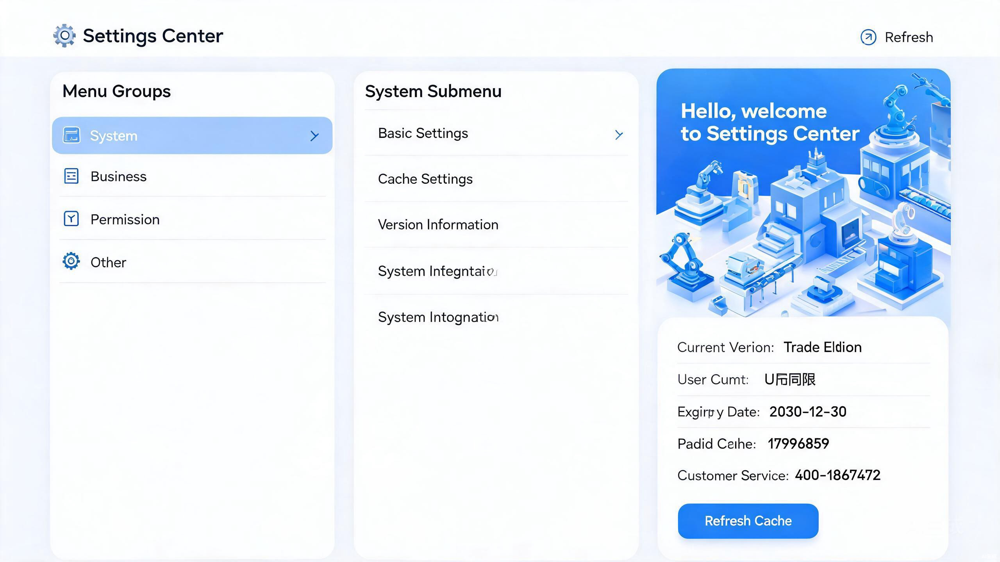

界面采用三栏布局：
1. **第一栏（一级分组）**：列出4大类设置项，包括系统、业务、权限、其他，每项带图标。
2. **第二栏（子菜单）**：展示当前一级分组下的子菜单项，例如"系统"下有"系统参数""主题设置""序列号配置""AI数据策略"等。
3. **第三栏（内容区）**：展示选中子菜单的配置内容。若未选择子菜单，则展示欢迎页，包含：3D工厂插画、欢迎语"您好，欢迎您来到设置中心"、授权信息卡片（当前版本/商贸版、用户量/不限制、到期时间/2030-12-30、付费代码/17996859）、客服电话400-1867472、"刷新系统缓存"按钮。

### 10.3 操作步骤

#### 进入设置中心
1. 在左侧系统菜单中点击"设置中心"，进入设置中心主页面。
2. 默认展示欢迎页，显示授权信息和客服联系方式。

#### 浏览配置项
1. 在第一栏点击一级分组，例如"系统"。
2. 第二栏展示"系统"下的子菜单项。
3. 点击子菜单（如"系统参数"），第三栏展示对应的配置表单。

#### 修改配置
1. 在第三栏的配置表单中修改参数。
2. 点击表单顶部的"保存"按钮提交。
3. 点击第三栏顶部的"刷新缓存"按钮使修改即时生效。

#### 刷新系统缓存
1. 在欢迎页点击"刷新系统缓存"按钮，或在任意子页面顶部点击"刷新缓存"按钮。
2. 系统弹出提示"缓存刷新成功"。
3. 刷新缓存后，所有配置项的最新值在系统中即时生效。

### 10.4 注意事项

- **统一入口**：建议通过设置中心进入各配置页面，避免直接通过URL访问导致配置遗漏。
- **授权信息**：授权信息由系统自动读取，不可手动修改。若到期时间临近，请联系客服续费。
- **刷新缓存影响**：刷新缓存会清空后端的配置缓存并重新加载，期间可能有短暂的响应变慢（通常小于1秒），不影响业务数据。
- **权限要求**：仅`ADMIN`角色和`isAdmin=1`的用户可访问设置中心，普通管理员仅可见部分子菜单。

---

## 11. 主题设置

### 11.1 功能说明

主题设置用于自定义ERP系统的视觉外观，包括：
- 预设主题切换（默认蓝、深色绿、暖橙、紫色等）
- 自定义颜色（主色、成功色、警告色、信息色、危险色、侧边栏背景、侧边栏文字、头部背景、页面背景）
- 实时预览修改效果

主题修改后即时预览，保存后同步到服务器，对所有用户生效（或仅对当前用户生效，可在系统参数中配置）。

### 11.2 界面描述

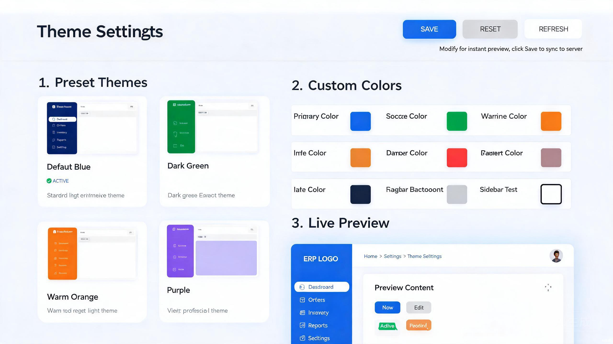

界面分为三个部分（自上而下）：
1. **顶部工具栏**：包含"保存""恢复默认""刷新"三个按钮，以及提示文字"修改后即时预览，点击'保存'后同步到服务器"。
2. **预设主题区**：以卡片网格形式展示4-6个预设主题，每张卡片包含：主题预览图（侧边栏+主区域的缩略图）、主题名称、主题描述。当前选中的主题卡片带蓝色对勾标记。
3. **自定义颜色区**：以三列网格形式展示颜色配置项，每个颜色项包含：颜色标签（带问号提示图标）、颜色选择器、十六进制色值输入框。可配置的颜色包括：主色、成功色、警告色、信息色、危险色、侧边栏背景色、侧边栏文字色、头部背景色、页面背景色。
4. **实时预览区**：展示一个迷你的ERP界面预览，包含：侧边栏（Logo、菜单项）、头部（面包屑、头像）、内容卡片（按钮、标签等）。预览会随颜色修改实时更新。

### 11.3 操作步骤

#### 应用预设主题
1. 在"预设主题"区点击目标主题卡片，例如"深色绿"。
2. 系统立即应用该主题，"实时预览"区显示深色绿主题效果。
3. 点击顶部"保存"按钮将主题保存到服务器。
4. 所有用户（或当前用户，取决于系统参数配置）下次登录后将看到新主题。

#### 自定义颜色
1. 在"自定义颜色"区找到要修改的颜色项，例如"主色"。
2. 点击颜色选择器，在弹出的色板中选择目标颜色，或在十六进制输入框中直接输入色值（如`#1890ff`）。
3. "实时预览"区立即显示新颜色效果。
4. 重复此步骤修改其他颜色。
5. 点击"保存"提交修改。

#### 恢复默认
1. 点击顶部"恢复默认"按钮。
2. 系统弹出确认提示"确认恢复所有主题设置为默认值？"
3. 点击"确认"后所有颜色恢复为系统出厂默认值。
4. 点击"保存"将默认值同步到服务器。

### 11.4 注意事项

- **即时预览**：颜色修改会立即反映在"实时预览"区，但仅点击"保存"后才会同步到服务器并对所有用户生效。
- **侧边栏对比度**：修改侧边栏背景色时，注意与侧边栏文字色保持足够对比度，避免文字不可读。
- **主题作用范围**：主题可配置为"全局生效"或"仅当前用户生效"，在"系统参数→基础设置→主题作用范围"中切换。
- **深色模式**：当前版本未提供完整的深色模式，建议通过预设主题中的深色主题实现类似效果。完整深色模式将在后续版本支持。

---

## 12. 序列号配置

### 12.1 功能说明

序列号配置用于自定义各类业务单据的编号规则。每种单据（销售订单、采购订单、出库单、入库单等）都可有独立的编号规则，包括：
- **编号前缀**：如`SO`（销售订单）、`PO`（采购订单）
- **日期格式**：`yyyyMMdd`、`yyMMdd`、`yyyy-MM-dd`或无日期
- **流水号位数**：2-10位，不足补零
- **重置类型**：不重置、按日重置、按月重置、按年重置
- **分隔符**：各部分之间的分隔符，如`-`
- **生成方式**：自动生成（推荐）或手动录入

例如：销售订单编号规则为`SO-yyyyMMdd-####`（按日重置），生成的编号为`SO-20260815-0001`。

### 12.2 界面描述

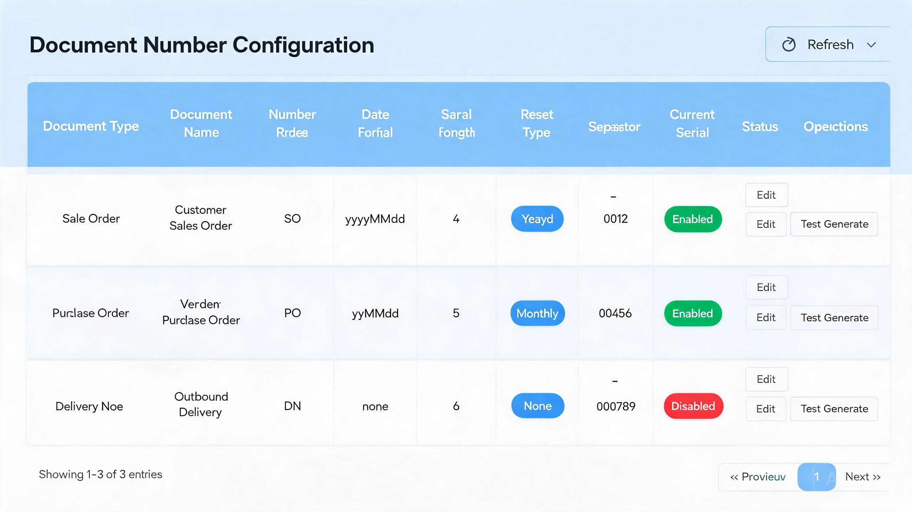

界面以卡片+表格形式展示：
1. **顶部卡片头部**：标题"单据编号配置"，右侧"刷新"按钮。
2. **配置列表表格**：列包括：单据类型（如`SaleOrder`）、单据名称（如`销售订单`）、编号前缀（如`SO`）、日期格式（如`yyyyMMdd`）、流水号位数（如4）、重置类型（标签：不重置/按日/按月/按年）、分隔符（如`-`）、当前流水号（如`23`）、状态（启用/禁用标签）、操作（编辑/测试生成）。

### 12.3 操作步骤

#### 编辑编号规则
1. 在配置列表中找到目标单据类型，点击"编辑"按钮。
2. 在弹窗中修改配置：
   - **编号前缀**：如`SO`（销售订单）、`PO`（采购订单）、`OUT`（出库单）。
   - **日期格式**：选择`yyyyMMdd`、`yyMMdd`、`yyyy-MM-dd`或"无日期"。
   - **流水号位数**：选择2-10位，建议4-6位。
   - **重置类型**：选择"不重置"（流水号持续累加）、"按日重置"（每天从1开始）、"按月重置"、"按年重置"。
   - **分隔符**：如`-`，留空则各部分直接连接。
   - **状态**：启用或禁用。
   - **生成方式**：自动生成（推荐，新建单据时系统自动填写编号并禁止修改）或手动录入（用户自行输入）。
3. 在"编号预览"区查看生成的示例编号，确认格式正确。
4. 点击"保存"完成修改。

#### 测试生成编号
1. 在配置列表中点击"测试生成"按钮。
2. 系统按当前规则生成一个示例编号，弹窗展示。
3. 用于验证规则配置是否正确，不会影响实际流水号。

### 12.4 注意事项

- **自动生成不可修改**：选择"自动生成"后，新建单据时编号由系统自动填写且不可手动修改，避免编号冲突或跳号。
- **重置类型影响**：选择"按日/月/年重置"后，每到重置周期流水号从1开始，适合单据量大的场景；"不重置"则流水号持续累加，适合单据量小的场景。
- **修改规则不溯及既往**：修改编号规则后，仅对新创建的单据生效，历史单据编号保持不变。
- **12种默认单据自动生成**：根据系统约束，包括`SYS_ROLE`、`BD_EMPLOYEE`、`MD_CUSTOMER`等12种单据类型默认启用自动生成编码，输入框禁用。可在"设置中心→自动编号设置"中切换手动/自动模式或修改规则。
- **流水号位数充足**：建议根据业务量预估选择足够的流水号位数，避免位数不足导致编号溢出。例如4位流水号最多支持9999条/周期。

---

## 13. AI数据策略

### 13.1 功能说明

AI数据策略用于控制AI助手调用过程中企业数据的安全保护策略，防止敏感信息泄漏到AI厂商或日志文件。本模块是数据安全的最后一道防线，主要功能包括：
- 展示各AI厂商的数据使用政策（是否用于模型训练）
- 配置敏感字段脱敏策略
- 配置日志记录策略
- 配置AI严格模式
- 提供生产环境安全部署建议

### 13.2 界面描述

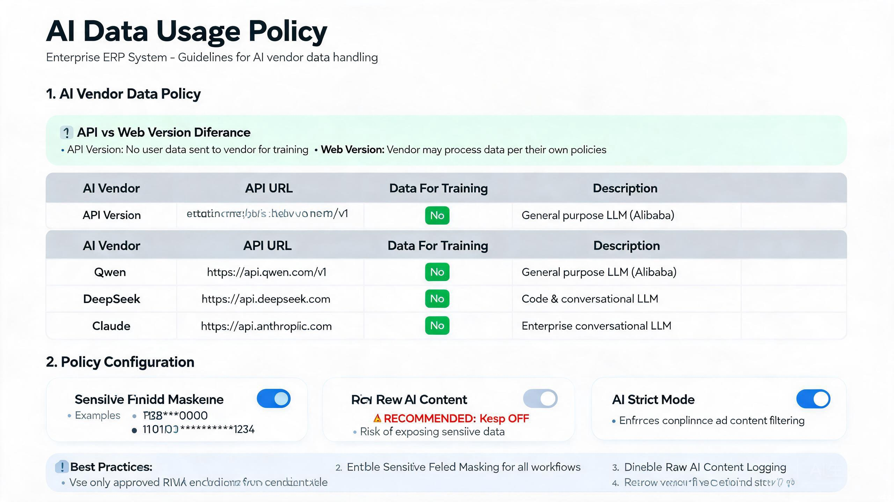

界面自上而下分为四个部分：
1. **页面标题与描述**：标题"AI 数据使用政策"，下方描述"控制 AI 调用过程中数据的脱敏、日志记录和访问权限"。
2. **AI厂商数据政策表**：绿色提示框说明"商用API vs 网页版"的区别（重要：网页版默认会用对话数据训练模型，商用API不会），下方表格列出各AI厂商：厂商名称（Qwen/DeepSeek/Claude）、API地址、数据是否用于训练（绿色"不用于训练"标签）、说明。
3. **政策配置区**：以卡片形式展示3个可配置策略，每张卡片包含：策略名称、状态标签（已开启/已关闭）、开关、策略说明。包括：
   - **敏感字段脱敏**：开启后，系统查询出来再发给AI的业务数据中的敏感字段会被替换为脱敏形式（手机号13800138000→138\*\*\*\*0000，身份证110101199001011234→110101\*\*\*\*\*\*\*\*1234，银行卡、邮箱、座机等同样脱敏）；用户自己在对话里输入的内容原样发送，不脱敏（否则口述的电话会以星号形式写进客户档案）。
   - **日志记录AI原文**：开启后AI请求和响应原文写入后端日志文件，生产环境建议关闭。
   - **AI严格模式**：开启后敏感实体（客户/供应商/员工/订单）的查询结果不会发送给AI做进一步推理，只返回原始数据给前端。
4. **安全建议区**：信息提示框列出生产环境部署建议6条，包括敏感字段脱敏保持开启、日志记录AI原文关闭、API Key加密存储、HTTPS部署、API Key权限隔离、定期审计。

### 13.3 操作步骤

#### 开启/关闭敏感字段脱敏
1. 找到"敏感字段脱敏"卡片。
2. 点击右侧的开关按钮，切换为"已开启"。
3. 系统自动保存配置，无需额外点击保存。
4. 开启后，所有发送给AI的请求中，手机号、身份证、银行卡、邮箱、座机等敏感字段会自动脱敏，AI仍能理解字段含义但拿不到真实数据。

#### 配置日志记录策略
1. 找到"日志记录 AI 原文"卡片。
2. 默认为"已关闭"状态（绿色标签）。
3. 若需调试AI调用问题，可临时开启：点击开关切换为"已开启"（黄色标签）。
4. **重要**：调试完成后请务必关闭，避免日志文件泄漏敏感信息。关闭后日志仅记录traceId、意图、参数长度等元信息。

#### 开启AI严格模式
1. 找到"AI 严格模式"卡片。
2. 点击开关切换为"已开启"。
3. 开启后，敏感实体（客户/供应商/员工/订单）的查询结果不会发送给AI做进一步推理，只返回原始数据给前端。
4. 适用于需要查询敏感数据但不想让AI二次处理的场景。

#### 查看AI厂商政策
1. 在"AI 厂商数据使用政策"表格中查看各厂商的数据使用政策。
2. 表格显示厂商名称、API地址、数据是否用于训练、说明。
3. 所有商用API厂商均标记为"不用于训练"（绿色标签）。

### 13.4 注意事项

- **API vs 网页版区别**：本系统通过商用API调用AI服务，数据默认不会被AI厂商用于模型训练。但请注意不要与AI厂商网页版（如`chat.qwen.com`、`chat.deepseek.com`）混淆——网页版默认会用对话数据训练模型。
- **生产环境必读**：生产环境部署时，请严格遵循"安全建议"区的6条建议：敏感字段脱敏保持开启、日志记录AI原文关闭、API Key加密存储、HTTPS部署、API Key权限隔离、定期审计。
- **API Key加密**：API Key采用AES-GCM加密存储，不会明文写入数据库，可在数据库中查看`sys_config`表的`ai_api_key`字段验证（应为密文）。
- **HTTPS强制**：生产环境必须使用HTTPS部署，防止传输过程被监听。Nginx配置中应强制HTTP跳转HTTPS。
- **定期审计**：建议每周通过"操作日志"页面查看AI调用记录（模块名称筛选"AI助手"），发现异常调用及时处理。

---

## 附录：模块权限矩阵

| 子模块 | ADMIN | GENERAL_MANAGER | 部门主管 | 普通员工 |
|--------|-------|-----------------|----------|----------|
| 用户管理 | ✓ | ✗ | ✗ | ✗ |
| 角色管理 | ✓ | ✗ | ✗ | ✗ |
| 员工权限 | ✓ | ✗ | ✗ | ✗ |
| 字段权限 | ✓ | ✗ | ✗ | ✗ |
| 数据字典 | ✓ | ✓（只读） | ✗ | ✗ |
| 自定义字段配置 | ✓ | ✗ | ✗ | ✗ |
| 打印模板 | ✓ | ✓ | ✓（只读） | ✗ |
| 操作日志 | ✓ | ✓（只读） | ✓（本部门） | ✓（本人） |
| 系统参数 | ✓ | ✗ | ✗ | ✗ |
| 设置中心 | ✓ | ✗ | ✗ | ✗ |
| 主题设置 | ✓ | ✓ | ✓ | ✓ |
| 序列号配置 | ✓ | ✗ | ✗ | ✗ |
| AI数据策略 | ✓ | ✗ | ✗ | ✗ |

> 注：✓表示可访问，✗表示不可访问。具体权限以系统角色权限配置为准。

---

## 附录：常见问题

### Q1：忘记admin密码怎么办？
A：admin为系统内置超级管理员，密码无法通过界面重置。需通过数据库直接修改：
```sql
UPDATE sys_user SET password = '<新密码的BCrypt哈希值>' WHERE username = 'admin';
```
建议联系系统供应商协助处理。

### Q2：用户登录后看不到任何菜单？
A：可能原因：
1. 用户未分配角色 → 在"用户管理→分配角色"中分配。
2. 角色未分配菜单权限 → 在"角色管理→分配权限"中勾选菜单。
3. 用户被禁用 → 在"用户管理"中启用用户。
4. Token缓存未刷新 → 让用户退出重新登录。

### Q3：修改系统参数后不生效？
A：修改参数后需点击"保存"按钮提交到数据库，再点击"刷新缓存"按钮使新值在系统中即时生效。仅保存不刷新缓存的话，需等待后端服务重启才会生效。

### Q4：自定义字段在表单中不显示？
A：可能原因：
1. 字段未启用 → 在"自定义字段配置"中启用。
2. 缓存未刷新 → 点击"刷新缓存"按钮。
3. 字段所属分区与表单分区不匹配 → 检查"所属分区"配置。

### Q5：操作日志可以删除吗？
A：操作日志为审计数据，不允许任何用户删除或修改。日志默认保留365天，超过保留期的日志会被定时任务自动归档到历史表。

### Q6：AI助手的对话数据会被用于训练模型吗？
A：不会。本系统通过商用API调用AI服务，数据默认不会被AI厂商用于模型训练。但请注意不要与AI厂商网页版混淆——网页版默认会用对话数据训练模型。详见"AI数据策略"页面。

---

*本手册最后更新：2026-08-15*
