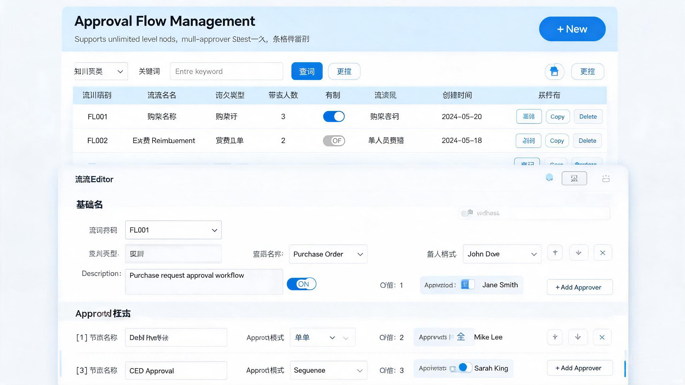
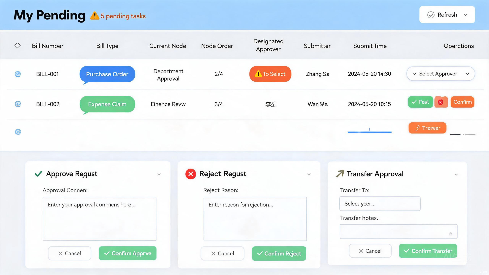
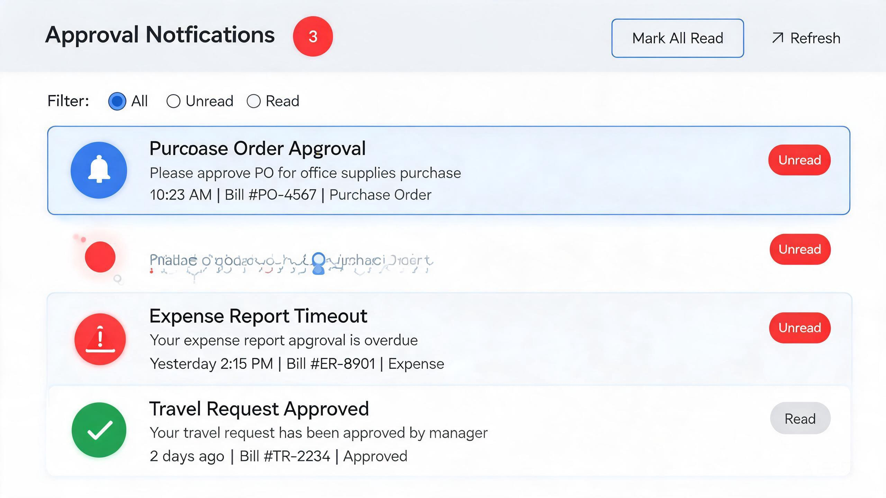
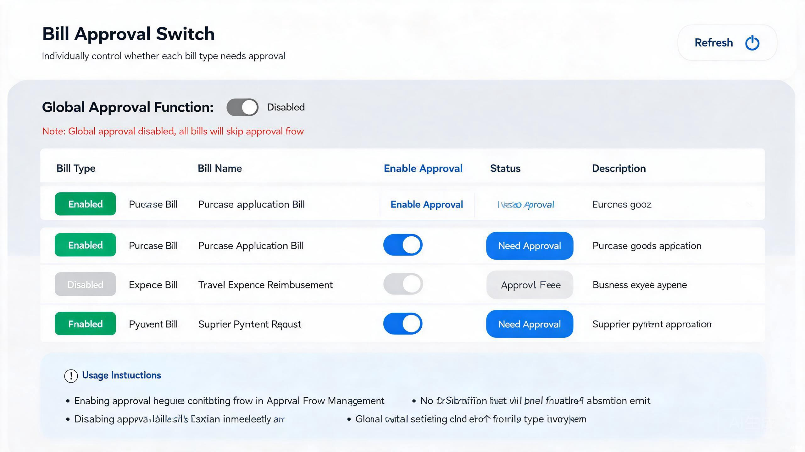

# 审批管理模块操作手册

> 本手册覆盖智能ERP系统"审批管理"模块下的全部4个子模块，详细说明每个子模块的功能定位、界面布局、操作步骤与注意事项。审批管理模块用于配置和控制业务单据的审批流程，是企业内控和风险防范的核心工具。

---

## 目录

1. [审批流程配置](#1-审批流程配置)
2. [审批任务](#2-审批任务)
3. [审批通知](#3-审批通知)
4. [单据审批开关](#4-单据审批开关)

---

## 1. 审批流程配置

### 1.1 功能说明

审批流程配置用于定义各类业务单据的审批流程。每种单据（销售订单、采购订单、出库单等）可配置独立的审批流程，流程由若干审批节点组成，按顺序流转。系统支持：
- **无限级审批节点**：可根据管理需要设置任意数量的审批节点
- **多审批人选其一**：一个节点可配置多个候选审批人，由提交人选择一人审批
- **4种审批模式**：单人审批、任选一人、全部审批、依次审批
- **条件审批模板**：根据单据条件（金额、类型等）匹配不同的审批流程
- **流程复制**：快速创建相似单据的审批流程

### 1.2 界面描述



界面分为两个主要区域：
1. **顶部搜索栏**：提供单据类型下拉、关键词输入（流程编码/名称）、查询/重置按钮，以及右上角"+新建流程"主按钮。标题旁有提示标签"支持无限级节点 · 多审批人选其一 · 条件审批"。
2. **流程列表表格**：列包括：流程编码、流程名称、单据类型、节点数、启用（开关）、描述、创建时间、操作（编辑/条件模板/复制/删除）。

**流程编辑弹窗**（点击"+新建流程"或"编辑"后弹出）：
- **基础信息栏**：流程编码、流程名称（必填）、单据类型（必填）、启用开关、描述。
- **节点编辑器**：以卡片形式展示所有审批节点，每张节点卡片包含：节点序号、节点名称、审批模式（下拉选择：单人审批/任选一人/全部审批/依次审批）、节点顺序、上移/下移/删除按钮。节点下方展示候选审批人标签列表和"+添加审批人"按钮。

### 1.3 操作步骤

#### 新建审批流程
1. 点击页面右上角"+新建流程"按钮，系统弹出全屏编辑弹窗。
2. 在基础信息栏填写：
   - **流程编码**：如`sale_order_flow`，唯一标识。
   - **流程名称**：如`销售订单审批流程`，必填。
   - **单据类型**：选择"销售订单"，必填。
   - **启用**：默认开启。
   - **描述**：如"适用于所有销售订单的二级审批流程"。
3. 在节点编辑器中点击"添加节点"按钮，创建第一个节点：
   - **节点名称**：如`部门经理审批`。
   - **审批模式**：选择"单人审批"。
   - 点击"+添加审批人"按钮，在弹出的员工选择弹窗中搜索并勾选审批人，点击"确定"添加为候选审批人。
4. 重复步骤3添加后续节点，例如第二个节点为"财务总监审批"，审批模式选择"全部审批"，添加多个候选审批人。
5. 使用上移/下移按钮调整节点顺序。
6. 点击"保存"按钮完成流程创建。

#### 配置审批模式
系统支持4种审批模式，根据业务需求选择：
- **单人审批**：仅一个审批人，该审批人通过后流转到下一节点。
- **任选一人**：多个候选审批人，由提交人从候选中选择一个审批人，被选中的审批人通过后流转到下一节点。
- **全部审批**：多个候选审批人，所有候选人都需要通过才能流转到下一节点。
- **依次审批**：多个候选审批人，按顺序依次审批，前一个通过后下一个才可审批，全部通过后流转到下一节点。

#### 配置条件模板
1. 在流程列表中点击"条件模板"按钮。
2. 在弹窗中添加条件规则：
   - **条件字段**：如`totalAmount`（总金额）。
   - **条件操作**：如`大于`。
   - **条件值**：如`100000`。
   - **匹配流程**：选择金额大于10万时使用的审批流程。
3. 可添加多个条件规则，按优先级从上到下匹配。
4. 点击"保存"完成条件模板配置。提交单据时系统会根据单据条件自动匹配对应的审批流程。

#### 复制流程
1. 在流程列表中点击"复制"按钮。
2. 系统复制源流程的全部节点和审批人配置到新流程，编码自动加`_copy`后缀。
3. 进入新流程编辑器修改编码、名称、单据类型后保存。

#### 启用/停用流程
1. 在流程列表的"启用"列，点击开关按钮切换流程状态。
2. 停用后，该单据类型的新提交单据不再使用此流程；已在审批中的单据不受影响。

#### 删除流程
1. 在流程列表中点击"删除"按钮。
2. 系统弹出二次确认。
3. 点击"确认"完成删除。**注意**：若该流程正在被审批中的单据使用，系统会拒绝删除并提示"该流程有N个进行中的审批任务，请等待审批完成或转用其他流程后再删除"。

### 1.4 注意事项

- **单据类型不可修改**：流程创建后单据类型不可修改，如需变更请复制流程后重新创建。
- **流程编码唯一**：流程编码全局唯一，重复时系统会报错。
- **至少一个节点**：流程必须至少包含一个审批节点，否则无法保存。
- **候选审批人必填**：每个节点至少配置一个候选审批人，否则该节点无法审批。
- **条件模板优先级**：条件模板按从上到下顺序匹配，第一个匹配成功的条件对应的流程即为生效流程。若无任何条件匹配，则使用默认流程。
- **审批人离职处理**：若审批人离职或调岗，需及时更新流程节点配置，避免审批卡死。系统不自动处理离职审批人，需管理员手动维护。

---

## 2. 审批任务

### 2.1 功能说明

审批任务（我的待办）展示当前用户需要处理的审批任务列表。当其他用户提交单据后，系统根据审批流程将任务推送到当前用户的待办列表。审批人可在此处执行以下操作：
- **通过**：同意审批，单据流转到下一节点或完成审批
- **驳回**：不同意审批，单据退回给提交人
- **转交**：将审批任务转交给他人处理
- **选择审批人**：对于"任选一人"模式的节点，由提交人或当前审批人从候选中选择一个审批人

### 2.2 界面描述



界面分为两个主要区域：
1. **顶部标题栏**：标题"我的待办"，右侧显示待办数量标签（如"5 条待办"，黄色警告标签），以及"刷新"按钮。
2. **待办任务表格**：列包括：单据编号、单据类型（标签）、当前节点、节点序号、指定审批人（显示姓名或"待选择"黄色标签）、提交人、提交时间、操作。

**操作列动态显示**：
- 若节点为"任选一人"模式且未选择审批人：显示审批人下拉框（候选审批人列表）+"确认选择"按钮。
- 若已指定审批人：显示"通过"（绿色）、"驳回"（红色）、"转交"（橙色）三个按钮。

**审批弹窗**：
- **通过弹窗**：显示单据编号、节点名称、审批意见输入框（多行文本），"确认通过"按钮。
- **驳回弹窗**：显示单据编号、节点名称、驳回原因输入框（多行文本），"确认驳回"按钮。
- **转交弹窗**：显示单据编号、转交给（用户名输入框）、转交说明（多行文本），"确认转交"按钮。

### 2.3 操作步骤

#### 查看待办任务
1. 进入"审批任务"页面，系统自动加载当前用户的待办任务列表。
2. 顶部显示待办总数。
3. 点击"刷新"按钮可手动刷新列表。

#### 选择审批人（任选一人模式）
1. 在待办列表中找到"指定审批人"列显示"待选择"标签的任务。
2. 在操作列的下拉框中选择一个候选审批人。
3. 点击"确认选择"按钮，系统将任务分配给选中的审批人。
4. 任务从当前用户的待办列表消失，出现在被选中审批人的待办列表中。

#### 通过审批
1. 在待办列表中找到要审批的任务，点击"通过"按钮。
2. 在弹窗中输入审批意见（建议详细说明同意理由）。
3. 点击"确认通过"按钮提交。
4. 系统：
   - 若当前节点为最后一个节点：单据状态变为"已生效"，通知提交人审批通过。
   - 若当前节点非最后一个节点：单据流转到下一节点，通知下一节点审批人。

#### 驳回审批
1. 在待办列表中点击"驳回"按钮。
2. 在弹窗中输入驳回原因（**必填**，建议详细说明驳回理由，便于提交人修改）。
3. 点击"确认驳回"按钮提交。
4. 单据状态退回到"草稿"或"待审核"，通知提交人审批被驳回及驳回原因。

#### 转交审批
1. 在待办列表中点击"转交"按钮。
2. 在弹窗中输入转交目标人的用户名。
3. 输入转交说明（可选，建议说明转交原因）。
4. 点击"确认转交"按钮提交。
5. 任务从当前用户待办列表消失，出现在转交目标人的待办列表中。系统记录转交操作日志。

### 2.4 注意事项

- **审批意见建议必填**：虽然系统不强制要求通过时填写审批意见，但建议审批人详细填写，便于审计追溯和提交人理解审批结果。
- **驳回原因必填**：驳回时必须填写驳回原因，否则系统会提示"请输入驳回原因"。驳回原因会通知给提交人。
- **转交需谨慎**：转交后任务归属变更，原审批人无法再操作该任务。建议仅在确实无法审批时使用转交功能。
- **任选一人模式**：该模式下，提交人提交单据后需先选择审批人，审批任务才会推送给被选中的审批人。若提交人未选择，任务会停留在"待选择"状态。
- **任务超时**：系统支持审批超时提醒（需在系统参数中配置超时时间），超时后会在"审批通知"中显示超时提醒。
- **刷新频率**：待办列表不会自动刷新，建议定期点击"刷新"按钮查看最新任务，或关注"审批通知"页面的新通知。

---

## 3. 审批通知

### 3.1 功能说明

审批通知用于向用户推送审批相关的消息提醒，包括：
- **待办通知**：有新的审批任务需要处理
- **结果通知**：审批通过或驳回的结果通知
- **超时通知**：审批任务超时未处理的提醒

通知支持已读/未读状态管理，未读通知数量在页面标题旁以红色徽章显示。

### 3.2 界面描述



界面分为三个区域：
1. **顶部标题栏**：标题"审批通知"，标题旁有红色未读数量徽章（如"3"），右侧有"全部标记已读"按钮和"刷新"按钮。
2. **筛选栏**：单选按钮组，包括"全部""未读""已读"三个选项，切换后重新加载通知列表。
3. **通知列表**：以卡片形式展示通知，每张通知卡片包含：
   - **左侧图标**：根据通知类型显示不同颜色图标（蓝色铃铛=待办、绿色对勾=结果、红色警告=超时、灰色信息=其他）。
   - **中间内容**：通知标题、通知内容、通知元信息（时间、单据编号、类型标签）。
   - **右侧状态**：未读（红色标签）或已读（灰色标签）。
   - 未读通知卡片背景为浅蓝色，标题加粗显示。

### 3.3 操作步骤

#### 查看通知
1. 进入"审批通知"页面，系统自动加载所有通知，默认显示"全部"。
2. 在筛选栏点击"未读"仅查看未读通知，点击"已读"仅查看已读通知。
3. 通知按时间倒序排列，最新通知在最上方。

#### 标记单条已读
1. 点击未读通知卡片。
2. 系统自动将该通知标记为已读，卡片背景从浅蓝色变为白色，标题取消加粗。
3. 顶部未读数量徽章减1。

#### 全部标记已读
1. 点击顶部"全部标记已读"按钮。
2. 系统将当前列表中所有未读通知标记为已读。
3. 顶部未读数量徽章清零，提示"已全部标记为已读"。

#### 跳转处理
1. 点击通知卡片，系统自动标记已读。
2. 若通知关联了单据编号，可点击单据编号跳转到对应单据详情页面。
3. 在单据详情页面可查看单据内容并执行审批操作。

### 3.4 注意事项

- **通知不删除**：审批通知为审计数据，不允许用户删除，仅支持标记已读。历史通知可永久查阅。
- **通知保留期**：默认保留180天，超过保留期的通知会被定时任务自动清理。可在系统参数中调整保留期。
- **实时推送**：审批通知依赖后端轮询机制，默认每30秒刷新一次。如需更实时的通知，可在系统参数中缩短轮询间隔（但不建议低于10秒，以免增加服务器压力）。
- **超时通知**：超时通知仅在系统参数中配置了审批超时时间后才会触发，默认未配置。若需启用，请在"系统参数→审批与AI→审批参数"中设置超时时间。
- **通知渠道**：当前版本仅支持站内通知，不支持邮件/短信/微信通知。后续版本将支持多渠道通知。

---

## 4. 单据审批开关

### 4.1 功能说明

单据审批开关用于单独控制每种业务单据是否需要审批。系统支持两级开关控制：
- **全局审批开关**：总开关，停用后所有单据都不进入审批流程，直接生效
- **单据级审批开关**：分开关，单独控制某种单据是否需要审批

两级开关为"与"关系：仅当全局开关启用且单据级开关启用时，该单据才需要审批。这种设计便于灵活控制——例如全局启用审批，但某些低风险单据（如内部调拨单）可单独关闭审批。

### 4.2 界面描述



界面分为四个区域：
1. **顶部标题栏**：标题"单据审批开关"，提示标签"单独控制每种单据是否需要审批"，右侧"刷新"按钮。
2. **全局开关栏**：灰色背景区域，显示"全局审批功能:"标签和启用/停用开关，开关旁有"启用"/"停用"文字。当全局开关停用时，显示红色提示文字"注意：全局审批已停用，所有单据都不会进入审批流程"。
3. **单据类型表格**：列包括：单据类型（绿色"启用"/灰色"停用"标签）、单据名称、启用审批（开关）、状态（绿色"需要审批"/灰色"免审批"标签）、说明。每行单据类型对应一个独立的审批开关。
4. **使用说明提示框**：底部蓝色信息提示框，列出4条使用说明：
   - 开启某单据的审批开关后，需要到审批流程管理中配置对应的审批流程
   - 若未配置审批流程，单据提交时会提示错误
   - 关闭审批后，单据创建即生效，不再需要审核
   - 全局审批开关停用时，所有单据级开关都不生效

### 4.3 操作步骤

#### 控制全局审批开关
1. 在全局开关栏找到"全局审批功能"开关。
2. 点击开关切换状态：
   - **启用**（默认）：所有单据级开关生效，按各自配置决定是否审批。
   - **停用**：所有单据都不进入审批流程，单据创建即生效。停用时显示红色警告提示。
3. 系统自动保存全局开关状态，无需额外点击保存。

#### 控制单据级审批开关
1. 在单据类型表格中找到目标单据，例如"销售订单"。
2. 在"启用审批"列点击开关按钮切换状态：
   - **启用**：该单据创建后需提交审批才能生效，状态显示绿色"需要审批"。
   - **停用**：该单据创建后直接生效，无需审批，状态显示灰色"免审批"。
3. 系统自动保存该单据的开关状态，提示"销售订单审批已启用/停用"。

#### 典型配置场景

**场景1：全公司启用审批（推荐）**
1. 全局开关：启用。
2. 所有单据级开关：启用。
3. 在"审批流程配置"中为每种单据配置审批流程。

**场景2：仅高风险单据启用审批**
1. 全局开关：启用。
2. 销售订单、采购订单、付款单等高风险单据：启用。
3. 内部调拨单、其他入库单等低风险单据：停用。
4. 为启用的单据配置审批流程。

**场景3：紧急情况临时关闭审批**
1. 全局开关：停用。
2. 所有单据创建即生效，无需审批。
3. **重要**：紧急情况解除后，请及时恢复全局开关为启用状态，避免内控失效。

### 4.4 注意事项

- **全局开关优先级最高**：全局开关停用时，无论单据级开关如何设置，所有单据都不进入审批流程。这相当于"紧急熔断"机制。
- **启用审批必须配置流程**：若某单据启用了审批开关但未在"审批流程配置"中配置对应的审批流程，提交单据时会报错"未找到销售订单的审批流程，请联系管理员配置"。
- **状态切换影响**：将单据从"需要审批"切换为"免审批"后，已提交但未审批完成的单据不受影响，仍按原流程审批；新创建的单据则无需审批。
- **审计建议**：建议定期审计审批开关配置，避免无关闭审批的情况导致内控失效。可通过"操作日志"页面查看审批开关的修改记录。
- **27张带审批流程的业务单据**：根据系统约束，27张业务单据默认启用审批流程，其ServiceImpl需添加submitForApproval前置校验（单据存在性、明细非空、关联数据有效性、数量/单价校验，出库类单据需库存充足校验）。在关闭审批开关前请充分评估风险。

---

## 附录：审批流程与单据状态机

### 单据状态流转图

```
草稿(0) →【提交】→ 待审核(1) →【审核通过】→ 已生效(2)
                          ↓
                     【驳回】→ 草稿(0)

已生效(2) →【重置草稿】→ 草稿(0)
已生效(2) →【结案】→ 已结案(close_status=1)
已生效(2) →【作废】→ 已作废(status=7)

已结案 →【反结案】→ 已生效(2)
已作废 →【反作废】→ 作废前原状态（草稿 or 已生效）
```

### 审批与状态机的关系

| 操作 | 触发条件 | 状态变化 | 审批参与 |
|------|----------|----------|----------|
| 保存 | 用户点击"保存" | 保存为草稿(0) | 不进入审批 |
| 提交 | 用户点击"提交" | 草稿(0)→待审核(1) | 进入审批流程 |
| 审核通过 | 最后一个节点审批通过 | 待审核(1)→已生效(2) | 审批完成 |
| 驳回 | 任意节点驳回 | 待审核(1)→草稿(0) | 审批终止 |
| 重置草稿 | 已生效状态的重置草稿 | 已生效(2)→草稿(0) | 不进入审批 |
| 结案 | 已生效状态的结案 | 已生效(2)→已结案 | 不进入审批 |
| 作废 | 已生效状态的作废 | 已生效(2)→已作废 | 不进入审批 |

> 注：草稿保存为宽松校验，不强制必填项；提交时为完整校验，需通过submitForApproval前置校验（单据存在性、明细非空、关联数据有效性、数量/单价校验，出库类单据需库存充足校验）。

---

## 附录：常见问题

### Q1：提交单据时提示"未找到审批流程"？
A：可能原因：
1. 该单据类型未在"审批流程配置"中配置审批流程 → 新建对应单据类型的审批流程。
2. 审批流程未启用 → 在"审批流程配置"中启用该流程。
3. 该单据的审批开关未启用 → 在"单据审批开关"中启用该单据的审批。
4. 全局审批开关未启用 → 在"单据审批开关"中启用全局审批。

### Q2：审批人离职了，待办任务卡死怎么办？
A：处理方法：
1. 管理员登录系统，进入"审批流程配置"页面。
2. 编辑该流程，将离职审批人从候选审批人中移除，添加新的审批人。
3. 已卡死的待办任务：可由其他审批人通过"转交"功能转交给新审批人，或由管理员在数据库中手动更新`approval_task`表的`current_approver`字段。

### Q3：如何批量查看多个单据的审批进度？
A：当前版本"审批任务"页面仅展示当前用户的待办任务。如需查看所有单据的审批进度，建议：
1. 进入对应单据的列表页面（如销售订单列表）。
2. 查看"审批状态"列，了解每个单据的当前审批节点。
3. 点击单据编号进入详情页，查看完整的审批记录（审批人、审批时间、审批意见）。

### Q4：审批通过后单据状态没有变化？
A：可能原因：
1. 当前节点非最后一个节点，单据流转到下一节点，需下一节点审批人继续审批。
2. 系统缓存未刷新，等待30秒后刷新页面查看。
3. 后端审批服务异常，请联系管理员检查后端日志。

### Q5：可以撤回已提交的审批吗？
A：当前版本不支持提交人主动撤回审批。若需撤回，可联系当前节点的审批人执行"驳回"操作，单据会退回到草稿状态。

### Q6：条件审批模板如何配置？
A：在"审批流程配置"页面，点击流程行的"条件模板"按钮，添加条件规则。例如：
- 条件字段：`totalAmount`，操作：`大于`，值：`100000`，匹配流程：`大额销售订单审批流程`。
- 提交销售订单时，若总金额大于10万，自动使用"大额销售订单审批流程"；否则使用默认流程。
- 条件按从上到下顺序匹配，第一个匹配成功的条件生效。

---

*本手册最后更新：2026-08-15*
