# 价格管理 · 样品管理 · CRM模块操作手册

> 本手册覆盖智能ERP系统的三大模块：价格管理（销售价格策略、采购价格策略）、样品管理（打样管理、免费样品管理）、CRM客户关系管理（仪表板、客户、线索、商机、漏斗、跟进、公海、私海、预警、联系人、投诉、销售目标、问卷调查共13个子模块）。这些模块协同工作，帮助企业从市场获客、跟进转化、商机推进到样品打样、报价成交的全流程数字化管理。

---

## 目录

### 第一部分：价格管理
1. [销售价格策略](#1-销售价格策略)
2. [采购价格策略](#2-采购价格策略)

### 第二部分：样品管理
3. [打样管理](#3-打样管理)
4. [免费样品管理](#4-免费样品管理)

### 第三部分：CRM客户关系管理
5. [CRM仪表板](#5-crm仪表板)
6. [CRM客户管理](#6-crm客户管理)
7. [客户私海](#7-客户私海)
8. [客户公海](#8-客户公海)
9. [线索管理](#9-线索管理)
10. [商机管理](#10-商机管理)
11. [销售漏斗看板](#11-销售漏斗看板)
12. [跟进记录](#12-跟进记录)
13. [客户预警](#13-客户预警)
14. [联系人管理](#14-联系人管理)
15. [客户投诉](#15-客户投诉)
16. [销售目标](#16-销售目标)
17. [问卷调查](#17-问卷调查)

---

# 第一部分：价格管理

## 1. 销售价格策略

### 1.1 功能说明

销售价格策略用于配置销售业务中的定价规则，支持多种价格类型和优先级控制。系统根据策略优先级自动匹配最合适的售价，避免人为定价错误，实现标准化报价管理。

主要功能包括：
- 策略的增、删、改、查
- 4种价格类型：固定价、折扣率、加价率、毛利率
- 优先级控制（数字越小优先级越高）
- 生效日期和失效日期控制
- 启用/禁用策略

### 1.2 界面描述

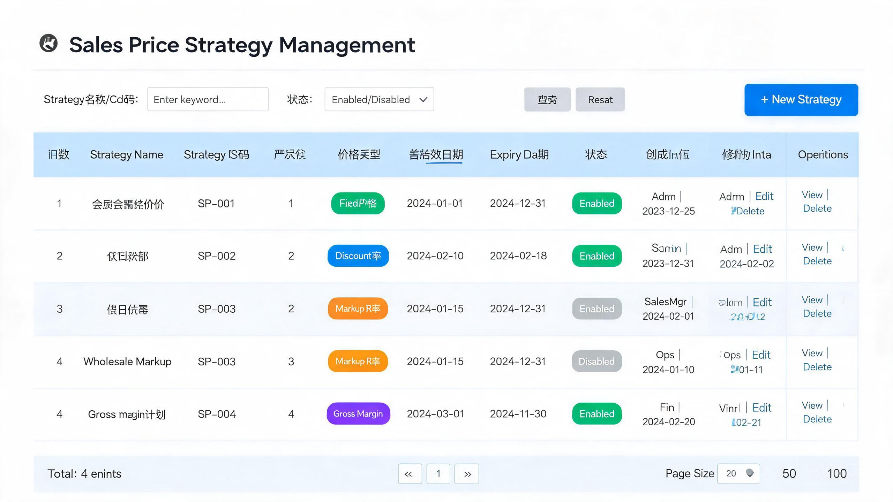

界面分为两个区域：
1. **搜索栏**：策略名称/编码关键词输入、状态下拉（启用/禁用）、查询/重置按钮、"+新增策略"主按钮。
2. **策略列表表格**：列包括序号、策略名称、策略编码、优先级、价格类型（彩色标签：固定价蓝色/折扣率绿色/加价率橙色/毛利率红色）、生效日期、失效日期、状态（绿色启用/灰色禁用）、审计字段（创建人/创建时间/修改人/修改时间）、操作（查看/编辑/删除）。

### 1.3 操作步骤

#### 新增价格策略
1. 点击"+新增策略"按钮，跳转到策略编辑页面。
2. 填写策略基础信息：
   - **策略名称**：如"VIP客户9折策略"。
   - **策略编码**：如`VIP_DISCOUNT_9`。
   - **优先级**：数字越小优先级越高，如`1`。
   - **价格类型**：选择"固定价""折扣率""加价率"或"毛利率"。
   - **生效日期**：策略开始生效的日期。
   - **失效日期**：策略失效的日期。
3. 根据价格类型配置具体参数：
   - **固定价**：直接指定售价金额。
   - **折扣率**：设置折扣比例，如`0.9`表示9折。
   - **加价率**：在成本价基础上加价的比例，如`0.2`表示加价20%。
   - **毛利率**：按目标毛利率反推售价。
4. 配置适用范围（客户分类、物料分类、客户等级等）。
5. 点击"保存"完成新增。

#### 修改策略
1. 在策略列表中点击"编辑"按钮。
2. 修改策略配置后点击"保存"。

#### 启用/禁用策略
1. 在策略列表中找到目标策略。
2. 通过操作菜单切换启用/禁用状态。
3. 禁用后该策略不再参与售价匹配。

### 1.4 注意事项

- **优先级冲突**：当多个策略同时匹配时，系统按优先级数字从小到大选择，数字最小的策略生效。
- **生效日期控制**：仅在生效日期和失效日期之间的策略才会参与匹配，过期策略自动失效。
- **价格类型不可修改**：策略创建后价格类型不可修改，如需变更请新建策略。
- **删除限制**：已被销售订单引用的策略不可删除，建议改为禁用。

---

## 2. 采购价格策略

### 2.1 功能说明

采购价格策略用于配置采购业务中的定价规则，与销售价格策略对称。系统根据策略自动匹配采购单价，规范采购行为，控制采购成本。

主要功能包括：
- 策略的增、删、改、查
- 3种价格类型：固定价、折扣率、加价率
- 优先级控制
- 生效日期和失效日期控制

### 2.2 界面描述

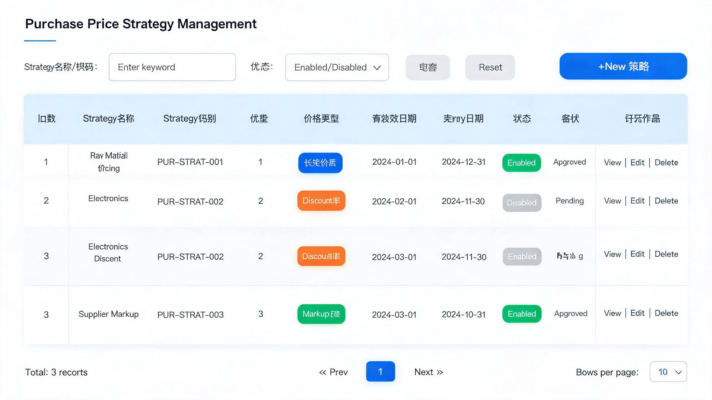

界面布局与销售价格策略类似，包含搜索栏和策略列表表格。价格类型标签仅3种（无毛利率类型）。

### 2.3 操作步骤

操作步骤与销售价格策略基本一致，区别在于：
1. **价格类型**：仅支持固定价、折扣率、加价率3种（不支持毛利率，因为采购不涉及毛利反推）。
2. **适用范围**：配置供应商分类、物料分类等采购维度。
3. **匹配场景**：在采购订单、采购入库单等单据中选择物料和供应商后，系统自动匹配采购单价。

### 2.4 注意事项

- **采购价上限控制**：可在系统参数中配置采购单价上限，超过上限的策略不参与匹配。
- **供应商协议价优先**：若供应商基础资料中维护了协议价，协议价优先于策略价。
- **价格变更追溯**：策略修改后，历史采购单据的单价不受影响，仅影响新创建的单据。

---

# 第二部分：样品管理

## 3. 打样管理

### 3.1 功能说明

打样管理用于管理客户打样需求的全流程，从打样申请、审核、打样生产、进度跟踪到完成确认和转BOM。打样是制造业获取客户订单的关键环节，系统化的打样管理可提升打样效率和转化率。

主要功能包括：
- 打样单的增、删、改、查
- 打样单状态流转：草稿→待审核→已生效→打样中→已完成→已确认→已转BOM / 已取消
- 打样进度跟踪（图纸设计/物料准备/加工中/组装调试/待验收/已完成）
- 成本金额核算
- 转BOM（将打样成功的样品转为正式BOM）

### 3.2 界面描述

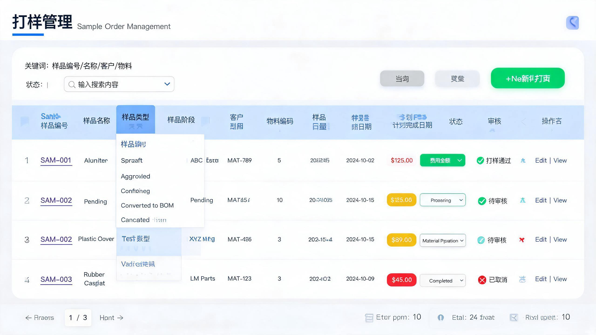

界面分为两个区域：
1. **筛选栏**：关键词输入（打样单号/样品名称/客户/物料）、状态下拉（8种状态）、查询/重置按钮、"+新增打样单"绿色按钮。
2. **打样单列表表格**：列包括打样单号（紫色可点击链接）、样品名称、样品类型、打样阶段、客户、物料编码、打样数量、需求交期、计划完成、成本金额、状态（彩色标签）、打样进度（下拉选择器，支持选择/输入进度）、审计字段、操作。

### 3.3 操作步骤

#### 新增打样单
1. 点击"+新增打样单"按钮，跳转到打样单编辑页面。
2. 填写表头信息：
   - **客户**：选择需要打样的客户。
   - **样品名称**：如"304不锈钢法兰样品"。
   - **样品类型**：如"新品打样""改良打样""复制打样"。
   - **打样阶段**：如"初样""验证样""小批量"。
   - **物料编码**：关联的物料。
   - **打样数量**：本次打样的数量。
   - **需求交期**：客户要求的交付日期。
   - **计划完成**：内部计划的完成日期。
   - **成本金额**：预估的打样成本。
3. 添加打样明细（如需多个规格）。
4. 点击"保存"存为草稿，或点击"提交"进入审批流程。

#### 跟踪打样进度
1. 在打样单列表中找到状态为"打样中"的打样单。
2. 在"打样进度"列的下拉框中选择当前进度阶段：
   - 图纸设计
   - 物料准备
   - 加工中
   - 组装调试
   - 待验收
   - 已完成
3. 系统自动保存进度状态，便于团队协同跟踪。

#### 完成打样
1. 打样生产完成后，点击操作菜单选择"完成"。
2. 打样单状态变为"已完成"。
3. 客户确认样品后，点击"确认"，状态变为"已确认"。

#### 转BOM
1. 打样确认后，点击操作菜单选择"转BOM"。
2. 系统将打样单的物料清单转为正式BOM，可在BOM管理中查看和维护。
3. 打样单状态变为"已转BOM"，流程结束。

### 3.4 注意事项

- **状态不可逆**：除"草稿→待审核""已生效→打样中"等正向流转外，已转BOM和已取消的状态不可逆。
- **打样进度自定义**：打样进度支持下拉选择和手动输入，可根据企业实际流程自定义进度阶段。
- **成本核算**：成本金额为预估成本，实际成本需在打样过程中通过领料单和工时单归集。
- **转BOM前提**：仅"已确认"状态的打样单可转BOM，未确认的打样单不可转。

---

## 4. 免费样品管理

### 4.1 功能说明

免费样品管理用于管理向客户免费提供的样品，包括样品申请、审核、发货、完成等环节。与打样管理不同，免费样品通常是现有产品的样品，用于客户体验、市场推广、品质确认等场景。

主要功能包括：
- 免费样品单的增、删、改、查
- 状态流转：草稿→已提交→已生效→已发货→已完成 / 已取消
- 发货登记（快递公司、快递单号）
- 金额核算（虽然免费，仍需记录成本）

### 4.2 界面描述

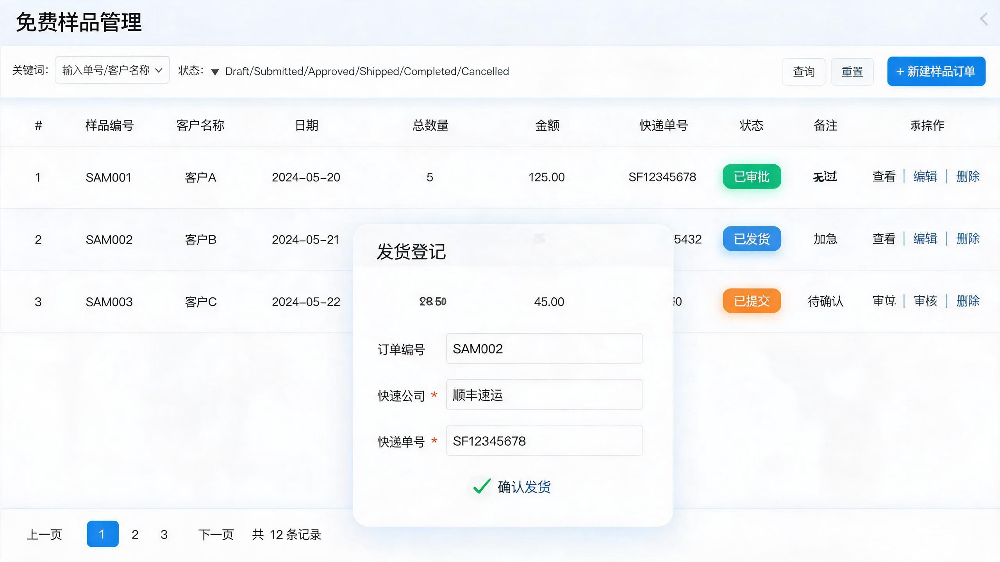

界面分为两个区域：
1. **筛选栏**：关键词输入（单号/客户名称）、状态下拉（6种状态）、查询/重置按钮、"+新增样品单"主按钮。
2. **样品单列表表格**：列包括序号、单号、客户、日期、总数量、金额、快递单号、状态（彩色标签）、备注、审计字段、操作。

**发货登记弹窗**：点击"发货"后弹出，包含单号（只读）、快递公司（必填）、快递单号（必填）、确认发货按钮。

### 4.3 操作步骤

#### 新增免费样品单
1. 点击"+新增样品单"按钮，跳转到编辑页面。
2. 填写客户、样品日期、样品明细（物料、数量、单价、金额）。
3. 点击"保存"存为草稿，或"提交"进入审批。

#### 发货登记
1. 审核通过的样品单，在操作菜单点击"发货"。
2. 在弹窗中填写快递公司（如"顺丰"）和快递单号。
3. 点击"确认发货"，状态变为"已发货"。

#### 完成样品单
1. 客户收到样品后，点击操作菜单选择"完成"。
2. 状态变为"已完成"，流程结束。

### 4.4 注意事项

- **免费≠无成本**：虽然样品免费提供给客户，但系统仍记录成本金额，用于市场费用核算。
- **快递单号必填**：发货登记时快递公司和快递单号为必填项，便于物流跟踪。
- **库存扣减**：免费样品发货时会扣减对应物料的库存，请确保库存充足。

---

# 第三部分：CRM客户关系管理

## 5. CRM仪表板

### 5.1 功能说明

CRM仪表板是CRM模块的首页，提供关键指标概览和数据分布可视化，帮助销售管理者快速掌握客户全貌、销售进展和待办事项。

主要功能包括：
- 关键指标统计（客户总数、活跃客户、本月新增、待跟进数）
- 客户状态分布（潜在/初步接触/洽谈中/已签约/流失）
- 销售阶段分布（线索/资格确认/方案/谈判/成交/流失）
- 意向等级分布（A/B/C/D级）
- 点击指标可下钻查看明细

### 5.2 界面描述

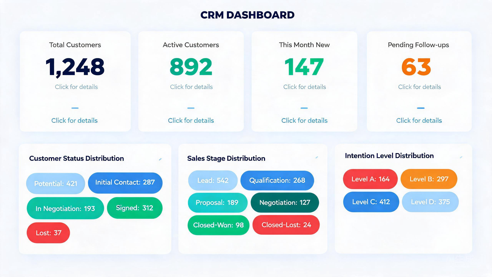

界面分为两个区域：
1. **顶部统计卡片**：4个统计指标卡片横向排列，每个卡片包含指标名称、数值（彩色显示）、"点击查看明细"提示。
2. **底部分布区块**：3个分布区块横向排列：
   - **客户状态分布**：以标签形式展示各状态客户数量，点击标签可筛选对应客户。
   - **销售阶段分布**：以标签形式展示各销售阶段的客户数量。
   - **意向等级分布**：以标签形式展示A/B/C/D级客户数量。

### 5.3 操作步骤

#### 查看关键指标
1. 进入CRM模块首页，仪表板自动加载。
2. 顶部4个卡片展示客户总数、活跃客户、本月新增、待跟进客户数。
3. 数值实时反映最新数据。

#### 下钻查看明细
1. 点击任意统计卡片，跳转到对应明细列表。
2. 例如点击"待跟进"卡片，跳转到客户列表并筛选出待跟进的客户。

#### 查看分布
1. 在底部3个分布区块中查看各维度分布。
2. 点击任意分布标签，跳转到客户列表并按该维度筛选。
3. 例如点击客户状态分布的"洽谈中"标签，跳转到客户列表并筛选CRM状态为"洽谈中"的客户。

### 5.4 注意事项

- **数据实时性**：仪表板数据每次进入页面时刷新，不自动轮询。如需最新数据请手动刷新页面。
- **权限控制**：仪表板仅展示当前用户有权限查看的客户数据，受员工权限配置影响。

---

## 6. CRM客户管理

### 6.1 功能说明

CRM客户管理是CRM模块的核心，维护客户的全生命周期信息，包括基础信息、联系人、跟进记录、商机、订单、收款等。支持客户分类、分级、状态管理，以及私海/公海归属管理。

主要功能包括：
- 客户的增、删、改、查
- 客户星标置顶（重要客户标记）
- 内联编辑CRM状态、销售阶段、意向等级
- 私海/公海归属切换
- 黑名单标记
- 列设置（自定义显示列）

### 6.2 界面描述

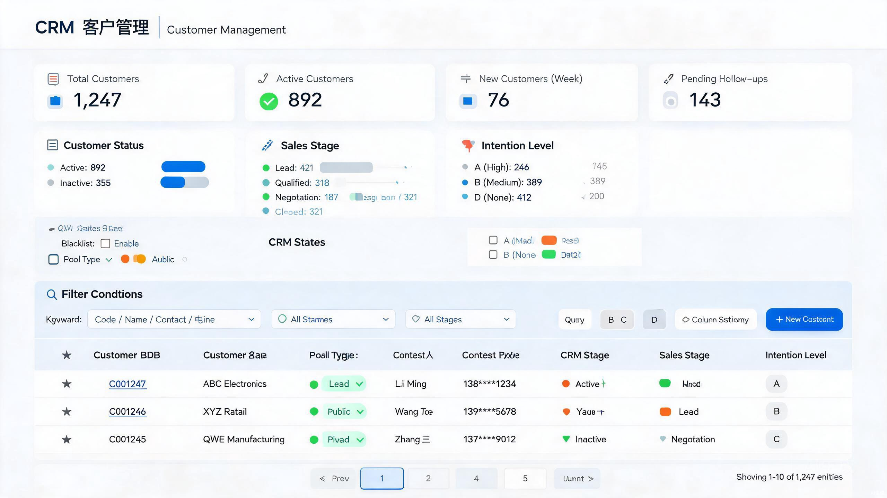

界面分为三个区域：
1. **顶部仪表板**：统计卡片和分布标签（与CRM仪表板类似）。
2. **筛选栏**：关键词输入（编码/名称/简称/联系人/电话）、CRM状态下拉、销售阶段下拉、意向等级下拉、黑名单下拉、归属下拉（私海/公海）、查询/重置按钮、列设置按钮、"+新增客户"主按钮。
3. **客户列表表格**：列包括星标切换、客户编码（可点击链接）、客户名称、归属（私海绿色/公海橙色标签）、联系人、联系电话、CRM状态（内联可编辑下拉）、销售阶段（内联可编辑下拉）、意向等级（彩色标签）等。

### 6.3 操作步骤

#### 新增客户
1. 点击"+新增客户"按钮，跳转到客户编辑页面。
2. 填写客户基础信息：客户编码（自动生成）、客户名称、简称、联系人、联系电话、邮箱、地址等。
3. 填写CRM信息：CRM状态、销售阶段、意向等级、客户来源、行业分类等。
4. 点击"保存"完成新增。

#### 内联编辑客户状态
1. 在客户列表中找到目标客户。
2. 在"CRM状态"列直接点击下拉框，选择新的状态。
3. 系统自动保存修改，无需进入编辑页面。
4. 同样支持内联编辑"销售阶段"等字段。

#### 星标置顶
1. 在客户列表最左侧的星标列，点击星形图标。
2. 点亮的星标表示该客户为重要客户，置顶显示。
3. 仅私海客户可设置星标，公海客户不可。

#### 转移到公海
1. 在客户编辑页面或操作菜单中选择"转移到公海"。
2. 客户从私海移入公海，原归属人不再享有该客户的独占权。
3. 公海客户可被其他销售员领取。

### 6.4 注意事项

- **私海独占**：私海客户仅归属人可查看和编辑，其他销售员不可见，避免撞单。
- **公海共享**：公海客户所有销售员可见，先到先得领取。
- **内联编辑权限**：内联编辑需有客户编辑权限，否则下拉框为只读。
- **列设置**：通过列设置按钮可自定义显示列，配置保存在浏览器本地。

---

## 7. 客户私海

### 7.1 功能说明

客户私海展示当前销售员名下的客户（即归属人为当前用户的客户）。私海客户独占，其他销售员不可见，确保销售员对客户的独占开发权。

主要功能包括：
- 我的客户统计（客户总数、本月活跃、今日待跟进、逾期跟进、长期未开单）
- 客户列表筛选和排序
- 快速发起跟进
- 转移到公海

### 7.2 界面描述

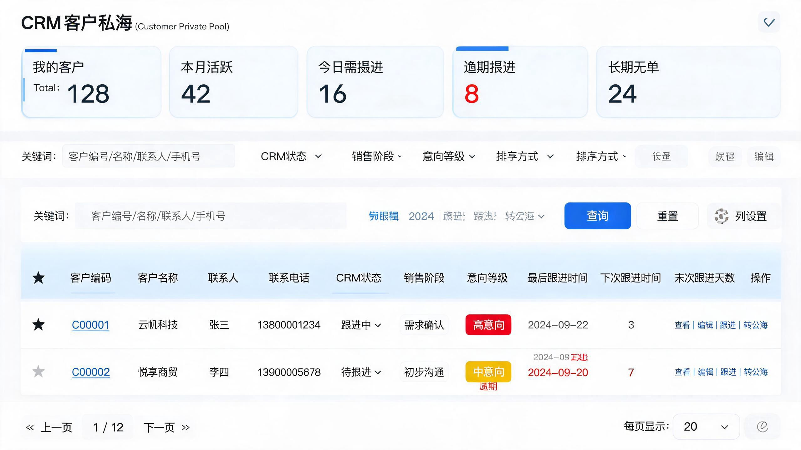

界面分为三个区域：
1. **统计卡片**：我的客户、本月活跃、今日待跟进、逾期跟进、长期未开单。
2. **筛选栏**：关键词、CRM状态、销售阶段、意向等级、排序方式（最后跟进/创建时间/意向）下拉、查询/重置按钮、列设置。
3. **客户列表表格**：星标、客户编码、客户名称、联系人、联系电话、CRM状态（内联下拉）、销售阶段（内联下拉）、意向等级、最后跟进日期、下次跟进日期（逾期红色显示）、距上次跟进天数、操作（查看/编辑/跟进/转移公海）。

### 7.3 操作步骤

#### 查看今日待跟进
1. 进入客户私海页面。
2. 点击顶部"今日待跟进"统计卡片，列表筛选出今日需跟进的客户。
3. 逐个客户发起跟进。

#### 快速跟进
1. 在客户列表中找到要跟进的客户。
2. 点击操作列的"跟进"按钮。
3. 在弹窗中填写跟进方式、跟进日期、跟进摘要、重要程度等。
4. 保存后跟进记录关联到该客户。

#### 转移到公海
1. 选中要转移的客户。
2. 点击操作列的"转移公海"按钮。
3. 客户从私海移入公海。

### 7.4 注意事项

- **逾期跟进提醒**：下次跟进日期已过但未跟进的客户，下次跟进日期列显示红色，提醒销售员及时跟进。
- **自动回收**：根据系统参数配置（默认90天未跟进/180天未开单），长期未活跃的私海客户会被自动回收到公海。
- **领取上限**：每个销售员的私海客户数有上限（在系统参数CRM参数中配置），达到上限后不可再领取公海客户。

---

## 8. 客户公海

### 8.1 功能说明

客户公海展示所有未归属具体销售员的客户。公海客户可被任何有权限的销售员领取，实现客户资源的共享和流转。系统支持自动回收规则，将长期未跟进的私海客户自动回收到公海。

主要功能包括：
- 公海客户统计（公海总数、本月新增、本月领取、逾期）
- 自动回收规则展示
- 客户领取（单个/批量）
- 一键分配全部
- 立即执行自动回收
- 客户释放

### 8.2 界面描述

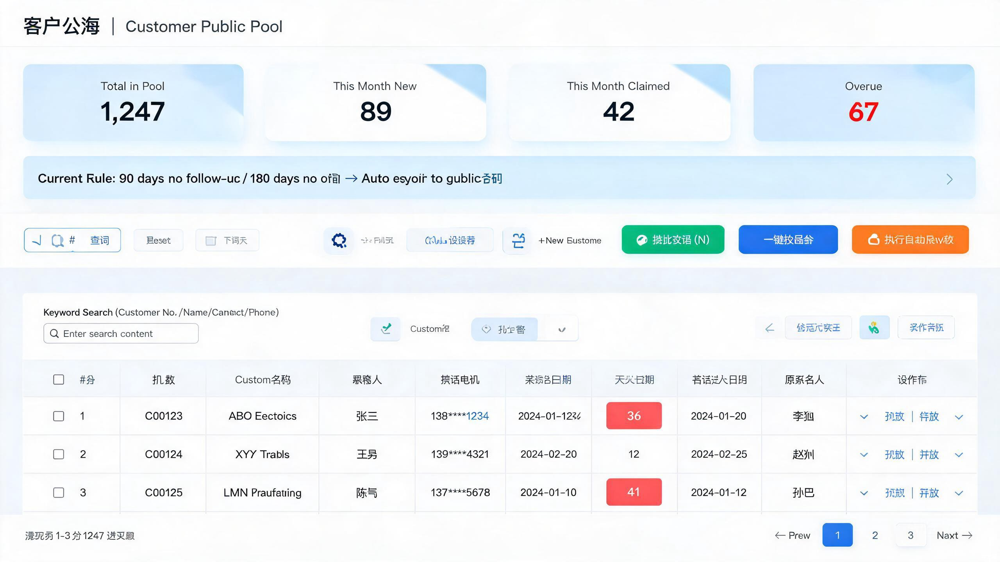

界面分为三个区域：
1. **统计卡片与规则**：统计指标卡片，以及绿色标签显示当前回收规则"当前规则：90天未跟进 / 180天未开单 → 自动回收公海"。
2. **工具栏**：关键词搜索、查询/重置按钮、列设置、"+新增客户"按钮、"批量分配(N)"绿色按钮、"一键分配全部"主按钮、"立即执行自动回收"橙色按钮。
3. **公海客户列表**：勾选框、序号、客户编号、客户名称、联系人、联系电话、进入公海日期、公海天数（超30天红色标签）、最后跟进日期、原归属人、操作（领取/释放）。

### 8.3 操作步骤

#### 领取客户
1. 在公海客户列表中找到目标客户。
2. 点击操作列的"领取"按钮。
3. 客户从公海移入当前用户的私海，原归属人变更为当前用户。

#### 批量分配
1. 在列表中勾选多个客户。
2. 点击"批量分配(N)"按钮（N为勾选数量）。
3. 在弹窗中选择目标销售员。
4. 点击"确认"批量分配给指定销售员。

#### 一键分配全部
1. 点击"一键分配全部"按钮。
2. 在弹窗中选择分配规则（按部门、按负载均衡等）和目标销售员。
3. 系统将公海全部客户按规则分配。

#### 立即执行自动回收
1. 点击"立即执行自动回收"橙色按钮。
2. 系统立即扫描所有私海客户，将符合回收规则（90天未跟进/180天未开单）的客户回收到公海。
3. 弹窗显示回收数量和回收清单。

### 8.4 注意事项

- **领取上限**：每个销售员的私海客户数有上限，达到上限后不可再领取。
- **自动回收定时任务**：除了手动执行"立即执行自动回收"，系统每天凌晨2点自动执行回收任务。
- **公海天数提醒**：公海天数超过30天的客户显示红色标签，建议优先分配或重点跟进。
- **释放操作**：仅原归属人可释放已领取但未到回收期的客户，释放后客户回到公海。

---

## 9. 线索管理

### 9.1 功能说明

线索管理用于管理潜在客户线索，是销售漏斗的入口。线索来源于市场活动、网站咨询、电话拜访、转介绍等渠道。线索经过筛选和培育后，可转化为正式客户进入销售流程。

主要功能包括：
- 线索的增、删、改、查
- 线索状态管理（新建/跟进中/已转化/已丢弃）
- 意向等级评估（A/B/C/D级）
- 线索转化为客户
- 线索导入导出（Excel）

### 9.2 界面描述

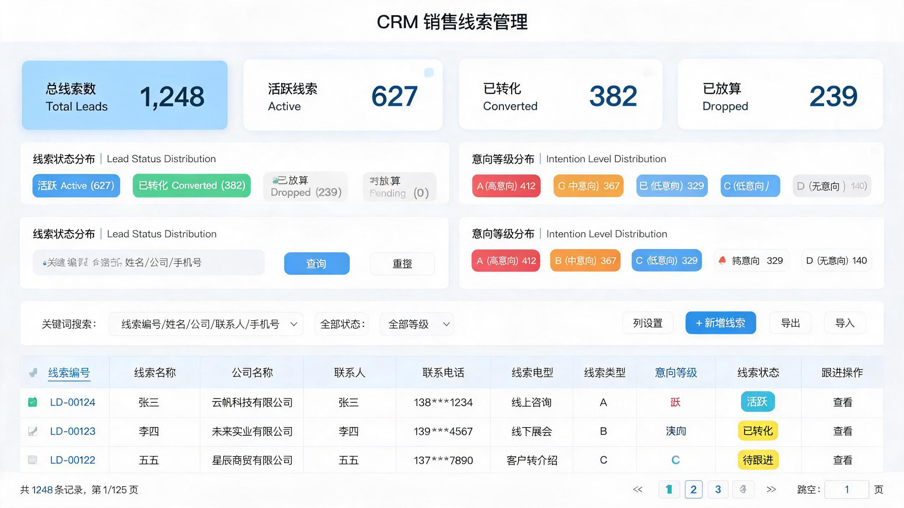

界面分为三个区域：
1. **仪表板**：统计卡片（线索总数/活跃/已转化/已丢弃）和分布标签（线索状态分布、意向等级分布A/B/C/D）。
2. **筛选栏**：关键词输入（线索编号/名称/公司/联系人/电话）、线索状态下拉、意向等级下拉、查询/重置按钮、列设置、"+新增线索"按钮、导出/导入按钮。
3. **线索列表表格**：线索编号（可点击链接）、线索名称、公司名称、联系人、联系电话、线索类型、意向等级（彩色标签）、线索状态等。

### 9.3 操作步骤

#### 新增线索
1. 点击"+新增线索"按钮。
2. 填写线索信息：线索名称、公司名称、联系人、联系电话、线索来源、线索类型、意向等级等。
3. 点击"保存"完成新增。

#### 跟进线索
1. 在线索列表中点击线索编号进入详情。
2. 添加跟进记录，更新意向等级和线索状态。
3. 持续培育直到线索成熟。

#### 转化为客户
1. 当线索意向明确后，在线索详情页面点击"转化为客户"。
2. 系统将线索信息映射为客户信息，创建新的客户记录。
3. 线索状态变为"已转化"，关联到新创建的客户。

#### 批量导入
1. 点击"导入"按钮，选择Excel文件。
2. 系统按模板解析线索数据并批量导入。
3. 导入结果弹窗显示成功/失败数量和失败原因。

### 9.4 注意事项

- **线索去重**：新增线索时系统按公司名称+联系电话去重，避免重复线索。
- **转化后线索不可逆**：线索转化为客户后，线索状态变为"已转化"，不可再转为线索。
- **导入模板**：批量导入前请下载标准模板，按模板格式填写数据，避免导入失败。

---

## 10. 商机管理

### 10.1 功能说明

商机管理用于跟踪有明确采购意向的销售机会。商机从线索或客户转化而来，经历多个销售阶段（资格确认→方案提供→谈判→成交），最终赢单或输单。商机管理是销售漏斗的核心，帮助企业预测销售业绩、优化销售策略。

主要功能包括：
- 商机的增、删、改、查
- 商机状态Tab切换（全部/进行中/赢单/输单/逾期）
- 销售阶段管理
- 预估金额和成交概率
- 竞争对手记录
- 下次跟进计划
- 商机导入导出

### 10.2 界面描述

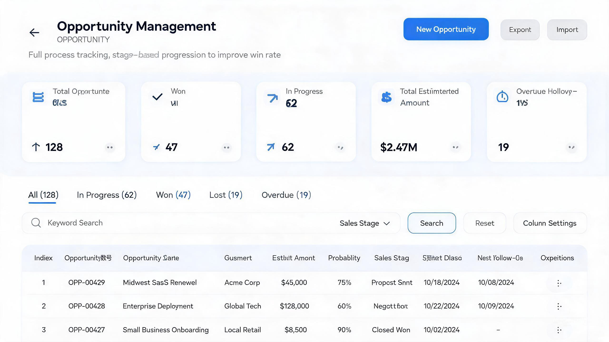

界面采用现代化科技风格设计：
1. **页面头部**：返回按钮、标题"商机管理 OPPORTUNITY"、副标题"销售机会全流程跟踪 · 阶段化推进提升赢单率"、新增商机/导出/导入按钮。
2. **统计卡片**：图标+数值+标签的卡片形式，展示商机总数、赢单、进行中、预估金额合计、逾期跟进。
3. **搜索栏**：状态Tab切换（全部/进行中/赢单/输单/逾期，带数量徽章）、关键词搜索、销售阶段下拉、搜索/重置按钮、列设置。
4. **商机列表表格**：序号、商机编号、商机名称、客户、预估金额、成交概率、销售阶段、预计成交、下次跟进等。

### 10.3 操作步骤

#### 新增商机
1. 点击"新增商机"按钮。
2. 填写商机信息：商机名称、关联客户、联系人、预估金额、成交概率、销售阶段、预计成交日期、下次跟进日期、竞争对手、备注等。
3. 点击"保存"完成新增。

#### 推进销售阶段
1. 在商机列表中找到要推进的商机。
2. 点击"编辑"，修改销售阶段（如从"资格确认"推进到"方案提供"）。
3. 同步更新成交概率（阶段越靠后概率越高）。
4. 保存修改。

#### 标记赢单/输单
1. 商机成交或失败后，在商机详情页面。
2. 点击"赢单"或"输单"按钮。
3. 填写赢单/输单原因和备注。
4. 商机状态变为"赢单"或"输单"，不再继续跟进。

### 10.4 注意事项

- **成交概率**：成交概率建议按销售阶段设置参考值（资格确认20%、方案提供50%、谈判70%、即将成交90%），实际可根据具体情况调整。
- **逾期跟进**：下次跟进日期已过但未跟进的商机标记为"逾期跟进"，建议优先处理。
- **赢单/输单不可逆**：商机标记赢单或输单后不可恢复为进行中，操作前请确认。

---

## 11. 销售漏斗看板

### 11.1 功能说明

销售漏斗看板以看板形式可视化展示商机在各销售阶段的分布，帮助销售管理者直观了解销售pipeline健康度、发现阶段瓶颈、预测销售业绩。

主要功能包括：
- 顶部统计概览（商机总数、已成交、未关闭、预估金额合计、逾期跟进）
- 看板视图（按销售阶段分列展示商机卡片）
- 商机卡片点击查看详情
- 一键跳转商机管理

### 11.2 界面描述

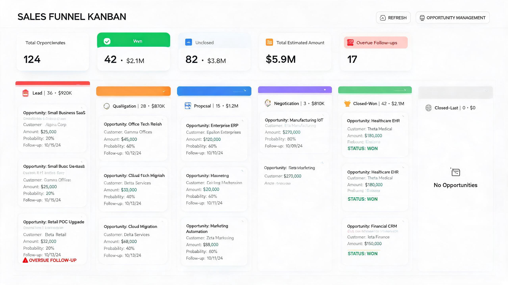

界面分为两个区域：
1. **顶部统计卡片**：商机总数、已成交（绿色）、未关闭（蓝色）、预估金额合计（橙色）、逾期跟进（红色）、刷新/进入商机管理按钮。
2. **看板视图**：多个列横向排列，每列代表一个销售阶段（线索/资格确认/方案/谈判/赢单/输单），列顶部有彩色边框。每列头部显示阶段标签、商机数量、金额合计。列内以卡片形式展示商机，每张卡片包含：商机名称、客户名称、预估金额、成交概率、下次跟进日期（逾期显示红色标签）。

### 11.3 操作步骤

#### 查看漏斗分布
1. 进入销售漏斗看板页面。
2. 各列展示对应销售阶段的商机，列头显示数量和金额。
3. 通过列间对比，直观发现哪个阶段商机堆积（瓶颈）。

#### 查看商机详情
1. 点击任意商机卡片。
2. 弹窗展示商机详情：商机编号、名称、客户、联系人、预估金额、成交概率、销售阶段、预计成交、下次跟进、最后跟进、竞争对手、备注等。
3. 点击"进入商机管理"可跳转到商机编辑页面。

#### 刷新数据
1. 点击顶部"刷新"按钮。
2. 看板重新加载最新数据。

### 11.4 注意事项

- **看板不编辑**：看板仅用于查看，不可直接拖拽卡片改变阶段（如需修改阶段请进入商机管理编辑）。
- **空列处理**：若某阶段无商机，列内显示"暂无商机"占位符。
- **逾期标识**：下次跟进日期已过且未跟进的商机卡片显示红色"逾期跟进"标签，建议优先处理。

---

## 12. 跟进记录

### 12.1 功能说明

跟进记录用于记录销售员与客户/线索/商机的每次互动，是CRM数据的核心。完整的跟进记录帮助销售员梳理客户关系进展，帮助管理者了解销售工作量和跟进质量。

主要功能包括：
- 跟进记录的增、删、改、查
- 关联多种来源（线索/客户/商机）
- 多种跟进方式（电话/拜访/邮件/微信/会议）
- 重要程度标记
- 跟进方式分布统计

### 12.2 界面描述

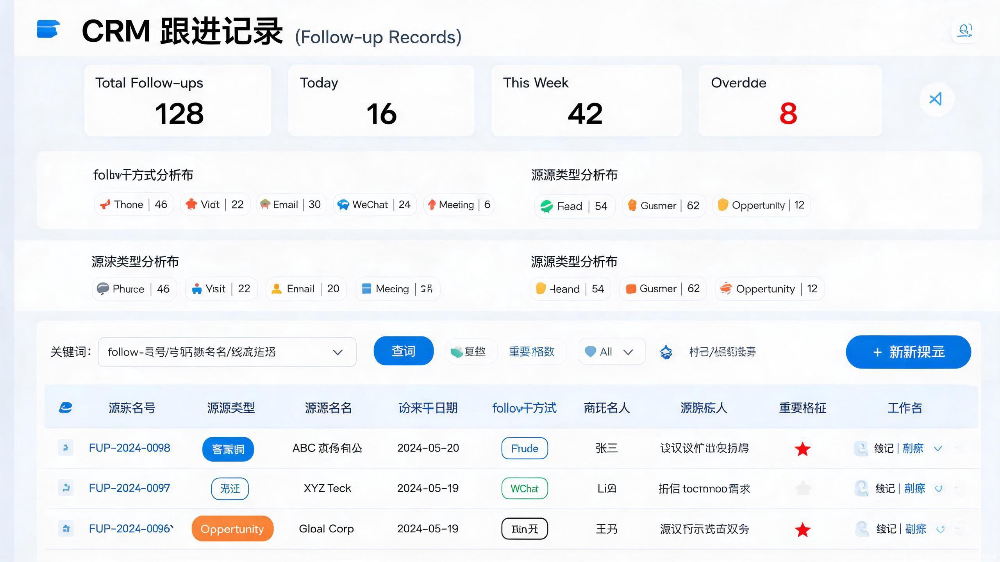

界面分为三个区域：
1. **仪表板**：统计卡片（跟进总数/今日/本周/逾期）和分布标签（跟进方式分布、来源类型分布）。
2. **筛选栏**：关键词输入（跟进单号/来源名称/联系人/摘要）、来源类型下拉、跟进方式下拉、重要程度下拉（全部/普通/重要）、查询/重置按钮、列设置、"+新增跟进"按钮。
3. **跟进记录列表表格**：跟进单号（可点击链接）、来源类型（标签）、来源名称、跟进日期、跟进方式（描边标签）、联系人、跟进摘要、重要程度、操作。

### 12.3 操作步骤

#### 新增跟进记录
1. 点击"+新增跟进"按钮。
2. 选择来源类型（线索/客户/商机）和具体来源。
3. 填写跟进信息：
   - **跟进日期**：默认当天。
   - **跟进方式**：电话/拜访/邮件/微信/会议等。
   - **联系人**：本次跟进的联系人。
   - **跟进摘要**：简要描述跟进内容。
   - **重要程度**：普通或重要。
   - **下次跟进日期**：计划下次跟进时间。
4. 点击"保存"完成新增。

#### 从客户/线索/商机快速跟进
1. 在客户私海、线索管理、商机管理等页面。
2. 点击操作列的"跟进"按钮。
3. 系统自动关联来源，只需填写跟进内容。

### 12.4 注意事项

- **跟进摘要必填**：跟进摘要是必填项，建议详细描述跟进内容和客户反馈，便于后续追溯。
- **下次跟进日期**：填写下次跟进日期后，系统会在私海页面的"今日待跟进"中提醒。
- **重要跟进标记**：重要跟进记录标记后，在仪表板的"重要"筛选中可快速查看。

---

## 13. 客户预警

### 13.1 功能说明

客户预警用于自动识别有流失风险的客户，帮助销售团队提前介入挽留。系统根据客户的跟进频率、订单频率、活跃度等指标，自动计算风险等级并发出预警。

主要预警类型：
- 逾期跟进预警（超过计划跟进日期未跟进）
- 长期未开单预警（长期未产生订单的客户）
- 黑名单预警（被加入黑名单的客户）
- 高价值流失风险（高价值客户活跃度下降）

### 13.2 界面描述

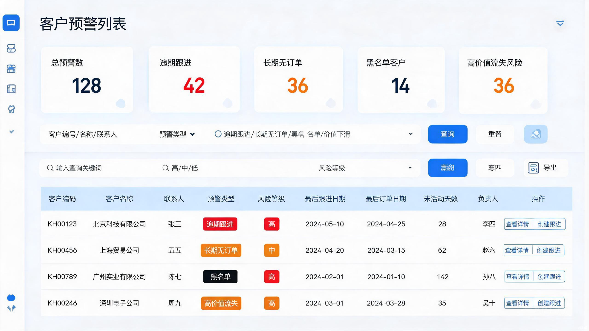

界面分为两个区域：
1. **统计卡片**：预警总数、逾期跟进、长期未开单、黑名单、高价值流失风险，每个指标用不同颜色显示。
2. **筛选栏与列表**：关键词搜索、预警类型下拉、风险等级下拉、查询/重置按钮、导出按钮。列表展示客户编码、客户名称、联系人、预警类型（红/橙/黄标签）、风险等级（彩色标签）、最后跟进日期、最后订单日期、距上次活动天数、归属人、操作（查看详情/创建跟进）。

### 13.3 操作步骤

#### 查看预警客户
1. 进入客户预警页面。
2. 顶部统计卡片展示各类型预警数量。
3. 点击某个统计卡片，列表筛选出对应类型的预警客户。

#### 处理预警
1. 在预警列表中找到目标客户。
2. 点击"查看详情"查看客户完整信息。
3. 点击"创建跟进"快速发起一次跟进，挽留客户。
4. 跟进后预警状态自动更新。

#### 按风险等级筛选
1. 在筛选栏选择风险等级（高/中/低）。
2. 列表仅展示对应风险等级的预警客户。
3. 建议优先处理高风险客户。

### 13.4 注意事项

- **预警自动计算**：预警由系统定时任务（每天凌晨3点）自动计算，非实时。
- **风险等级**：风险等级由系统根据多项指标综合计算，包括距上次跟进天数、距上次订单天数、客户价值等。
- **跟进后预警更新**：创建跟进后，预警状态会在下次定时任务执行时更新（跟进后1-2天）。

---

## 14. 联系人管理

### 14.1 功能说明

联系人管理用于维护客户公司的联系人信息，一个客户可有多个联系人（采购负责人、技术负责人、财务负责人等）。完整的联系人信息有助于精准对接和关系维护。

主要功能包括：
- 联系人的增、删、改、查
- 关联客户
- 标记关键联系人和决策人
- 联系人导入导出

### 14.2 界面描述

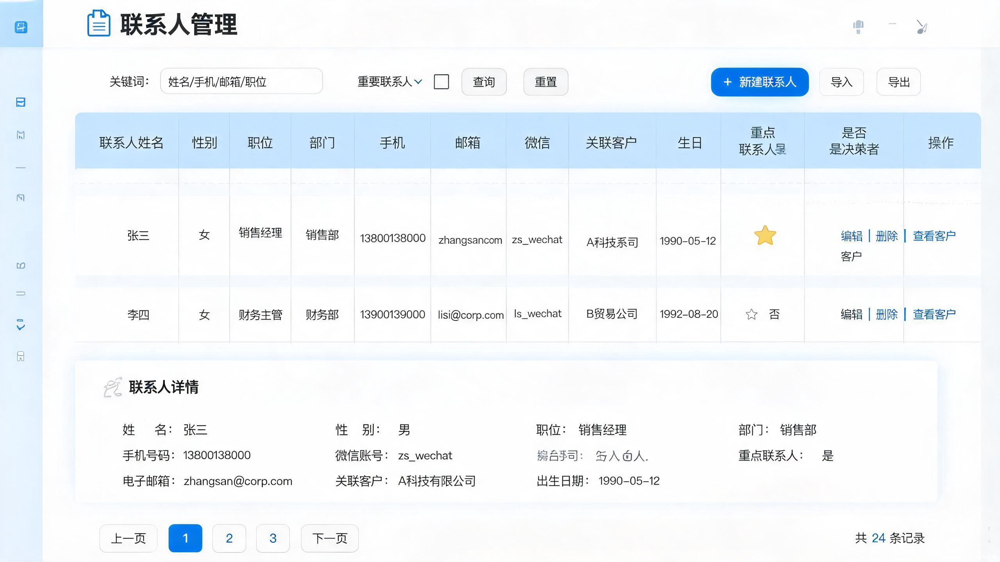

界面分为两个区域：
1. **筛选栏**：关键词输入（姓名/电话/邮箱/职位）、客户筛选下拉、重要联系人筛选、查询/重置按钮、"+新增联系人"按钮、导入/导出按钮。
2. **联系人列表表格**：姓名、性别、职位、部门、手机号、邮箱、微信、关联客户、生日、是否关键联系人（星标）、是否决策人（标签）、操作（编辑/删除/查看客户）。

### 14.3 操作步骤

#### 新增联系人
1. 点击"+新增联系人"按钮。
2. 填写联系人信息：姓名、性别、职位、部门、手机号、邮箱、微信、关联客户、生日等。
3. 标记是否为关键联系人、是否为决策人。
4. 点击"保存"完成新增。

#### 查看关联客户
1. 在联系人列表中点击"查看客户"按钮。
2. 跳转到关联客户的详情页面。

### 14.4 注意事项

- **关键联系人**：关键联系人是采购决策的核心人物，建议重点维护。
- **决策人标记**：决策人标记用于识别客户的最终决策者，影响商机成交概率。
- **一个客户多联系人**：一个客户可关联多个联系人，建议维护完整的联系人体系。

---

## 15. 客户投诉

### 15.1 功能说明

客户投诉用于记录和处理客户对产品或服务的不满，规范投诉处理流程，提升客户满意度。投诉处理闭环包括：投诉登记→分派处理→处理反馈→客户确认→关闭投诉。

主要功能包括：
- 投诉的增、删、改、查
- 投诉类型分类（质量/服务/交付/价格/其他）
- 优先级管理（紧急/高/中/低）
- 处理人分派
- 状态流转（待处理/处理中/已解决/已关闭）

### 15.2 界面描述

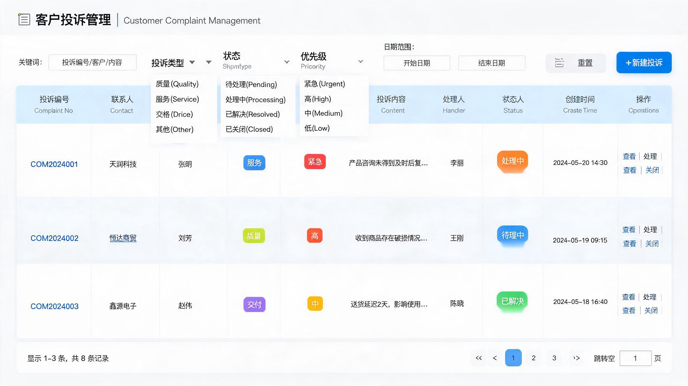

界面分为两个区域：
1. **筛选栏**：关键词输入（投诉编号/客户/内容）、投诉类型下拉、状态下拉、优先级下拉、日期范围选择器、查询/重置按钮、"+新增投诉"按钮。
2. **投诉列表表格**：投诉编号（可点击链接）、客户名称、联系人、投诉类型（彩色标签）、优先级（彩色标签）、投诉内容（截断显示）、处理人、状态（彩色标签）、创建时间、操作（查看/处理/关闭）。

### 15.3 操作步骤

#### 登记投诉
1. 点击"+新增投诉"按钮。
2. 填写投诉信息：客户、联系人、投诉类型、优先级、投诉内容、相关单据等。
3. 选择处理人。
4. 点击"保存"，状态默认为"待处理"。

#### 处理投诉
1. 在投诉列表中找到待处理的投诉。
2. 点击"处理"按钮。
3. 填写处理方案和处理结果。
4. 状态变为"处理中"，继续跟踪直到问题解决。

#### 关闭投诉
1. 投诉处理完成后，点击"关闭"按钮。
2. 填写关闭说明和客户满意度。
3. 状态变为"已关闭"，流程结束。

### 15.4 注意事项

- **紧急投诉**：紧急投诉需在24小时内响应，建议设置短信/邮件提醒。
- **投诉类型统计**：通过投诉类型统计可发现产品/服务的共性问题，驱动改进。
- **关闭需客户确认**：建议关闭投诉前征得客户确认，避免客户不满意导致重复投诉。

---

## 16. 销售目标

### 16.1 功能说明

销售目标用于设定和跟踪销售团队和个人的业绩目标，包括销售额目标、新客户目标、订单数量目标等。系统自动计算目标完成率，可视化展示业绩达成情况。

主要功能包括：
- 销售目标的增、删、改、查
- 按年度/季度/部门/销售员维度设置目标
- 目标金额、新客户数、订单数等多维度目标
- 自动计算完成率（进度条可视化）
- 批量导入

### 16.2 界面描述

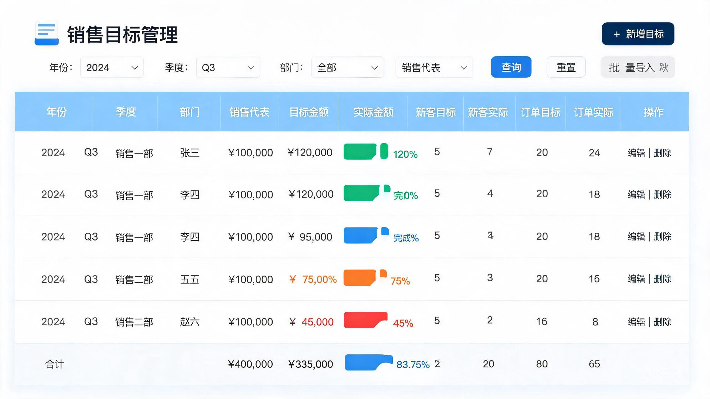

界面分为两个区域：
1. **筛选栏**：年度选择器、季度选择器、部门下拉、销售员下拉、查询/重置按钮、"+新增目标"按钮、批量导入按钮。
2. **目标列表表格**：年度、季度、部门、销售员、目标金额、实际金额、完成率（进度条+百分比，颜色按达成率区分：绿色≥100%/蓝色80-99%/橙色60-79%/红色<60%）、新客户目标、新客户实际、订单数目标、订单数实际、操作（编辑/删除）。底部汇总行展示总目标和总实际。

### 16.3 操作步骤

#### 设置销售目标
1. 点击"+新增目标"按钮。
2. 选择年度、季度、部门、销售员。
3. 填写目标金额、新客户目标数、订单数目标。
4. 点击"保存"完成设置。

#### 查看完成率
1. 在目标列表中查看"完成率"列。
2. 进度条颜色直观反映达成情况：绿色（超额完成）、蓝色（接近达成）、橙色（需努力）、红色（严重落后）。
3. 底部汇总行展示团队整体达成情况。

#### 批量导入目标
1. 点击"批量导入"按钮。
2. 下载导入模板。
3. 按模板填写目标数据。
4. 上传Excel文件批量导入。

### 16.4 注意事项

- **实际数据自动汇总**：实际金额、新客户数、订单数由系统从销售订单、客户、订单数据自动汇总，无需手动维护。
- **目标不可重复**：同一销售员同一季度的目标不可重复设置，重复时系统会提示。
- **汇总维度**：底部汇总行按当前筛选条件汇总，便于团队整体把控。

---

## 17. 问卷调查

### 17.1 功能说明

问卷调查用于向客户发送满意度调查、NPS调查、产品反馈等问卷，收集客户反馈，持续改进产品和服务。

主要功能包括：
- 问卷的增、删、改、查
- 多种问卷类型（满意度/NPS/产品反馈/服务反馈）
- 关联客户发送
- 回收问卷响应
- 满意度评分和NPS评分统计

### 17.2 界面描述

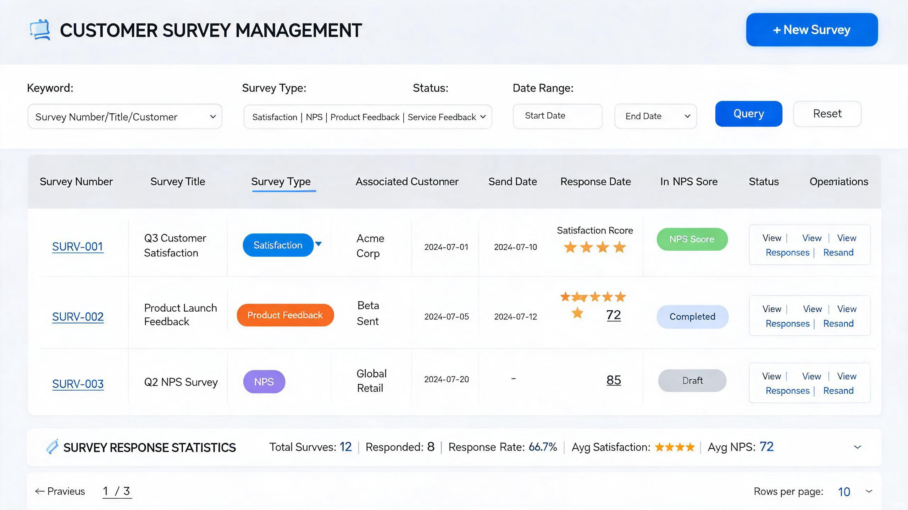

界面分为两个区域：
1. **筛选栏**：关键词输入（问卷编号/标题/客户）、问卷类型下拉、状态下拉、日期范围选择器、查询/重置按钮、"+新增问卷"按钮。
2. **问卷列表表格**：问卷编号（可点击链接）、问卷标题、问卷类型（彩色标签）、关联客户、发送日期、响应日期、满意度评分（星级）、NPS评分（数字）、状态（彩色标签）、操作（查看/查看响应/重发）。

### 17.3 操作步骤

#### 创建并发送问卷
1. 点击"+新增问卷"按钮。
2. 选择问卷类型（满意度/NPS/产品反馈/服务反馈）。
3. 填写问卷标题和问题。
4. 选择关联客户。
5. 点击"发送"，问卷通过邮件/短信发送给客户。

#### 查看问卷响应
1. 客户填写问卷后，状态变为"已响应"。
2. 在问卷列表中点击"查看响应"按钮。
3. 查看客户的评分和反馈内容。

#### 重发问卷
1. 对于未响应的问卷，点击"重发"按钮。
2. 系统重新发送问卷给客户。

### 17.4 注意事项

- **问卷链接有效期**：问卷链接默认有效期为30天，过期后客户无法填写，可手动重发。
- **NPS评分**：NPS（Net Promoter Score）评分范围0-10分，9-10分为推荐者，7-8分为中立者，0-6分为贬损者。
- **满意度匿名**：可选择匿名问卷模式，鼓励客户真实反馈。

---

## 附录：CRM销售漏斗全景

```
市场线索 → 线索管理 → 客户转化 → 客户管理 → 商机管理 → 报价/样品 → 销售订单
    ↓           ↓          ↓          ↓          ↓          ↓
  跟进记录 ← 跟进记录 ← 跟进记录 ← 跟进记录 ← 跟进记录 ← 跟进记录
                                                                ↓
                                                          客户投诉/问卷
                                                                ↓
                                                          客户满意度提升
```

### 销售阶段与成交概率参考

| 销售阶段 | 成交概率参考 | 阶段说明 |
|----------|-------------|----------|
| 线索 | 10% | 初次接触，需求未明确 |
| 资格确认 | 20% | 确认客户有需求和预算 |
| 方案提供 | 40% | 已提供解决方案，客户认可 |
| 谈判 | 60% | 进入价格和条款谈判 |
| 即将成交 | 80% | 合同待签或订单待下 |
| 赢单 | 100% | 已成交 |
| 输单 | 0% | 已流失 |

---

## 附录：常见问题

### Q1：线索和客户的区别？
A：线索是潜在客户信息，尚未确认需求真实性；客户是已确认需求、进入正式销售流程的对象。线索通过"转化为客户"操作升级为客户。

### Q2：私海和公海的区别？
A：私海客户归属具体销售员，独占可见；公海客户无归属人，所有销售员可见可领取。私海客户长期未活跃（默认90天未跟进/180天未开单）会自动回收到公海。

### Q3：打样单和免费样品单的区别？
A：打样单是按客户需求定制生产样品，涉及生产过程和成本核算，可转BOM；免费样品单是现有产品的样品，主要用于客户体验，不涉及生产，仅记录发货。

### Q4：销售价格策略的优先级如何生效？
A：当多个策略同时匹配时，系统按优先级数字从小到大选择，数字最小的策略生效。例如优先级1的策略优先于优先级2的策略。

### Q5：商机的成交概率如何设置？
A：成交概率建议按销售阶段设置参考值（见附录表格），实际可根据客户反馈和谈判进展手动调整。系统不强制要求概率与阶段一致。

### Q6：客户预警如何自动计算？
A：系统每天凌晨3点执行定时任务，根据客户的跟进频率、订单频率、活跃度等指标自动计算风险等级并生成预警。预警非实时，最快T+1天更新。

### Q7：免费样品发货时库存不足怎么办？
A：免费样品发货会扣减库存，若库存不足系统会提示"库存不足，无法发货"。请先通过采购入库或其他入库补充库存后再发货。

---

*本手册最后更新：2026-08-15*
