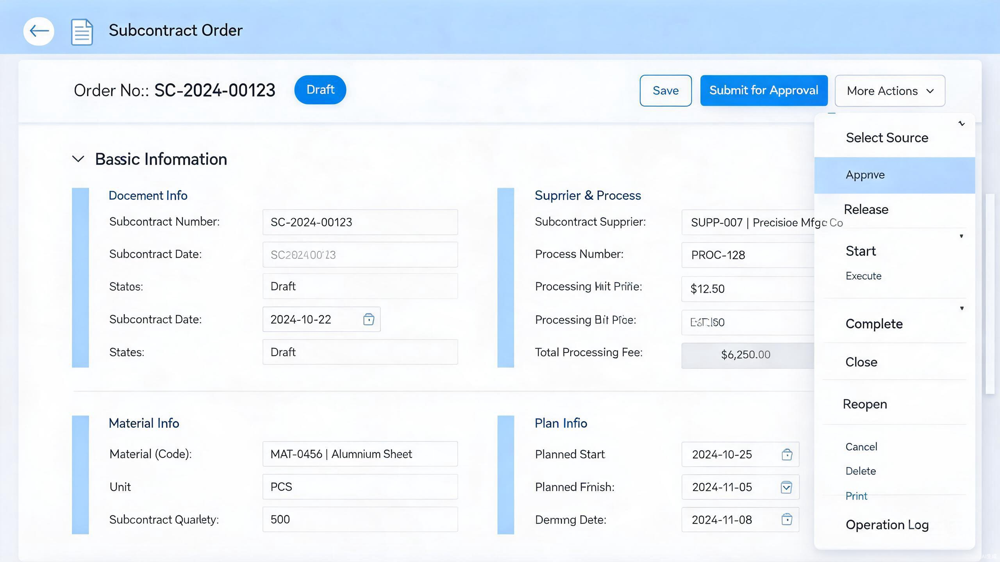
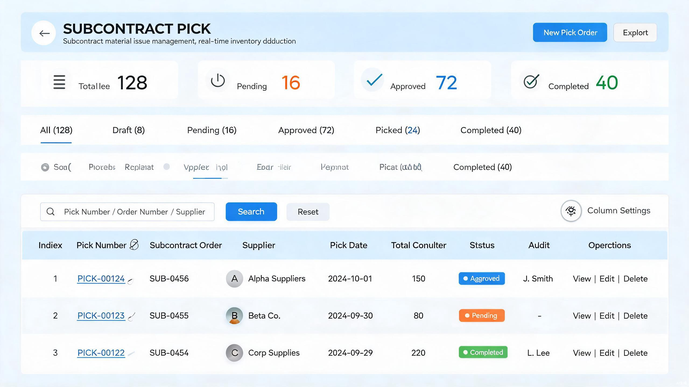
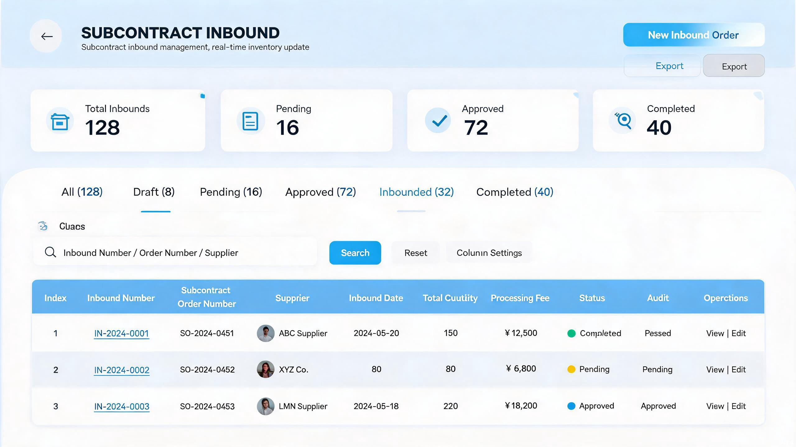
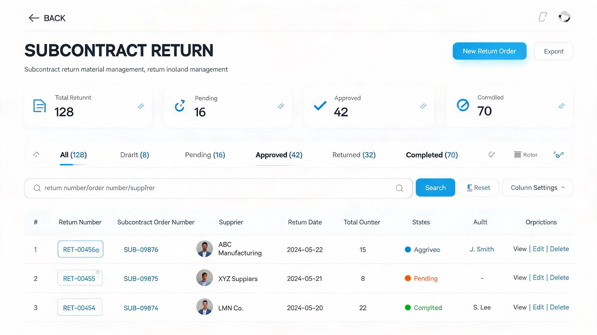
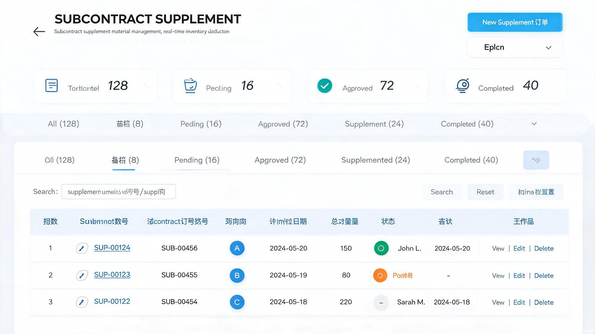

# 委外管理模块操作手册

> 本手册适用于智能ERP系统的委外管理模块，涵盖委外加工全流程的5个核心子模块：委外加工单、委外领料单、委外入库单、委外退料单、委外补料单。每个子模块均包含功能说明、界面描述、操作步骤和注意事项。

---

## 目录

1. 委外加工单
2. 委外领料单
3. 委外入库单
4. 委外退料单
5. 委外补料单

---

## 一、委外加工单

### 1.1 功能说明

委外加工单是委外业务的核心源头单据，用于记录企业将物料委托外部供应商进行加工的业务。单据承载物料信息、供应商与工序信息、计划信息、委外发料清单等内容，并支持完整的审批流转：草稿→待审核→已生效→下达→完工→结案。审核通过后可下推生成委外领料单、委外入库单等下游单据，实现委外全流程的闭环管理。

**核心能力：**
- 录入委外物料、委外数量、加工单价，自动计算加工费总额
- 关联供应商和委外工序号，明确委外责任方
- 维护委外发料清单（应发数量、实发数量、供应方式）
- 支持选单生成（可从生产订单、BOM等源头单据下推）
- 完整状态机：草稿(0)→待审核(1)→已生效(2)→下达(3)→完工(5)→结案(6)
- 支持附件上传、打印预览、操作日志查询

### 1.2 界面描述

界面自上而下分为以下几个区域：

- **顶部标题栏**：左侧为"返回列表"按钮、单据标题（新增委外加工单/委外加工单）、委外单号、状态标签；右侧为操作按钮区，草稿状态下显示"保存"和"提交审核"按钮，并通过"更多操作"下拉菜单提供选单、审核、下达、开始执行、完工、结案、反结案、取消单据、删除、打印、操作日志等功能。
- **基本信息卡片**（可折叠）：包含5个分组
  - 单据信息：委外单号（保存后自动生成）、委外日期（必填）、状态
  - 物料信息：物料（必填，下拉选择）、单位（自动带出）、委外数量（必填）
  - 供应商与工序：委外供应商（必填）、委外工序号、加工单价（必填）、加工费总额（自动计算）
  - 计划信息：计划开工日期（必填）、计划完工日期（必填）
  - 其他：备注
- **委外发料清单卡片**（可折叠）：明细表格，包含物料、来源单号、单位、应发数量、实发数量、供应方式（我方供料/客供料/不供料）、备注、操作（删除）列；底部显示委外数量、加工单价、加工费总额汇总。
- **附件资料卡片**（可折叠）：支持上传图片、PDF、Word、Excel等文件。
- **审核流转卡片**（可折叠）：可视化展示创建单据→提交审核→审核通过→下达→完工5个节点，已完成的节点高亮显示。
- **底部操作按钮区**：统一的BillActions组件，根据单据状态动态显示可用操作。

### 1.3 操作步骤

#### 新增委外加工单

1. 在委外管理模块首页，点击"委外加工单"进入列表页。
2. 点击页面右上角"新增"按钮，进入新增委外加工单编辑界面。
3. **填写基本信息**：选择"委外日期"（必填项，默认为当天）；在"物料信息"分组中，从下拉框选择需要委外加工的物料（支持搜索过滤），系统自动带出单位；输入"委外数量"（必填项，精度支持到小数点后4位）。
4. **填写供应商与工序**：从下拉框选择"委外供应商"（必填项，支持搜索过滤）；输入"委外工序号"（如30，可选）；输入"加工单价"（必填项），系统自动计算"加工费总额"=委外数量×加工单价。
5. **填写计划信息**：选择"计划开工日期"（必填项）；选择"计划完工日期"（必填项，应晚于开工日期）。
6. **维护委外发料清单**：点击"添加明细"按钮新增一行；选择物料、输入应发数量、实发数量、选择供应方式；可通过"选单"按钮从源头单据（如生产订单）批量带入明细；如需删除某行，点击该行"删除"按钮。
7. **上传附件**（可选）：展开"附件资料"卡片，点击"上传附件"按钮上传相关文件。
8. **填写备注**（可选）：在"其他"分组的备注框中输入说明信息。
9. 点击顶部"保存"按钮存为草稿（宽松校验，允许必填项为空），或点击"提交审核"按钮直接进入审批流程（会进行完整校验）。

#### 提交审核与审批

1. 草稿状态下，点击"提交审核"按钮，系统校验必填项后，单据状态变为"待审核"。
2. 待审核状态下，通过"更多操作→审核"完成审核，状态变为"已生效"。
3. 已生效状态下，可通过"更多操作→下达"将单据下达给供应商执行，状态变为"下达"。
4. 下达状态下，通过"更多操作→开始执行"标记开始加工，通过"更多操作→完工"标记加工完成，状态变为"完工"。
5. 完工状态下，通过"更多操作→结案"关闭单据，状态变为"结案"。
6. 结案后如需重新打开，通过"更多操作→反结案"回到"已生效"状态。

#### 下推下游单据

1. 已生效状态的委外加工单，可通过列表页"下推"按钮生成委外领料单、委外入库单等下游单据。
2. 下游单据自动携带委外单号、供应商、物料等信息。

### 1.4 注意事项

- **委外单号**由系统自动生成，保存前不可编辑，保存后置灰不可修改。
- **草稿保存**为宽松校验，允许必填项为空；**提交审核**为严格校验，必须填写所有必填项。
- **状态控制**：非草稿状态下，所有表头字段和明细均不可编辑；只有草稿状态可删除单据。
- **加工费总额**=委外数量×加工单价，系统自动计算，不可手动修改。
- **计划完工日期**应晚于计划开工日期，否则系统提示错误。
- **供应方式**影响库存扣减逻辑：选择"我方供料"会扣减本方库存，"客供料"和"不供料"不扣减本方库存。
- **作废采用严格型校验**：作废前会校验是否存在已生效的下游单据，如有则阻塞作废并提示。
- **结案后**不可再修改、作废，只能通过"反结案"回到已生效状态。

---

## 二、委外领料单

### 2.1 功能说明

委外领料单（又称委外发料单）用于记录向委外供应商发料的业务。单据关联委外加工单，记录发料的物料、数量、仓库等信息，审核后扣减对应仓库的库存。支持选单生成（从委外加工单下推），并支持下推生成委外补料单、委外退料单等下游单据。

**核心能力：**
- 关联委外加工单，自动带出委外单号和供应商
- 维护发料明细（物料、数量、仓库、备注）
- 审核后实时扣减对应仓库库存
- 支持出库操作，记录实际出库信息
- 支持选单生成、下推、打印

### 2.2 界面描述

**列表页界面：**
- **顶部标题栏**：左侧为"返回"按钮、页面标题"委外领料单"及英文标识"SUBCONTRACT PICK"、副标题"委外发料管理·实时库存扣减"；右侧为"新增发料单"和"导出"按钮。
- **数据概览卡片**：以图标+数值形式展示关键统计数据（如待审核数、今日发料数、本月发料数等）。
- **搜索栏**：左侧为状态标签页（全部、草稿、待审核、已生效、已出库等，带数量徽标）；右侧为关键字搜索框（支持领料单号/委外单号/供应商搜索）、搜索按钮、重置按钮、列设置按钮。
- **数据表格**：列包含序号、领料单号（可点击跳转编辑页）、委外单号、供应商（带首字符头像）、领料日期、状态、总数量、备注、操作列。
- **列设置**：支持自定义显示/隐藏列，点击外部或ESC键关闭，不锁定页面滚动。

**编辑页界面：**
- 顶部标题栏同加工单结构，含返回、标题、单号、状态标签、保存/提交审核按钮、更多操作下拉（选单、审核、出库、重置草稿、删除、打印、操作日志）。
- 基本信息卡片：单据信息（领料单号、领料日期、状态）、委外来源（委外加工单必选、委外单号自动带出、供应商自动带出）、其他（备注）。
- 发料明细卡片：表格列含物料、来源单号、单位（自动带出）、数量、仓库、备注、操作（删除）；底部显示明细行数和总数量汇总。

### 2.3 操作步骤

#### 新增委外领料单

1. 在委外管理模块，点击"委外领料单"进入列表页。
2. 点击"新增发料单"按钮，进入编辑界面。
3. **选择委外来源**：在"委外加工单"下拉框中选择已生效的委外加工单（必填项，支持搜索）；系统自动带出"委外单号"和"供应商"信息。
4. **选择领料日期**（必填项，默认当天）。
5. **维护发料明细**：点击"添加明细"新增行，或通过"选单"从委外加工单的发料清单批量带入；选择物料（自动带出单位）、输入发料数量、选择发料仓库；可在备注列填写说明。
6. 点击"保存"存为草稿，或"提交审核"进入审批流程。

#### 审核与出库

1. 待审核状态下，通过"更多操作→审核"完成审核，状态变为"已生效"。
2. 已生效状态下，通过"更多操作→出库"执行实际出库操作，系统扣减对应仓库库存，状态变为"已出库"。
3. 如需撤回，在已生效或已出库状态下，通过"更多操作→重置草稿"回到草稿状态（会同步恢复已扣减的库存）。

### 2.4 注意事项

- **委外加工单必须先审核**，否则无法在领料单中被选择。
- **出库操作会实时扣减库存**，请确认仓库库存充足。
- **重置草稿**会恢复已扣减的库存，但若库存已被其他业务占用，可能导致负库存，需谨慎操作。
- **领料单号**由系统自动生成，保存后不可修改。
- **草稿状态**可删除单据，已生效及以上状态不可直接删除，需先重置草稿。
- **仓库选择**会影响库存扣减目标，请确认选择正确的发料仓库。

---

## 三、委外入库单

### 3.1 功能说明

委外入库单用于记录委外加工完成后的成品或半成品入库业务。单据关联委外加工单，记录入库的物料、数量、仓库、加工费等信息，审核后增加对应仓库的库存。支持选单生成（从委外加工单下推），加工费信息会同步到财务应付模块。

**核心能力：**
- 关联委外加工单，自动带出委外单号和供应商
- 维护入库明细（物料、数量、仓库、加工费、备注）
- 审核后实时增加对应仓库库存
- 加工费自动汇总，同步到应付账款
- 支持选单生成、下推、打印

### 3.2 界面描述

**列表页界面：**
- **顶部标题栏**：左侧为"返回"按钮、页面标题"委外入库单"及英文标识"SUBCONTRACT INBOUND"、副标题"委外入库管理·实时库存更新"；右侧为"新增入库单"和"导出"按钮。
- **数据概览卡片**：展示待审核数、今日入库数、本月入库数、加工费总额等关键指标。
- **搜索栏**：状态标签页（全部、草稿、待审核、已生效等）+ 关键字搜索框（入库单号/委外单号/供应商）+ 搜索/重置/列设置按钮。
- **数据表格**：列包含序号、入库单号（可点击跳转）、委外单号、供应商（带首字符头像）、入库日期、状态、总数量、加工费总额、备注、操作列。

**编辑页界面：**
- 顶部标题栏：返回、标题、单号、状态标签、保存/提交审核按钮、更多操作下拉（选单、审核、重置草稿、删除、打印、操作日志）。
- 基本信息卡片：单据信息（入库单号、入库日期、状态）、委外来源（委外加工单必选、委外单号自动带出、供应商自动带出）、其他（备注）。
- 入库明细卡片：表格列含物料、来源单号、单位（自动带出）、数量、仓库、加工费、备注、操作（删除）；底部显示明细行数、总数量、加工费总额汇总。

### 3.3 操作步骤

#### 新增委外入库单

1. 在委外管理模块，点击"委外入库单"进入列表页。
2. 点击"新增入库单"按钮，进入编辑界面。
3. **选择委外来源**：在"委外加工单"下拉框中选择已生效/下达/完工的委外加工单（必填项）；系统自动带出"委外单号"和"供应商"。
4. **选择入库日期**（必填项，默认当天）。
5. **维护入库明细**：点击"添加明细"新增行，或通过"选单"从委外加工单下推；选择入库物料（自动带出单位）、输入入库数量、选择入库仓库、输入加工费；系统自动汇总加工费总额。
6. 点击"保存"存为草稿，或"提交审核"进入审批流程。

#### 审核入库

1. 待审核状态下，通过"更多操作→审核"完成审核，状态变为"已生效"。
2. 审核通过后，系统自动增加对应仓库的库存，并将加工费信息同步到应付账款模块。
3. 如需撤回，通过"更多操作→重置草稿"回到草稿状态（会同步扣减已增加的库存）。

### 3.4 注意事项

- **入库数量**不应超过委外加工单的委外数量，建议在委外数量范围内入库。
- **加工费**是应付账款的依据，请准确填写，审核后同步到财务模块。
- **审核后实时增加库存**，请确认入库仓库选择正确。
- **重置草稿**会扣减已增加的库存，若库存已被其他业务占用，可能导致负库存。
- **入库单号**由系统自动生成，保存后不可修改。
- **同一委外加工单**可多次入库，支持分批入库场景。

---

## 四、委外退料单

### 4.1 功能说明

委外退料单用于记录委外业务中的退料业务，即把已发料给供应商的物料退回本方仓库。单据关联委外加工单，记录退料的物料、数量、仓库、退料原因等信息，审核后执行入库操作增加对应仓库库存。支持选单生成（从委外领料单或委外加工单下推）。

**核心能力：**
- 关联委外加工单，自动带出委外单号和供应商
- 维护退料明细（物料、数量、仓库、备注）
- 审核后执行入库操作，增加对应仓库库存
- 记录退料原因，便于追溯分析
- 支持选单生成、打印

### 4.2 界面描述

**列表页界面：**
- **顶部标题栏**：左侧为"返回"按钮、页面标题"委外退料单"及英文标识"SUBCONTRACT RETURN"、副标题"委外退料管理·退料入库管理"；右侧为"新增退料单"和"导出"按钮。
- **数据概览卡片**：展示待审核数、今日退料数、本月退料数、退料总数量等指标。
- **搜索栏**：状态标签页（全部、草稿、待审核、已生效、已入库等）+ 关键字搜索框（退料单号/委外单号/供应商）+ 搜索/重置/列设置按钮。
- **数据表格**：列包含序号、退料单号（可点击跳转）、委外单号、供应商（带首字符头像）、退料日期、状态、总数量、退料原因、备注、操作列。

**编辑页界面：**
- 顶部标题栏：返回、标题、单号、状态标签、保存/提交审核按钮、更多操作下拉（选单、审核、入库、重置草稿、删除、打印、操作日志）。
- 基本信息卡片：单据信息（退料单号、退料日期、状态）、委外来源（委外加工单必选、委外单号自动带出、供应商自动带出）、其他（备注，placeholder为"退料原因说明"）。
- 退料明细卡片：表格列含物料、来源单号、单位（自动带出）、数量、仓库、备注、操作（删除）；底部显示明细行数和总数量汇总。

### 4.3 操作步骤

#### 新增委外退料单

1. 在委外管理模块，点击"委外退料单"进入列表页。
2. 点击"新增退料单"按钮，进入编辑界面。
3. **选择委外来源**：在"委外加工单"下拉框中选择对应的委外加工单（必填项）；系统自动带出"委外单号"和"供应商"。
4. **选择退料日期**（必填项，默认当天）。
5. **填写退料原因**（在备注栏填写，建议详细说明退料原因）。
6. **维护退料明细**：点击"添加明细"新增行，或通过"选单"从委外领料单下推；选择退料物料（自动带出单位）、输入退料数量、选择退料入库的仓库；可在备注列填写行级说明。
7. 点击"保存"存为草稿，或"提交审核"进入审批流程。

#### 审核与入库

1. 待审核状态下，通过"更多操作→审核"完成审核，状态变为"已生效"。
2. 已生效状态下，通过"更多操作→入库"执行实际入库操作，系统增加对应仓库库存，状态变为"已入库"。
3. 如需撤回，在已生效或已入库状态下，通过"更多操作→重置草稿"回到草稿状态（会同步扣减已增加的库存）。

### 4.4 注意事项

- **退料数量**不应超过已发料数量，建议在已发料数量范围内退料。
- **入库操作会实时增加库存**，请确认退料入库的仓库选择正确。
- **退料原因**建议详细填写，便于后续追溯和分析委外质量问题。
- **重置草稿**会扣减已增加的库存，若库存已被其他业务占用，可能导致负库存。
- **退料单号**由系统自动生成，保存后不可修改。
- **草稿状态**可删除单据，已生效及以上状态需先重置草稿才能删除。

---

## 五、委外补料单

### 5.1 功能说明

委外补料单用于记录委外业务中因物料损耗、质量问题等原因需要向供应商补充发料的业务。单据关联委外加工单，记录补料的物料、数量、仓库、补料原因等信息，审核后执行出库操作扣减对应仓库库存。补料单是委外领料单的补充，用于处理领料数量不足的场景。

**核心能力：**
- 关联委外加工单，自动带出委外单号和供应商
- 维护补料明细（物料、数量、仓库、备注）
- 必填补料原因，便于追溯补料责任
- 审核后执行出库操作，扣减对应仓库库存
- 支持选单生成、打印

### 5.2 界面描述

**列表页界面：**
- **顶部标题栏**：左侧为"返回"按钮、页面标题"委外补料单"及英文标识"SUBCONTRACT SUPPLEMENT"、副标题说明补料流程；右侧为"新增补料单"和"导出"按钮。
- **数据概览卡片**：展示待审核数、今日补料数、本月补料数、补料总数量等指标。
- **搜索栏**：状态标签页（全部、草稿、待审核、已生效、已出库等）+ 关键字搜索框（补料单号/委外单号/供应商）+ 搜索/重置/列设置按钮。
- **数据表格**：列包含序号、补料单号（可点击跳转）、委外单号、供应商（带首字符头像）、补料日期、状态、总数量、补料原因、备注、操作列。

**编辑页界面：**
- 顶部标题栏：返回、标题、单号、状态标签、保存/提交审核按钮、更多操作下拉（选单、审核、出库、重置草稿、删除、打印、操作日志）。
- 基本信息卡片：单据信息（补料单号、补料日期、状态）、委外来源（委外加工单必选、委外单号自动带出、供应商自动带出）、补料原因（必填，textarea）、备注。
- 补料明细卡片：表格列含物料、来源单号、单位（自动带出）、数量、仓库、备注、操作（删除）；底部显示明细行数和总数量汇总。

### 5.3 操作步骤

#### 新增委外补料单

1. 在委外管理模块，点击"委外补料单"进入列表页。
2. 点击"新增补料单"按钮，进入编辑界面。
3. **选择委外来源**：在"委外加工单"下拉框中选择对应的委外加工单（必填项）；系统自动带出"委外单号"和"供应商"。
4. **选择补料日期**（必填项，默认当天）。
5. **填写补料原因**（必填项，textarea，请详细说明补料原因，如物料损耗、质量问题、数量不足等）。
6. **维护补料明细**：点击"添加明细"新增行，或通过"选单"从委外加工单或委外领料单下推；选择补料物料（自动带出单位）、输入补料数量、选择补料出库的仓库；可在备注列填写行级说明。
7. 点击"保存"存为草稿，或"提交审核"进入审批流程。

#### 审核与出库

1. 待审核状态下，通过"更多操作→审核"完成审核，状态变为"已生效"。
2. 已生效状态下，通过"更多操作→出库"执行实际出库操作，系统扣减对应仓库库存，状态变为"已出库"。
3. 如需撤回，在已生效或已出库状态下，通过"更多操作→重置草稿"回到草稿状态（会同步恢复已扣减的库存）。

### 5.4 注意事项

- **补料原因**为必填项，请详细填写，便于后续追溯补料责任和成本分析。
- **出库操作会实时扣减库存**，请确认仓库库存充足。
- **补料数量**应根据实际损耗合理确定，避免过度补料造成浪费。
- **重置草稿**会恢复已扣减的库存，但若库存已被其他业务占用，可能导致负库存。
- **补料单号**由系统自动生成，保存后不可修改。
- **补料单与领料单的区别**：领料单是首次发料，补料单是因损耗等原因的补充发料，两者均扣减库存，但业务含义不同，建议分类统计。

---

## 附录：委外管理业务流程总览

### 委外业务完整流程

1. 创建委外加工单（草稿）→ 提交审核 → 审核通过 → 下达 → 完工 → 结案
2. 已生效委外加工单 → 下推委外领料单 → 审核 → 出库（扣减库存）
3. 委外领料单 → 下推委外补料单 → 审核 → 出库（扣减库存）（如需补料）
4. 已生效委外加工单 → 下推委外入库单 → 审核（增加库存、生成应付）（加工完成）
5. 委外领料单/委外加工单 → 下推委外退料单 → 审核 → 入库（增加库存）（如有退料）

### 状态机说明

| 单据类型 | 状态流转 |
|---------|---------|
| 委外加工单 | 草稿(0)→待审核(1)→已生效(2)→下达(3)→完工(5)→结案(6) |
| 委外领料单 | 草稿(0)→待审核(1)→已生效(2)→已出库(3) |
| 委外入库单 | 草稿(0)→待审核(1)→已生效(2) |
| 委外退料单 | 草稿(0)→待审核(1)→已生效(2)→已入库(3) |
| 委外补料单 | 草稿(0)→待审核(1)→已生效(2)→已出库(3) |

### 通用操作说明

- **保存**：仅存为草稿，宽松校验，允许必填项为空。
- **提交审核**：进入审批流程，严格校验所有必填项。
- **审核**：待审核状态下可审核，审核后单据生效并影响库存/财务。
- **重置草稿**：撤回审核，回到草稿状态，同步恢复库存/财务影响。
- **出库/入库**：执行实际库存操作，扣减或增加对应仓库库存。
- **删除**：仅草稿状态可删除，已生效及以上状态需先重置草稿或作废。
- **打印**：支持打印预览，可自定义打印模板。
- **操作日志**：记录单据的所有操作历史，便于追溯。

---

> **文档版本**：V1.0  
> **最后更新**：2026-08-15  
> **适用系统**：智能ERP系统
