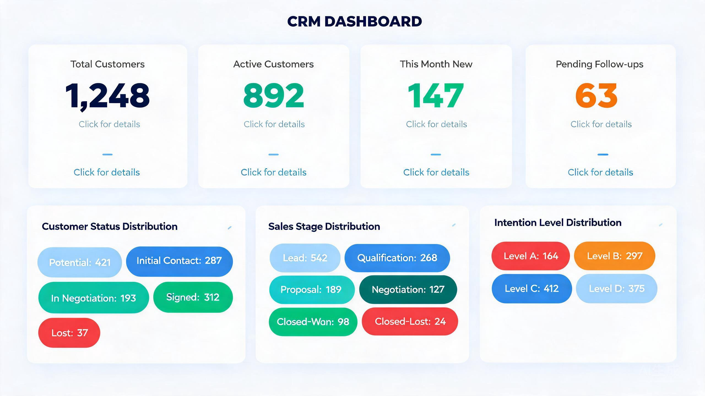

# 工作台与首页操作手册

> 适用版本：智能ERP系统
> 文档说明：本手册详细介绍登录系统后默认首页「工作台（Dashboard）」的功能、界面分区、操作方法与注意事项。工作台是用户每天登录后的第一落点，汇聚了待办审批、超期任务、草稿单据、应收应付跟进等关键信息，支持一键审批、跳转单据、查看业绩简报等高频操作。

---

## 目录

1. [模块概述](#1-模块概述)
2. [进入方式与通用约定](#2-进入方式与通用约定)
3. [欢迎条与日期问候](#3-欢迎条与日期问候)
4. [四张个人任务统计卡片](#4-四张个人任务统计卡片)
5. [业绩/采购/库存简报卡片](#5-业绩采购库存简报卡片)
6. [待我审批](#6-待我审批)
7. [即将超期 / 已超期](#7-即将超期--已超期)
8. [我的草稿](#8-我的草稿)
9. [应收应付跟进](#9-应收应付跟进)
10. [一键审批与批量审批](#10-一键审批与批量审批)
11. [跳转到单据详情](#11-跳转到单据详情)
12. [常见问题与注意事项](#12-常见问题与注意事项)

---

## 1. 模块概述

工作台（Dashboard）是智能ERP系统的「个人信息门户」，登录系统后默认落地到此页面（路由 `/dashboard`，固定标签 `affix: true`，不可关闭）。页面以「任务优先」为设计原则，自上而下依次展示：问候条→关键指标→业绩简报→审批→超期→草稿→应收应付，所有卡片均可点击跳转到对应单据或列表页面，支持单条通过、批量审批等快捷操作。

工作台承担的核心价值：
- **待办集中入口**：跨模块聚合销售/采购/库存/生产四类审批任务，避免用户在各子模块间切换查找。
- **风险前置提醒**：将「即将超期」和「已超期」任务单独高亮，确保高优先级单据第一时间被看到。
- **草稿续编辑**：聚合用户所有未完成的草稿单据，点击即可继续完善。
- **资金风险预警**：独立卡片展示逾期的应收（客户回款）与应付（供应商付款）跟进项。
- **业绩可视化**：按用户角色展示今日/本月业绩、采购到货、库存总览等关键数据。

---

## 2. 进入方式与通用约定

### 2.1 进入方式

- **默认入口**：登录成功后自动跳转 `/dashboard`（即使 `menuRoutePaths` 里只配了子看板路径，工作台根路径也始终豁免权限校验，以避免登录后卡死）。
- **手动进入**：点击左侧导航顶部「工作台」菜单或顶部标签页。
- **返回工作台**：任何页面点击浏览器返回（面包屑）或导航菜单第一项都能回到工作台。

### 2.2 通用操作约定

| 交互元素 | 行为说明 |
|----------|----------|
| 统计卡片（可点击） | 鼠标悬停时光标变为手型，点击后滚动到对应章节；若为列表卡片则跳转到对应列表页。 |
| 任务项 | 行内背景色区分风险等级：红色=超期、橙色=紧急、蓝色=待处理；点击可跳转对应单据详情。 |
| 状态徽标（Badge） | 卡片标题旁红色/黄色/蓝色数字徽标，表示该分类下待处理条数。 |
| `v-loading` 骨架加载 | 每个卡片独立加载，任一接口慢不影响整张页面渲染，失败时卡片内显示空态。 |
| 时间格式化 | 到期日与创建时间统一使用「YYYY-MM-DD HH:mm」或中文星期格式（如：2026年8月26日 周三）。 |

---

## 3. 欢迎条与日期问候

### 3.1 功能说明

页面顶部卡片用于快速问候用户，并展示当天日期与待办总览。标题左侧显示「上午好/中午好/下午好/晚上好/夜深了」问候语，按当前小时动态计算；副标题显示当日的中文星期日期和全页待办汇总（待审批+超期+草稿+应收应付）。

### 3.2 界面描述

欢迎条采用卡片式布局（`el-card shadow="never"`）：
- **左侧文本区**：第一行大字为「问候语 + 员工姓名」（优先取 `employeeName` → `realName` → `username`，都为空时显示「同事」）；第二行灰色小字为「日期 + 共 N 项任务待处理」。
- **右侧图标区**：铃铛图标（`Bell`），点击图标不触发跳转（纯装饰位，若后续版本接全局通知则联动）。

### 3.3 操作步骤

1. 登录系统，成功后自动进入工作台。
2. 阅读欢迎条上的「共 N 项任务待处理」总数字，可快速判断当天工作量。
3. 若姓名显示为「同事」，说明当前用户的基础档案未完整维护——可联系管理员补全员工档案，以便正确识别。

### 3.4 注意事项

- 问候语根据浏览器本地时间计算（与用户电脑时间一致，非服务器时间）。
- 待办总数优先使用后端 `overview API` 返回的精确统计；若 API 异常则回退为前端实际列表长度之和（两种口径可偏差 ± 几条），两者皆空时显示 0。

---

## 4. 四张个人任务统计卡片

### 4.1 功能说明

欢迎条下方为一行 4 张彩色统计卡片（`el-row gutter=16`，响应式：小屏 12 列=每行 2 张，中屏 6 列=每行 4 张）。每张卡片对应工作台的一个分类，点击可跳转到同页对应章节。

4 张卡片的标准配置：

| 卡片类型 | 图标颜色 | 背景色 | 数值说明 | 提示文字 |
|----------|----------|--------|----------|----------|
| 待我审批 | 红 `#f56c6c` | 红色 12% 透明 | overview 的 `pendingApprovalCount` | 需尽快处理 |
| 即将超期 / 已超期 | 橙 `#e6a23c` | 橙色 12% 透明 | overview 的 `overdueCount` | 优先级最高 |
| 我的草稿 | 灰 `#909399` | 灰色 12% 透明 | overview 的 `myDraftCount` | 继续完善 |
| 应收应付跟进 | 蓝 `#409eff` | 蓝色 12% 透明 | overview 的 `arApFollowUpCount` | 避免逾期 |

### 4.2 界面描述

每张卡片内部左右分区：左侧为彩色圆角图标方块（内嵌 Element Plus 图标组件：`DocumentChecked` / `Timer` / `EditPen` / `Money`），右侧上下排列：大字数值 → 分类标签 → 灰色提示文字。

### 4.3 操作步骤

1. 浏览 4 张卡片的数字，确定当前最紧急的分类。
2. 点击任一张卡片（整卡可点击），页面自动滚动到下方对应章节。
3. 卡片顶部会显示半透明加载动画 `v-loading="loading.overview"`，等待 overview 接口返回后数字会自动刷新。

### 4.4 注意事项

- 统计数字来源为后端聚合接口 `/api/dashboard/overview`，**非前端列表计数**（接口按权限汇总的范围更大，包含跨页内容）。若数字与下方列表条数不一致属正常现象。
- 若用户角色无某些模块权限，对应卡片数字可能为 0（属预期，不是 bug）。

---

## 5. 业绩/采购/库存简报卡片

### 5.1 功能说明

业绩简报是工作台中与角色相关的「轻量 KPI」卡片区段。根据当前用户角色/岗位动态生成 1~3 张横向卡片，每张对应一个业务指标（如「本月销售业绩」「本月采购到货」「仓库总库存价值」等），右侧附带环比/同比标签（涨/跌/持平）。

> 本卡片为可选区块：当后端未返回 `performanceCards` 时（如纯财务用户看不到销售指标），整个 `el-row` 不渲染，页面无空白。

### 5.2 界面描述

每张简报卡采用浅卡片样式，横向左右分区：
- **左侧**：上行为标签（如「本月销售业绩」），下行为金额（`¥`+千分位格式数字）。
- **右侧**：彩色标签（`el-tag effect=plain size=small`），显示环比状态（上升绿/下跌红/持平灰）与幅度百分比（如「环比 +8.2%」）。

### 5.3 操作步骤

1. 登录后系统自动按当前用户角色拉取简报数据。
2. 点击卡片（可扩展）将跳转到对应的报表中心页面（09 标准版已实现）。
3. 若未看到任何简报卡片，说明当前角色暂无配置指标（可联系管理员增加角色对应的简报模板）。

### 5.4 注意事项

- 金额格式化统一使用 `¥` + 千分位，负数用红色显示。
- 标签颜色对应：上升=`success`（绿）、下降=`danger`（红）、持平=`info`（灰）。
- 数据刷新频率：每次进入页面刷新一次，不自动轮询（避免占用服务器）。

---

## 6. 待我审批

### 6.1 功能说明

「待我审批」是工作台的核心模块，聚合当前用户需要处理的所有审批任务（销售/采购/库存/生产四大类）。支持按单据类型筛选、单击通过、批量审批，点击任务项可跳转到对应单据详情页。

核心能力：
- 跨模块聚合 27 张可审批业务单据。
- 按单据类型筛选（全部/销售/采购/库存/生产）。
- 单条快速通过（弹框填写审批意见）。
- 批量「一键审批」多条任务。
- 最大 8 条预览，超出显示「查看全部 N 条」跳转完整审批任务页。

### 6.2 界面描述

卡片顶部标题栏左侧为红色 `DocumentChecked` 图标 + 标题「待我审批」，标题旁红色徽标显示条数；右侧为 `el-radio-group` 筛选按钮组（全部/销售/采购/库存/生产）+「一键审批」绿色按钮（按钮只在筛选后有条目时可用，执行时显示 loading 状态）。

列表区按「8 条内全展示、超出截断」规则渲染。每个任务项左右布局：
- **左侧**：单据类型标签（彩色：销售蓝/采购橙/库存绿/生产紫）+ 任务标题+单据号+元信息（客商名称·创建人·创建时间·金额）。
- **右侧**：「待审批」黄色标签 +「通过」绿色小按钮（按钮 loading 时显示转圈）。

空态：无待办任务时居中显示 Element Plus `el-empty` 组件（80 像素图片，文案「暂无待审批任务」）。

### 6.3 操作步骤

#### 查看待办列表
1. 进入工作台后，向下滚动找到「待我审批」卡片。
2. 卡片加载中显示骨架动画；接口返回后列表渲染。
3. 顶部徽标红色数字表示待审批总条数。

#### 筛选单据类型
1. 在卡片右上角 `单选按钮组` 中选择：全部 / 销售 / 采购 / 库存 / 生产。
2. 选择后列表即时过滤（无需点查询）。
3. 切回「全部」即可重新看到所有类型。

#### 单条通过审批
1. 在任务项最右侧点击绿色「通过」按钮。
2. 系统弹框显示：单据编号、当前节点名称、审批意见多行文本框。
3. 建议填写审批意见（便于审计追溯），点击「确认通过」。
4. 若成功：任务从列表消失，ElMessage 提示「审批通过」；下一节点审批人会收到新待办。
5. 若失败：ElMessage 显示错误原因（如「该单据已被他人审批」），点击「确定」后重新刷新列表。

#### 批量一键审批
1. 确认筛选后的 8 条预览任务都是需要通过的（若不需要先筛选或关闭当前行）。
2. 点击右上角绿色「一键审批」按钮。
3. 系统弹框要求填写统一审批意见（将写入所有批量通过的审批记录中）。
4. 点击「确认全部通过」，按钮进入 loading 状态，完成后 ElMessage 显示「成功通过 N 条 / 失败 M 条」。
5. 失败条目会保留在列表中并附错误原因，可手动逐条处理。

#### 跳转单据详情
1. 点击任务项整行（卡片有 `clickable` CSS 样式，光标变为手型）。
2. 系统打开对应单据编辑/详情页面（如销售订单编辑页）。
3. 在详情页可查看完整内容、执行驳回、查看审核流转等操作。

#### 查看全部待办
1. 若待办超过 8 条，卡片底部显示蓝色提示链接「查看全部 N 条」。
2. 点击后跳转到「审批任务」完整列表页（对应路径 `/approval/tasks`）。
3. 该页面支持完整分页、更复杂筛选和批量操作（详见《08-审批管理模块操作手册》）。

### 6.4 注意事项

- **通过不支持跳过**：审批人只能执行「通过」操作；若需驳回/转交，请点击任务行跳转详情后在编辑页顶部的「更多操作」菜单中执行（工作台只提供高频的「通过」）。
- **批量通过的前提**：同批次任务必须为「任选一人」模式的选择后审批人，或「单人审批」模式；「全部审批」「依次审批」模式不支持批量通过（系统会自动跳过并返回错误信息）。
- **意见建议必填**：系统不强制校验通过时填写审批意见，但建议填写，后续在单据「操作日志」中可永久追溯。
- **超期提醒**：等待超过系统配置的审批超时时间后（默认 24h，可在系统参数设置），任务会从「待我审批」移动到「即将超期 / 已超期」卡片。

---

## 7. 即将超期 / 已超期

### 7.1 功能说明

「即将超期 / 已超期」卡片用于警示高优先级的逾期任务（包括逾期的审批、超期的应收应付、到期的销售订单等）。支持按紧急程度筛选：全部 / 已超期 / 紧急 / 即将到期，按到期日排序，最高优任务始终排第一。

### 7.2 界面描述

顶部标题栏左侧为橙色 `Timer` 图标 + 标题「即将超期 / 已超期」，标题旁黄色徽标；右侧为筛选按钮组（全部/已超期/紧急/即将到期）。

任务列表每条显示：
- **左侧标签 1**（紧急度标签，深色底白字）：已超期（红 `danger`）/ 紧急（橙 `warning`）/ 即将到期（蓝 `primary`）。
- **左侧标签 2**（单据类型标签，浅色）：同待我审批卡片的彩色类型标签。
- **标题行**：任务标题 + 单据编号。
- **元信息行**：到期日期 + 剩余天数（超期显示「已超 N 天」红字；紧急显示「仅剩 N 天」橙字；即将到期显示「N 天后到期」蓝字）。
- **金额**（可选）：若业务单据有金额，以元数据形式显示。
- **右箭头**：整行可点击跳转。

任务行 CSS 类名对应紧急度，使整行背景色也不同（overdue 红底 / urgent 橙底 / soon 蓝底），视觉强化。

### 7.3 操作步骤

1. 进入工作台。若有超期任务会在欢迎条右侧也提示数字。
2. 点击顶部「即将超期 / 已超期」统计卡片快速跳转到本节，或直接滚动到卡片。
3. 使用右上筛选按钮按紧急度过滤。
4. 点击任务整行打开对应单据详情页，执行所需操作（如审批通过、催收应收等）。
5. 若超过 8 条，点击底部「查看全部 N 条」跳转到完整的超期任务列表页（路径 `/dashboard/overdue`）。

### 7.4 注意事项

- **超期判断口径**：系统参数「审批超时时间」+ 业务单据的到期日期（如订单的交货日期、发票的付款日期）。两种口径都会产生超期任务。
- **紧急度阈值**（默认值，可在系统参数调整）：
  - 已超期：到期日 < 今日（00:00:00）。
  - 紧急：今日 < 到期日 ≤ 今日+3 天。
  - 即将到期：今日+3 天 < 到期日 ≤ 今日+7 天。
  - 大于 7 天：不列入本节卡片。
- **剩余天数为 0**：当天到期的任务归入「紧急」，不标记为「已超期」（给到当天缓冲时间）。

---

## 8. 我的草稿

### 8.1 功能说明

「我的草稿」卡片聚合当前用户在所有业务单据中保存但未提交审核的草稿（保存为宽松校验的草稿状态单据）。点击任一条目即可跳转到对应编辑页继续完善。

### 8.2 界面描述

本节与「应收应付跟进」并排组成双栏（`el-col :lg=12`）。顶部标题栏为灰色 `EditPen` 图标 + 标题「我的草稿」，蓝色徽标显示条数。

每条紧凑任务项（`compact` 样式）显示：
- 左侧：单据类型标签（彩色浅色）。
- 中部：单据编号（加粗）+ 创建时间 + 金额（可选）。
- 右侧：「草稿」灰色 info 标签 + 右箭头。

### 8.3 操作步骤

1. 在工作台双栏卡片区，找到左上「我的草稿」。
2. 卡片为空时显示 `el-empty`：「暂无草稿单据」。
3. 点击任一任务行，跳转到对应单据的编辑页（带 id 的路由 `/xxx/edit/:id`）。
4. 在编辑页补全缺失字段，点击「保存」或「提交审核」。

### 8.4 注意事项

- **草稿可宽松保存**：草稿单据通常不强制必填，因此可能存在关键字段未填的情况；提交时会触发完整校验提示所有缺失字段。
- **不可删除（在工作台）**：草稿删除请跳转到编辑页后在草稿状态执行「删除」按钮（工作台仅提供跳转入口，不提供快速删除，避免误删）。
- **30 天自动提醒**：超过 30 天仍未提交的草稿会同时出现在「即将超期」卡片中，提醒用户要么完善要么删除。

---

## 9. 应收应付跟进

### 9.1 功能说明

与「我的草稿」并排为双栏右侧卡片。展示当前用户负责的客户应收逾期项与供应商应付逾期项。红色标签=应收（`AR`），橙色标签=应付（`AP`）。点击跳转对应收款单/付款单或核销页面，便于财务人员跟进回款与付款。

### 9.2 界面描述

顶部红色 `Money` 图标 + 标题「应收应付跟进」，红色徽标显示条数。

每条任务项：
- 左侧：`AR/AP` 深色标签（AR 红底、AP 橙底）+ 客商名称+单据号。
- 元信息：到期日（必显示）· 金额（必显示，¥千分位）。
- 右侧：右箭头。

整行背景使用 `overdue` 样式（红底），表示默认已逾期。

### 9.3 操作步骤

1. 财务/商务用户进入工作台后优先检查本节。
2. 应收项（红色标签）：点击跳转到销售收款单+核销页，记录回款。
3. 应付项（橙色标签）：点击跳转到采购付款单+核销页，安排付款。
4. 完成回款/付款后，该条目将在下次刷新时从卡片消失。

### 9.4 注意事项

- **跟进口径**：仅展示「已超过到期日期且未完全核销」的应收应付，部分核销的余额仍会显示（不等于零）。
- **权限**：员工权限开启「仅看本人负责客户/供应商」时，列表仅展示用户为业务员或负责人的往来项（非全局逾期）。
- **刷新频率**：每次进入页面时刷新，不自动轮询，最新数据请手动刷新浏览器页面。

---

## 10. 一键审批与批量审批

### 10.1 功能说明

工作台提供两个层级的快捷审批：
1. **单条通过按钮**（每条待办任务右侧）：单次审批 1 条。
2. **批量一键审批**（待我审批卡片右上「一键审批」）：一次审批当前筛选条件下的全部可见待办（最多 8 条预览中实际匹配的条目）。

### 10.2 操作步骤

#### 单条通过
1. 在「待我审批」找到目标条目。
2. 点击右侧「通过」按钮，显示 loading 转圈。
3. 弹框填写审批意见 → 「确认通过」。
4. 成功后任务行淡出消失，ElMessage 提示「审批通过」。

#### 批量一键审批
1. 先使用筛选按钮组筛选出要通过的分类（如「全部」= 所有待办一起过）。
2. 确认列表中的 8 条预览条目都需要通过（不过的请先点到详情驳回）。
3. 点击「一键审批」按钮。
4. 弹框输入统一审批意见 → 确认。
5. 后端逐条执行，前端汇总结果：「成功 5 条，失败 1 条：[第3条：该单据状态已变更，请刷新]」。
6. 失败条目保留在列表，供手动处理。

### 10.3 注意事项

- **批量审批的安全性**：
  - 「任选一人」模式下，未选择审批人的条目不会被批量通过（系统在结果提示中标明「未指定审批人」）。
  - 「全部审批 / 依次审批」模式节点，批量通过时自动跳过，提示「该节点为多人模式，请手动审批」。
- **幂等性**：短时间重复点击「通过」按钮，后端做幂等校验——只执行一次，第二次返回「已通过」但不报错。
- **审批通过后**：单据状态会即时变更，但单据是否「立即生效」取决于是否为最后一个审批节点（最后节点通过才生效，中间节点通过只流转到下一节点）。

---

## 11. 跳转到单据详情

### 11.1 操作步骤（通用）

工作台 4 大列表卡片（待办审批/超期/草稿/应收应付跟进）均统一支持跳转：
1. 将鼠标移到任务项，光标变为手型（表示可点击）。
2. 单击任务行空白处（不要误点右侧小按钮）。
3. 系统使用 `router.push(routePath)` 跳转到对应单据路由：
   - 若带 `:id` 参数的路由，自动填当前单据 id。
   - 列表单据（如审批任务列表）跳转完整列表页（带 `/dashboard/overdue` 等路径）。
4. 在打开的页面可执行完整操作（驳回/删除/核销等）。

### 11.2 注意事项

- **路由权限**：即使工作台有权看到某条目，如果跳转目标路径不在 `menuRoutePaths` 中，全局路由守卫会拦截并跳回工作台（403 场景可联系管理员开菜单权限）。
- **关闭标签返回**：打开的新标签页顶部有关闭按钮，关闭后自动回到工作台。

---

## 12. 常见问题与注意事项

### Q1：工作台徽标数字和下方列表条数不一致？
A：正常现象。徽标数字用后端 overview 聚合接口返回（汇总全量范围），列表用分页接口只取前 N 条。两者应趋势一致但数字可相差。若严重不一致（如 10 vs 100），请点击页面右上角「刷新」按钮手动刷新整个页面（或按 F5）。

### Q2：工作台显示「暂无待办」但我明明有单据？
A：检查以下 3 点：
1. 单据是否处于「待我审批」的状态？只有状态为「待审核」且当前登录用户是审批人，才会出现在待办卡片。
2. 权限是否正常？退出登录并重新登录，让后端重新下发 `menuRoutePaths` 和用户角色。
3. 审批人是否配置错误？在「审批流程配置」页面检查审批候选名单是否包含当前用户。

### Q3：点击「通过」提示「单据已被他人审批」？
A：说明在你点击的瞬间，另一个审批人已经通过（或同一审批的另一候选），这是多人审批中常见的并发场景。点击「确定」关闭提示，任务行会自动消失——不影响业务。

### Q4：一键审批后部分失败，需要重新点吗？
A：不需要整批重点。失败条目会保留在列表里，单独看失败原因。常见 3 种失败：
1. 「未指定审批人」→ 点行进入详情手动选择一个审批人后通过。
2. 「该节点为多人模式」→ 走详情页的逐个审批流程。
3. 「单据状态已变更」→ 说明任务已被处理，刷新即可。
4. 「权限不足」→ 联系管理员。

### Q5：应收应付跟进显示的金额不正确？
A：先确认「是否全额核销」——收款/付款单保存后还要执行核销，才算真正结清。核销成功后，下次进入工作台时条目会自动消失。

### Q6：工作台页面能否添加我想要的卡片？
A：当前版本工作台卡片布局固定（按角色动态的业绩简报除外）。如需个性化，可在「系统设置→主题设置→首页布局」中调整（下一版本开放）。

### 全局注意事项

- **数据刷新**：工作台各卡片数据仅在进入页面时加载一次。等待超过 10 分钟，请手动刷新页面以获取最新数据。
- **时区**：所有日期/到期日按服务器存储值（东八区）展示，与浏览器本地时区无关。
- **移动端适配**：工作台在小于 768px 宽度（手机）时，双栏卡片自动变单栏、统计卡片从 4 列变 2 列，不影响操作。
- **固定标签属性**：工作台为 `affix: true` 固定标签，关闭按钮被隐藏——无法通过标签页「×」关闭工作台。

---

*本手册最后更新：2026-08-27*
